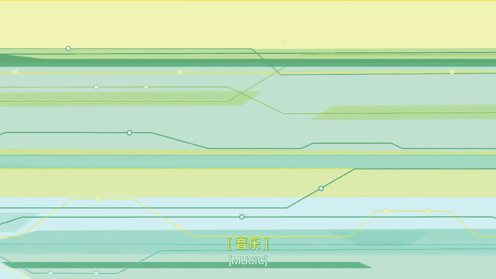
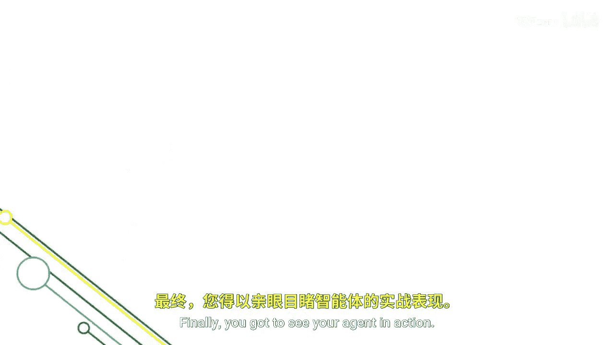

# 阿尔伯塔大学【中英⚡强化学习｜Reinforcement Learning Specialization】 p149 P149 02_课程总结 -BV1CdGrzuEJU_p149-

Congratulations！You have completed coursese4 and built a complete RL system。

Let's quickly review the system you built。Throughout the capstone。

 we've been incrementally adding tools for solving the lunar Lander problem。

We started by formalizing the problem as an MDVP and implementing the environment。

This mainly involves precisely specifying a reward function to get the agent to appropriately land。

We then discussed how to design an agent to learn a good policy in this environment。

The first step was to figure out which reinforcement learning items were appropriate for the given problem setting。

We followed the course map that we built in Cose3 to narrow it down to three algorithms。

 expected SARSA， SArsRSA， and Q learning。Next， we investigated how the choice of meta parameterss influence the agent's success。

All the specific implementation details， including those about function approximation。

 explorationiration， and optimization can be considered meta parameterss。

How we specify these can have a big impact on the performance of our agent。

We discuss several of these choices and common rules of thumb。For example。

 we decided on the size and activation functions for the neural network based on conventional wisdom。

 however， some matter parameterss like the step size can be difficult to select。

This led to the final part of the project， a parameter study of the step size。

Understanding our algorithms and systems is critical for successful deployment。Finally。

 you get to see your agent in action。

We hope that you've learned a bit about the nuances of applying reinforced learning methods in practice There are a lot of choices to make。

 and it requires quite a lot of expertise and experience to get it right。

Our goal was to give you some of that hands on experience。

 Hopefully this will help you in your future endeavors applying RL in the real world。

