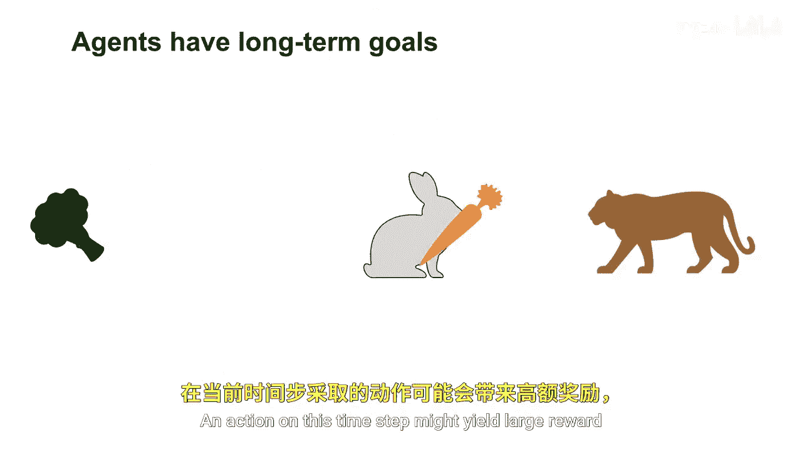
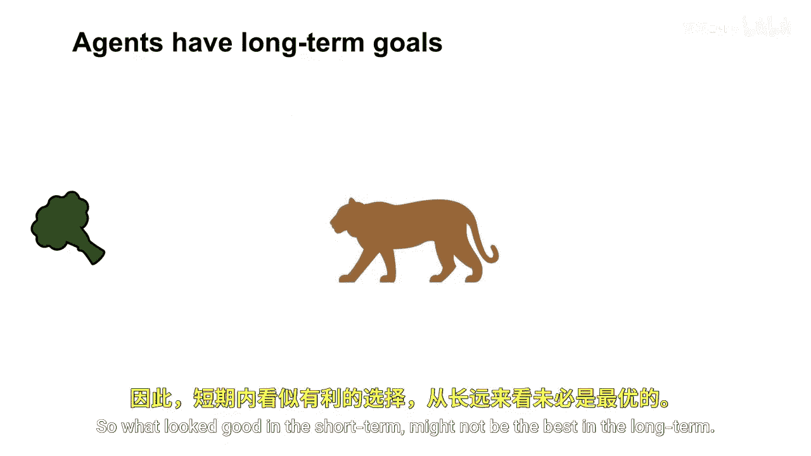
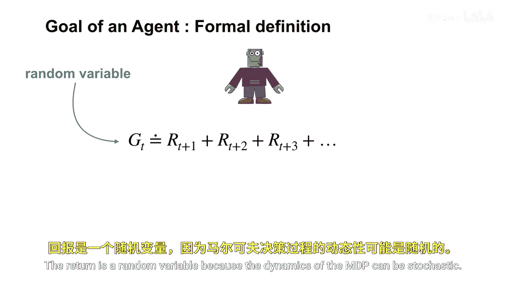
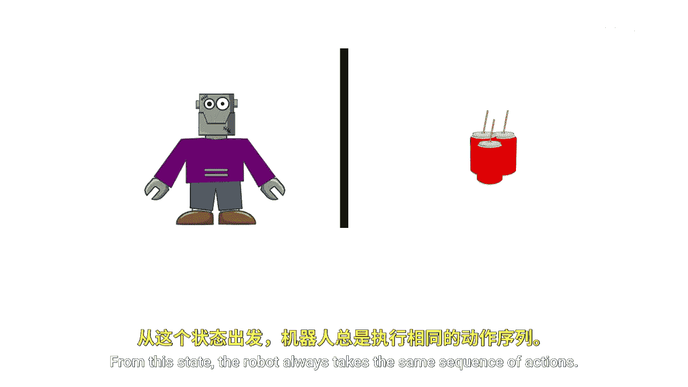
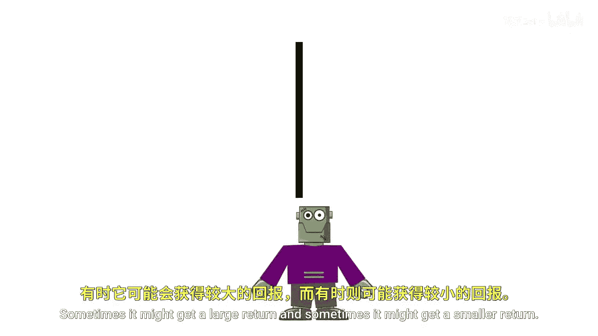
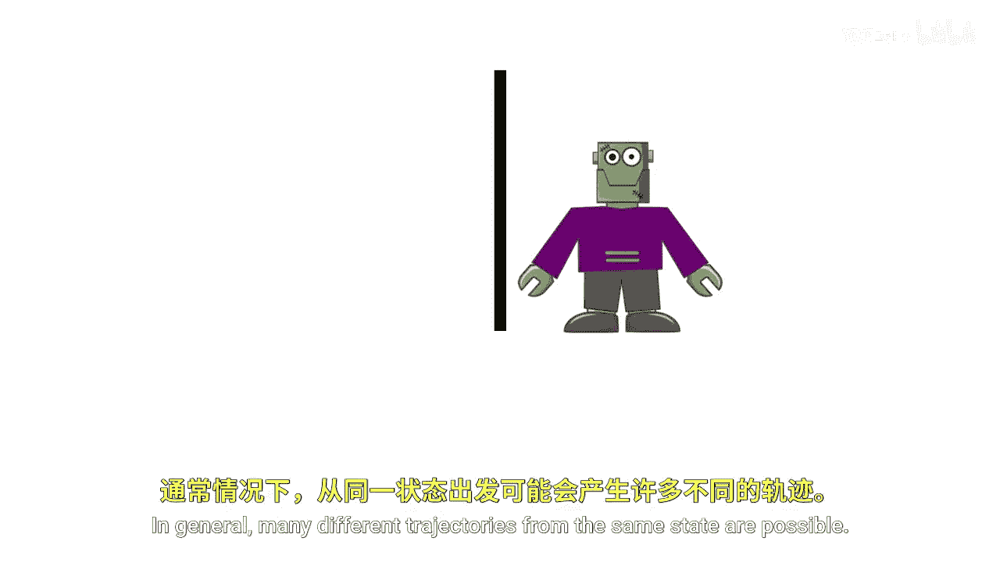
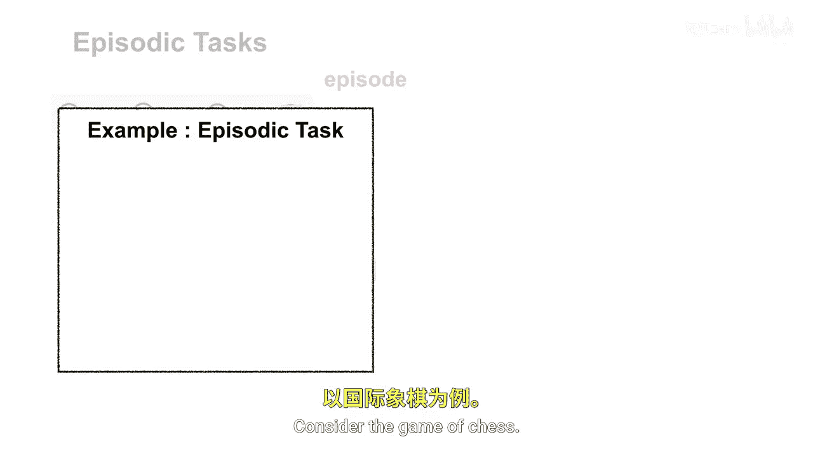
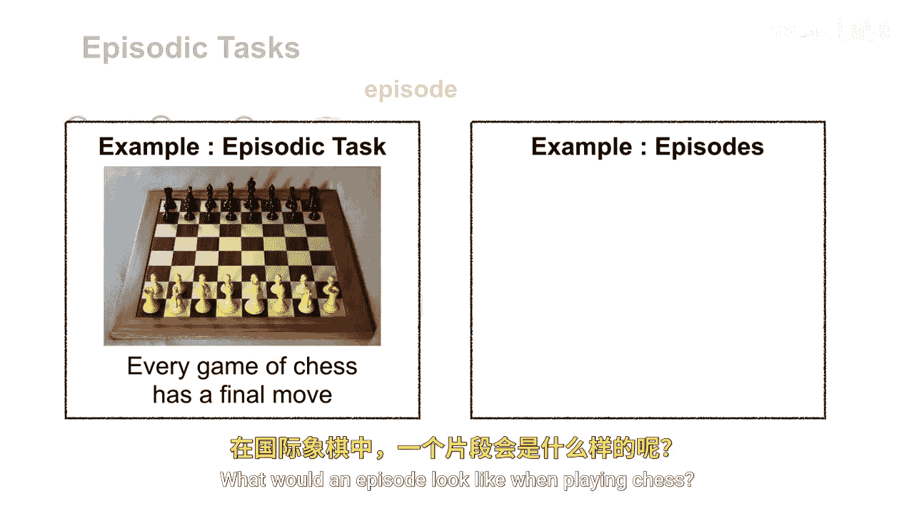

# 阿尔伯塔大学【中英⚡强化学习｜Reinforcement Learning Specialization】 p15 P15 01_强化学习的目标 -BV1CdGrzuEJU_p15-

嗯。In reinforcement learning， the agent's objective is to maximize future reward。

Today we will formalize this notion。By the end of this video。

 you will be able to describe how rewards relate to the goal of an agent and identify episodic tasks。

Likes define the agent's goal。Perhaps we can just maximize the immediate reward。

 as we did in bandits。Unfortunately， this won't work in an MDP。

An action on this time step might yield large reward。

 but cause the agent to transition into a state that yields low reward。

So what looked good in the short term might not be the best in the long term。

Consider a robot learning to walk， the reward could be proportional to the forward motion。

Lururgching forward would clearly maximize immediate reward。However。

 this action caused the robot to fall over。If the robot maximized total forward motion instead。

 it would walk quickly but carefully。Now let's formally define what we mean by maximizing total future reward。

The return at Time step T is simply the sum of rewards obtained after time step T。

We denote the return with the letter G。Their return is a random variable because the dynamics of the MDVP can be stochastic。

To better understand this， imagine our can collecting robot starts here。From this state。

 the robot always takes the same sequence of actions。

Sometimes it might get a large return。And sometimes it might get a smaller turn。

This is due to the randomness in both the individual rewards and the state transitions。In general。

 many different trajectories from the same state are possible。

This is why we maximize the expected return。For this to be well defined。

 the sum of rewards must be finite。Specifically， let's say there is a final time step called capital T。

 where the Age environment interaction ends。What happens when the interaction ends？

In the simplest case， the interaction naturally breaks into chunks called episodes。

Each episode begins independently of how the previous one ended。At termination。

 the agent is reset to a start state。Every episode has a final state。

 which we call the terminal state。We call these tasks episodic tasks。

To understand episodic tasks better， let's look at a concrete example。 Consider the game of chess。

A game of chess always ends with a checkmate， draw or resignation。

What would an episode look like when playing chess？

As you might have guessed， a single game of chess would constitute an episode。

Each game starts from the same start state with all the pieces reset。Let's summarize what we learned。

 We formulated the goal of an agent in terms of maximizing the expected return。

We then discussed episodic tests where the Age environmentron interaction breaks up into episodes。

