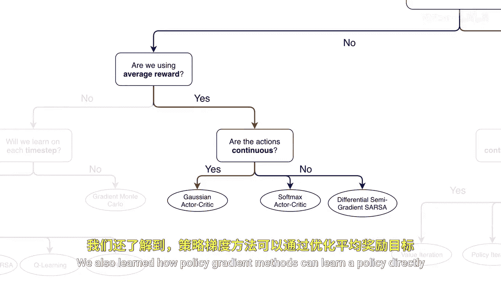

# 阿尔伯塔大学【中英⚡强化学习｜Reinforcement Learning Specialization】 p150 P150 03_专项课程总结 -BV1CdGrzuEJU_p150-

嗯。

Congratulations， you've completed the reinforceinforment learninging specialization We've come a long way since the first course where you learned about the basic ideas of value functions。

 policies and the sequential decision making problem。

The easiest way to remember all that you've learned is to look again at our course map。

We started in the tabular setting to allow you to get comfortable with many of the key concepts in RL without getting bogged down by the additional issues that arise when using function approximation。

We started by assuming you have a perfect model and focus on the key ideas in prediction and control we talked about dynamic programming methods and how they solve Belelman equations。

We then move to sample based methods where the agent is no longer given the model。

 it mainly learns from trial and error interaction with the world。

We started by considering algorithms where the agent does not learn a model。

 including both Monte Carlo algorithms and temporal difference learning algorithms that use bootstrapping and so can learn and update their policy on every time step。

These included Q learning， SArsSA unexpected SArsSA for control， and TD for prediction。

We then revisited all these concepts using function approximation to learn approximate values and policies。

We first talked about how Monte Carlo and TD algorithms extend to using function approximation。

 this required defining a loss function and understanding gradient based approaches to optimization。

We then discuss two new ideas， average reward and policy gradient methods。

We learned about using average reward as a new way to formulate the agent's goal in continuing test。

 we also learned how policy gradient methods can learn a policy directly by optimizing the average reward objective。

Our goal in this specialization was to give you foundational knowledge understandinging the fundamentals is essential to using reinforce and learning appropriately。

 you hopefully now better understand when RL is well suited to a particular problem and how to formulate your problem as an RL problem。

This seemingly simple thing represents a big step too often people think。

 how can I apply the state of the art and RL to my problem？

When either a very simple approach is appropriate or the problem wasn't even well posed as an RL problem in the first place。

 we want you to know better。 Hopefully， you have learned something about being methodical and scientific in using Rl。

 You now know how important it is to formalize your MP or bandit。

 identify appropriate algorithms and carefully evaluate and understand the performance of your autonomous learning system。

😊，Knowing the fundamentals is the first step towards learning more about advanced topics in RL。

What you have learned here will also help demystify algorithms you might read about in blog posts or scientific papers。

 ones that seem complex at first glance。You should now be able to see how state of the art all systems are actually built on relatively straightforward ideas。

 never be impressed by things you don't understand。

My goal is to help more people understand and effectively use ourL I'm looking forward to seeing the things you accomplish with your new skills。

We have really enjoyed our time with you。It is so exciting to learn about a new topic for the first time。

We also strongly believe that R L and AI will change the world for the better。

 You are now ready to play your part in that better world。

