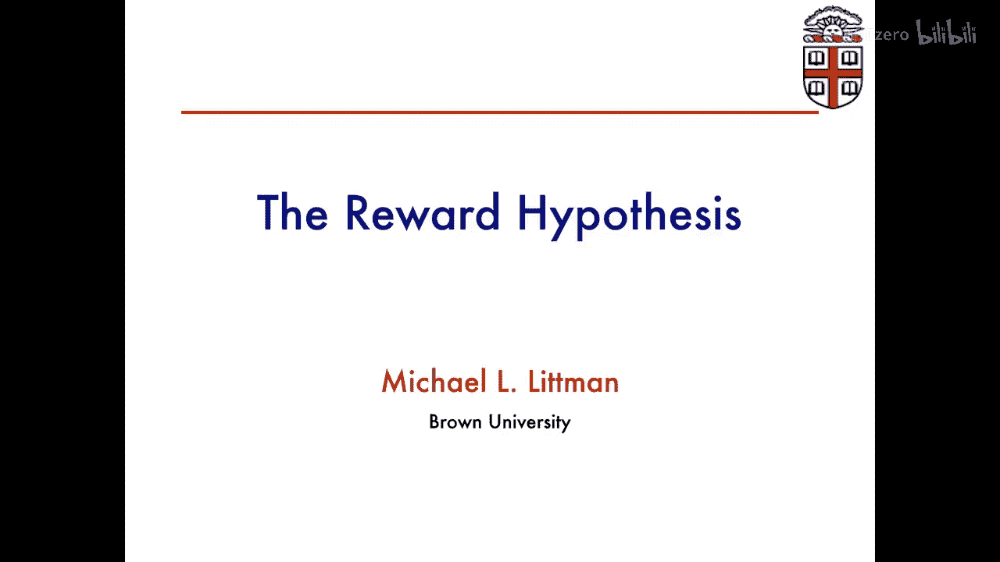
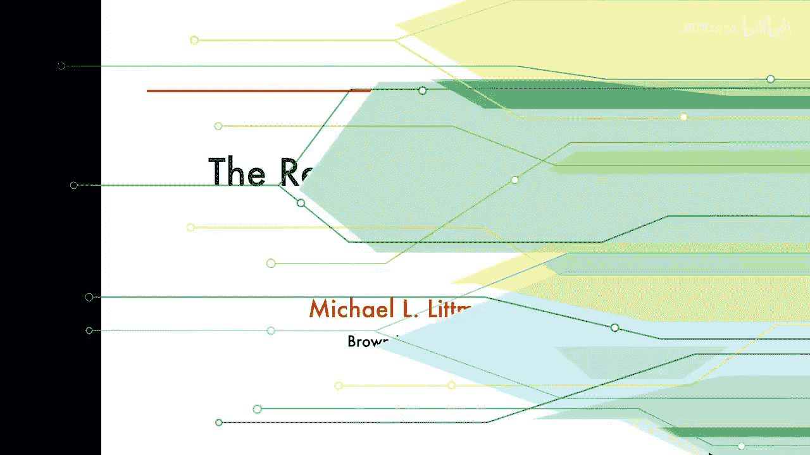

# 阿尔伯塔大学【中英⚡强化学习｜Reinforcement Learning Specialization】 p16 P16 02_迈克尔·利特曼：奖励假说 -BV1CdGrzuEJU_p16-

Hi， I'm Michael Liman， I'm a computer science professor at Brown University and I was asked to speak about the reward hypothesis。

The basic idea of the reward hypothesis is illustrated in this famous saying。

Give a man a fish and he'll eat for a day， teach a man to fish， and he'll eat for a lifetime。

 give a man a taste for fish and he'll figure out how to fish even if the details change okay。

 maybe it's not famous saying but someone who isn't me retweet it so that's something。Anyway。

There are three ways to think about creating intelligent behavior。

 the first give a man of fish is good old fashioned AI。If we want a machine to be smart。

 we program it with the behavior we want it to have。But as new problems arise。

 the machine won't be able to adapt to new circumstances。

 it requires us to always be there providing new programs。

The second teach Aman to fish is supervised learning。If we want a machine to be smart。

 we provide training examples and the machine writes its own program to match those examples。

It learns。So as long as we have a way to provide training examples。

 our machine will be able to write its own programs， and that's progress。But situations change。

 I mean， most of us don't have the opportunity to eat fish or to fish for our food every day。

The third give a man a taste for fish， that's reinforcement learning。

 it's the idea that we don't have to specify the mechanism for achieving a goal。

 we can just encode the goal and the machine can design its own strategy for achieving it these days you don't have to catch a salmon to eat a salmon。

 there's supermarkets， there's seafood chain restaurants and if all else fails gas station sushi。

So that's the high level idea， but what about the hypothesis itself？

Now I'm pretty sure I got it from Rich Sutton。But I've heard that Rich Sutton attributes it to me。

 so if I'm going to tell you about it， I thought it would be a good idea to get a handle on the history of the term。

Google Trends is an awesome service that provides information about how often a term is used historically。

 so when I asked it about the reward hypothesis， it saidNo dice。

Searching for reward hypothesis reinforcement learning has 3，580 results， so that's something。

On the first few pages of results， I found a few examples， a blog post by Muhammad Ashshraoff says。

  all goals can be described by the maximization of expected cumulative rewards。

David Silver used the same phrase in his intro reinforcement learning course。

 but he spelled maximization with an S because he's British。

Ric Sutton has a blog post called the rewardward Hypothesis。

 and there he states it a little bit differently。He says what we mean by goals and purposes can be well thought of as maximization of the expected value of the cumulative sum of a received scalar signal reward。

This version emphasizes that it goes beyond goals and the fact that reward is a scalealar。

 but overall the spirit is very much the same as the other versions I found。Okay。

 what about my version， so I searched my archive and I got no hits at all。

Then I saw in that same essay that Rich said that I call it the reinforcement learning hypothesis。

So that explains why I wasn't finding it。With the right term in hand。

 I was able to dig up this slide from a talk that I gave in the early 2000s。

And it saysIn behavior arises from the actions of an individual seeking to maximize its received reward signals in a complex and changing world。

Again， it's pretty similar to the others， I neglected to say cumulative and scalar。

But I did contrast the simplicity， the idea of reward with the complexity of the real world。

I also pointed out the implications of this idea。So if you buy into this hypothesis。

 it suggests that there's two main branches of research that need to be addressed。

The first is to figure out what rewards agents should optimize。

 and the second is to design algorithms to maximize it。

People have given a lot of attention to the first bullet I'm going to focus on the second。

 how can we define rewards？Well， why is that even hard？

Sometimes it's not a reinforcement learning agent on the stock market can probably just be given monetary rewards to optimize buying actions cost dollars。

 selling actions generate dollars， the tradeoffs are easy， there's a common currency， literally。

This picture shows a reinforcement learning based solar panel some of my students built。

Moving the motors to reposition itself costs energy and the sun shining on the panel brings in energy。

 so again， there's a common currency。If we're designing a reinforcement learning agent to control a thermostat。

 what's the reward？Turning on the heat or air conditioning costs energy。

 but not turning on the heat or air conditioning causes discomfort in the occupants。

 so there's no common currency。I suppose we could translate both into dollars。

 but it's not very natural。How much are you willing to pay to move the temperature a little closer to your comfort zone？

We typically define some units of cost for discomfort， but setting a precise value can be tricky。

We can express the idea of a goal using rewards One way is to define a state where the goal is achieved as having plus one reward and all others zero reward。

That's sometimes called the goal rewarding coding。Another is to penalize the agent with a negative one each step in which the goal has not been achieved。

 once the goal is achieved， there's no more cost， that's the action penalty representation。

In both cases， optimal behavior is achieved by reaching the goal， so that's good。

 but they result in subtle differences in terms of what the agent should do along the way。

The first doesn't really encourage the agent to get to the goal with any sense of urgency。

 and the second runs into serious problems if there's some small probability of getting stuck and never reaching the goal。

And both schemes can lead to big problems for goals with really long horizons。

Imagine we want to encourage an agent to win a Nobel Prize。Come to think of it。

 that would discourage computer science research since there's no Nobel in CS。

But my point is that we'd give the agent a reward for being honored in Sweden and zero otherwise that's really really rough some intermediate rewards like plus 0。

0001 for doing well in a science test or plus 001 for getting tenure could make a big difference for helping to point the agent in the right direction so even if we accept the reward hypothesis。

 there's still work to do to define the right rewards。

The F Loan provides three different places behavior could come from。

 and we can use the same approach to talking about where rewards can come from。

Computer scientists love the computer scientists love recursion。

Programming is the most common way of defining rewards for a learning agent。

 a person sits down and does the work of translating the goals of behavior into reward values。

 and that can be done once and for all by writing a program that takes in states and outputs rewards。

Some recent research looks at special languages for specifying tasks like temporal logic。

These languages might be useful as intermediate formats that are somewhat easy for people to write。

 but also somewhat easy for machines to interpret。Rewards can also be delivered on the fly by a person recent research focuses on how reinforcement learning algorithms need to change when the source of rewards is a person。

 people act differently than reward functions， they tend to change the reward they give in response to how the agent is learning。

 for example。Standard reinforcement learning algorithms don't respond well to this kind of nonstationary reward。

We can also specify rewards by example， that can mean an agent learning to copy the rewards that a person gives。

But a very interesting version of this approach is inverse reinforcement learning In inverse reinforcement learning a trainer demonstrates an example of the desired behavior and the learner figures out what rewards the trainer must have been maximizing that makes this behavior optimal。

 so whereas reinforcement learning goes from rewards to behavior。

 inverse reinforcement learning is going from behavior to rewards。Once identified。

 these rewards can be maximized in other settings， resulting in powerful generalization between environments。

Rewards can also be derived indirectly through an optimization process if there's some high level behavior we can create a score for an optimization approach can search for rewards that encourage that behavior。

So returning to the Nobel Prize example from earlier。

 imagine creating multiple agents pursuing this goal instead of a single one that would allow us to evaluate not just the result of the behavior。

 was the prize one， but the rewards being used as an incentive for this behavior。Arguably。

 this is how living agents get their reward functions。

 reinforcement learning agents survive if they have good reward functions and a good algorithm for maximizing them。

Those agents pass their reward functions along to their offspring。More generally。

 this is an example of meta reinforcement learning。

 learning at the evolutionary level that creates better ways of learning at the individual level。

Personally， I think the reward hypothesis is very powerful and very useful for designing state of the art agents。

 it's a great working hypothesis that has helped lead us to some excellent results。

But I'd caution you not to take it too literally， we should be open to rejecting the hypothesis when it has outlived its usefulfulness。

For one thing， there are examples of behavior that seem to be doing something other than maximizing reward。

For example， it's not immediately apparent how to capture risk adverse behavior in this framework。

Risk adverseverse behavior involves choosing actions that might not be best on average。

 but for example， minimize the chance of a worst case outcome。Oh， on the other hand。

 maybe you can capture this kind of behavior by intervening on the reward stream to magnify negative outcomes。

That will shift the behavior in precisely the right way。

What about when the desired behavior isn't to do the best thing all the time。

 but to do a bunch of things in some balance， like like imagine a pure reward maximizing music recommendation system。

 it should figure out your favorite song and then play it for you all the time and that's not what we want。

Although。Maybe there are ways to expand the state space。

 so the reward for playing a song is scaled back if that song has been played recently。

's it's kind of like the idea that an animal，It gets a lot of value from drinking。

 but only if it's thirsty， if it just had a drink， the reward for drinking again right away is low。

So。Maybe rewards can handle these cases。Well， another observation that I think is worth considering is whether pursuing existing rewards is a good match for high level human behavior。

 there are people who single mindedly pursue their explicit goals。

But it's not clear that we judge such people as being good to have around。

 as moral philosophers might point out the goals we should be pursuing aren't immediately evident to us as we age。

 we learn more about what it means to make good decisions and generations of scholars have been working out what it means to be a good。

 ethical person。Part of this is better understanding the impacts of our actions on the environment and the impacts on each other。

 and that's just reinforcement learning。But part of it is articulating a deeper sense of purpose。

Are we just identifying details of the reward functions that are already buried in our minds or are we actually creating better goals for ourselves？

I don't know， but in the meantime， we should entertain the possibility that maximizing rewards might just be an excellent approximation of what motivates intelligent agents。

