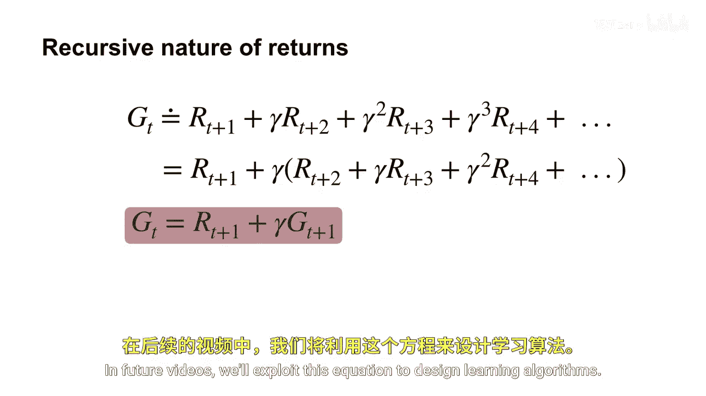
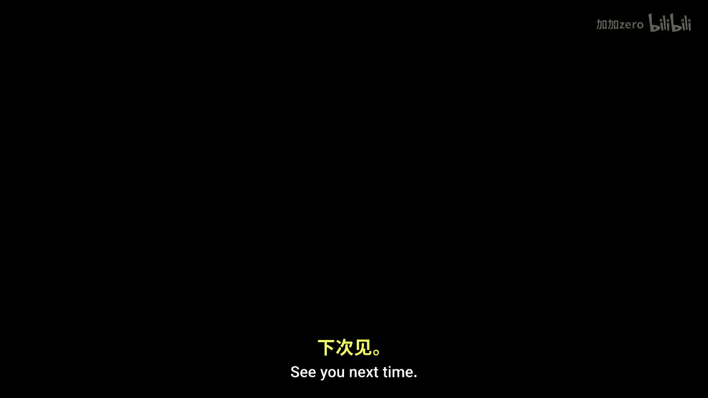

# 阿尔伯塔大学【中英⚡强化学习｜Reinforcement Learning Specialization】 p17 P17 01_持续任务 -BV1CdGrzuEJU_p17-

Mmhmm。🎼う。In the previous video， we discussed episodic problems。🎼In many problems， however。

 the agent environment interaction continues without end。 Today。

 we will see how such problems can be formulated as continuing tasks。In this video。

 you will learn to differentiate between episodic and continuing tasks。

Formte returns for continuing tasks using discounting。

And describe how returns as successive time steps are related to each other。

Let's look at the differences between episodic and continuing tasks。As we discussed earlier。

 episodic tasks break up into episodes。Every episode in an episodic task must end in a terminal state。

The next episode begins independently of how the last episode ended。

The return at time step T is the sum of rewards until termination。In contrast。

 continuing tasks cannot be broken up into independent episodes。The interaction goes on continually。

 there are no terminal states。To make this more concrete。

 consider a smart thermostat which regulates the temperature of a building。

This can be formulated as a continuing task， since the thermostat never stops interacting with the environment。

The state could be the current temperature。Along with details of the situation。

 like the time of day and the number of people in the building。There are just two actions。

 turn on the heater or turn it off。The reward would be minus1 every time someone has to manually adjust the temperature and zero otherwise。

To avoid negative reward， the thermostat would learn to anticipate the user's preferences。

So how can we formulate the return for continuing tasks？

We can try to sum up all the future rewards as we did for episodic tasks。

But now we're summing over an infinite sequence， this return might not be finite。

So how can we modify this sum so that it's always finite？

One solution is to discount future rewards by a factor gamma called the discount rate。

Gamma is at least zero， but less than one。The return formulation can then be modified to include discounting。

The effect of discounting on the return is simple。Immediate rewards contribute more to the sum。

Rewards far into the future contribute less because they are multiplied by gamma raised to successively larger powers of K。

Intuitively， this choice makes sense a dollar today is worth more to you than a dollar in a year。

We can concisely write this sum as this expression， which is guaranteed to be finite。Let's see why。

Assume RMX is the maximum reward our agent can receive at any time step。

We can now upper bound the return GT by replacing every reward with RMX。

Since our max is just a constant， we can pull it out of the summation。

Note that the second factor is just a geometric series。

 and the geometric series evaluates to one divided by  one minus gamma。

R max times1 divided by 1 minus gamma is finite and is an upper bound on GT。So we know GT is finite。

Now let's look at the effect of the discount factor on the behavior of the agent。

We can look at the two extreme cases when gamma equals zero and when gamma approaches1。

When gamma equals zero， the return is just the reward at the next time step。

So the agent is short sightighted and only cares about immediate expected reward。On the other hand。

 when gamma approaches one。The immediate and future rewards are weighted nearly equally in the return。

The agent in this case is more far sighted。Finally。

 let's discuss a simple but important property of the return， it can be written recursively。

Let's factor okgamma starting from the second term in our sum。Amazingly。

 the sequence in parentheses is the return on the next time step。So we can just replace it with GT+1。

Now we have a recursive equation with GT on the left and GT plus1 on the right。

This simple equation is more powerful than it seems in future videos we'll exploit this equation to design learning algorithms。

To recap， we learned about continuing tasks where the agent environment interaction goes on indefinitely。

Discounting is used to ensure returns are finite。And we saw that returns can be defined recursively。

See you next time。

