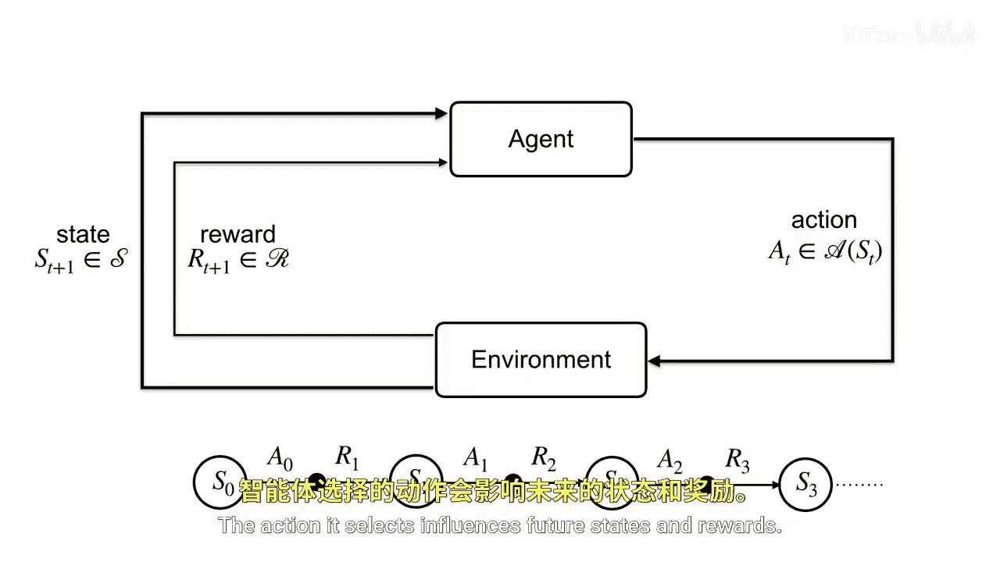
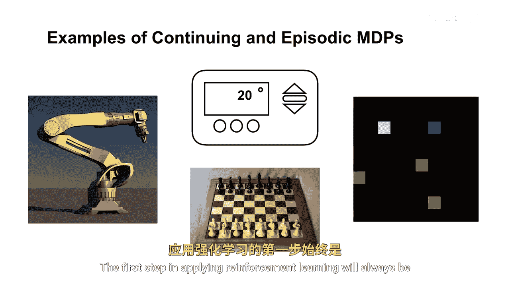

# 阿尔伯塔大学【中英⚡强化学习｜Reinforcement Learning Specialization】 p19 P19 03_第2周总结 -BV1CdGrzuEJU_p19-

This week we introduced MDPs when you first heard about MDPs。

 you might have thought how can this be the problem formulation used for all of reinforcement learning。

 it's too simple。By now， maybe you're starting to see that it can represent many problems。To recap。

 MDPs formalize the problem of an agent interacting with an environment。

 the agent and environment interact at discrete time stepss at each time the agent observes the current state of the environment。

Based on this state， the agent selects an action。After that。

 the environment transitions to a new state and emits a reward。Remember。

 the agent's choices have long term consequences， the action it selects。

 influences future states and rewards。

The goal of reinforce learning is to maximize total future reward。

This often means balancing immediate reward with the long term consequences of actions。

We formalize this goal with the expected return， which is the expected discounted sum of future rewards。

By discounting with gamma less than1， we can guarantee the return remains finite。

The precise value of gamma defines how much we care about short term rewards versus long term rewards。

We discussed a number of examples of problems that can be naturally formulated as either episodic or continuing MDPs。

 The MDP formalism can be used to model many real world problems。

The first step in applying reinforcement learning will always be to formulate the problem as an MDP。

That's all for this week， see you next time。