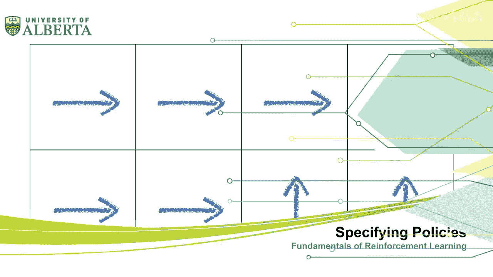
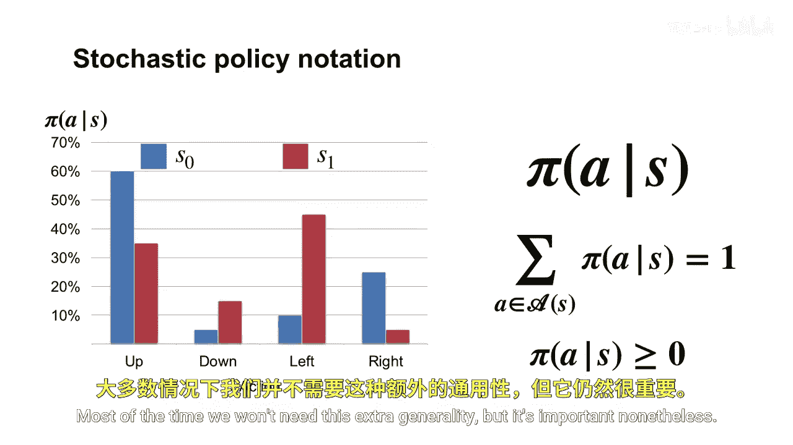

# 阿尔伯塔大学【中英⚡强化学习｜Reinforcement Learning Specialization】 p20 P20 03_策略规范 -BV1CdGrzuEJU_p20-

Reinforcement learning is a problem formulation for sequential decision making under uncertainty。

Earlier， we learned that the agent's role in this interaction is to choose an action on each time step。

The choice of action has an immediate impact on both the immediate reward and the next state。

 In this video， we will describe policies how an agent selects these actions。

By the end of this video， you will be able to recognize that a policy is a distribution over actions for each state。

Describe the similarities and differences between stochastic and deterministic policies and generate valid policies for a given MVP or Markov decision process。

In the simplest case， a policy maps each state to a single action。

This kind of policy is called a deterministic policy。

We will use the fancy Greek letter pi to denote a policy。

PI of S represents the action selected in state S by the policy pi。In this example。

 pi selects the action A1 in state S0 and action A0 in states S1 and S2。

We can visualize a deterministic policy with the table。

 Each row describes the action chosen by pi in each state。

Notice that the agent can select the same action in multiple states。

And some actions might not be selected in any state。

Consider the example shown here where an agent moves towards its house on a grid。

The state's corresponded locations on the grid。 The actions move the agent up， down， left and right。

The arrows describe one possible policy， which moves the agent towards its house。

Each arrow tells the agent which direction to move in each state。In general。

 a policy assigns probabilities to each action in each state。

We use the notation pi of a given S to represent the probability of selecting action A in a state S。

A stochastic policy is one where multiple actions may be selected with nonzero probability。

Here we show the distribution over actions for state S0， according to Pi。

Remember that PiI specifies a separate distribution over actions for each state。

So we had to follow some basic rules。The sum overall action probabilities must be one for each state。

And each action probability must be non negative。Let's look at another state， S1。

Pi in S1 corresponds to a completely different distribution over actions In this example。

 the set of available actions is the same in each state， but in general。

 this set can be different in each state。Most of the time we won't need this extra generality。

 but it's important nonetheless。

Let's go back to our house example， a stochastic policy might choose up or right with equal probability in the bottom row。

Notice this tacat policy will take the same number of steps to reach the house as the deterministic policy we discussed before。

Previously we discussed how a stochastic policy， like Epson greedy can be useful for exploration。

The same kind of exploration exploitation trade off exists in MDP。Let's talk more about that later。

It's important that policies depend only on the current state。

 not on other things like time or previous states。The state defines all the information used to select the current action in this MDP。

 we can define a policy that chooses to go either left or right with equal probability。

We might also want to define a policy that chooses the opposite of what it did last。

 alternating between left and right actions。However。

 that would not be a valid policy because this is conditional on the last action。

 that means the action depends on something other than the state。

It is better to think of this as a requirement on the state， not a limitation on the agent。In MVPs。

 we assume that the state includes all the information required for decision making。

If alternating between left and right would yield a higher return。

Then the last action should be included in the state。That's it for this video。

The most important things to remember are one。An agent's behavior is specified by a policy that maps the state to a probability distribution over actions。

And 2。The policy can depend only on the current state and not other things like time or previous states。

See you next time。