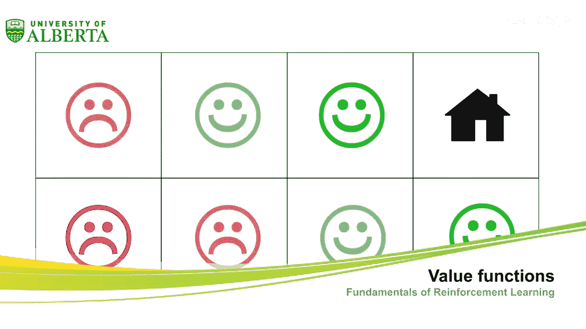
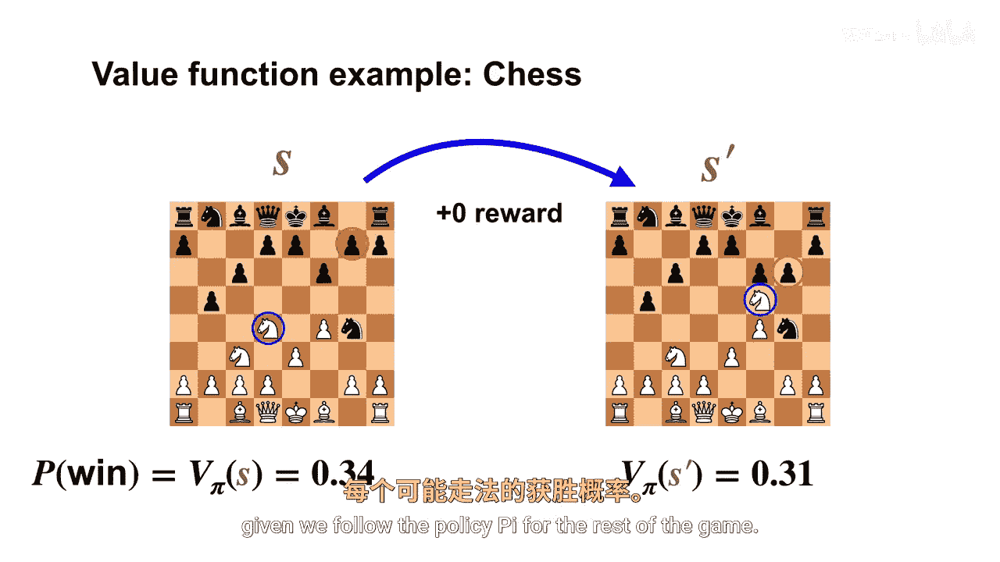

# 阿尔伯塔大学【中英⚡强化学习｜Reinforcement Learning Specialization】 p21 P21 04_价值函数 -BV1CdGrzuEJU_p21-

Many problems involve some amount of delayed reward。

A store manager could lower their prices and sell off their entire inventory to maximize short term gain。

But they would do better in the long run by maintaining inventory to sell when the demand is high。

In reinforcement learning， reward captures the notion of short term gain。The objective， however。

 is to learn a policy that achieves the most reward in the long run。

Value functions formalize what this means。

By the end of this video， you will be able to describe the roles of the state value and action value functions in reinforcement learning。

Describe the relationship between value functions and policies。

And create examples of value functions for a given MDP。Roughly speaking。

 a state value function is the future reward an agent can expect to receive starting from a particular state。

More precisely， the state value function is the expected return from a given state。

The agent's behavior will also determine how much total reward it can expect。

So a value function is defined。With respect to a given policy。

The Subscript pi indicates the value function is contingent on the agent selecting actions according to P。

Likewise， a subscript pi on the expectation indicates that the expectation is computed with respect to the policy pi。

We can also define an action value function。An action value describes what happens when the agent first selects a particular action。

More formally， the action value of a state is the expected return if the agent selects action A and then follows policy pi。

Value functions are crucial in reinforced learning。

 they allow an agent to query the quality of its current situation instead of waiting to observe the long term outcome。

The benefit is twofold。 First， the return is not immediately available。 and second。

 the return may be random due to stochasticity in both the policy and environment dynamics。

The value function summarizes all the possible futures by averaging over returns。Ultimately。

 we care most about learning a good policy value function enable us to judge the quality of different policies。

For example， consider an agent playing the game of chess。Chess is an episodic MDP。

The state is given by the positions of all the pieces on the board。The actions are the legal moves。

And termination occurs when the game ends in either a win， loss， or draw。

We could define the reward as plus one for winning and zero for all the other moves。

This reward does not tell us much about how well the agent is playing during the match。

We will have to wait until the end of the game to see any non zero reward。

The value function tells us much more。The state value is equal to the expected sum of future rewards。

 since the only possible non zeroro reward is plus one for winning。

 the state value is simply the probability of winning if we follow the current policy pie。

In this two player game， the opponent's move is part of the state transition。For example。

 the environment moves both the agent's piece circled in blue。

 and the opponent's piece circled in red。This puts the board into a new state S prime Note。

 the value of state S prime is lower than the value of state S。

This means we are less likely to win the game from this new state。

 assuming we continue following policy pie。An action value function would allow us to assess the probability of winning for each possible move。

 given we follow the policy pie for the rest of the game。

To build some intuition， let's look at a simple continuing MDVP。

The states are defined by the locations on the grid。The actions move the agent up， down， left。

 or right。The agent cannot move off the grid and bumping generates a reward of minus1。

Most other actions yield no reward。There are two special states， however。

These special states are labeled A and B。Every action in state A yields plus 10 reward and plus 5 reward in state B。

Every action in state A and B transitions the agent to states， A prime and B prime respectively。

Remember， we must specify the policy before we can figure out what the value function is。

Let's look at the uniform random policy。Since this is a continuing task， we need to specify gamma。

Let's go with 0。9。Later， we will learn several ways to compute and estimate the value function。

But this time will be nice to you and computed for you。On the right。

 we have written the value of each state。First， notice the negative values near the bottom。

These values are low because the agent is likely to bump into the wall before reaching the distance states A and B。

Remember， A and B are both the only sources of positive reward in this MDVP。

State A has the highest value。Notice that the value is less than 10。

 even though every action from state A generates a reward of plus 10， why。

 Because every transition from a moves the agent close to the lower wall and near the lower wall。

 the random policy is likely to bump and get negative reward。 On the other hand。

 the value of state B is slightly greater than 5。The transition from B moves the agent to the middle。

In the middle， the agent is unlikely a bump。And is close to the high valued states A and B。

It's really quite amazing how the value function compactly summarizes all these possibilities。

In this video， we introduce the definitions of state and action value functions。Soon。

 we will discuss how value functions can be computed。For now。

 you should understand that a state value function refers to the expected return from a given state under a specific policy。

And an action value function refers to the expected return from a given state after selecting a particular action and then following a given policy。

