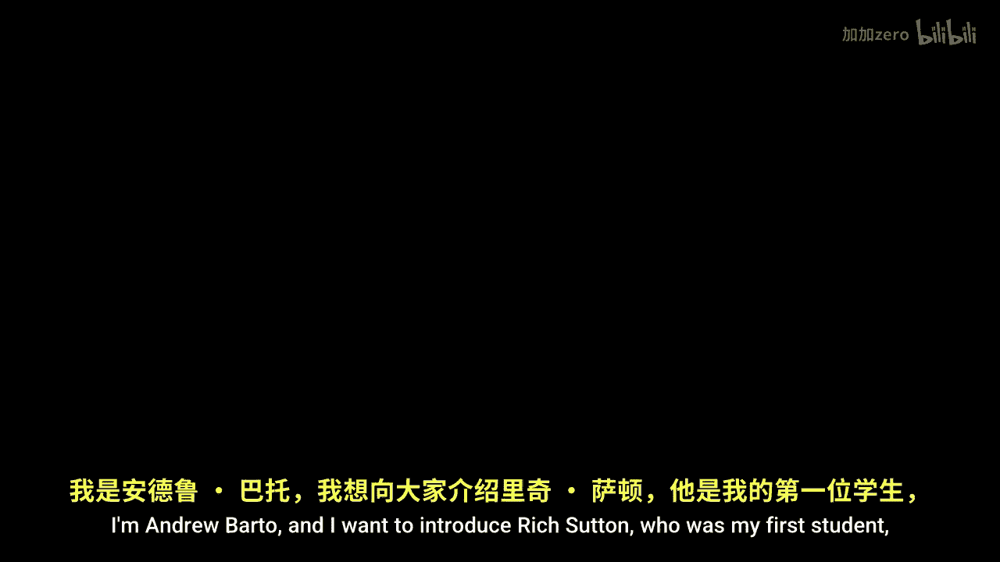

# 阿尔伯塔大学【中英⚡强化学习｜Reinforcement Learning Specialization】 p22 P22 05_理查·萨顿与安迪·巴托：强化学习简史 -BV1CdGrzuEJU_p22-

🎼Im Andy Barto。啊。I want to introduce。Rich Sutton， who was my first student。And。

Weve spent many years working together。Both of us。Amazed， I think， as to the outgrowth of。

That early work。Rich。It's amazingly focused， persistent。😔，Ban of genius， I think。

 and see I'm embarrassing him。But。嗯。You knowA lot of the core ideas are really owe an enormous amount to rich。

So that's rich。Well。I feel I learned an enormous power from you， Andy。And。You just。

been essential to making our work scholarly。And Mel to。知。To the modern age and to the old。

I feel enormously grounded by all the things I learned as your student in those years。嗯。

But I say I want to say that the thing， the main thing we did， we'll go wrote that textbook， okay。

 but the main thing we did was we rediscovered the field of reinforcement。

I sometimes like to say that we discovered it， but I know you would react to that because nothing is new。

 there's nothing new under the side used to tell me。And if you do find something。Yeah。

You there's nothing wrong with rediscovering something old that you should embrace that。

If you rediscover the wheel， as you say， we should call it the wheel。嗯。It maybe a better wh。

 a better， but I do feel we rediscovered reinforcement and we woke it up as it would fallen into on neglect。

And we clarify what it was and how it was different from supervised learning。

This is sort of what I was characterizing as the origin story of reinforcement learning。

 it's an obvious， obvious idea， Martinvin Musky knew it in 1960 or 59。

It's so obvious that everyone knew it。But then it became overshadowed by supervised learning。

Until Harry Cl started knocking on people's doors and saying， hey。

 this is something that's been neglected and it's real and it's important and task us to figure it out。

So in fact， the very first neural network simulation on a digital computer by Farlan Clark。Was it54。

 was a reinforcement warning system？In their second paper， Clark and Farling a year later。

It was the same system， but they focused on generalization and it departed from。So from。

The roots of it and after that， Perceptron and Wirowhoff was error correction。

Even though some of the words they used were。Tri on error they really。You， so became supervised。

Yeah there were exceptions， but you we said Minsky， maybe Minsky's thesis and his steps paper。

It is full of， prediction。TD like things。Certainly the credit assignment problem and then his thesis。

Princeton was a reinforcement learning。Physical network。嗯。对。Learned to go through a maze。

 I think Minsky lost interest in it。For a number of reasons， or maybe it was embarrassed。

 I don't know， but that was reinforcement so Andy， typical of yourself。

 you are talking about what other people did historically， but maybe typical of me。

 I wanted to bring it back to what we did because I think we did do something。I mean。

 we almost did very little， but we recognized we just stood up and said this is a thing。

 this is a thing that hasn't been investigated and it's deserving an investigation and we wrote papers onsoative search networks and just really。

 really simple ideas and made the claim that this had not been done， a combination of association。

And。And trial and error。As you said， I think at the time。

Search for something that works and then you remember。

Comcombining search and memory and that that is the essence of reinfor thinking that strangely had been so I discovered something relevant to that meization。

Robin Popastone， who was my colleague at University of Massachusetts for a while。And。嗯。当问。

Talked about meization， which is what RL is memized search。

You do some operation and then you remember the results and the next time you have to do it。

You look it up instead of recomputing it and it saves a lot of time and so on， and in a sense。

 RLI through is memorized context sensitive search。

And Pobblestone actually hit the end of one of his paper on this 50， I forget the date。

 but talks about。Interpola it。Like using polynomials instead of lookup table to look up something with generalization。

 and that's what neural networks do， for example。So we didn't。We we discovered we did invent。

Memormalization， but we sort of。A new use for it， I don't know if people were doing memorized search。

The way reinforcement learned。So Harry had his idea on a distributed approach。

 goal seeking systems made up of goal seeking components。

And he also had the idea of what he called generalized reinforcement。That呃あ。

One of these units could be reinforced by all kinds of signals， not just。Or by any signal。

And the way I remember it。You know。The essential。Essential， I don't know。

 I'm going to call them so it's like an insight but it's like an absence of an insight it was it was we decided one day。

 well maybe just the goal seeking unit thing， maybe that's，That's an interesting idea all on its own。

 without making goal seeking systems out of goal seeking components and without having generalizing enforce。

 we it just have a specialized reward signal。And we just study that learning and maybe that's the thing。

 maybe that's something that needs to be worked out like， and to me it was very like。

 maybe just that。You know it was like a leave all that other fancy stuff or confusing stuff aside for the moment。

 there's a point to be made， and I think that's what reinforcement learning is is just focusing on a learning system to actually wants something that does trial and error and remembers it and has a specialized reward signal。

