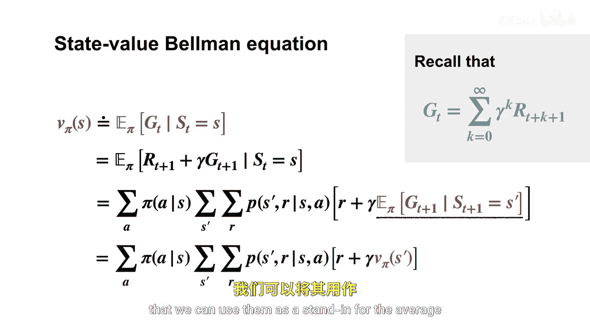
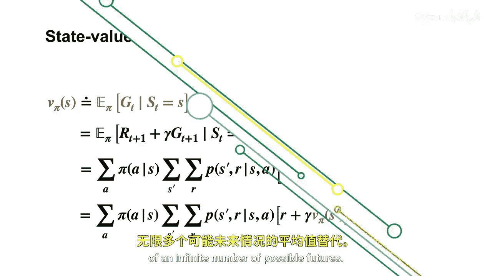
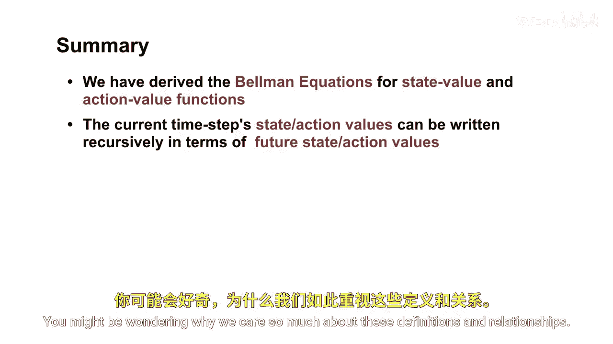

# 阿尔伯塔大学【中英⚡强化学习｜Reinforcement Learning Specialization】 p23 P23 01_贝尔曼方程推导 -BV1CdGrzuEJU_p23-

In everyday life， we learn a lot without getting explicit， positive or negative feedback。 Imagine。

 for example， you are riding a bike and hit a rock that sends you off balance。

Let's say you recover so you don't suffer any injury。

You might learn to avoid rocks in the future and perhaps react more quickly if you do hay one。

How do we know that hitting a rock is bad， even when nothing bad happened this time？

The answer is that we recognize that the state of losing our balance is bad。

 even without falling and hurting ourselves。Perhaps we had similar experiences in our past when things didn't work out so nicely。

In reinforcement learning， a similar idea allows us to relate the value of the current state to the value of future states without waiting to observe all the future rewards。

We use Belelmont equations to formalize this connection between the value of a state and its possible successors。

By the end of this video， you will be able to derive the Belelman equation for state value functions。

 to find the Belelman equation for action value functions。

 and understand how Belelman equations relate current and future values。First。

 let's talk about the Belman equation for the state value function。

The Belmon equation for the state value function defines a relationship between the value of a state and the value of its possible successor states。

Now we'll illustrate how to derive this relationship from the definitions of the state value function and return。

Let's start by recalling that the state value function is defined as the expected return。

 starting from the state S。Recall that the return is defined as the discounted sum of future rewards。

We saw previously that the return at time T can be written recursively as the immediate reward plus the discounted return at time T+1。

Now let's expand this expected return。First， we expand the expected return as a sum over possible action choices made by the agent Second。

 we expand over possible rewards and next states condition on state S and action A。

We can break it down in this order because the action choice depends only on the current state。

 while the next state and reward depend only on the current state in action。

The result is a weighted sum of terms consisting of immediate reward。

 plus expected future return from the next state S prime。

All we have done is explicitly write the expectation as it's defined as a sum of possible outcomes weighted by the probability that they occur。

😊，Note that capital Rt+1 is a random variable while the little R represents each possible reward outcome。

The expected return depends on states and rewards infinitely far into the future。

We could recursively expand this equation as many times as we want。

 but it would only make the expression more complicated instead。

 we can notice that this expected return is also the definition of the value function for state S prime。

The only difference is that the time index is t plus 1 instead of T。

This is not an issue because neither the policy nor P depends on time making this replacement。

 We get the Belmon equation for the state value function。

The magic of value functions is that we can use them as a stand in for the average of an infinite number of possible futures。

We can derive a similar equation for the action value function。

It will be a recursive equation for the value of a state action pair in terms of its possible successor state action pairs。

In this case， the equation does not begin with the policy selecting an action。

This is because the action is already fixed as part of the state action pair。Instead。

 we skip directly to the Dna function P to select the immediate reward and next date S prime。Again。

 we have weighted sum over termss consisting of immediate reward plus expected future return given a specific next state little S prime。

However， unlike the Belelmon equation for the state value function， we can't stop here。

We want a recursive equation for the value of one state action pair in terms of the next state action pair。

At the moment we have the expected return given only the next state。To change this。

 we can express the expected return from the next state as a sum over the agent's possible action choices。

😊，In particular， we can change the expectation to be conditioned on both the next state and the next action。

 and then some over all possible actions。Each term is weighted by the probability under pi of selecting a prime in the state S prime。

Now this expected return is the same as the definition of the action value function for S prime and A prime。

Making this replacement， we get the Belelman equation for the action value function。

So we have now covered how to derive the Belman equations for state and action value functions these equations provide relationships between the values of a state or state action pair and the possible next states or next state action pairs。

You might be wondering why we care so much about these definitions and relationships。

The Belmon equations capture an important structure of the reinforcement learning problem。Next。

 we will discuss why this relationship is so fundamental in reinforcement learning and how we can use it to design algorithms which efficiently estimate value functions。

