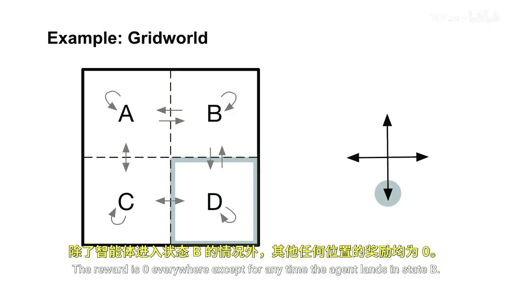
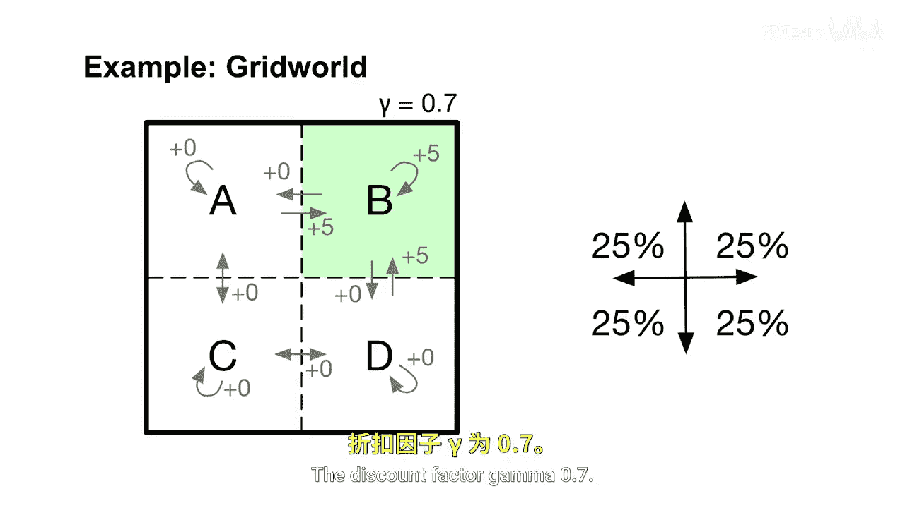
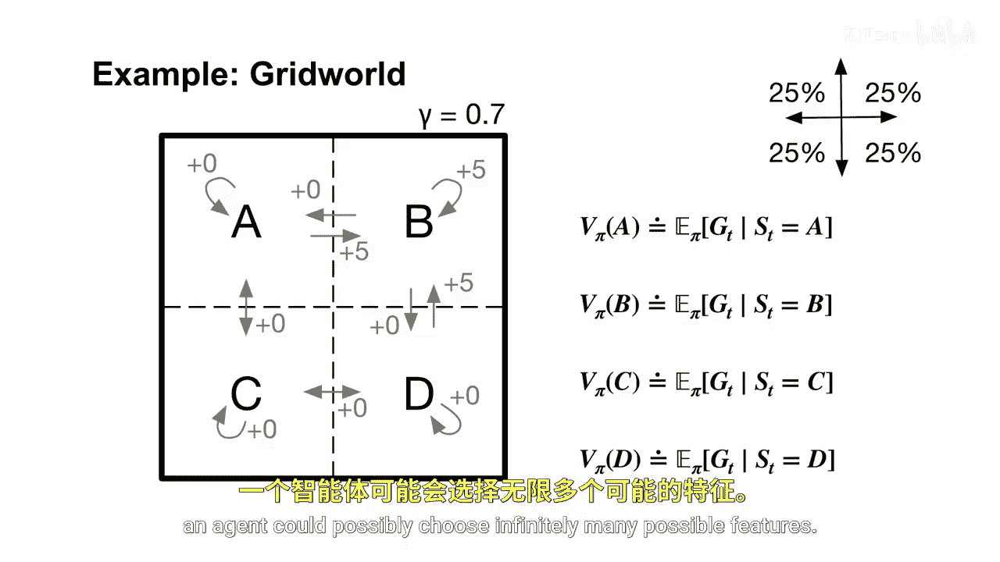
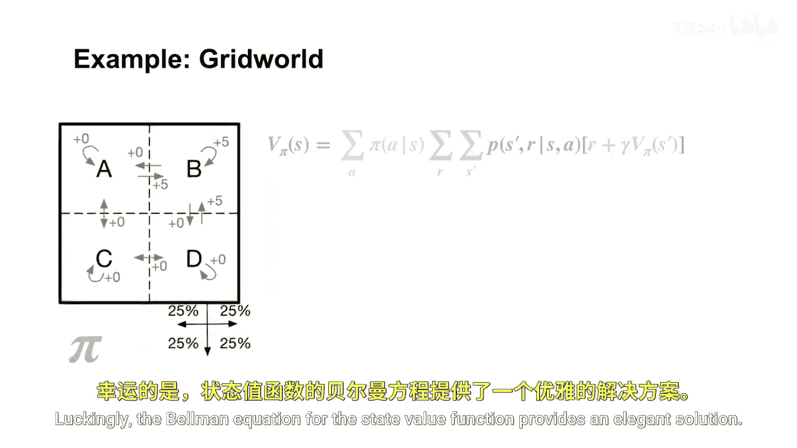
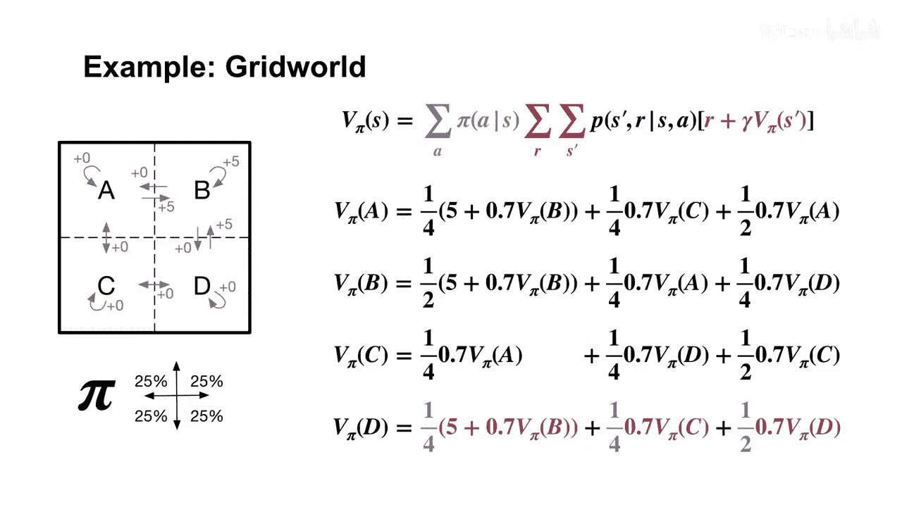
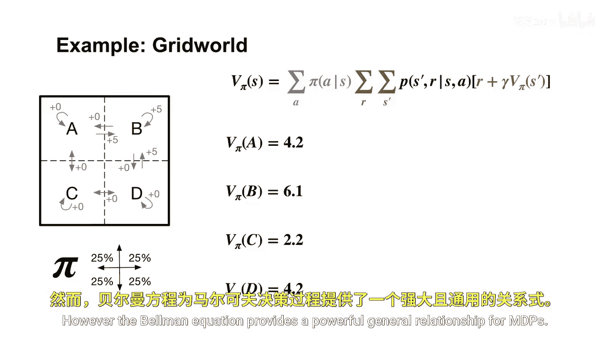

# 阿尔伯塔大学【中英⚡强化学习｜Reinforcement Learning Specialization】 p24 P24 02_为什么需要贝尔曼方程 -BV1CdGrzuEJU_p24-

嗯。Previously， we learned how Belmon equations allow us to express the value of a state or state action pair in terms of its possible successors。

But you may be wondering what is the point of all this？By the end of this video。

 you will be able to use the Belelman equations to compute value functions。

To illustrate the power of Belman equations， consider this small example consisting of just four states labeled A。

 B， C， and D on a grid。The action space consists in moving up， down， left or right。

Actions which would move off the grid instead keep the agent in place。Say for example。

 we start in state C。Moving up would take us to state a。If we then try to move the left。

 we would hit a wall and stay in state A。Moving right next would take us to state b。From there。

 moving down with land us in state D。The reward is zero everywhere。

 except for any time the agent lands in state B， if the agent lands in state B。

 it gets a reward of plus5。

This includes starting in state B and hitting a wall to remain there。

Let's consider the uniform random policy， which moves in every direction， 25% of the time。

The discount factor gamma is 0。7。

How can we actually work out the value of each of these states， A， B， C， and D， under this policy？

Recall that the value function is defined as the expected return under policy pi。

This is an average over the return obtained by each sequence of actions an agent could possibly choose。

 infinitely many possible futures。

Luckily， the Belmon equation for the state value function provides an elegant solution。

Using the Belman equation， we can write down an expression for the value of state A in terms of a sum over the four possible actions and the resulting possible successor states。

We can simplify the expression further in this case because for each action。

 there's only one possible associated next state and reward。

 thus the sum over S prime and R reduces to a single value。Note that here。

 S prime and R do still depend on the selected action and the current state S。

But to keep the notation short， we haven't written this explicitly。If we go right from state A。

 we land in state B and receive a reward of plus5。This happens one quarter of the time under the random policy。

If we go down， we land in state C and receive no immediate reward again。

 this occurs one quarter of the time。If you go either up or left， we will land back in state A again。

Each of the actions up and left again occur one quarter of the time。

 since they both land in state A and receive no reward。

 we combine them into a single term with factor of1 over2。Finally。

 we arrive with expression shown here for the value of state A。

We can write down a similar equation for each of the other states。Bi。C。And D。

Now we have a system of four equations for four variables， you can solve this by hand if you want。

 or put it into an automatic equation solver。

The unique solution is shown here。The important thing to note is that the Abelman equation reduced an unmanageable infinite sum over possible futures to a simple linear algebra problem。

Perhaps for this small problem， you can come up with other ways to work out the values of each of these states。

 however， the Belmont equation provides a powerful general relationship for MDPs。

In this case， we use the Belmon equation to directly write down a system of equations for the state values and install the system to find the values。

This approach may be possible for MDPs of moderate size， however， in more complex problems。

 this won't always be practical。Consider the game of chess， for example。

We probably won't be able to even list all the possible states。

 there are around 10 to the 45 of them。Constructing and solving the resulting system of Belman equations would be a whole other story。

Yet humans can learn to play chess very well。However。

 this simple game represents a tiny fraction of human experience。

 and humans can learn to do many things。 Our agents should be able to learn many things， too。😊。

In upcoming lessons， we will discuss algorithms based on Belelman equations that can scale up to large problems。

Hopefully， you see why Belelmon equations are so fundamental for reinforcement learning。To sum up。

 without the Belmon equation， we might have to consider an infinite number of possible futures。

The Belelmont equations exploit the structure of the MDP formulation to reduce this infinite sum to a system of linear equations。

We can then potentially solve the Belman equation directly to find the state values。

