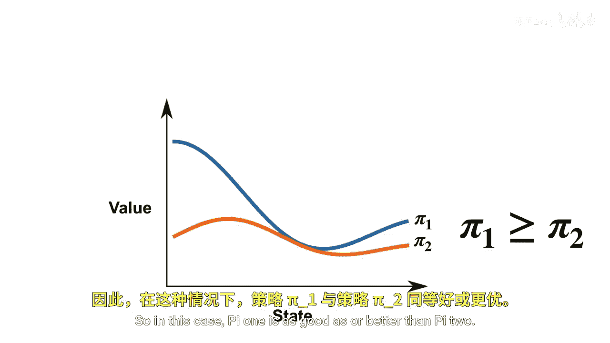
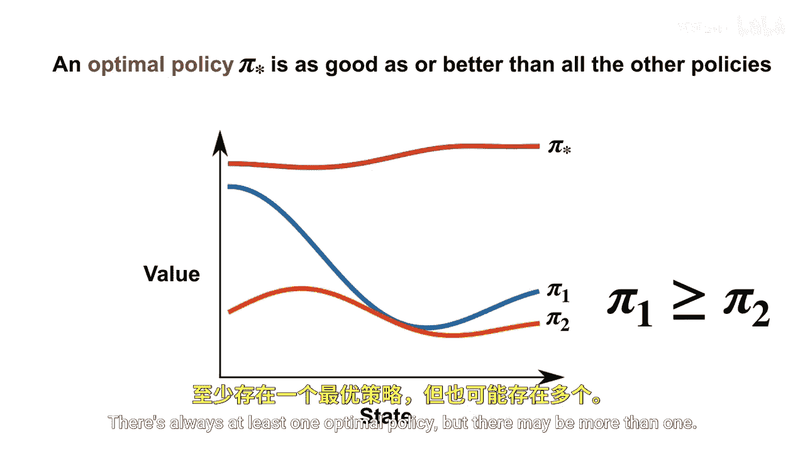
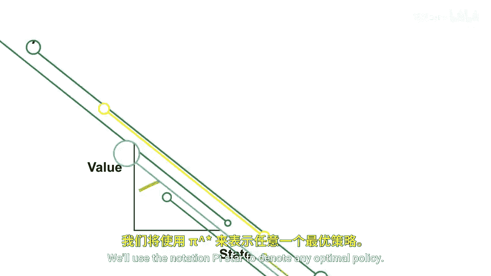
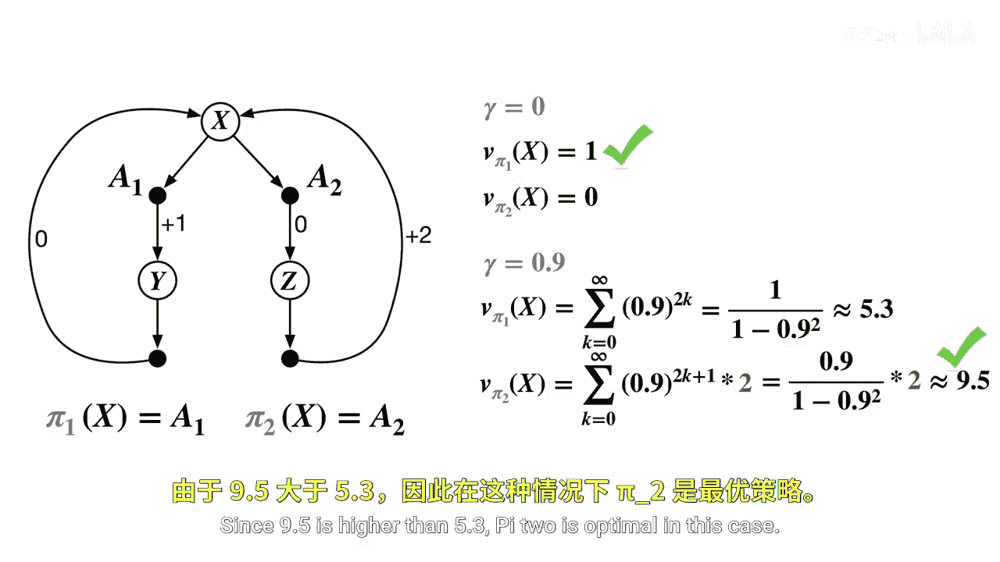

# 阿尔伯塔大学【中英⚡强化学习｜Reinforcement Learning Specialization】 p25 P25 01_最优策略 -BV1CdGrzuEJU_p25-

Up to this point， we've generally talked about a policy as something that is given。

The policy specifies how an agent behaves， given this way of behaving。

 we then aim to find the value function。But the goal of reinforcement learning is not just to evaluate specific policies。

 ultimately we want to find a policy that obtains as much reward as possible in the long run。

In this video， we will make this notion precise with the idea of an optimal policy。

By the end of this video， you will be able to define an optimal policy。

Understand how a policy can be at least as good as every other policy in every state and identify an optimal policy for a given MDP。

To define an optimal policy， we first have to understand what it means for one policy to be better than another。

Here we can see the value of two policies plotted across states。

Note that we plot it as a continuous line for illustration only。

 we are still considering discrete states， and the value might not vary smoothly across states。

This plot illustrates that in some states， pi 1 achieves a higher value and in other states。

 pi 2 achieves a higher value。So it does not make much sense to say pi 1 is better than pi 2 or that pi 2 is better than pi1。

We will say policy pi 1 is as good as or better than policy pi2。

 if and only if the value under pi 1 is greater than or equal to the value under pi 2 for every state。

We denote this relationship between policies whether are're greater than or equal to sign。

In the diagram shown here， the line visualizing the value of pi 1 is always above the line for pi 2。

 so in this case， pi 1 is as good as or better than pi 2。

An optimal policy is a policy which is as good as or better than all the other policies。 That is。

 an optimal policy will have the highest possible value in every state。

There is always at least one optimal policy， but there may be more than one we'll use the notation pi star to denote any optimal policy。

It might not be clear why there must exist optimal policies。

 that is policies that are at least as good as all other policies in every state Could't we have a situation where doing well in one state requires doing badly in another。

Let's say there is such a policy pi1， which does well in some states。

 while policy pi2 does well in others。We could combine these policies into a third policy pi3。

 which always chooses actions according to whichever a policy pi1 and P2 has the highest value in the current state。

Pi 3 will necessarily have a value greater than or equal to both pi1 and pi 2 in every state。

So we will never have a situation where doing well in one state requires sacrificing value in another。

Because of this， there always exists some policy which is best in every state。

This is of course only an informal argument， but there is in fact a rigorous proof showing that there must always exist at least one optimal deterministic policy。

Notice that in some states， pi3 has a strictly greater value than either pi 1 or pi2 as an exercise。

 try to explain how this is possible， given that pi3 simply chooses actions according to whichever of pi1 and pi2 has a higher value in each state。

Let's look at a specific example to build some intuition about optimal policies。

Consider the two choice MDP shown here。The only decision to be made is in the top state labeled X。

 the agent can take either action A1 or A2。From state X， action A1 takes the agent to state Y。

In state Y， only action A1 is available and it takes the agent back to state X。On the other hand。

 action A2 and x takes the agent to state Z from state Z。

 action A1 is again the only action available and it takes the agent back to state X。

The numbers show the rewards the agent receives after each action。

Notice that while A1 offers an immediate reward of+1。

 A2 offers a larger reward of+2 after a single step delay。

There are only two deterministic policies in this MDP。

 which are completely defined by the agent's choice in state X， take action A1 or take action A2。

 let's call these pi 1 and pi 2。Which of these two policies is optimal？

The optimal policy will be the one for which the value of x is highest。

 the answer depends on the discount factor gamma。Consider gamma equals0。In this case。

 the value is defined using only the immediate reward。The value of state x under pi 1 is plus1。

 while the value under pi 2 is0 because the plus2 reward occurs after a one step delay。

 which does not affect the return when gamma is set to zero。So in this case。

 pi 1 is the optimal policy what if instead gamma equals 0。9？In this case。

 the value of x under each policy is an infinite sum pi 1 receives an immediate reward of 1。

 followed by zero and then  one again and so on。Each reward in the expression for the value of state X is discounted by some power of gamma。

We can express this compactly as a geometric series， App the geometric series formula。

 we get the value shown here for pi 1， which evaluates to around 5。3。

 we can write the value under pi2s similarly， except we will receive a reward of two on every odd step instead of one on every even step。

We can again write this as a geometric series and obtain a closed form solution。In this case。

 the solution evaluates to around 9。5 since 9。5 is higher than 5。3， pi 2 is optimal in this case。

In this two choice MDP， finding the optimal policy was relatively straightforward。

 there were only two deterministic policies and we simply had to compute the value function for each of them。

In general， it will not be so easy， even if we limit ourselves to deterministic policies。

 the number of possible policies is equal to the number of possible actions to the power of the number of states。

😊，We could use a brute force search where we compute the value function for every policy to find the optimal policy。

 but it's not hard to see this will become intractable for even moderately large MDPsLuckiily。

 there's a better way to organize our search of the policy space。

The solution will come in the form of yet another set of Belelman equations called the Belelman Opity equations。

 which we will introduce in an upcoming video。That's it for this video the most important things to take away are an optimal policy is defined as the policy with the highest value in all states。

 at least one optimal policy always exists， but there may be more than one。

The exponential number of possible policies makes searching for the optimal policy by brute force intractable。

