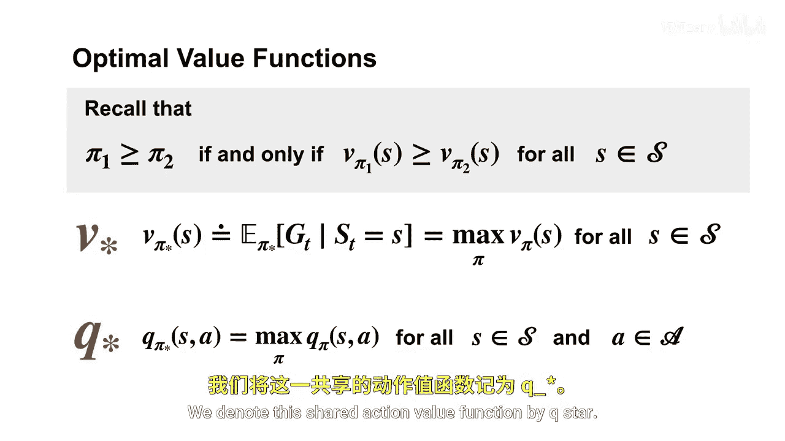
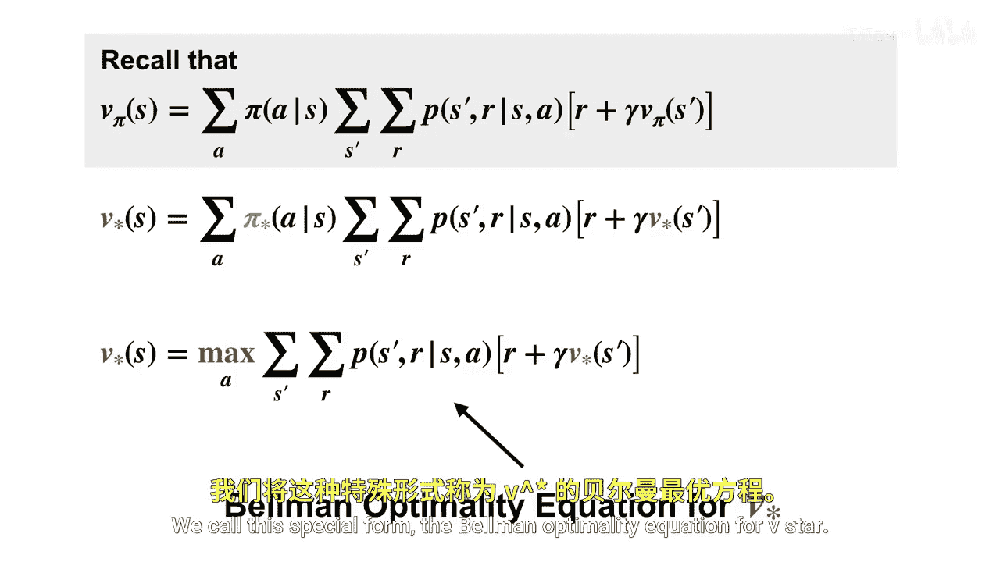
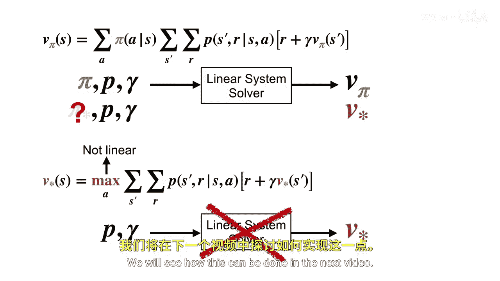
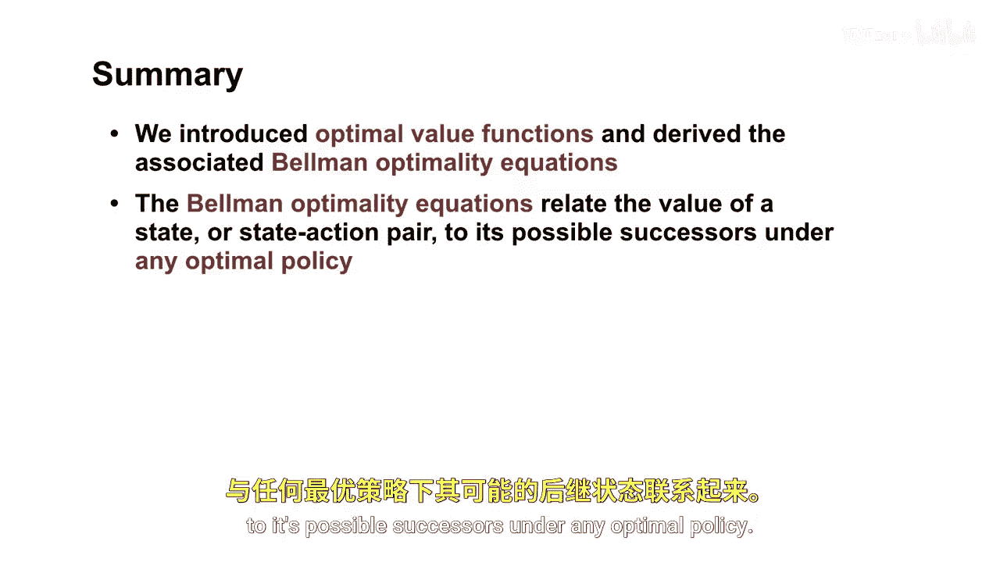

# 阿尔伯塔大学【中英⚡强化学习｜Reinforcement Learning Specialization】 p26 P26 02_最优价值函数 -BV1CdGrzuEJU_p26-

Previously， we learned about how optimal policies achieve the goal of reinforcement learning to obtain as much reward as possible in the long run。

In this video， we'll describe the related notion of an optimal value function and introduce an associated set of beelman equations。

By the end of this video， you will be able to derive the Belman optimality equation for the state value function。

Derriiveve the Belman optimality equation for the action value function。

And understand how the Belelman optimality equations relate to the previously introduced Belelman equations。

Recall that for two policies pi 1 and pi 2， pi 1 is considered as good as or better than pi 2。

 if and only if the value under pi 1 is greater than or equal to the value under pi 2 for all states。

An optimal policy is one which is good as or better than every other policy。

The value function for the optimal policy thus has the greatest value possible in every state。

We can express this mathematically by writing that v pi star of s is equal to the maximum value over all policies。

And this holds for every state in our state space。Taking a maximum over policies might not be intuitive。

 so let's take a moment to break down what it means。

Imagine we were to consider every possible policy and compute each of their values for the state S。

 the value of an optimal policy is defined to be the largest of all the computed values。

 We could repeat this for every state， and the value of an optimal policy would always be the largest。

All optimal policies have this same optimal state value function， which we denote by V star。

Opttimal policies also share the same optimal action value function。

 which is again the maximum possible for every state action pair。

We denote this shared action value function by Q star。

Recall the Belman equation for the state value function。

This equation holds for the value function of any policy， including an optimal policy。

By substituting the optimal policy pi star into this Belelman equation。

 we get the Belelmon equation for v star so far we haven't done anything special。

 this is simply the Belmon equation we introduced previously for the specific case of an optimal policy。

However， because this is an optimal policy， we can rewrite the equation in a special form which doesn't reference the policy itself。

😊，Remember， there always exists an optimal deterministic policy。

 one that selects an optimal action in every state。

 such a deterministic optimal policy will assign probability1 for an action that achieves the highest value and probability zero for all other actions。

We can express this another way by replacing the sum of a pi star with a max over a。

Notice that pi star no longer appears in the equation。

 we have derived a relationship that applies directly to V star itself。We call this special form。

 the Belman Opity equation for V star。

We can make the same replacement in the Belelman equation for the action value function。Here。

 the optimal policy appears in the inner sum。Once again。

 we replace the sum over pi star with a max over a。

This gives us the Belman optimality equation for Q star。In an earlier lecture。

 we discussed how the Belman equations form a linear system of equations that can be solved by standard methods。

The Bel and optimality equation gives us a similar system of equations for the optimal value。

One natural question is， can we solve this system in a similar way to find the optimal state value function？

Unfortunately， the answer is no。Taking the maximum over actions is not a linear operation。

 so standard techniques from linear algebra for solving linear systems won't apply。In this course。

 we will not form and solve systems of equations in the usual way， instead。

 we will use other techniques based on the Belelman equations to compute value functions and policies。

You might be wondering why we can't simply use pi star in the ordinary Belllman equation to get a system of linear equations for V star。

The answer is simple， we don't know pi star， if we did。

 then we would have already achieved the fundamental goal of reinforcement learning。

If we can manage to solve the Belman optimality equation for V star。

 we can use the result to obtain pi star fairly easily。

We will see how this can be done in the next video。

So， we introduced optimal value functions and derived the associated Belman optimality equations。

The Melmon optimality equations relate the value of a state or state action pair to its possible successors under any optimal policy。

See you next time where we'll learn how to find the optimal policy from the optimal value function。

