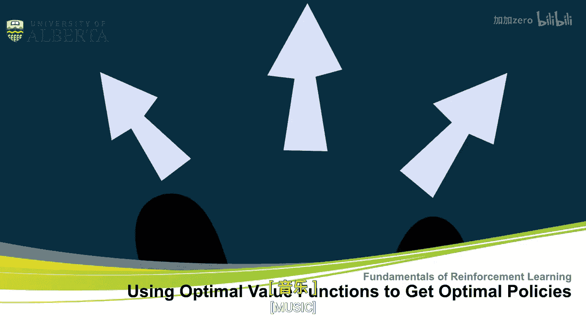
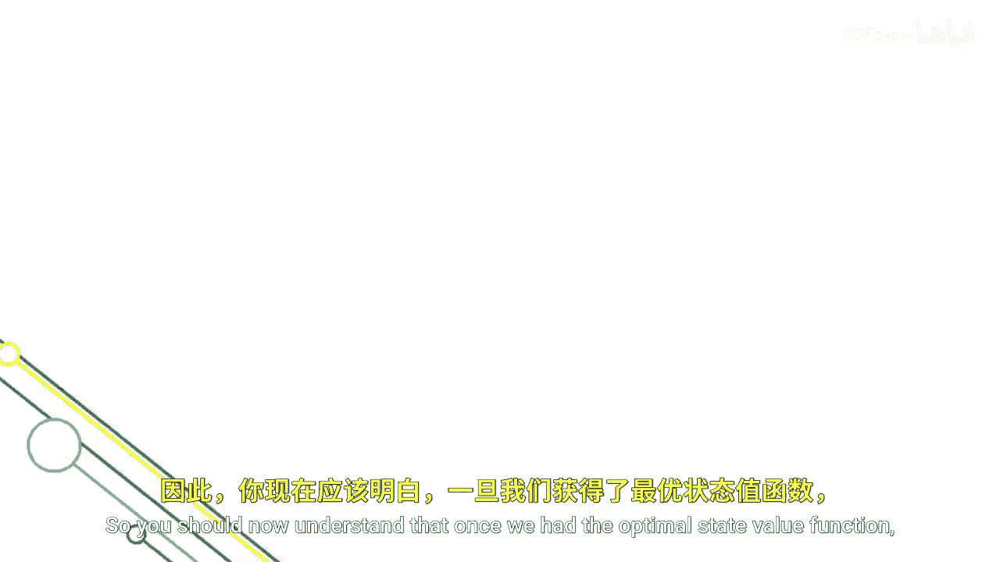

# 阿尔伯塔大学【中英⚡强化学习｜Reinforcement Learning Specialization】 p27 P27 03_利用最优价值函数求解最优策略 -BV1CdGrzuEJU_p27-

We just learned about optimal value functions and the Belman optimality equations。

You might be wondering why this matters， when our ultimate goal is not to find the value function of an optimal policy。

 but the optimal policy itself。In this video， we will show how given an optimal value function。

 it is actually quite easy to find an associated optimal policy。

 so the two goals are almost the same。By the end of this video。

 you will be able to understand the connection between the optimal value function and optimal policies。

And verify the optimal value function for a given MDP。For now。

 we'll put off the question of how to find optimal value functions。

 let's just look at an example where we have already worked out the optimal state value function V star。

Specifically， let's take another look at the grid world we introduced earlier in the course。

 as before， all actions in state A transition to state A prime with a reward of plus 10。In state B。

 all actions transition to B prime with a reward of plus 5， the reward is0 everywhere else。

 except for minus1 for bumping into the walls。The discount factor is 0。9。

Here are the associated optimal values for each state。Notice that unlike before。

 the values along the bottom are not negative， unlike the uniform random policy。

 the optimal policy won't ever choose to bump into the walls as a consequence。

The optimal value of state A is also much higher than the immediate reward of plus 10。In general。

 having VSt makes it relatively easy to work out the optimal policy as long as we also have access to the Dyna function P。

For any state， we can look at each available action and evaluate the boxed term。

There will be some action for which this term obtains a maximum。A deterministic policy。

 which selects this maximizing action for each state。

 will necessarily be optimal since it obtains the highest possible value。

The equation shown here for pi star is thus almost the same as the Belman optimality equation for V star。

V star is equal to the maximum of the box term over all actions。Pi star is the AG Max。

 which simply means the particular action which achieves this maximum。

To evaluate the box term for a given action， we need only perform a one step look ahead at the possible next date and rewards that follow。

First， imagine doing so for a particular action， labeled A1。

We look at each state and reward which might follow from state S after taking action A1。

Since we have access to v star and P， we can then evaluate each term in the sum over s prime and R。

Let's say that for A1， the box term evaluates to5。We can repeat the same procedure for A2。Again。

 this requires only a one step look ahead thanks to having access to V star。Let's say in this case。

 we find a result of 10。Finally， for A3， let's say we obtain a result of seven。

Of these three actions， A2 maximizes the box term with a value of 10。

This means that A2 is the optimal action。In fact， there could be more than one maximizing action if multiple actions are tied。

If there are multiple maximizing actions， we could define a stochastic optimal policy that chooses between each of them with some probability。

Let's take a look at how we can find the optimal policy for the grid World example here。

We will use the grid on the right to fill in the optimal action choice for each state。First。

 consider the state highlighted here。A one step look ahead considers each action and the potential next states and rewards。

This is especially simple in this case because each action leads us deterministically to a specific next state and reward。

The up action leads here， giving no reward and a next state value of 17。5。

The sum of reward and discounted next day value is 14。The right action hits the wall。

 giving minus one reward and leaving the agent in the same state， which has a value of 16。

The sum of reward and discounted next day value is 13。4。The down action leads here。

 giving no reward but a next state value of 14。4 After discounting this gives 13。Finally。

 the left action leads here， again giving no reward， but a next state value of 17。8。

Discounting by gamma gives us 16。Of all these choices， the highest value action is left at 16。

Therefore， left is the optimal action in this state and must be selected by any optimal policy。

As an aside， we have also verified that V star obeys the Belman optimality equation in this state。

For the maximizing left action， the right side of the equation evaluates to 16。

 which is indeed equal to v star for the state itself。Let's look at another example。In this state。

 two different actions up and left， each gave the same optimal value of 0。9 times 19。8。

 which equals 17。8。Thus， in this state， there are two different optimal actions。

 and an optimal policy is free to pick either with some probability。As a last example。

 let's look at state A itself。Remember that regardless of the action we pick in state A。

 we transition to a prime with a reward of plus 10。This means that in state A。

 every action is optimal since the transitions are equivalent。

V star for state A is 10 plus gamma times v star of a prime。10 plus 0。9 times 16 is equal to 24。4。

 which is indeed the recorded value for V star。Hopefully now it is clear how we can do this for every state to find the optimal policy。

To save us some time， let's just fill on the rest， we see that the optimal policy essentially heads towards state A to obtain+ 10 reward as quickly as possible。

Working out the optimal policy from V star is especially simple in this grid world each action leads us deterministically to a specific next state and a reward。

 so we only have to evaluate one transition per action。Remember that in general。

 the dynamics function P can be stochastic， so it might not always be so simple。However。

 as long as we have access to P， we can always find the optimal action from V star。

By computing the right hand side of the Belman Opity equation for each action。

And finding the largest value。If instead we have access to Qstar。

 it's even easier to come up with the optimal policy。In this case。

 we do not have to do a one step look ahead at all。

 we only have to select any action A that maximizes Q star of S and A。

The action value function cachees the results of a one step look ahead for each action。In this sense。

 the problem of finding an optimal action value function corresponds to the goal of finding an optimal policy。

So you should now understand that once we had the optimal state value function。

 it's relatively easy to work out the optimal policy。If we have the optimal action value function。

 working out the optimal policy is even easier。This correspondence between optimal value functions and optimal policies will help us to derive many of the reinforcement learning algorithms we will explore later in this specialization。

