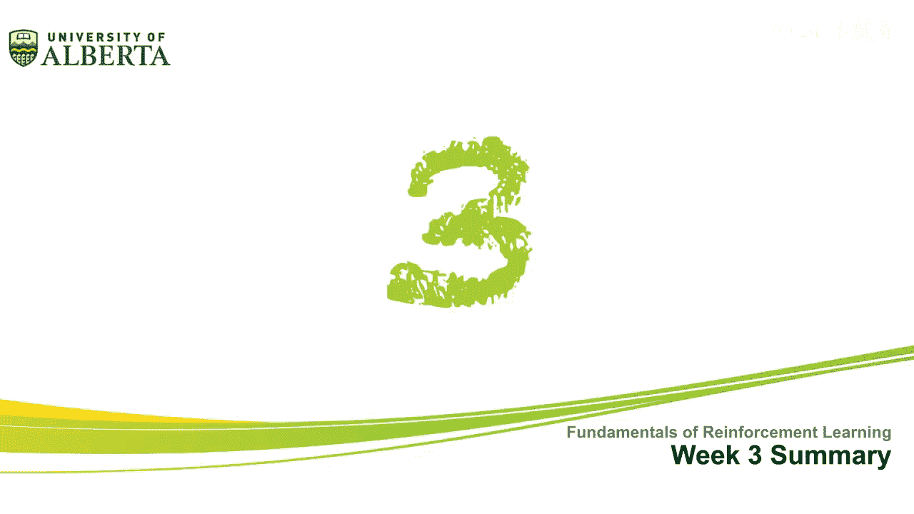
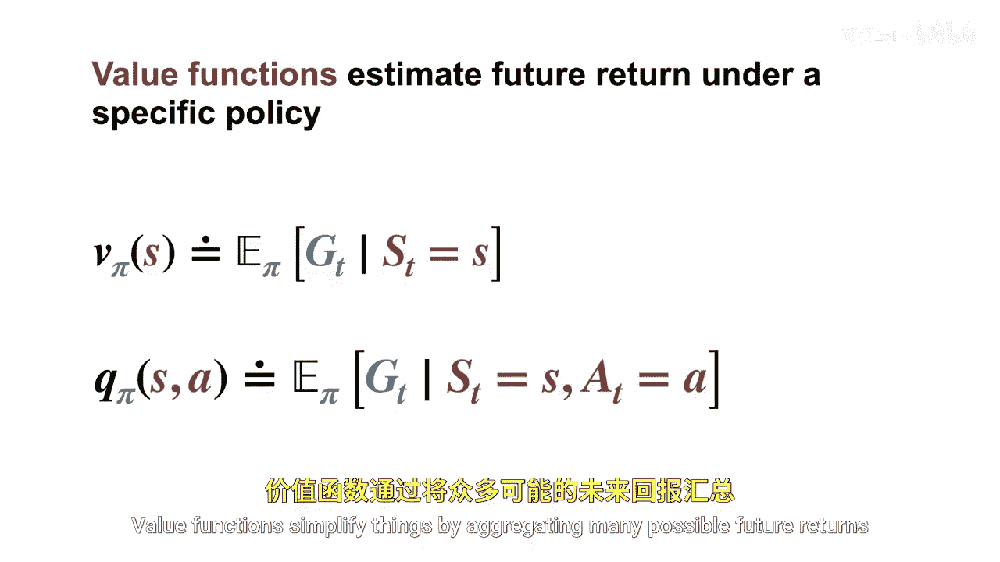
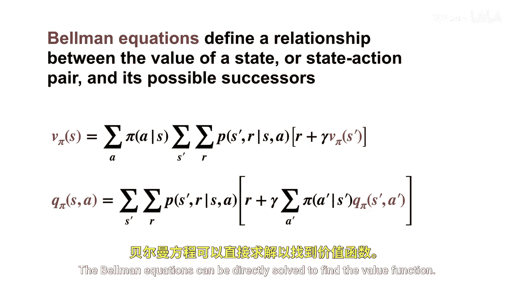

# 阿尔伯塔大学【中英⚡强化学习｜Reinforcement Learning Specialization】 p28 P28 04_第三周总结 -BV1CdGrzuEJU_p28-

This week we learned all about policies， value functions， and the relationships between them。

We also learned about Belelman equations， which help us reason about the value of policies。

In this video， we'll do a quick recap of everything we covered。Palicies tell an agent how to behave。

Deterministic policies map each state to an action。Each time a state is visited。

 a deterministic policy selects the associatedso action pi of S。

Sttochastic policies map each state to a distribution over all possible actions。

Each time state is visited， a stochastic policy randomly draws in action from the associated distribution with probability pi of a given S。

A policy by definition depends only on the current state。

It cannot depend on things like time or previous states。

This is best thought of as a restriction on the state， not the agent。

The state should provide the agent with all the information it needs to make a good decision。

This is an important assumption for many of the techniques in reinforcement learning。

Value functions are like magic。 Value functions capture the future total reward under a particular policy。

😊，We discuss two kinds of value functions， state value functions， and action value functions。

The state value function gives the expected return from the current state under a policy。

 the action value function gives the expected return from state S if the agent first selects action A and follows pi after that。

Value functions simplify things by aggregating many possible future returns into a single number。

Belman equations define a relationship between the value of a state or state action pair and its successor states。

The bellman equation for the state value function gives the value of the current state as a sum over the values of all the successor states and immediate rewards。

The Belllman equation for the action value function gives the value of a particular state action pair as the sum over the values of all possible next state action pairs and rewards。

The Belman equations can be directly solved to find the value function。

These Belelman equations help us evaluate policies。

But they do not yet achieve our ultimate goal to find a policy that attains as much reward as possible。

To make this goal more precise， we defined optimal policies， the optimal value function。

 and the associated Belllman optimality equations。An optimal policy is a policy which achieves the highest value possible in every state。

There is always at least one optimal policy， but there may be more than one。

The optimal state value function is equal to the highest possible value in every state。

Every optimal policy shares the same optimal state value function。

The same is true for optimal action value functions and optimal policies。Like all value functions。

 the optimal value functions have Belelman equations。

These Belelmon equations do not reference a specific policy。

This amounts to replacing the policy in the Belman equation with a max overall actions。

The Al policy must always select the best available action。

We can extract the optimal policy from the optimal state value function。But to do so。

 we also need the one step dynamics of the MDP。We can get the optimal policy with much less work if we have the optimal action value function。

We simply select the action with the highest value in each state。

Next week we will see how to compute optimal policies using these bowelman equations， See then。

