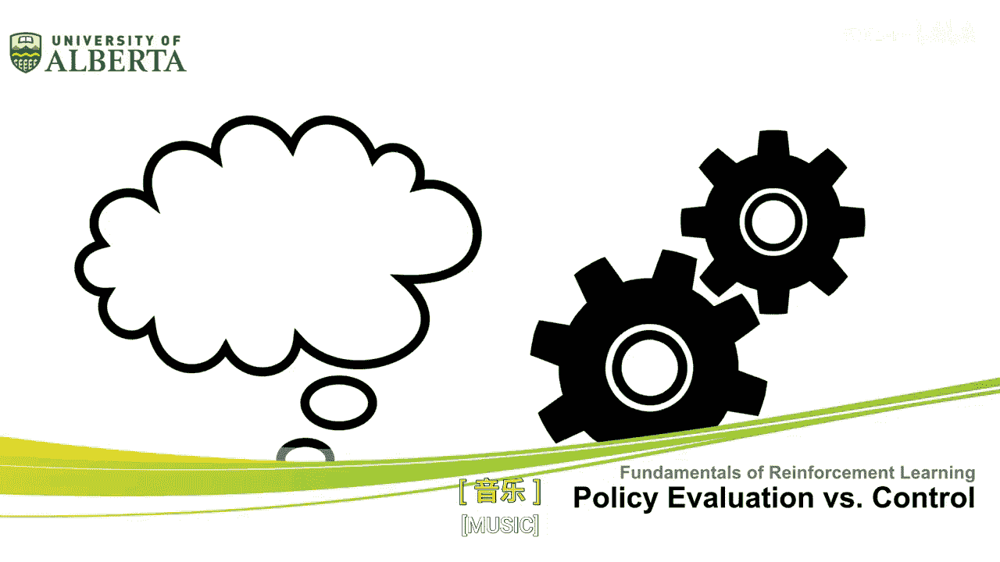
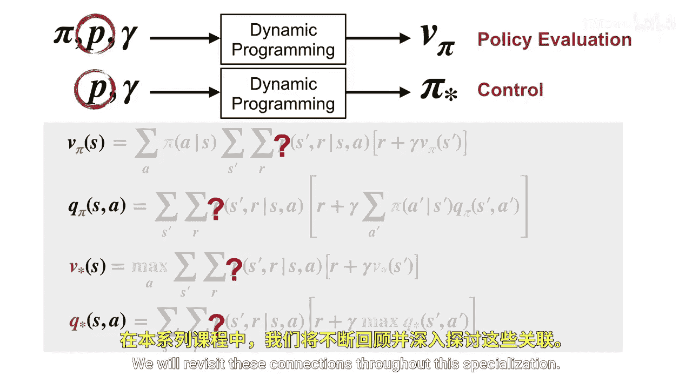

# 阿尔伯塔大学【中英⚡强化学习｜Reinforcement Learning Specialization】 p29 P29 03_策略评估与策略控制 -BV1CdGrzuEJU_p29-

We often talk about two distinct tasks， policy evaluation and control。

Policy evaluation is the task of determining the value function for a specific policy。

Control is the task of finding a policy to obtain as much reward as possible。In other words。

 finding a policy which maximizes the value function。

Control is the ultimate goal of reinforcement learning。

But the task of policy evaluation is usually a necessary first step。

It's hard to improve our policy if we don't have a way to assess how good it is。This week。

 we will look at a collection of algorithms called dynamicy programming for solving both policy evaluation and control problems。

By the end of this video， you will be able to understand the distinction between policy evaluation and control。

And explain the setting in which dynamic programming can be applied as well as its limitations。

Dnamic programming algorithms use the Belman equations to define iterative algorithms for both policy evaluation and control。

Before diving into the details of this approach， let's take some time to clarify the two tasks。

Imagine someone hands you a policy and your job is to determine how good that policy is。

Policy evaluation is the task of determining the state value function V pi for a particular policy pi。

Recall that the value of a state under a policy pi is the expected return from that state if we act according to P。

The Red is itself a discounted sum of future rewards。

We have seen how the Belelmon equation reduces the problem of finding V Pi to a system of linear equations。

 one equation for each state。So the problem of policy evaluation reduces to solving this system of linear equations。

In principle， we could approach this task with a variety of methods from linear algebra。In practice。

 the iterative solution methods of dynamic programming are more suitable for general MDPs。

Control is the task of improving a policy recall that a policy pi 2 is considered as good as or better than pi 1。

If the value under pi 2 is greater than or equal to the value under pi 1 in every state。

We say pi2 is strictly better than pii1， if pi 2 is as good as or better than pi 1。

And there is at least one state where the value under pi 2 is strictly greater than the value under pi 1。

The goal of the control task is to modify a policy to produce a new one which is strictly better。

Moreover， we can try to improve the policy repeatedly to obtain a sequence of better and better policies。

When this is no longer possible， it means theres no policy which is strictly better than the current policy。

And so the current policy must be equal to an optimal policy。

 and we can consider the control task complete。Imagine we had access to the dynamics of the environment P。

This week is all about how we can use this knowledge to solve the tasks of policy evaluation and control。

😊，Even with access to these dynamics， we'll need careful thought and clever algorithms to compute value functions and optimal policies for the next several videos we will investigate a class of solution methods called dynamicy programming for this purpose。

Dynamic programming uses the various Baelman equations we've seen。

 along with knowledge of P to work out value functions and optimal policies。

Classical dynamic programming does not involve interaction with the environment at all； instead。

 we use dynamic programming methods to compute value functions and optimal policies given a model of the MDP。

Nonetheless， dynamic programming is very useful for understanding other reinforced learning algorithms。

 most reinforced learning algorithms can be seen as an approximation to dynamic programming without the model。

This connection is perhaps most striking in the temporal difference based dina planning algorithm that we cover in course2 we will revisit these connections throughout this specialization。

To summarize， policy evaluation is the task of determining the state value function V P for a policy pi control is the task of improving an existing policy。

And dynamic programming techniques can be used to solve both of these tasks if we have access to the Dna function P。

 See you next time where we will learn how to use dynamic programming for policy evaluation。

