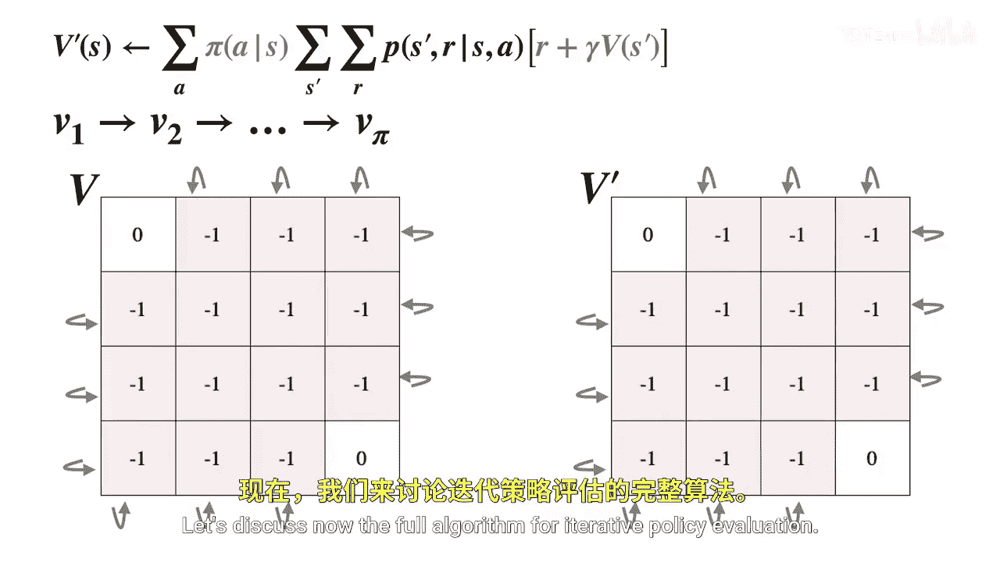
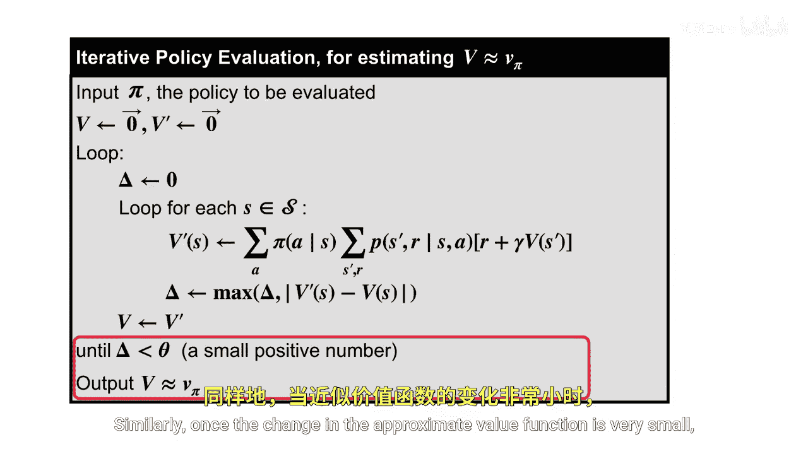
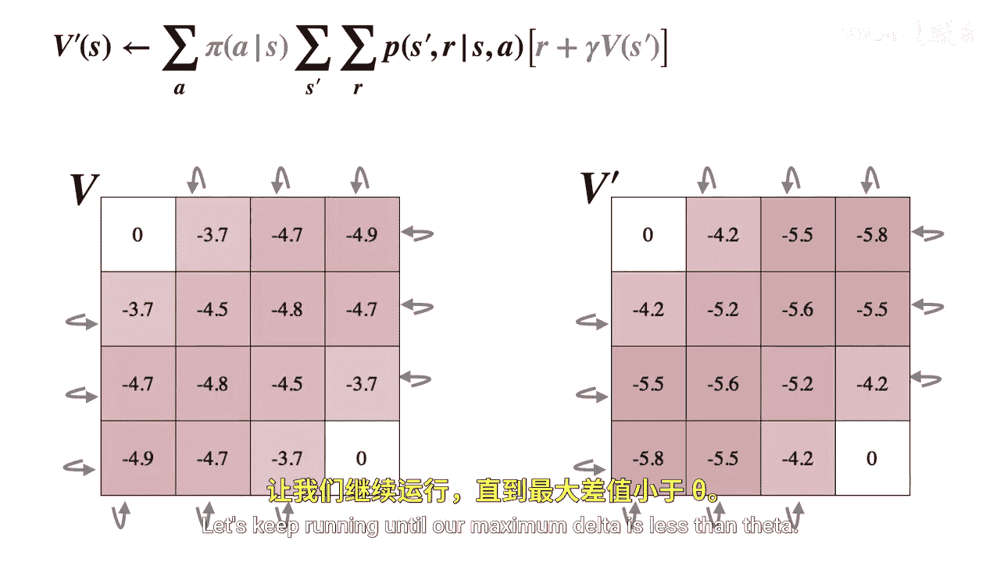
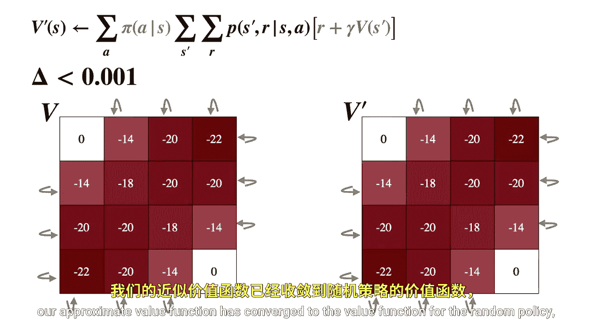

# 阿尔伯塔大学【中英⚡强化学习｜Reinforcement Learning Specialization】 p30 P30 04_迭代策略评估 -BV1CdGrzuEJU_p30-

Dynamic programming algorithms are obtained by turning the Belmon equations into update rules In this video。

 we will introduce the first of these algorithms called iterative policy evaluation。

By the end of this video， you will be able to outline the iterative policy evaluation algorithm for estimating state values for given policy。

And apply iterative policy evaluation to compute value functions。Remember。

 the Belmont equation gives us a recursive expression for V pi。

The idea of iterative policy evaluation is so simple that at first it might seem a bit silly。

We take the Belmon equation and directly use it as an update rule。Now。

 instead of an equation which holds for the true value function。

 we have a procedure we can apply to iteratively refine our estimate of the value function。

This will produce a sequence of better and better approximations to the value function。

Let's see visually how this procedure works。We begin with an arbitrary initialization for our approximate value function。

Let's call this V0。Each iteration then produces a better approximation by using the update rules shown at the top of the slide。

Each iteration applies this update to every state S in the state space， which we call a sweep。

Applying this update repeatedly leads to a better and better approximation to the state value function V pi。

If this update leaves the value function approximation unchanged。

 that is if Vk plus 1 equals VK for all states。Then VK equals v pi and we have found the value function。

This is because V Pi is the unique solution to the Belllman equation。

The only way the update could leave VK unchanged is if VK already obeys the Bellman equation。In fact。

 it can be proven that for any choice of v0， VK will converge to V Pi in the limit as K approaches infinity。

To implement iterative policy evaluation， we store two arrays， each has one entry for every state。

One array， which we label V stores the current approximate value function。Another array， V prime。

 stores the updated values。By using two arrays， we can compute the new values from the old one state at a time。

Without the old values being changed in the process。At the end of a full sweep。

 we can write all the new values into V。Then we do the next iteration。

It is also possible to implement a version with only one array。

 in which case some updates will themselves use new values instead of old。

This single array version is still guaranteed to converge and in fact will usually converge faster。

This is because it gets to use the updated values sooner。But for simplicity。

 we focus on the two array version。Let's look at how iterative policy evaluation works on a particular example。

Consider the4x four grid world shown here。This is an episodic MDP with the terminal state located in the top left and bottom right corners。

The terminal state is shown in two places， but formerly it is the same state。

The reward will be minus1 for every transition。Since the problem is episodic。

 let's consider the undiscounted case of gamma equals1。There are four possible actions in each state。

 up， down， left， and right。Each action is deterministic。

If the action would move the agent off the grid， it instead leaves the agent in the same state。

Now let's evaluate the uniform random policy， which selects each of the four actions one quarter of the time。

The value function represents the expected number of steps until termination from a given state。

The order we sweep through the states is not important since we are using the two array version of the algorithm。

Let's assume we sweep the states first from left to right and then from top to bottom。

We never update the value of the terminal state as it is defined to be zero。

We initialized all the values in V to0。The initial value stored and V prime are irrelevant since they will always be updated before they are used。

 we can now begin our first iteration with the update to state 1。To compute the update。

 we have to sum over all actions。 Consider the left action first。

 which has probability one quarter under the uniform random policy。

The D function P is deterministic here， so only the reward and value for a 1 S prime contributes to the sum。

The sum includes minus1 for the reward and zero for the value of the terminal state。

Since we initialized all state values to zero， and the reward freeze transition is minus1。

 the computation for all the other actions will look much the same。

The result is that v prime of state1 is set to minus1。Next， we move to state 2。

 We first evaluate the term in the sum for the left action。Again。

 the action probability is one quarter， and in this case the next state is state 1。

Although we have updated the value of state 1 already。

 the version of the algorithm we are running will use the old value stored in V。

So the value for state one in the update is still zero。Again。

 all the other actions will look much the same。The result is that v prime of state 2 is also set to minus1。

 In fact， since every state value is initialized to 0， every state's value will be set to minus1。

After completing this full sweep， we copy the updated values from v prime to V。

 This has been only one sweep。 Let's discuss now the full algorithm for iterative policy evaluation。

Take any policy we want to evaluate， initialize two arrays， V and v prime。

 We can initialize these however we like， but let's set them to zero。

We just saw how one sweep of iterative policy evaluation works。

 let's look at how we compute multiple sweeps and determine how the algorithm stops。

The outer loop continues until the change in the approximate value function becomes small。

We track the largest update to the state value in a given iteration， let's call this deelta。

The outer loop terminates when this maximum change is less than some user specified constant called theta。

As discussed before， once the approximate value function stops changing， we have converged to VPI。

Similarly， once the change in the approximate value function is very small。

 this means we are close to VPI。

Let's pick up where we left off in our grid world example， we had just completed our first sweep。

Let's use a value of 0。001 for the stopping parameter theta。The smaller the value we choose。

 the more accurate our final value estimate will be。

We've already completed one iteration and the maximum change in value was 1。0。

Since this is greater than 0。001， we carry on to the next iteration after the second sweep。

 notice how the terminal state starts to influence the value of the nearest states first。

Let's run one more sweep。We see that now the influence of the terminal state has propagated further。

Let's run a few more sweeps to see what happens。We can start to see how the value of each state is related to its proximity to the terminal state。

Let's keep running until our maximum delta is less than theta。

Here is the result we eventually arrive at。 Our approximate value function has converged to the value function for the random policy。

And we're done。That's it for this video， you should now understand how we can turn the Belelman equation into an update rule to iteratively compute value functions。

Soon we will see how these ideas can also be used for policy improvement。 See you next time。

