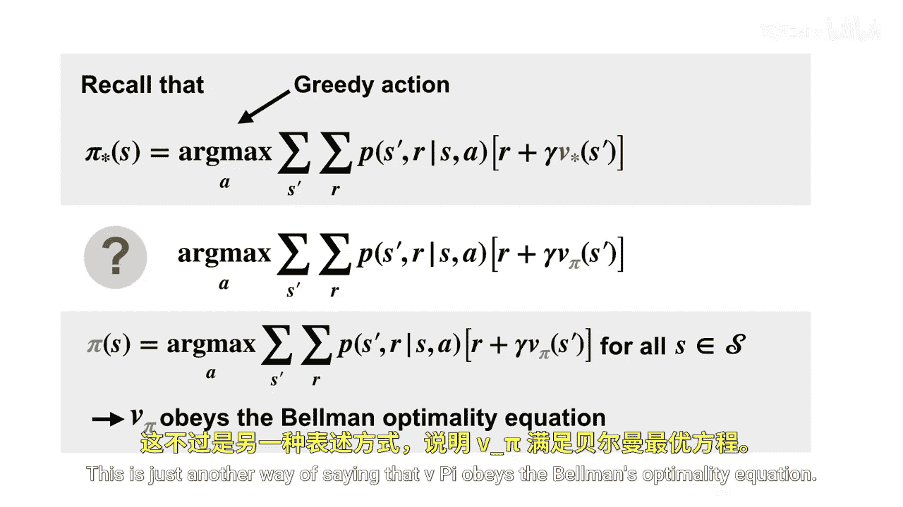
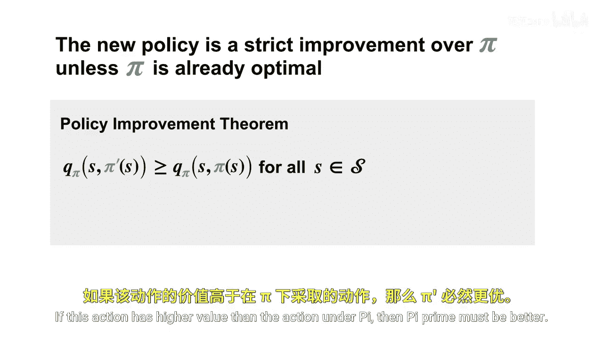
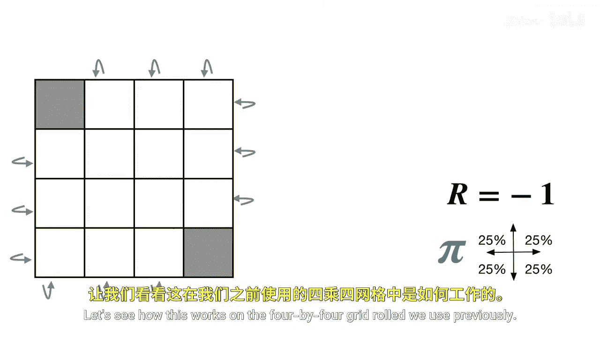
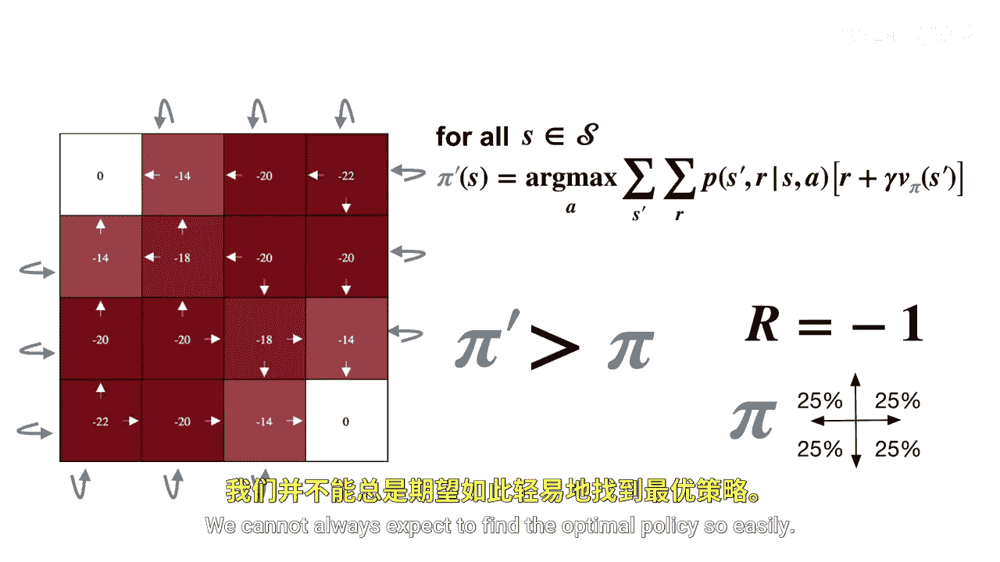

# 阿尔伯塔大学【中英⚡强化学习｜Reinforcement Learning Specialization】 p31 P31 01_策略改进 -BV1CdGrzuEJU_p31-

We just looked at how dynamic programming can be used to iteratively evaluate a policy。

We hinted that this was the first step towards the control task where the goal is to improve a policy。

In this video， we'll finally explain how this works。By the end of this video。

 you will be able to understand the policy improvement theorem。

And how it can be used to construct improved policies and use the value function for a policy to produce a better policy。

Previously， we showed that given V star， we can find the optimal policy by choosing the greedy action。

The greedy action maximizes the Belman optimality equation in each state。

Imagine instead of the optimal value function， we select an action which is greedy with respect to the value function V pi of an arbitrary policy pi。

What can we say about this new policy that is greedy with respect to VP？

The first thing to note is that this new policy must be different than pi。

If this gratification doesn't change pi， then pi was already greedy with respect to its own value function。

This is just another way of saying that VP obeys the Belman optimality equation。

In which case， pi is already optimal。In fact， the new policy obtained in this way must be a strict improvement on pie unless pie was already optimal。

This is a consequence of a general result called the policy Improvement theorem。

Recall the definition of Q pi。It tells you the value of a state if you take action A and then follow policy pi。

Imagine we take action A according to P Prime and then follow policy P。

If this action has higher value than the action under pi， then pi prime must be better。

The policy improvement theorem formalizes this idea。Policy pi prime is at least as good as pi。

 if in each state。The value of the action selected by pi prime is greater than or equal to the value of the action selected by pi。

Policy pi prime is strictly better if the value is strictly greater in at least one state。

Let's see how this works on the 4x4 grid world we used previously。

Here's the final value function we found。 Remember that this is the value function for the uniform random policy。

Now， what might the greedtified policy look like？In each state。

 we need to select the action that leads to the next state with the highest value。In this case。

 the value that is least negative。Here's P prime。This is quite different from the uniform random policy we started with。

Note that the values shown here do not correspond to the values for pi prime。

The new policy is guaranteed to be an improvement on the uniform random policy we started with。

 according to the policy improvement theorem。In fact， if we look more closely at the new policy。

 we can see that it is in fact optimal。In every state。

 the chosen actions lie on a shortest path to the terminal state。Remember。

 the value function we started with was not the optimal value function。

And yet the gry policy with respect to v pie is optimal。More generally。

 the policy improvement theorem only guarantees that the new policy is an improvement on the original。

We cannot always expect to find the optimal policy so easily。

That's it for this video You should now understand that the policy improvement theorem tells us that a gratified policy is a strict improvement。

Unless the original policy was already optimal。You should also now know how to use the value function under a given policy to produce a strictly better policy。

Next time we will discuss how to use this result to create an iterative dynamic programming algorithm to find the optimal policy See you then。

