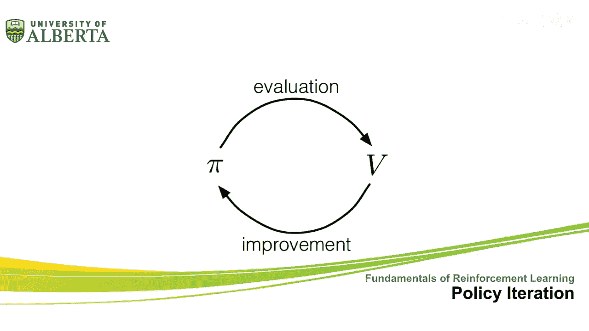
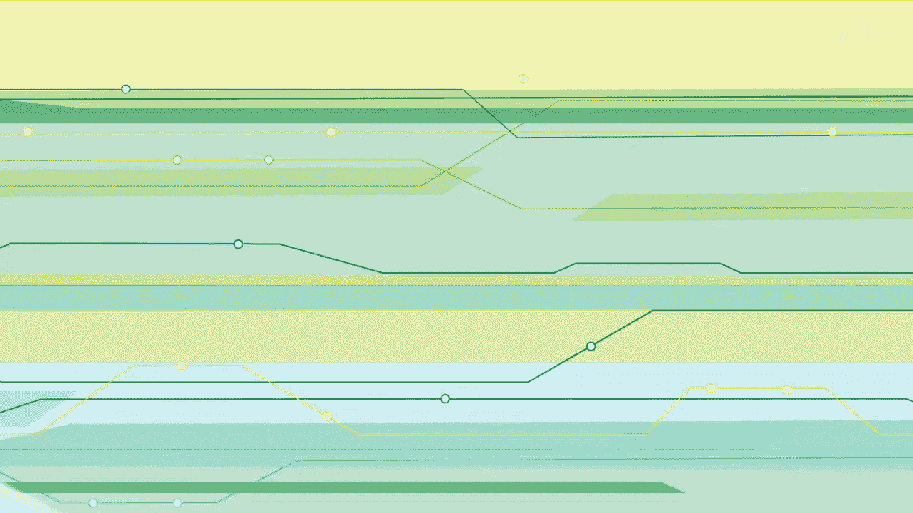
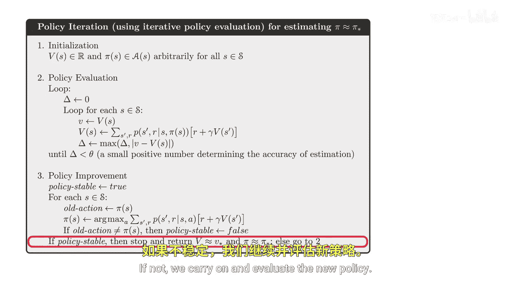
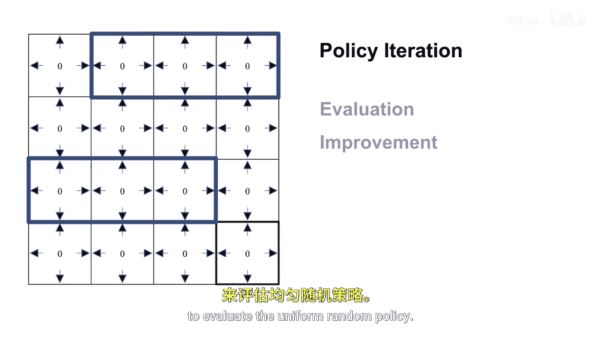
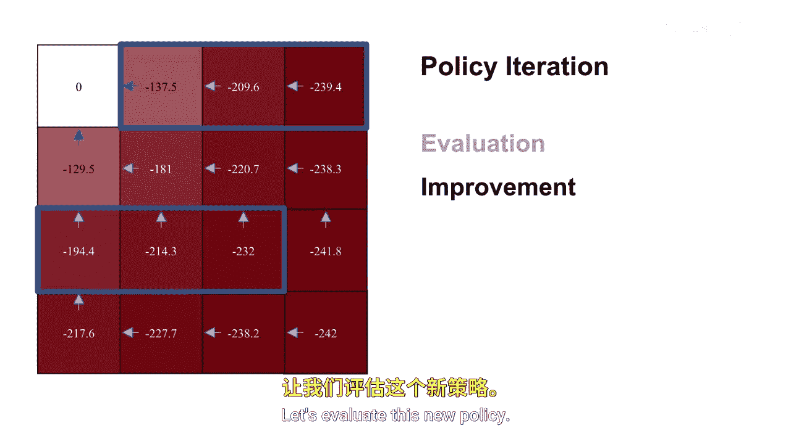
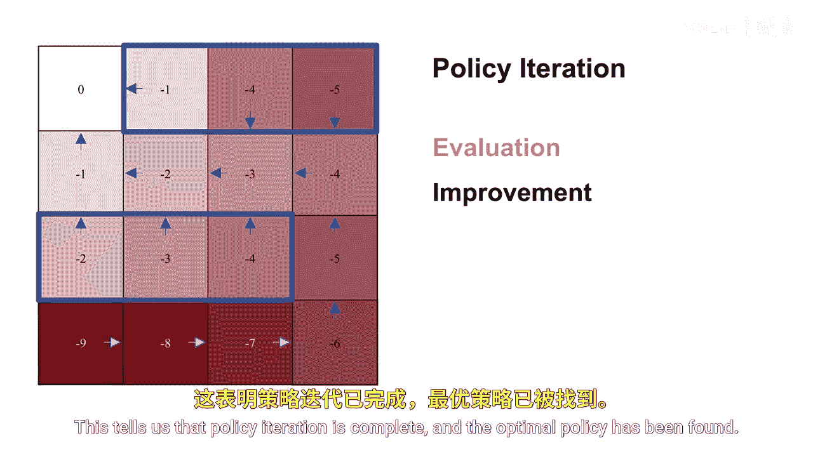

# 阿尔伯塔大学【中英⚡强化学习｜Reinforcement Learning Specialization】 p32 P32 02_策略迭代 -BV1CdGrzuEJU_p32-

We just learned how the value function computed for a given policy can be used to find a better policy。

In this video， we will show how we can use this to find the optimal policy by iteratively evaluating and proving a sequence of policies。

By the end of this video， you will be able to outline the policy iteration algorithm for finding the optimal policy。

Understand the dance of policy and value， how policy iteration reaches the optimal policy by alternating between evaluating policy and improving it。

And apply policy iteration to compute optimal policies and optimal value functions。

Recall the policy improvement theorem。 It tells us that we can construct a strictly better policy by acting greedily with respect to the value function of a given policy unless the given policy was already optimal。

Let's say we begin with the policy pi1。We can evaluate pi 1 using iterative policy evaluation to obtain the state value V pi 1。

We call this the evaluation step。Using the result of the policy improvement theorem。

 we can then gratify with respect to V pi1 to obtain a better policy pi2 We call this the improvement step。

We can then compute V pi2。And use it to obtain an even better policy pi3。

This gives us a sequence of better and better policies。

Each policy is guaranteed to be an improvement on the last unless the last policy was already optimal。

So when we complete an iteration and the policy remains unchanged。

 we know we have found the optimal policy。 At that point， we can terminate the algorithm。

Each policy generated in this way is deterministic；

 there are finite number of deterministic policies。

So this iterative improvement must eventually reach an optimal policy。

This method of finding an optimal policy is called policy iteration。

Policy iteration consists of two distinct steps repeated over and over， evaluation and improvement。

We first evaluate our current policy pi1， which gives us a new value function that accurately reflects the value of pi 1。

The improvement step then uses V pi 1 to produce a greedy policy pi 2 at this point。

 pi 2 is greedy with respect to the value function of pi 1。

 but v pi 1 no longer accurately reflects the value of pi 2。

The next step of valuation makes our value function accurate with respect to the policy pi2。

Once we do this， our policy is once again not greedy。

This dance of policy and value proceeds back and forth until we reach the only policy which is greedy with respect to its own value function。

 the optimal policy。At this point and only at this point。

 the policy is greedy and the value function is accurate。

We can visualize this dance as bouncing back and forth between one line where the value function is accurate and another where the policy is greedy。

These two lines intersect only at the optimal policy and value function。

Policy iteration always makes progress towards the intersection by projecting first onto the line V equals v pi and then onto the line where pi is greedy with respect to V。

Of course， the real geometry of the space of policies and value functions is more complicated。

 but the same intuition holds。Here's what this procedure looks like in pseudocode。

We initialize V and pi in any way we like for each state S。Next。

 we call iterative policy evaluation to make V reflect the value of pi。

This is the algorithm we learned earlier in this module。Then in each state。

 we set pi to select the maximizing action under the value function。

If this procedure changes the selected action in any state。

 we note that the policy is still changing and set policy stable to false。

After completing step three， we check if the policy is stable， if not。

 we carry on and evaluate the new policy。

Let's look at how this works on a simple problem to build some intuition。

Remember the4x4 grid rolled example we used to demonstrate iterative policy evaluation。Previously。

 we showed that by evaluating the random policy and gratifying just once。

 we could find the optimal policy， this is not a very interesting case for policy iteration。

Let's modify this problem a little bit to make the control task a bit harder。First。

 let's remove one of the terminal states so that there is only one way to end the episode。

Previously each state emitted a reward of minus1， instead let's add some especially bad states。

These bad states are marked in blue。Transitioning into them gives a reward of negative 10。

The optimal policy should follow the winding low cost path in white to the terminal state。

This additional complexity means that policy iteration takes several iterations to discover the path。

 Let's see how this plays out。First， we initialize the policy and value function as before we choose the uniform random policy and set the value estimate to zero for all states。

The first step is to use iterative policy evaluation to evaluate the uniform random policy。

Since we've seen how this works before， let's skip straight to the result。

The values are quite negative everywhere， though slightly less so in states near the goal。

Next we perform the improvement step。You've seen how gratification works before。

 so again let's skip to the result。Notice that near the terminal state。

 the policy correctly follows the low cost path toward the terminal state。

In the states in the bottom row， however， the policy instead takes the more direct but lower value path through the bad states。

Let's evaluate this new policy。

Notice how after just one improvement， the values are starting to look much more reasonable。

But we aren't finished yet。Let's gratify again。Remember。

 the policy improvementrov theorem tells us that this new policy is an improvement on the last one unless we have already reached the optimum。

Specifically， the bottomized state now goes straight up along the low cost path。

One more step of policy evaluation reflects this change。

The value of the bottom right state goes from minus 15 to just minus6。

Let's keep going until we reach the optimal policy。

One more step of improvement improves action selection and yet another state。

 The next step of policy evaluation reflects this change。Improve again。😊，And evaluate。And improve。

Now we can see that the policy has reached the optimum and follows the low cost path avoiding the blue states。

Evaluating one more time gives us the optimal value function。If we try to gratify again。

 the policy remains unchanged。 This tells us that policy iteration is complete and the optimal policy has been found。

This example shows the power of policy iteration in that it guarantees we can follow a sequence of increasingly better policies until we reach an optimal policy。

Policy iteration cuts through the search space， which is key when the optimal policy is not straightforward。

 in this case， literally。The same kind of complexity will come up in problems we really care about。

In this week's assessment， you will have a chance to implement policy iteration on a slightly more realistic example。

That's it for this video， you should now understand how policy iteration works by alternating between policy evaluation and policy improvement。

And how policy iteration follows a sequence of better and better policies and value functions until it reaches the optimal policy and optimal value function。

See you next time。