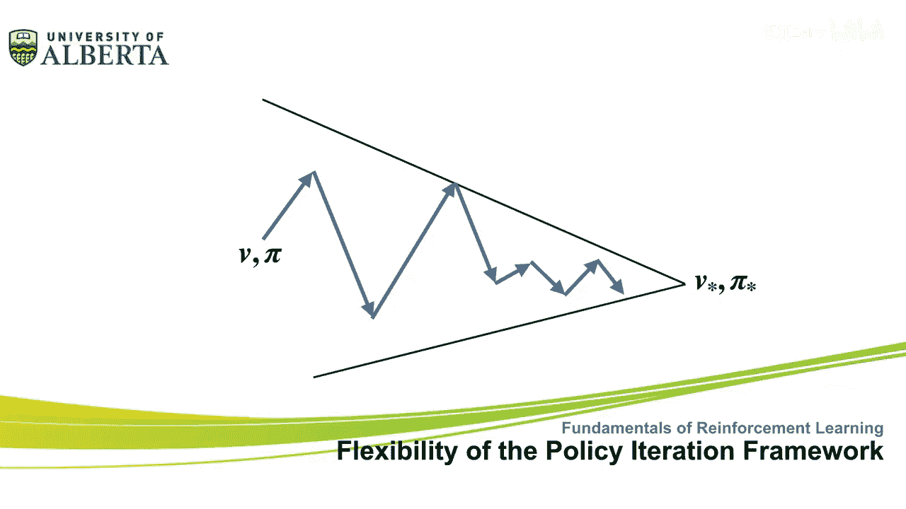
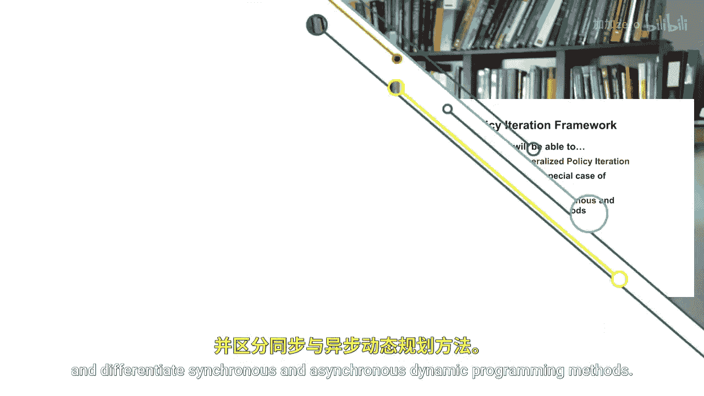
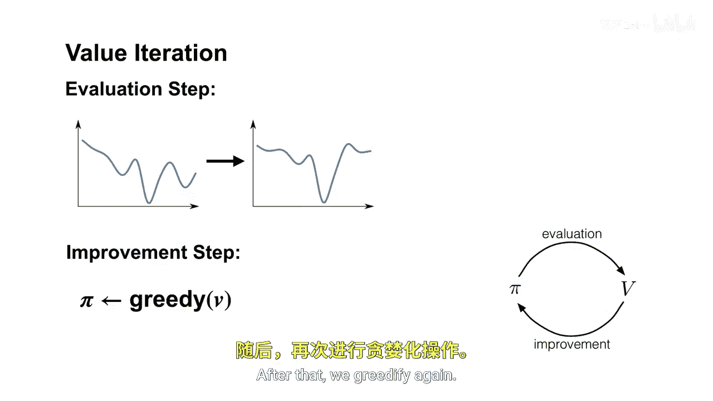
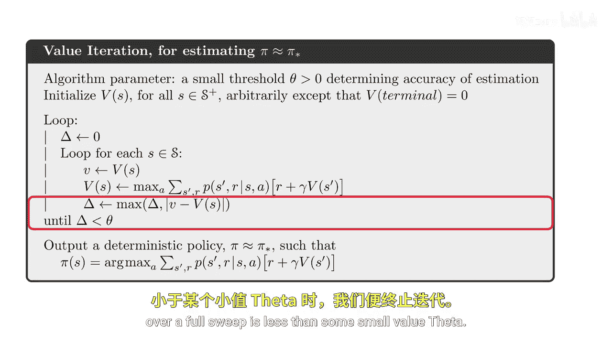

# 阿尔伯塔大学【中英⚡强化学习｜Reinforcement Learning Specialization】 p33 P33 01_策略迭代框架的灵活性 -BV1CdGrzuEJU_p33-

So far， we presented pulse iteration as a fairly rigid procedure。

We alternate between evaluating the current policy and gratifying to improve the policy。

The framework of generalized policy durationeration allows much more freedom than this while maintaining our optimality guarantees。

In this video， we will outline some of these alternatives。By the end of this video。

 you will be able to understand the framework of generalized pulse iteration。Outline value duration。

 an important special case of generalized policy duration。And。

Differentiate synchronous and asynchronous dynamic programming methods。

Recall the dance of policy and value。The policy duration algorithm runs each step all the way to completion。

Intuitively， we can imagine relaxing this。Imagine instead we follow a trajectory like this。

Each evaluation step brings our estimate a little closer to the value of the current policy。

 but not all the way。Each policy improvement step makes our policy a little more greedy。

But not totally greedy。Intuitively， this process should still make progress towards the optimalimum policy and value function。

In fact， the theory tells us the same thing。We will use the term generalized policy iteration to refer to all the ways we can interleave policy evaluation and policy improvement。

This brings us to our first generalized policy iteration algorithm called value iteration。

In value iteration， we still sweep over all the states and gratify with respect to the current value function。

However， we do not run policy evaluation to completion。We perform just one sweep over all the states。

After that， we gratify again。

We can write this as an update rule which applies directly to the state value function。

The update does not reference any specific policy， hence the name value iteration。

The full algorithm looks very similar to iterative policy valuation。

 Instead of updating the value according to a fixed policy。

 we update using the action that maximizes the current value estimate。

Value iteration still converges to V star in the limit。

We can recover the optimal policy from the optimal value function by taking the AGm。In practice。

 we need to specify a termination condition because we can't wait forever。

We will use the same condition we use for policy evaluation。

 We simply terminate when the maximum change in the value function over a full sweep is less than some small value theta。

Value iteration sweeps the entire state space on each generation， just like policy iteration。

Methods that perform systematic sweeps like this are called synchronous。

This can be problematic if the state space is large。Every sweep could take a very long time。

Asynchronous dynamic programming algorithms update the values of states in any order。

They do not perform systematic sweeps。They might update a given state many times before another is updated even once。

In order to guarantee convergence， asynchronous algorithms must continue to update the values of all states。

Here， for example， the algorithm updates the same three states forever， ignoring all the others。

This is not acceptable because the other states cannot be correct if they are never updated at all。

Asynchronous algorithms can propagate value information quickly through selective updates。

 Sometimes this can be more efficient than a systematic sweep。For example。

 an asynchronous method can update the states near those that have recently changed value。

That's it for this video。You should now understand that value iteration allows us to combine policy evaluation and improvement in a single step。

Asynchronous dynamic programming methods give us freedom to update states in any order。

 and the idea of generalized policy iteration unifies many algorithms。 This includes value iteration。

 asynchronous dynamic programming and almost all the methods you will cover in this specialization。

 See you next time。