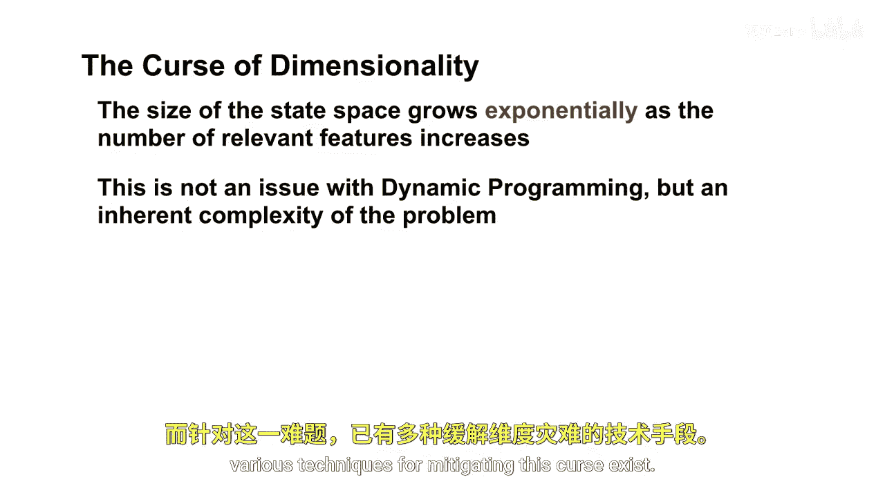

# 阿尔伯塔大学【中英⚡强化学习｜Reinforcement Learning Specialization】 p34 P34 02_动态规划的效率 -BV1CdGrzuEJU_p34-

We spent the last few videos discussing how dynamic programming methods can allow us to compute value functions and policies。

 but how useful are these methods really？How do they compare to simple alternatives In this video。

 we will talk about some of the other possible solution strategies。By comparison。

 dynamic programming is actually surprisingly efficient。By the end of this video。

 you'll be able to describe Monte Carlo sampling as an alternative method for learning a value function。

Describe brute force search as an alternative method for finding an optimal policy。

And understand the advantages of dynamic programming and bootstrapping over these alternatives。

iterative policy evaluation is the dynamic programming solution to the prediction or policy evaluation problem。

Let's look at a sample based alternative for policy evaluation。

The value of each state can be treated as a totally independent estimation problem。First。

 recall that the value is the expected return from a given state。The procedure is simple。 First。

 we gather a large number of returns under pi and take their average。

This will eventually converge to the state value。This is called a Monte Carlo method。However。

 if we do it this way， we may need a large number of returns from each state。

Each return depends on many random actions selected by Pi。

 as well as many random state transitions due to the dynamics of the MDP。

We could be dealing with a lot of randomness year。Each return might be very different than the true state value。

So we may need to average many returns before the estimate converges。

And we have to do this for every single state。The key insight of dynamic programming is that we do not have to treat the evaluation of each state as a separate problem。

 we can use the other value estimates we have already worked so hard to compute。

This process of using the value estimates of successor states to improve our current value estimate is known as bootstrapping。

 this can be much more efficient than a Monte Carlo method that estimates each value independently。

Policy iteration computes optimal policies。Brte For search is a possible alternative。

This method simply evaluates every possible deterministic policy one at a time。

 we then pick the one with the highest value。There are a finite number of deterministic policies。

 and there always exists in optimal deterministic policy。

So brute force search will find the answer eventually。However。

 the number of determin policies can be huge。A deterministic policy consists of one action choice per state。

 so the total number of deterministic policies is exponential in the number of states。

Even on a fairly simple problem， this number could be massive。

This process could take a very long time。The policy improvement theorem guarantees that policy duration will find a sequence of better and better policies。

 This is a significant improvement over exhaustively trying each and every policy。

So how efficient is dynamic programming compared to these naive alternatives？Well。

 policy iteration is guaranteed to find the optimalim policy in time polynomial in the number of states and actions。

Thus， dynamic programming is exponentially faster than the brute force search。Of the policy space。

In practice， dynamic programming is usually much faster even than this worst case guarantee。

For example， the original4 by4 grid world converged in just one step of policy iteration。

When we made the problem harder by adding bad states， it still converged in just five iterations。

It might also seem restrictive that we have to run policy evaluation to completion for each step of policy iteration。

In practice， this is not so bad。With each iteration， the policysy tends to change less and less。

The pulse evaluation step changes the value function less。

 and thus the evaluation step typically terminates quickly。Generally。

 solving an MDVP gets harder as the number of states grows。

The curse of dimensionality says that the size of state space grows exponentially as the number of state variables increases。

 a signal agent moving round a grid world is fine。 But what if we want to coordinate a transportation network of thousands of drivers moving between hundreds of locations。

 A raw enumeration of the possible states could lead to an exponential blow up。😊，Clearly。

 this would lead to problems if we try to sweep the states to perform policy iteration。In fact。

 this is not an issue with dynamic programming。This is a statement about the difficulty of the problems we are interested in tackling。

Various techniques for mitigating this curse exist。

 and we will continue to deal with this curse for the remainder of our time together。

That's it for this video。The most important takeaway is that bootstrapping can save us from performing a huge amount of unnecessary work by exploiting the connection between the value of a state and its possible successors。

See you next time。

