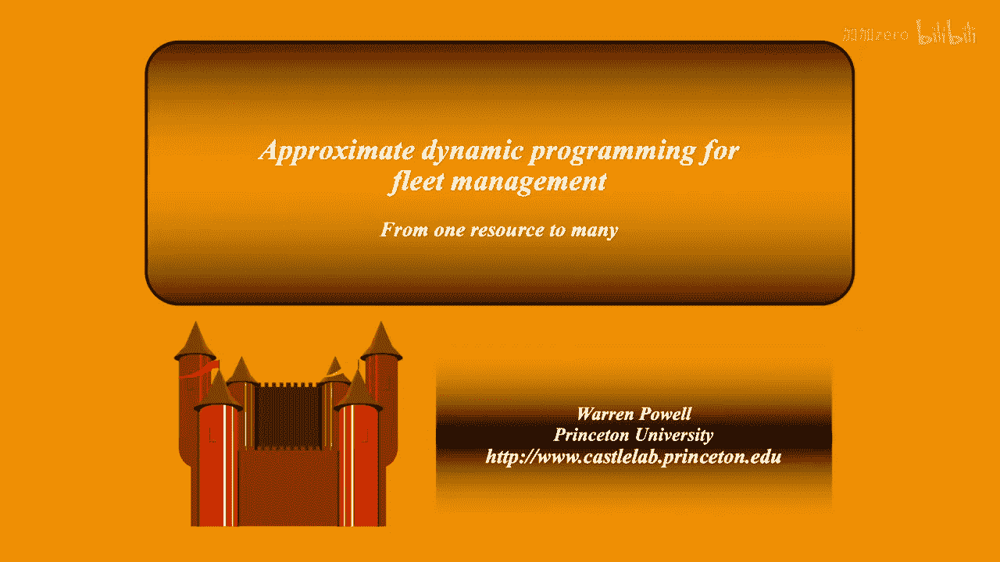

# 阿尔伯塔大学【中英⚡强化学习｜Reinforcement Learning Specialization】 p35 P35 03_沃伦·鲍威尔《车队管理中的近似动态规划简论》 -BV1CdGrzuEJU_p35-

I'm going to illustrate how to use approximate amic programming and reinforcement learning to solve high dimensionmenal problems This is something that arose in the context of truckload trucking think of this as Uber or live for a truckload freight where a truck moves the package from an entire load of freight from a to B from one city to the next here we have to pick the best driver on the left to assign to the best load on the right we don't have to move all the loads and I have to think about where the load's going and what might happen which is uncertain let's imagine that we just have one truck driver so this is the easier problem imagine that we're a new truck driver we're starting off in Texas。

And somebodybody's come along and shown us four loads of freight and I have to pick the best one to move each of the loads that go into different destinations I've never been to before my estimate of the downstream value of these destinations is  zero because I'm brand new of these。

 I'm going to look at all of them and say gee， the Lo go into New York is $450 that looks best。

 I'll pick that one。AndBefore I move I'm going to update the value of being in Texas to $450 because that's how much I made because the 450 I'm going to add it to the downstream value of 0。

 Now let's move to New York repeat the whole process all over again now to go back to Texas I would add the 125 to the 450 to get3 575 but there's load going to California making $600 so I'm going to take that one so now we do the value of New York is $600 go to California now I'm looking at various locations。

 one load is $400 going to Minnesota but I've never been to Minnesota so my best estimate of that is0 just because I've never been there so we're going to come back to that problem but for the moment the best load looks like the one going to Texas because I'm going to add the $350 to the downstream $450 to get $800 so we're going to go to Texas now I'm in Texas once again I'm looking at various loads there's one going to Colorado I've never been to Colorado but it's $800 the last time I was in Texas they made 4。

Let's go ahead and say the old estimate of the value being in Texas is $450 but now I've got this $800 load what I'm going to do is smooth these two I'm going to say use a smoothing factor of 0。

1 a learning rate step size to some where I'm going to take one minus the step size so I get a number 0。

9 times the old estimate plus 0。1 times the new estimate gives me an updated estimate of the value being in Texas of 485 so this is my updated estimate now this is classic approximate programming reinforcement learning the RL community has many variations of what I just showed you one of which would fix issues like ge why didn't I go to Minnesota because maybe I should have gone to Minnesota but this is also methods that will only work on one truck。

What if I have a fleet of trucks and I'm actually a trucking company so let's imagine I have a grid。

 a five by five grid so there's 25 locations to go to and so my truck can be in any one of these 25 locations。

But if I'm a trucking company and I have two trucks now my state is not what location my one truck is in。

 my state is the state of the fleet and I have all these different combinations of where to put two trucks and maybe I have six trucks and now I have all these permutations and combinations in fact as I grow this the formula for the number of states that my fleet can be in is given by this formula and as I grow the fleet size from one to five to 50 and if I grow my number of states or locations or attributes of the truck I can get this massively large number of states so classical discrete state representations best known in reinforcement learning which simply not work for a fleet of trucks So here I'm going to show you how to extend to a fleet of trucks let's imagine that I have a series set of drivers and loads and I have to assign drivers to loads this is an assignment problem So here are my drivers and here are my loads and。

Over time drivers will enterlea the system， new loads will be called in。

 I have to make those assignments in the future sequentially。

 and I need to think about those events that are going happen in the future to make the best decision now。

So let's take one truck now where I can look at two different loads and each one has a downstream value。

 I can take those downstream values， add it to the contribution that I earned from just making that initial assignment to a load and now I just have an simple assignment problem if I grow that to an entire fleet this would be a network problem I'll call it a linear program。

 there's packages for this Grobi， CX， these are available in Python if you're in a university these are free and you can solve very large problems very very quickly。

Now how do I do those transstream values because I know how to do the value of a truck。

 but how do I handle the fleet so here's what we're going to do We're going to go ahead and solve our assignment problem。

 we're going to assign three drivers to three loads that fourth driver has nothing to do so he just stays and each one has a downstream value。

Now what I'm going to do is take away the first driver for example， so we're going to move it。

 resolve， now I'm going to get the change in the total contribution for the whole system。

 that's the marginal value of that one driver with attribute A1 and we're going to call that marginal value the hat。

 and so this is the difference between the total contribution over the whole system with and without the driver。

Now we're going to do the smoothing just like we did with one truck where we have the attributes of our oneDriver。

 we have the old smooth estimate vbar the V hat is the updated marginal value of the oneDriver and we get an updated smooth estimate of the marginal value now I have to do this for each driver okay so the thing is I'll have to loop over the drivers however it is also the case that if we can solve this as a linear program LP packages will give you this marginal value it's called a dual variable for free other instances you have to do these numerical derivatives yourself but it's all quite scalable and at the end what we can do is have these smooth estimates v bars now the vbar is not the value of a driver it's the marginal value of a driver but this is a linear program and I can scale this to0 it's even thousands of drivers this is the overall algorithm the green is the linear program where I have to call a solve。

To solve that x is a vector here the V hat is a vector as well the V hat is the marginal value of each of these drivers the blue is where I update these marginal values to V bars and the red is where I then simulate forward in time so let's illustrate that simulation so the blue squares here is my problem now with a value in the future I'm going to simulate my way into the future and I'm going to do this iteratively and over the iterations I'm going to get better and better estimates to these marginal values and the oval quality of solution tends to increase not uniformly you'll see some little hips and skips there but generally if you've got a well definedfined algorithm this will move forward。

This has been a very brief introduction to handling high dimensionional resource allocation problems if you go to the website jungle。

priton。edu， you'll get a lot more additional material。

 just look under educational materials for hints of how to program this look for the Python modules on my GiHub directory and look for the blood management problem and you'll see a nice illustration。

