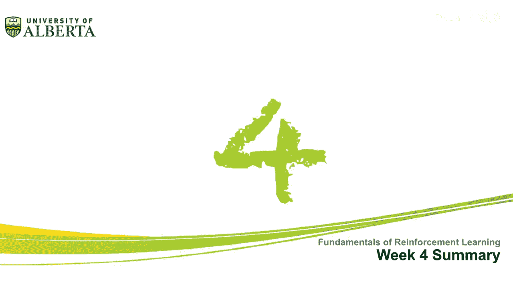
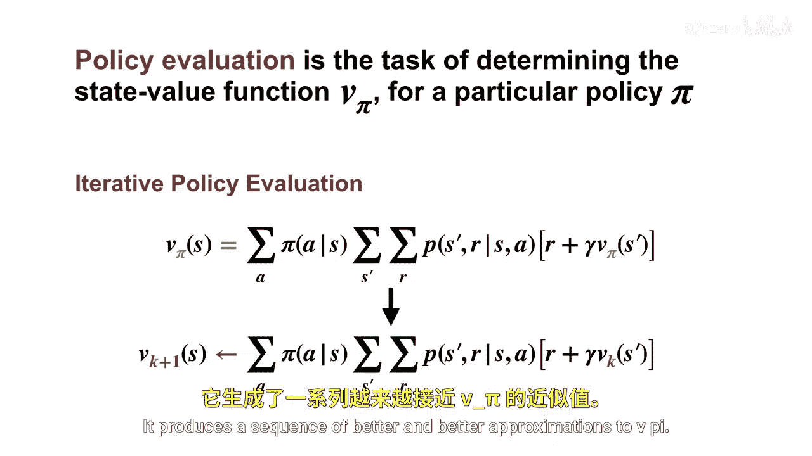
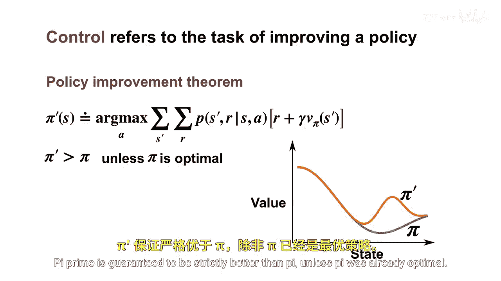
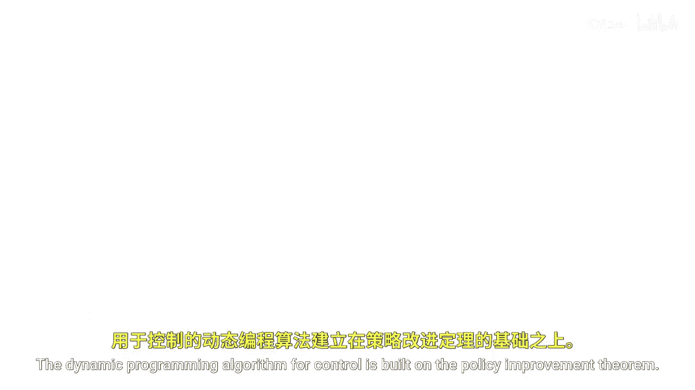

# 阿尔伯塔大学【中英⚡强化学习｜Reinforcement Learning Specialization】 p37 P37 05_第4周总结 -BV1CdGrzuEJU_p37-

This week we learned all about dynamic programming and how it can be used to solve the tasks of policy evaluation and control。

These algorithms form the foundation for reinforce learning algorithms that we will learn about later。

In this video， we'll do a quick recap of everything we covered。

Policy evaluation is the task of determining the state value function V P for a particular policy pi。

Iterative policy evaluation takes the Baalman equation for VP and turns it into an update rule。

It produces a sequence of better and better approximations to VP。

Control refers to the task of improving a policy。The policy improvement theorem tells us how to construct a better policy from a given policy。

The new policy pi Prime， is produced by simply gratifying with respect to the current values。

Pi Prime is guaranteed to be strictly better than pi unless pi was already optimal。

The dynamic programming algorithm for control is built on the policy improvement Theor。

This algorithm is called policy iteration。Policy duration consists of two steps。

 policy evaluation and policy improvement。In policy evaluation。

 we find the value function for the current policy。

Policy improvement or gratification then makes a policy greedy with respect to the current value function。

These steps are repeated over and over until the policy doesn't change。

 in which case the policy is guaranteed to be optimal。

We also discussed the framework of generalized policy durationeration。In generalized policy duration。

 the evaluation and improvement steps need not run to completion。

One example of generalized policy durationeration is value iteration。

Generalized policy iteration also includes asynchronous dynamic programming methods。

Synchronous methods repeatedly sweep over the entire state space。

Asynchronous methods are more flexible and they can update states in any order。

Asynchronous methods can more efficiently propagate value information。

This can be especially helpful when the state space is very large。

Asynchronous methods can be designed to focus on a few relevant states。In dynamic programming。

 we in some sense assume the best possible situation， we know exactly how the MDP works。

 and yet it still took considerable thought and clever algorithms to efficiently compute optimal policies。

We will continue to reap the benefits of this cleverness in almost all the algorithms we see in the remainder of this course。

