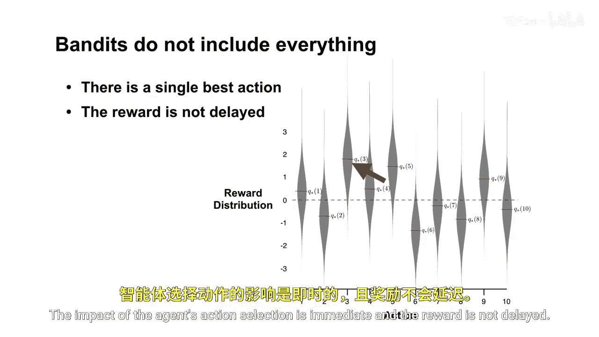
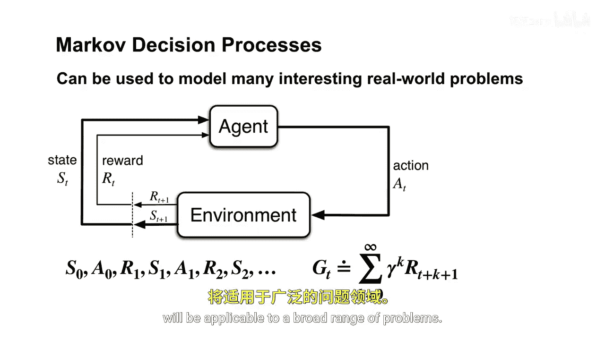
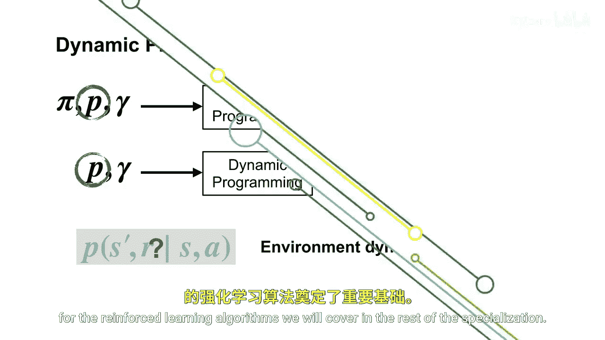

# 阿尔伯塔大学【中英⚡强化学习｜Reinforcement Learning Specialization】 p38 P38 01_恭喜 -BV1CdGrzuEJU_p38-

That brings us to the end of this course on the fundamentals of reinforcement learning congratulations you now have a solid foundation to dive into the concepts and algorithms we'll cover in the rest of this specialization。

We started off with an introduction to the idea of choosing actions to maximize reward in bandits。

In bandits we have a fixed set of actions or arms to choose from。

Each action gives us a reward according to some unknown distribution。

We would like to always pull the arm that provides the highest reward on average。

Since we don't know the reward distributions initially。

 we have to try each arm many times to get an idea of each average。

This brought us to the Expation exploitation tradeoff。Pull the arm that looks best now too much。

 and you might miss out on another better arm that only appeared worse due to insufficient information。

Spend too long exploring all the possibilities， and you might sacrifice exploiting an arm that you have good reason to believe has much higher value。

We talked about various strategies to handle this trade off。

Dealing with Bandits introduces many interesting questions。

 such as how to handle the explorationation exploitation tradeoff。However。

 bandits don't include everything。The KR banded problem presents the agent with the same situation at each time step。

There is a single best action and no need to associate different actions to different situations。

The impact of the agent's action selection is immediate and the reward is not delayed。

To better model the complexity of real world problems。

 we introduce Markov decision processes or MDPs。In NDPs。

 the action chosen by the agent impacts not only the immediate reward， but also the next state。

In turn， this affects the potential for future reward。So actions can have a long term consequence。

We introduced the idea of return， which is a potentially discounted sum of future rewards。

The MVP formalism can be used to model many interesting real world problems。

 The solution methods we explore in this specialization will be applicable to a broad range of problems。

The first step is always to frame your problem as an MDVP。

After introducing MDPs， we started to describe some of the basic concepts of reinforcement learning。

The policy tells the agent how to act in each state。

The value function estimates the expected future return for each state or each state action pair under a certain policy。

Belman equations link the value of each state or each state action pair to the value of its possible successors。

Finally， we introduce dynamic programming algorithms these algorithms provide methods for solving the two tasks of prediction and control。

As long as we have direct access to the environment dynamics。In the reinforcement learning problem。

 we will not assume we know the dynamics。 After all， in the real world。

 we can't always expect to know the effect of each of our actions until we try them。

Dynamic programming algorithms provide an essential foundation for the reinforcement learning algorithms we will cover in the rest of the specialization。

Give yourself a pat on the back for getting through all this material。

You now have all the background to understand the reinforcement learning setting。In the next course。

 we will discuss algorithms for estimating value functions and policies directly from experience。

These sample based learning algorithms do not require or even estimate the transition dynamics。

 Hope to see you there。