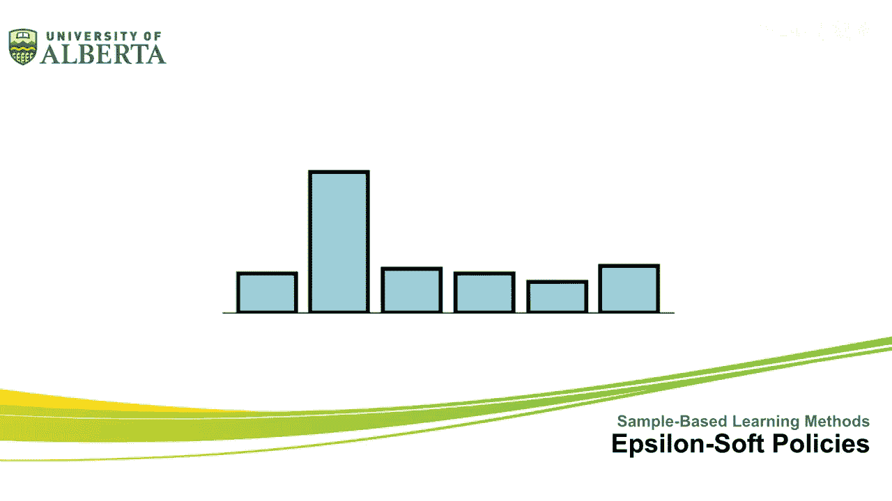
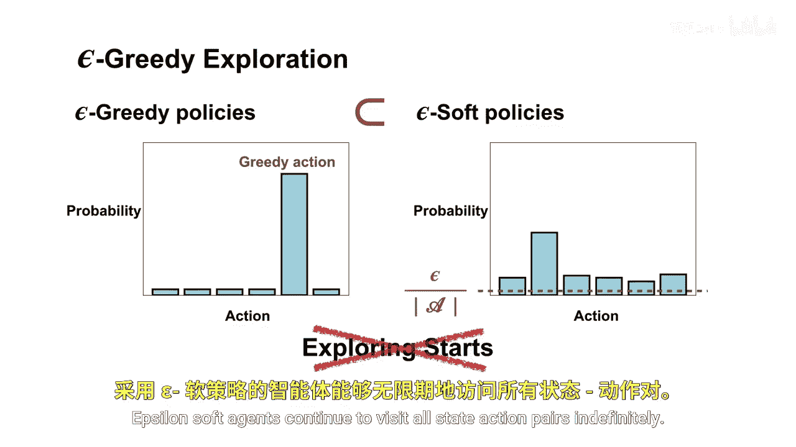
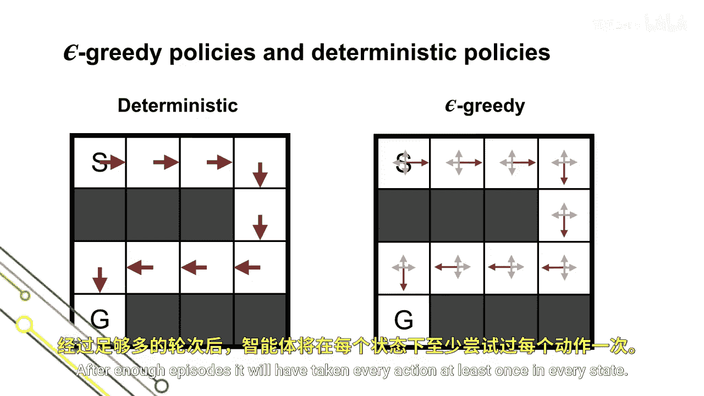
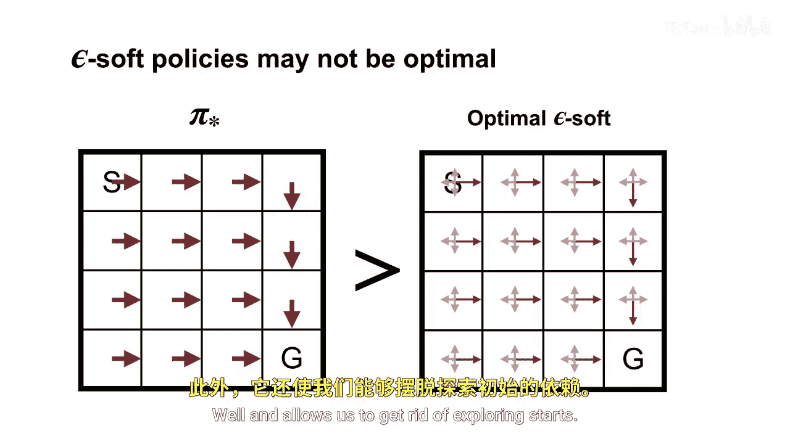
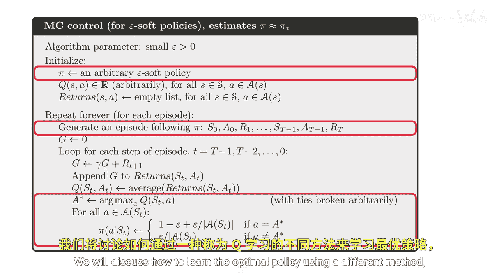

# 阿尔伯塔大学【中英⚡强化学习｜Reinforcement Learning Specialization】 p46 P46 01_ε-软策略 -BV1CdGrzuEJU_p46-

We've hinted how the assumptions underlying exploring starts might limit the applicability of Monte Carlo control。

In this video， we describe how to combine Epsilon greedy exploration with Monte Carlo to learn near optimal policies。

By the end of this video， you will understand why exploring starts can be problematic in real problems。

And you will be able to describe an alternative explorationiration method for Monte Carlo control。

Let's think about some situations where we cannot use exploring starts。

 this algorithm must be able to start from every possible state action pair。Otherwise。

 the agent may not explore enough and could converge to a suboptimal solution。In many problems。

 it can be difficult to randomly sample an initial state action pair。For example。

 how would you randomly sample the initial state action pair for a self driving car？

How could we ensure the agent can start in all possible states？

We would need to put the car in many different configurations in the middle of a busy freeway。

This would be dangerous and impractical。So how can we learn all the action values without exploring starts？

Remember Epsilon greedy exploration， we discussed this simple but effective method in the banded lectures。

We can use it with Monte Carlo too。As a quick recap， Epsilon greedy policies are stochastic policies。

 they usually take the greedy action， but occasionally take a random action。

Epsilon greedy policies are a subset of a larger class of policies called Epsilon So policies。

Epsilon So policies take each action with probability at least epsilon over the number of actions。

For example， both policies shown on the slide are valid Epsilon So policies。

The uniform randomand policy is another notable Epsilon So policy。

Epsilon So policies force the agent to continually explore；

 that means we can drop the exploring starts requirement from the Monte Carlo control algorithm。

An Epsilon soft policy assigns nonzero probability to each action in every state， because of this。

 Epsilon So agents continue to visit all state action pairs indefinitely。

Epsilon soft policies are always stochastic。Deterministic policies specify a single action to take in each state stochastic policies instead specify the probability of taking action in each state。

In Epsilon So policies， all actions have a probability of at least epsilon over the number of actions。

 they will eventually try all the actions。Let's look at an example of an epsilon greedy policy and a deterministic policy。

Here we have a grid world with the arrows representing the deterministic policy。From the start state。

 the agent will follow the exact same trajectory through the grip world。

The Epsilon greedy policy has more arrows because every action has some small probability of being selected。

Accordingly， the agent will probably follow a slightly different trajectory every episode。

After enough episodes， it will have taken every action at least once in every state。

This difference extends the solutions that we find by exploring with Epsilon soft policies。

If our policy always gives at least epsilon probability to each action。

 it's impossible to converge to a deterministic optimal policy。

Exploring starts can be used to find the optimalum policy。

But Epsilon soft policies can only be used to find the optimal Epsilon soft policy。

 that is the policy with the highest value in each state out of all the Epsilon soft policies。

This policy performs worse than the optimal policy in general， however。

 it often performs reasonably well and allows us to get rid of exploring starts。

Let's look at the pseudocode from Monte Carlo control with Epsilon So policies。

It's easy to understand this algorithm by highlighting how it differs from exploring starts。

There's one change to the initial conditions。One change to the policy evaluation step。

And one changed to the policy improvement step。The initial policy must be Epsilon So。

 such as the uniform random policy。The next change is how we use the policy to generate training data。

Since the agent's policy is epsilon soft， we don't have to rely on exploring starts for exploration。

Instead， the agent simply generates an episode following its Epson So policy。Finally。

 we improve the policy， the new policy is Epsilon greedy with respect to the current action value estimates。

You might think that this should be an Epsilon soft policy rather than Epsilon greedy。However。

 this makes sense because the optimal Epsilon soft policy is an Epsilon greedy policy。

Even though this algorithm may not find the optimal policy。

 it does find the optimal Epsilon So policy。In future videos。

 we will discuss how to learn the optimal policy using a different method called Q learning。

In this video， we talked about the practicality of exploring starts。

And discuss Monte Carlo control with Epsilon So policies。That's it for this time。

 go forth and explore safely。