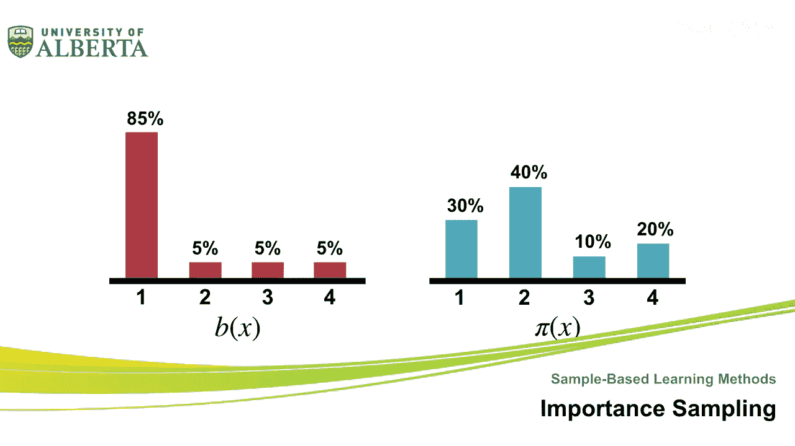
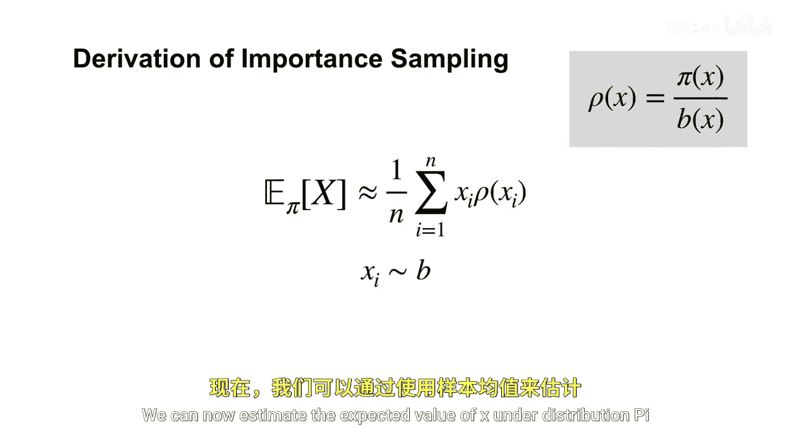
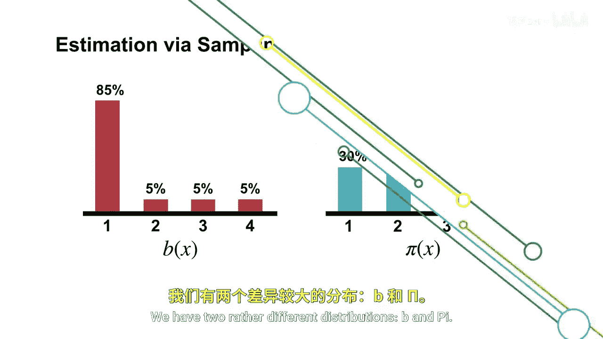
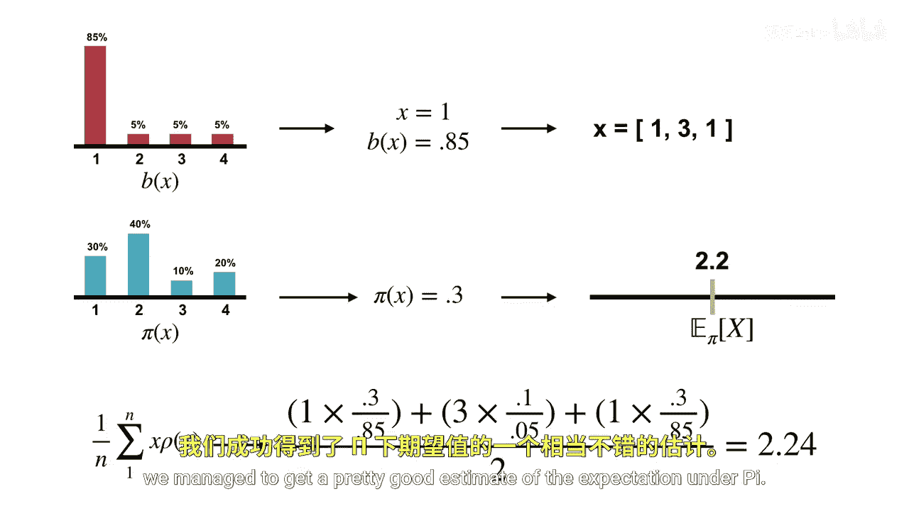

# 阿尔伯塔大学【中英⚡强化学习｜Reinforcement Learning Specialization】 p48 P48 02_重要性采样 -BV1CdGrzuEJU_p48-

Today we will discuss important sampling。As we will see in later videos。

 important sampling allows us to do off policy learning。

 learning about one policy while following another。In this video。

 we will first describe how important sampling works。By the end of this video。

 you will be able to use important sampling to estimate the expected value of a target distribution using samples from a different distribution。

Let's start by clearly stating the problem that important sampling solves。

We have some random variable x that is being sampled from a probability distribution B。

We want to estimate the expected value of x， but with respect to the target distribution， pi。

Because x is drawn from B， we cannot simply use the sample average to compute the expectation under pi。

The sample average would give us the expected value under B instead。

Let's start with the definition of the expected value。With sum over all possible outcomes X。

 multiplied by its probability according to pi。Next， we can multiply by b of x divided by b of x。

 because this term is equal to 1。B of x is the probability of observed outcome X under B。

Shifting around the numerator， we end up with a ratio between pi and B。

This ratio is very important to us and is called the importance sampling ratio。

We usually write the important sampling ratio as rh of x。Now， let's go a step further。

If we treat x times the important sampling ratio as a new random variable times the probability of observing x。

 we can then rewrite this sum as an expectation under B。

Notice that our expectation is now under B instead of being under pi。

We know how to use important sampling to correct the expectation。

 but how do we use it to estimate the expectation from data？It's actually very simple。

We just need to compute a weighted sample average with the important sampling ratio as the weightings。

 as shown on the slide。Note that these samples X are drawn from B not pi， and that's it。

 we can now estimate the expected value of x under distribution pi by using the sample average。

 the samples drawn from distribution B。

Let's take a look at a small example of using important sampling to estimate an expectation we have two rather different distributions。

 B and pi。

We'll draw samples according to B and try to estimate the expected value under pi。On the right。

 we'll keep track of our current estimate for the expected value under pi。 For reference。

 we show the true expected value in the middle of the line。 Let's draw a sample from B。

 We get x equals 1， which happens with probability 085。

The probability of getting x equals 1 from pi would have been 0。3。

To compute the sample average for pi， we need our important sampling formula。

Plugging in the observed values， we get an estimate of 0。35。Let's do it again。

We draw a sample from B， this time x equals 3， which happens with probability 0。05。

 the probability we would have seen at 3 if we sampled from pi is 0。1。We'll add X to the buffer。

 then plug in the observed values into our formula。We take the previous estimate。Plus。

 the new estimate and divide by2 to get 3。18。In one last sample。

 we draw another one from B and add it to the buffer。

We plug in the observed values to the important sampling ratio formula and get 2。2。

With samples just from B， we managed to get a pretty good estimate of the expectation under P。

That's it for this video today you learned how to use important sampling to estimate expected values according to one distribution when data is sampled from another see you next time。

