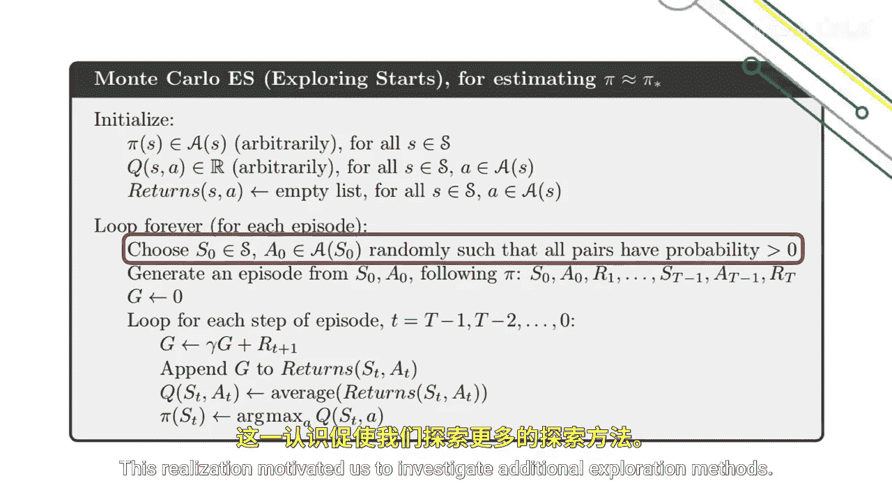
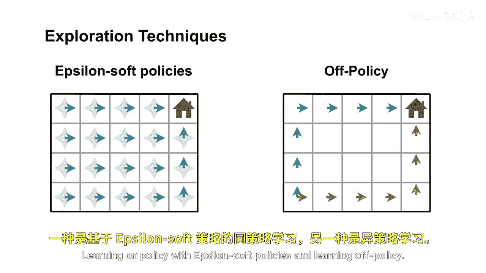
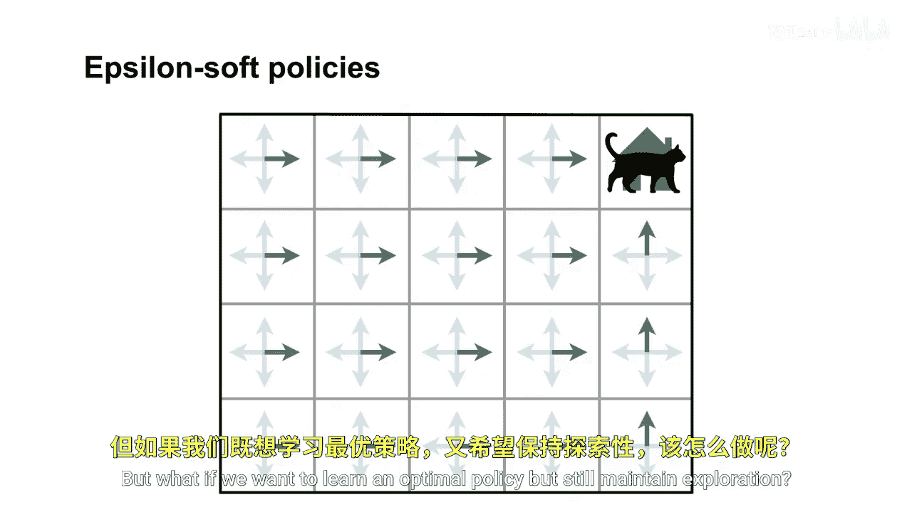
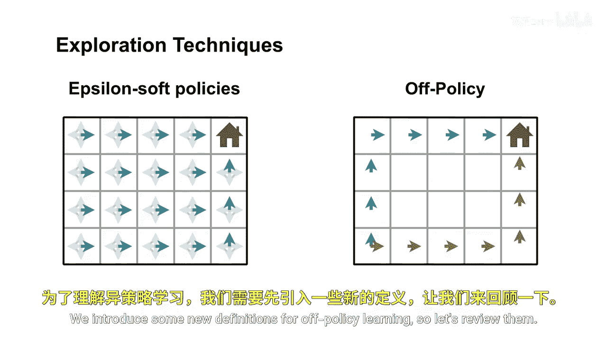

# 阿尔伯塔大学【中英⚡强化学习｜Reinforcement Learning Specialization】 p51 P51 05_第一周总结 -BV1CdGrzuEJU_p51-

Well done。You've made it through the first week of lectures。

This week was all about estimating value functions and finding optimal policies using only experience from the environment。

We saw on policy and off policy Monte Carlo and revisited the exploration problem from bandits。

Let's review the materials so far。Montic Carlo algorithms are sample based methods。

 they can be used when the model is unavailable or hard to write down。

Monte Carlo algorithms estimate value functions by averaging over multiple observed returns。

They wait for the full return before updating their values。Therefore。

 we use Monte Carlo only for episodic MDPs。We discussed how Monte Carlo can be used in signed generalized policy iteration。

This led to our first sample based control algorithm， Monte Carlo with exploring starts。

Montic Carlo algorithms don't do sweeps over the state action space like dynamic programming。

 so they need an exploration mechanism to ensure that they learn about every state action pair。

We first considered exploring starts。Exploring starts requires that the first state in action are chosen randomly at the beginning of every episode。

It is not always feasible or safe to use exploring starts。

Just imagine trying to do exploring starts with an autonomous car。

This realization motivated us to investigate additional exploration methods。

We covered two other strategies for the exploration problem。

 learning on policy with Epsilon soft policies and learning off policy。

For the first strategy， the agent follows and learns about a stochastic policy。

It usually takes the greedy action。A small fraction of the time， it takes a random action。This way。

 the value estimates for all state action pairs are guaranteed to continue to improve over time。

This on policy strategy forced us to learn a near optimal policy instead of an optimal policy。

But what if we want to learn an optimal policy， but still maintain exploration？

The answer lies with off policy learning。We introduced some new definitions for off policy learning。

 so let's review them。

A behavior policy is the policy that the agent uses to select actions。

A target policy is the policy that the agent learns about in its value function。

By setting an appropriate exploratory behavior policy。

 the agent can learn about any deterministic target policy。

One way to learn about one policy while following another is to use important sampling。

Important sampling allows the agent to estimate the expected return under the target policy from experience sampled under the behavior policy。

The ratio reweights the samples。It increases the importance of returns that were more likely to be seen under P。

 and it decreases those that were unlikely。The sample average effectively contains the right proportion of each return so that in in expectation。

 it is as if the returns had been sampled under a P。

That's all for this module Next we'll talk about one of the most fundamental concepts in reinforcement learning。

 temporal difference learning See you then。