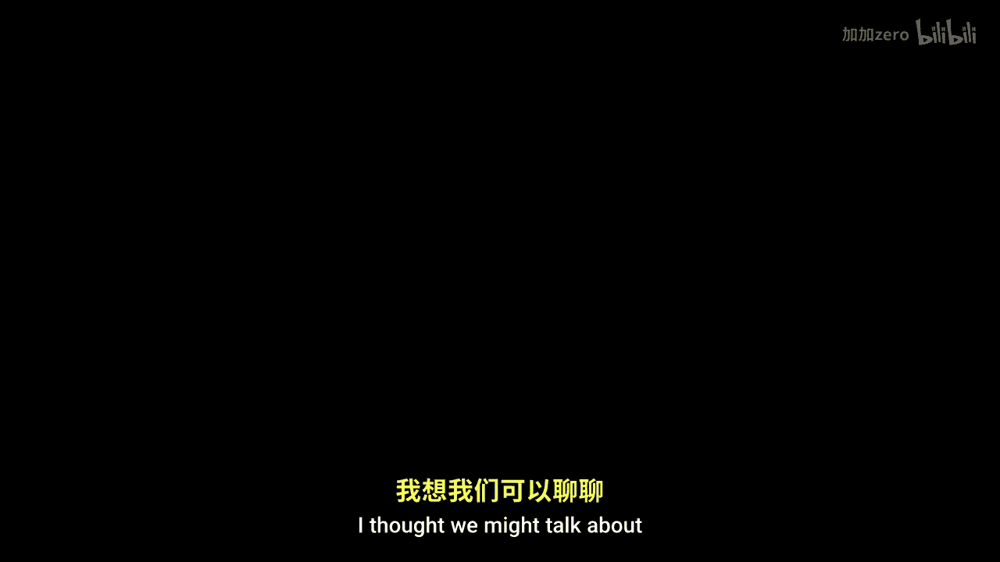

# 阿尔伯塔大学【中英⚡强化学习｜Reinforcement Learning Specialization】 p56 P56 03_安迪·巴托与理查德·萨顿：强化学习史补遗 -BV1CdGrzuEJU_p56-

I thought we might talk about it。

When we first decided that reinforcement learning was a thing。Didn't we ever just No。

 I'd like to talk about those early days too because there were some striking things。

So Rich was my first student。First graduate student。And oh， I don't want to tell you something。

 I don't think you know， so Harry cloth。Who we wrote about it in。In the book in a number of places。

 but he。Created a contract。At UMass， to study to see whether it is。

hypothesispo about hedonistic neurons made any sense， and so I was hired as a postdoc。And Harry。

According to Michael， Michael was one of the PIs。A contract wasn't a grant， it was a contract。😔。

But Michael's memoirs， which have come out now， said that Harry required。Them to bring you a award。

Or they wouldn't get the funded。Okay。He didn't know that I didn't know that either until I read Michael's piece the difference between。

 I don't think one reason we've worked together so well， I am by nature risk averse。

And Rich is a risk seeking person。I mean， he swims with sharks。That's the farthest thing。Well。

 I think the risk of burden you're contrary。You don't want to go in the same direction as all the other people。

Which means the thing that means that you as reinforcement makes being so popular。

 you won't almost go on a step beside it you are。I go in un orthogonal and only because I can't keep up with the literature to find a field that is sparsely covered so that I can make a contribution but now that I'm retired。

嗯。I'm not going in any orthogonal direction at the moment。

I'm amazed with what everybody's doing with reinforcement learning。And I'm thankful not to have to。

Be in the thick of things， the industrial scale reinforcement horn it's great stuff。

And it's just a flood of。Interesting papers but I。I'm not keeping up。Well， I want to talk。

Thus this topic is contraring this for this risk seeking youre in the risk seeking but that you left your tenure track position to study a field that was unpopular to be opposed to I don't recommend leaving a I to study a field that was unpopular so I know you don't see it as risk seeking。

 but I think any other normal human being would， you wanted to pursue what you thought was important anyway。

 I don't want to make it about you actually I want to make it about the field。

 so the field was interested well， it wasn't interested in learning。

 but I want to reinforcement learning and supervisely。

And how in the 60s in the first wave of neural networks。And machine learning。

It turned into supervised learning the early guys in 50s talked about things that were like reward。

But then they ended up studying supervised learning。

So that's terrific and that has happened over and over again through all the waves。

 there's always things coming up， but it's always a little bit of supervised learning versus reinforced learning。

深圳。Well， I've seen。Things in the current literature by。Sophisticated people misunderstanding。

The distinction between。Arror correction and trial and error。

And it just isn't almost in the same way， it's been misunderstood。You know， throughout history。

Throughout。Three waves in early that 50 yeah， that's true you know we were charged with saying if Harry's idea is we're worth that you know we had some and so we went back and we looked at everything。

We discovered real reinforcement learning among some people。

 but the field as a whole was focused on supervised learning。

Those distinctions were were not clear to people， that was a real revelation。And you know。

 I remember my first round of talks back in those days was about that， you know saying， you know。

 there's child and heroin。Not supervised。 So that's true。 it was a surprise。

 So I wrote this AI magazine article recently that kind of went through some of the surprises。

 And that was like number one。 It was， wow， you know， this， this is actually an。Of course。

 that appealed to me because then maybe we could do something。Innovative。It haven't。

Because most people hadn't。And we study。Except in engineering。St。

Stochastic control people and its own had been doing things like this， but it wasn't。

The AI community didn't really。Lch onto that。Well， the way I remember it。

 we looked through all the different。Com we couldn't find someone who' studied learning。For top to。

For for what， to optimize a signal。Except for the learning atomic。第二。Which nobody knew of about it。

 which was not associative。Yeah， pretty much I mean， there were a few works with bandits。

But basicallyically。Ludature came。Drier in the very few things。And it was strength because this。

It's an important kind of learning like so it's just a strange fact that the thing is reinforcement and we now see like we're having a second edition of a textbook on it and we're having a course all about it and like it wasn't a thing。

嗯。In 1980。It wasn't a topic。It was subsumed and swelled up。

And obliterated couldn't be seen because of。Supervisor also had。Suggestions of behaviors。

The one of the most unfashionable things around and so， oh， you know， really important。

Behaviorism man。And。And it includes elements of behaviors but not all of them。And。You know。

 we felt that people threw the baby out with the backwater by rejecting。Common sense。

Reinforcement learning principles， but even today， I mean it's called neobehaviors which is irritating because you know R has models and value functions and all kinds of things that pure behaviors would just not。

Allow in their fears。It's not behaviors。Well， it's all about what's going on in the algorithms inside the head。

It pure behaviorism。Well we make up to that in your head that you can't observe some behaviorists at least。

Pureure behaviorists。Ct to that。But I learned a lot from the。Peer behaviors。

And I really think it's a shame that it was。Disist that became unpopular。muchuch of that's been lost。

All they have learned。On the other hand， it's sort of given。

Given me like a secret weapon because I didn't understand。

What behaviors learned and so many other people haven't bother to learn。

That's where temple difference learning came from。No。啊。

You know intrinsically motivated persistence because you know。Throughout all of that。

 during were periods when there wasn't an extrinsic source of reward for the researchers。

But it's I mean， Jeffrey and I think us， I and others。I mean， some people would think it's。

It's foolish to keep studying the same thing， Alllan No will get a talk。There's a video on that。

And he characterized different kinds of researchers。And I forget all the names he gave them。

 but there were nomads， no magic research， so if something hot pops up。

All the nomads move over to that area， study that for a while until something else pops up and move over to that area。

I think。We've been the opposite。I mean， all sorts of things that popped up。You know。

We couldn' ignore it。So that makes us the old funny Dunds。Yeah。

I don't know if it's contrarian or stubborn or。Well， you know。

 I got interested in intrinsic intrinsic what psychologists call intrinsic motivation where you do something for its own sake。

 rather than for an extrinsic。Reward of some kind， and I think it's very powerful。嗯。I mean。

 I got interested in because I thought and still think it's a good way to create。Some skills。

 options are whatever。I call them you know from intrinsic， they might be useful in the future。

 but they might not， it's like basic research。Is intrinsically motivated， whether there is utility。ふ。

And it turns out there has been， you know， it incredible utility。

 but that was not the driving force as opposed to you know。Explicitly project driven。

Which are important too， but the intrinsic and I think animals。

Go through an intrinsically motivated stage where they learn all kinds of skills。

 become competent at dealing with their worlds。And then when they have problems。

That they have to solve， they have an armament they have。Someub skills that they can bring to bear。

 and I think that's an important principle。And I think， you know。

I think I've been intrinsically more advantage rich， too。For these issues that now are。

You knowIn the reinforcement learning set of ideas。To me， they're just interesting。

And the fact that they worked。ごめんさう。Reward， but that was not。可や。Driving force， at least for me。

I this Andy we've just。Had great success in reinforcement learning。

 and I just wanted to congratulate you and celebrate it with you and give you like a high five。え？Oh。

