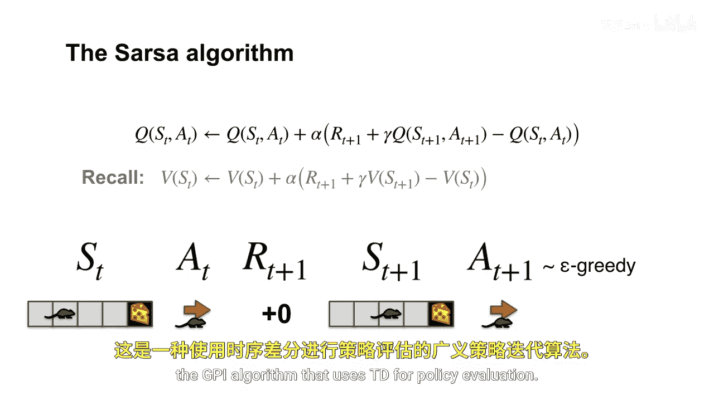
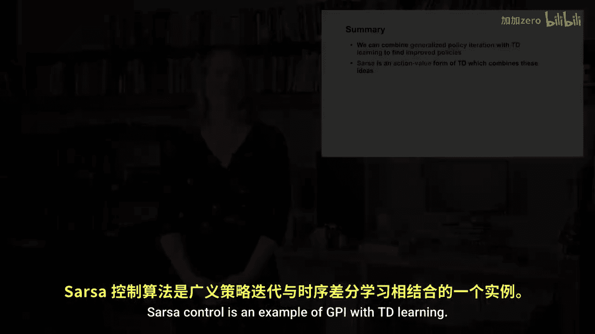

# 阿尔伯塔大学【中英⚡强化学习｜Reinforcement Learning Specialization】 p58 P58 03_基于时序差分的SARSA通用策略迭代 -BV1CdGrzuEJU_p58-

In previous videos， we talked about using generalized policy iteration to find an optimal policy。

 we've also talked about using TD to estimate value functions。

 but what would it look like if we used TD to do the policy evaluation step in generalized policy iteration？

By the end of this video， you'll be able to explain how generalized policy iteration can be used with TD to find improved policies。

As well as describe the SArsA control algorithm。Generalized policy iteration。

 or GPI combines two parts， policy evaluation and policy improvement。

The first algorithm we saw with this form was policy iteration。

Policy iteration runs policy evaluation to convergence before gratifying the policy。

 Then we saw GPI with Monte Carlo， which performs a cycle of policy evaluation and improvement every episode。

To better remember GPI with Monte Carlo， imagine a mouse in a four state corridor with cheese at the end。

The most starts out knowing nothing and follows a random policy。Eventually。

 the mouse will stumble into the cheese just by moving randomly at that point。

 the mouse updates its action values。Then it improves its policy by gratifying with respect to its action values。

 as the process repeats， it will eventually learn the optimal policy。

Notice that GPI with Monte Carlo does not perform a full policy evaluation step before improvement。

Rather， it evaluates and improves after each episode， going even further。

 we can improve the policy after just one policy evaluation step。We will do this with TD。

To use TD within GPI， we need to learn an action value function。

So we'll need to look at slightly different version of TD than you've seen in the past。

Instead of looking at transitions from state to state and learning the value of each state。

Let's look at transitions from state action pair to state action pair and learn the value of each pair。

This algorithm is called SAsSa prediction。Let's look at it in a bit more detail。

The SArsRSA acronym describes the data used in the updates state。Action。Reward。Next state。

And next action。SarRSA makes predictions about the values of state action pairs；

 the agent chooses an action in the initial state to create the first state action pair。Next。

 it takes that action in the current state and observes the reward Rt+1 and next state ST+1 in SARSSA。

 the agent needs to know its next state action pair before updating its value estimates that means it has to commit to its next action before the update。

Since our agent is learning action values for a specific policy。

 it uses that policy to sample the next action。Here's the full update equation。

 it actually looks quite similar to the TD update for state values。

 with state values V of S replaced by A values QSA。

The algorithm we just described is for policy evaluation。

 it learns action values for a specific fixed policy。However， thanks to the GPI framework。

 we can turn it into a control algorithm， this time willll improve the policy every time step rather than after an episode or after convergence。

This completes the description of SARSSA， the GPI algorithm that uses TD for policy evaluation。

In this video， we talked about how we can combine generalized policy iteration with TD learning to and improved policies。

SarA Control is an example of GPI with TD learning。

