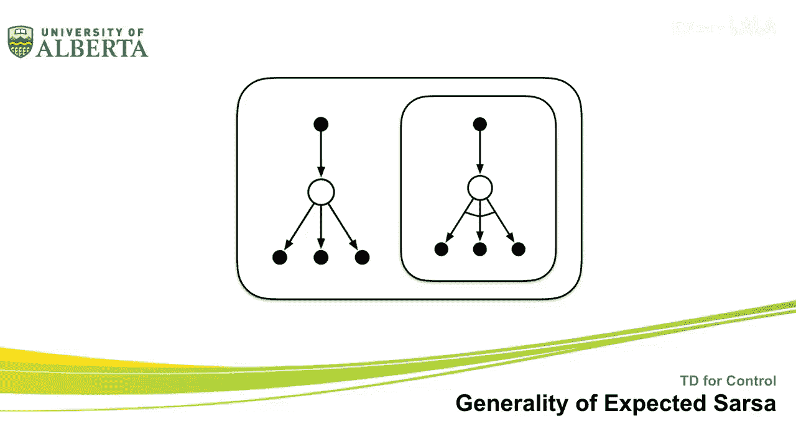
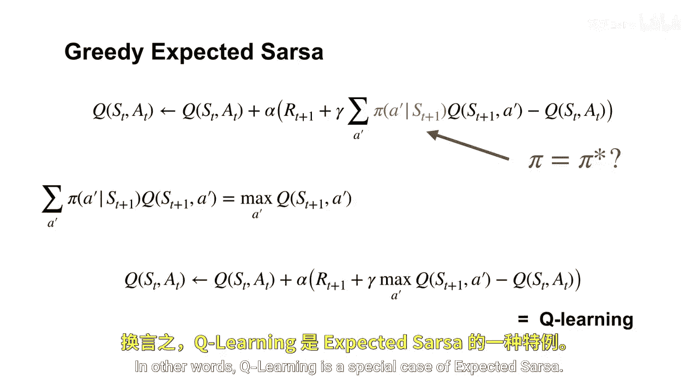

# 阿尔伯塔大学【中英⚡强化学习｜Reinforcement Learning Specialization】 p65 P65 03_期望SARSA算法的通用性 -BV1CdGrzuEJU_p65-

Up until now， we've seen three TD algorithms for control， SArsRSA， Q learning， and expected SARSA。

Two of those algorithms， SARSA and expected SARSSA， both approximate the same beman equation。Today。

 let's look at how expected SARSSA is related to Q learning。

By the end of this video， you will understand how expected SArsRSSA can do off policy learning without using important sampling。

And explain how expected SARSA generalizes Q learning。Let's start with the on policy case。

 where the behavior policy and the target policy are equal。Consider the expected SArsSA update。

The next action is sampled from piI in this case。However。

 notice that the expectation over actions is computed independently of the action actually selected in the next state。

😊，In fact， P need not be equal to the behavior policy。This means that expected SArsSA。

 like Q learning， can be used to learn off policy without important sampling。

Now what happens if the target policy is greedy with respect to its action value estimates。

 we can see that only the highest value action is considered in the expectation。

This is equivalent to computing the maximum over actions in the next state， just like in Q learning。

In other words， Q learning is a special case of expected SArsSA。

In this video， we showed that expected SARSSA and Q learning both use the expectation over their target policies in their update targets。

This allows them to learn off policy without important sampling。

Expected SArsRSA with a target policy that's greedy with respect to its action values is exactly Q learning。

