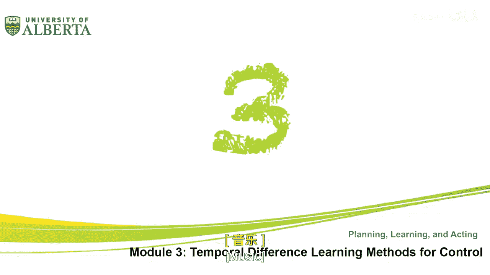
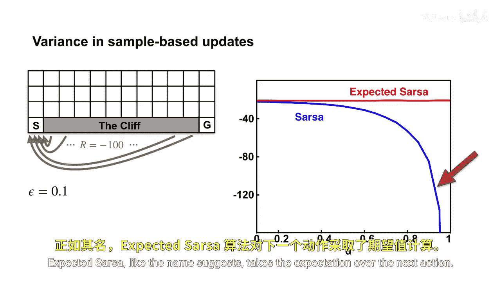

# 阿尔伯塔大学【中英⚡强化学习｜Reinforcement Learning Specialization】 p66 P66 04_第三周总结 -BV1CdGrzuEJU_p66-

This week we learned how to use TD methods for control。In this video。

 we'll recap everything we covered this week。The TD control algorithms are based on Bellllman equations。

We learned about three of them。SarRSA uses a sample based version of the Belelman equation。

It learns Q pi。Q learninging uses the Belelman Opity equation； it learns Q star。

Expected SARSSA uses the same Belman equation as SARSSA， but samples it differently。

It takes an expectation over the next action values。

What's the story with on policy and off policy learning？

SarRSSA is an on policy algorithm that learns the action values for the policy it's currently following。

Q learning is an off policy algorithm that learns the optimal action values。

 and expected SARSA is both an on policy and an off policy algorithm that can learn the action values for any policy。

SarRSSA can do better than Q learning when performance is measured online。

This is because on policy control methods account for their own exploration。In the Cl world。

 we saw that Q learning frequently fell off the cliff because of its exploratory actions。

Sara learned the longer but safer path that rarely fell off the cliff。This resulted in higher reward。

We then studied an improvement over SARSSA called expected SArsRSA。In the Cl world。

 expected SARSA outperformed SARSA for all the step size parameter values we tested。

This is because expected SARSA mitigates the variance due to its own policy。Expected SArsRSa。

 like the name suggests， takes the expectation over the next action。

That's all for this module next we'll learn how to combine planning。

 learning and acting See you then。