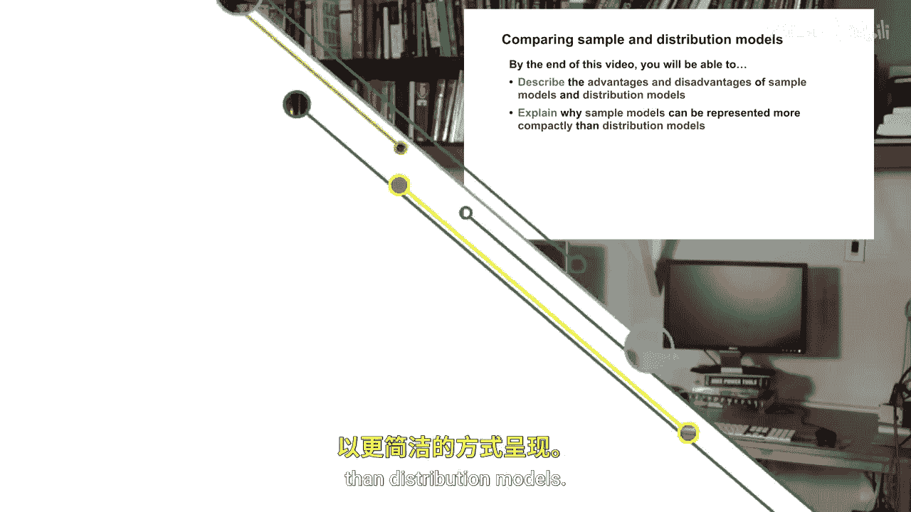
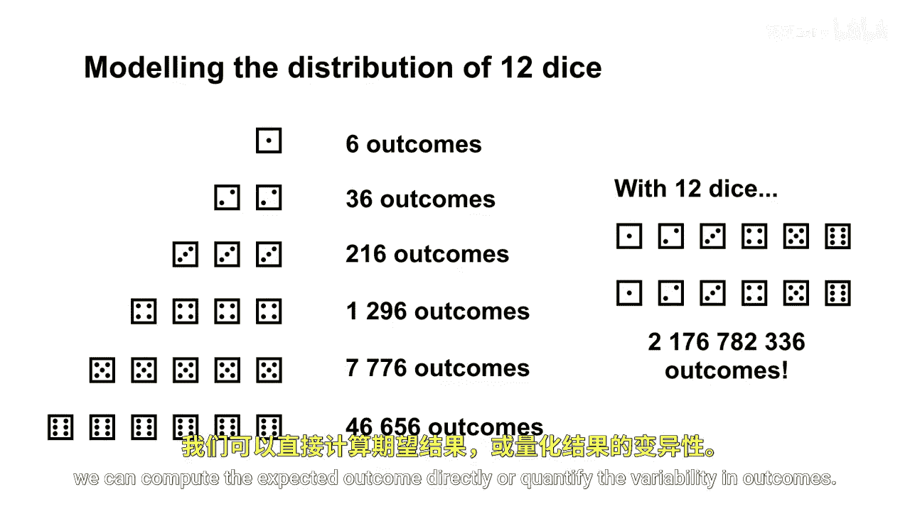

# 阿尔伯塔大学【中英⚡强化学习｜Reinforcement Learning Specialization】 p68 P68 04_样本模型与分布模型的比较 -BV1CdGrzuEJU_p68-

Moels represent knowledge of how the world works。 we've talked about two types of models。

 sample models and distribution models in this video we focus on a concrete example to illustrate the key differences between sample models and distribution models。

By the end of this video， you will be able to describe the advantages and disadvantages of sample models and distribution models。

 and you will also be able to explain why sample models can be represented more compactly than distribution models。

Let's consider the problem of rolling 12 dice。This can be done easily with a single dye and enough patients。

Rolling a single die 12 times is an example of a sample model。Programmatically。

 one would generate a random number from one to six 12 times。

This is very compact and does not consider joint probabilities。

Modeling the complete joint distribution of Ro 12 dice is much more work。

We must consider every possible outcome of 12 dice and assign a probability to each outcome。

With one die， we have six outcomes， with two dice， we have 36 outcomes，3 has 216，4 has 1，296。

 and by the time you get to 12 dice we have over 2 billion possible outcomes to consider but it can be useful that a distribution model produces the exact probability of an outcome For example。

 we can compute the expected outcome directly， or quantify the variability in outcomes。

Let's summarize the benefits of each type of model。Sample models require less memory。

Distribution models， on the other hand， can be used to compute the exact expected outcome by summing over all outcomes weighted by their probabilities。

 Note that sample models can only approximate this expected outcome by averaging many samples together。

Knowing the exact probabilities also has the flexibility of assessing risk， for example。

 when a doctor is prescribing medicine， they would consider many possible side effects on how likely they are to occur。

In this video， we described how sample models can be more compact than distribution models。

And how the explicit probabilities and distribution models can be useful in some situations。

 such as for computing expectations。