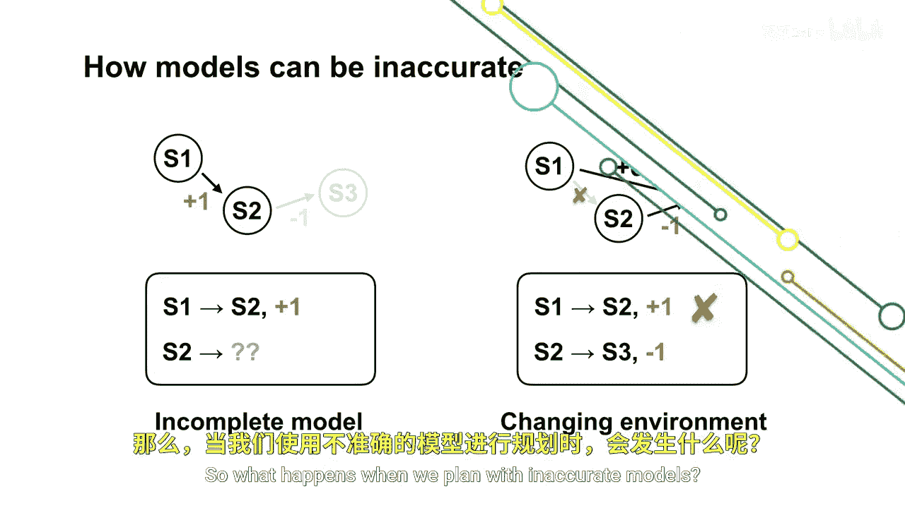
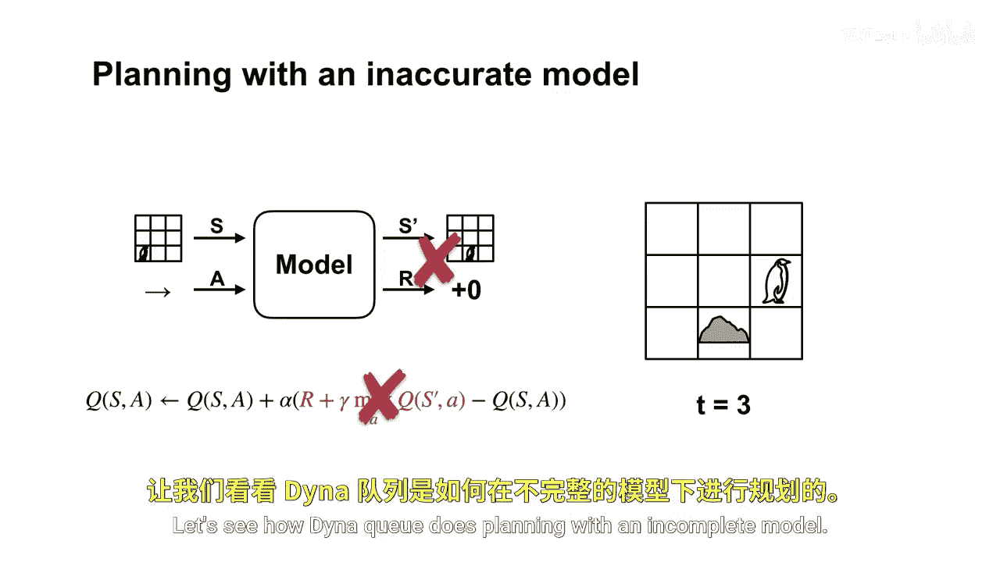
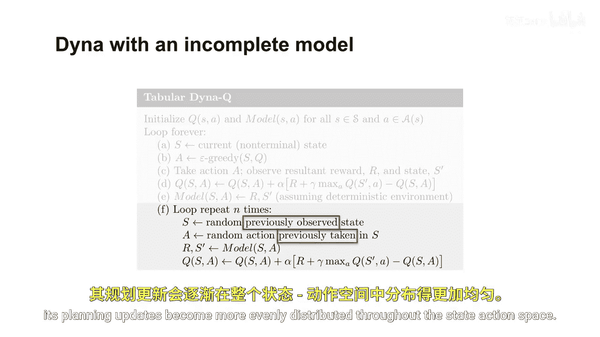

# 阿尔伯塔大学【中英⚡强化学习｜Reinforcement Learning Specialization】 p73 P73 01_如果模型不准确怎么办 -BV1CdGrzuEJU_p73-

So far in the course， we've talked about how agents can improve their policies or value functions by planning with experience generated from a model。

But what happens if the agent plans with experience from an inaccurate model？In this video。

 you will learn how to identify ways in which models can be inaccurate。

Explain the effects of planning with an inaccurate model。

And describe how Diana can plant successfully with an incomplete model。First。

 let's talk about what means for a model to be inaccurate models are inaccurate when transitions they store are different from transitions that happen in the environment At the beginning of learning。

 the agent hasn't tried most of the actions in almost all of the states The transitions associated with trying those actions in those states are simply missing from the model。

We call models with missing transitions incomplete models。

The model could also be inaccurate if the environment changes。

 taking an action in a state could result in a different next state and reward than what the agent observed before the change。

We say the model is inaccurate because what actually happens is different from what the model says。

So what happens when we plan within inaccurate models？

The effect of planning with an accurate models depends on how the model is inaccurate In the beginning。

 the model is incomplete Since the model can't produce a next state or reward。

 it can't be used for planning。 However， as the agent interacts with the environment。

 the model stores more and more transitions。Then the agent can perform updates by simulating transitions it's seen before。

That means that as long as the agent has seen some transitions， it can plan with the model。

Now let's think about how changes in the environment affect planning。

Imagine that the agent has already visited every state action pair and stored its experience in the model。

 Then the environment changes。 A transition in the model no longer reflects the transition in the environment。

What will happen when the agent tries to plan using its inaccurate model？

If the agent tries to perform a planning update with one of the incorrect transitions in the model。

 the value function or policy that the agent updates might change in the wrong direction。

Remember that planning approves the policy with respect to what the model thinks will happen rather than what will really happen in the environment。

The model becomes outdated when the environment changes。

Planning with that model will likely make the agent's policy worse with respect to the environment。

Now that we've gone over the two main ways that models can be inaccurate。

 let's think about how agents could plan successfully with incomplete models。

We've actually gone over one such algorithm already， D a Q。

Let's see how Dennycuto is planning with an incomplete model。

In the planning step， we must determine which state action pairs to query the model with。

The model only knows the next state and reward from state action pairs and has already visited。

Therefore， DnaQ can only do planning updates from previously visited state action pairs DnaQ only plans the transitions it has already seen。

 so in the first few time steps of learning， DnaQ might do quite a few planning updates with the same transition。

However， as DannyQ visits more state action pairs in the environment。

 its planning updates become more evenly distributed throughout the state action space。

In this video， we talked about how models can be inaccurate if they are either incomplete or if the environment changes。

Planning with an inaccurate model improves the policy or value function with respect to the model and not the environment。

And DnaQ can plan with an incomplete model by only sampling state action pairs that have been previously visited。

See you next time。