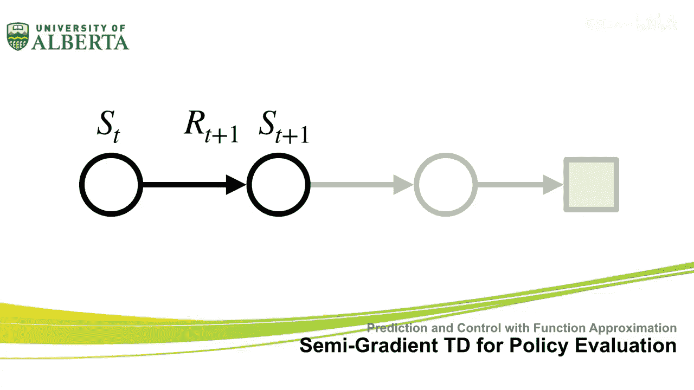
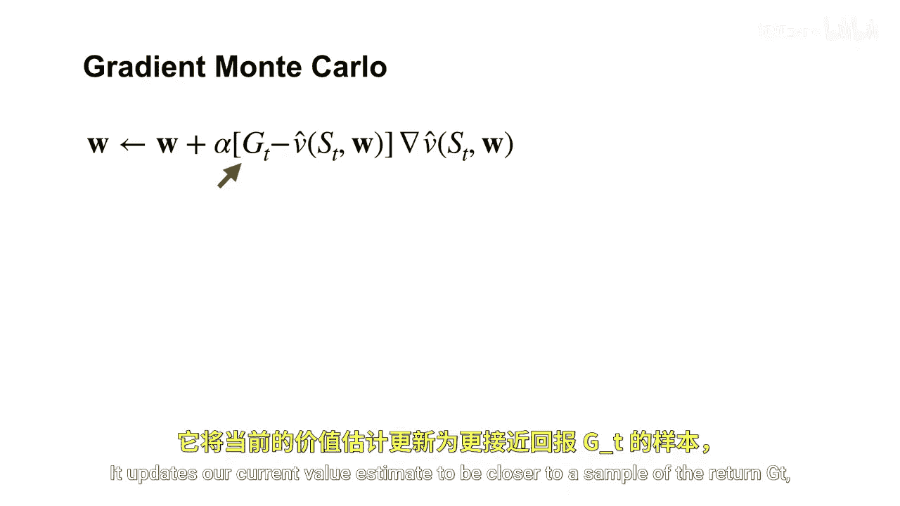
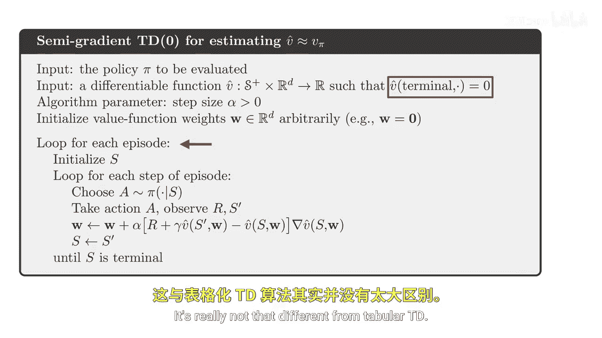

# 阿尔伯塔大学【中英⚡强化学习｜Reinforcement Learning Specialization】 p87 P87 01_用于策略评估的半梯度时序差分法 -BV1CdGrzuEJU_p87-

TD learning is built on the idea that the agent can use its own estimate of the value function to update its predictions。

We've seen TD learning in the tabular case。Today we will describe how it works with function approximation。

By the end of this video， you'll be able to。Understand the TD update for function approximation。

And outline the semi grading TD algorithm for value estimation。

Recall the Gry Monte Carlo Up equation。It updates our current value estimate to be closer to a sample of the return GT。

But we can consider using other targets instead of their return。In fact。

 we can replace the return in this update with any estimate of the value。

Let's call this estimate UT。If UT is an unbiased estimate of the true value。

 then our function appximator will converge to a local optimum under the appropriate conditions。

This was the case for the return。But we can also replace UT with the bootstrap target。

 such as the one step TD target。This is still an estimate of return。

 but in this case the estimate is biased。The TD target uses our current value estimate。

 which will likely not equal the true value function。Because of this。

 we cannot guarantee this algorithm will converge to a local minimum of the value error。

The upside is that the TD target often has lower variance than the sample of the return。

This means TD will tend to converge in fewer updates。

The TD update is not actually a stochastic gradienting descent update。

To see why we take the gradient of the error with respect to the weights for one sample。Remember。

 UT is equal to the TD target。Using the chain rule。

 we get this expanded expression for the gradient of the squared error for one sample。

But wait a minute。This doesn't look like the TD update。

These two expressions would only be equal if the gradient of UT is equal to0。

This is not the case for TD。In TD， the target contains an estimate of the value。

 which depends on the weights。This means the gradient of UT is not zero， as shown here。Therefore。

 TD is not performing gradientding toscent updates on the squared error。

We call it a semi gradient method。Despite this， TD converges in many of the cases we care about。

We will discuss TD's convergence properties in an upcoming video。

Here is the pseudocode for semi gradient TD。Is actually very similar to the TD algorithm for the tabular setting。

This algorithm does not have to wait until the end of an episode to make updates。

TD performs an update on each step， unlike Grady Monte Carlo， On each step of the episode。

 the agent selects an action A in state S。We use the resulting reward and next state to compute the TD target and update the weights immediately。

We continue in this way until we reach the terminal state， which is defined to have value 0。

 Then we start a new episode， and that's it。It's really not that different from tabular TD。

That's it for today。You should now understand the semi gradient TD algorithm。

