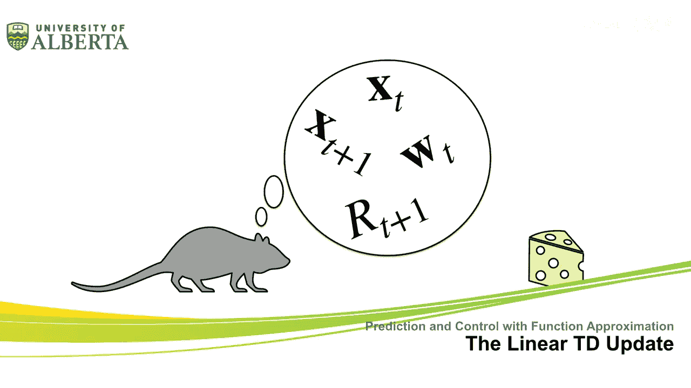
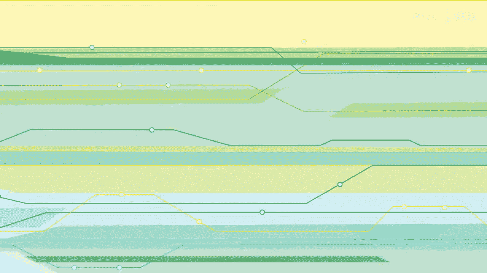
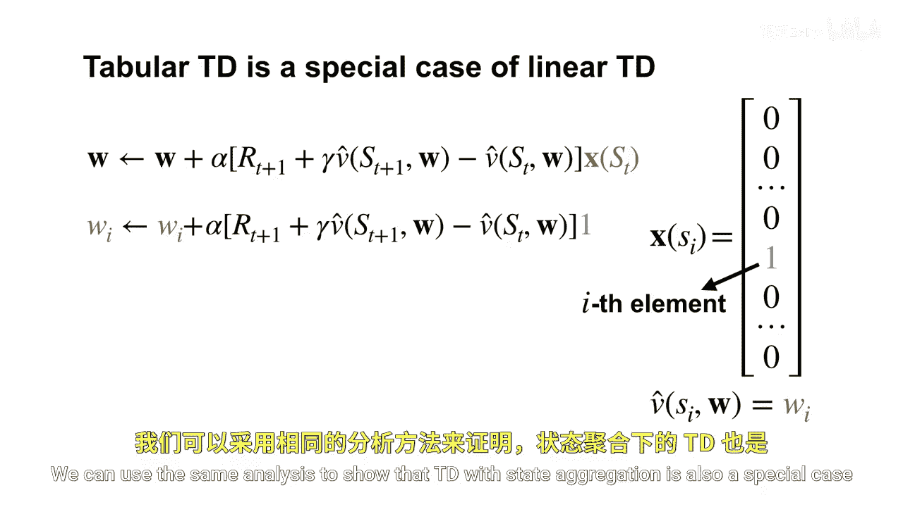

# 阿尔伯塔大学【中英⚡强化学习｜Reinforcement Learning Specialization】 p90 P90 01_线性时序差分更新 -BV1CdGrzuEJU_p90-

In principle， we can use any kind of function approximation for reinforcement learning。

Linear function approximation is an important special case it is simple enough that we can understand it well。

 but it is still quite powerful in general。In fact。

 linear function approximation with TD has been used to build Atari agents that exceed human performance in many games。

After watching this video， you will be able to derive the TD update with linear function approximation。

 understand that tabular TD is a special case of linear semi gradient TD。

 and understand why we care about linear TD as a special case。Recall the update for semi gradient TD。

It adjusts the weights in the direction of the TDR times the gradient of the approximate value function with respect to the weights。

In the linear case， the gradient of the approximate value for a state is just the feature vector for that state。

So the update for segra TD would look like this。The weight is updated in the direction of the feature vector times the TD error。

If a feature is large， then the corresponding weight can have a large impact on the prediction。

On the other hand， if the feature is zero， then that weight has no impact on the prediction and the gradient is therefore zero。

The fixed basis given by the expert design features， has a large impact on the update。

If well designed， we can get effective value function approximation with a simple update。

We already saw how linear value function approximation is a strict generalization of tabular value function approximation。

We can show that linear TD is a strict generalization of both tabular TD and TD with state aggregation。

Let's take a closer look at the algorithm to see this explicitly for tabular TD。

Imagine we have a tabular state representation， only one feature will be equal to one corresponding to the current state。

 and the rest will be zero。The value approximation for a state is equal to the weight associated with the current state。

We can therefore think of the weight vector as just a table of values， one for each state。

Here's the update for semi gradient TD with these tabular features。In the update。

 the feature vector x of ST selects a single weight associated with the current state。

This weight is just the value estimate for the state。

 so this update corresponds to the tabular TD update we saw in a previous course。

We can use the same analysis to show that TD with state aggregation is also a special case of linear TD。

But why do we care so much about the special case of linear function approximation？

Lar methods are simpler to understand and analyze mathematically。

 Much of the theory of TD learning is for the linear setting。

 we will discuss this more in the next video。In some applications。

 you may have access to expert knowledge to help you design good features。

 perhaps you are the domain expert， or perhaps you can talk to someone who knows a lot about your application。

If we can design these features well， then we can expect linear methods to learn quickly and achieve good prediction accuracy。

Feature design provides one way to incorporate domain knowledge that can result in good performance and practice。

That's it for today。We talked about the linear td update。

How tabular TD is a special case of linear semi gradient TD and why linear function approximation might be useful See you next time。

