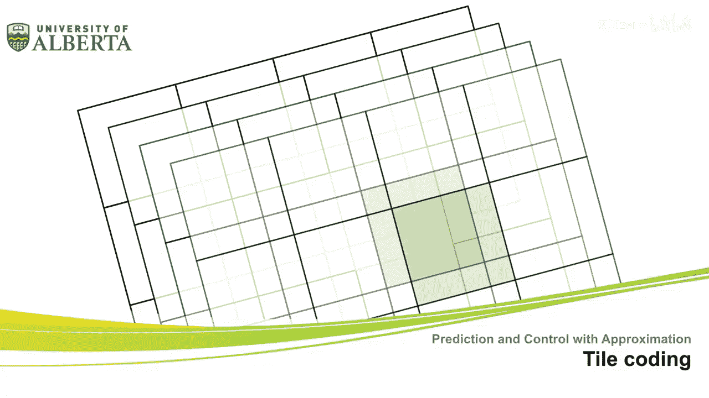
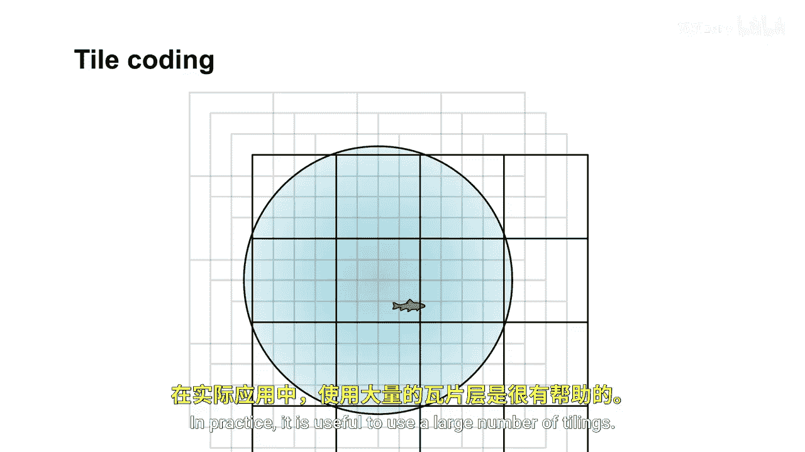
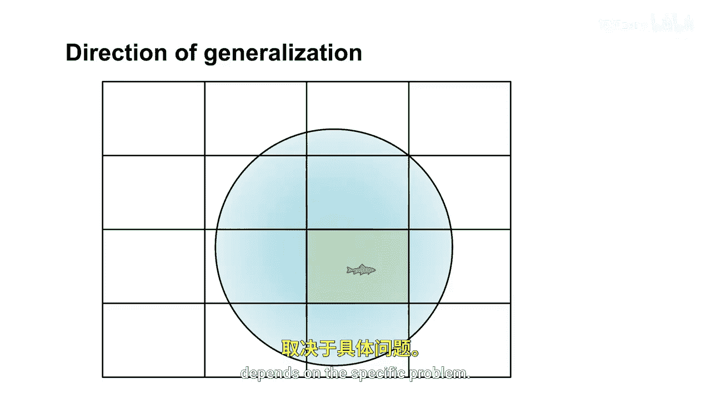

# 阿尔伯塔大学【中英⚡强化学习｜Reinforcement Learning Specialization】 p95 P95 05_瓦片编码 -BV1CdGrzuEJU_p95-

We previously talked about course coding today let's look at a computationally efficient way to perform course coding。

 Tal coding。By the end of this video， you'll be able to explain how tile coding achieves both generalization and discrimination。

And understand the benefits and limitations of tile coding。

Tal coding is a specific type of course coding。Talconing performs an exhaustive partition of the state space using overlapping grids。

This is perhaps best understood through an example。

Let's revisit our fish friend who lives in a two dimensional continuous state space， the pondnd。

Unlike coursese coding， which uses arbitrary shapes， tile coding uses squares。

What's the most convenient way to lay out a bunch of squares over a space， it's a grid。

Let's call this grid a Tline。So far， using this is just state aggregation。

Larger tiles will result in increased generalization。

Although the ideal tile size depends on the specific problem。

 it's generally a good idea to use larger tiles。To improve the discriminative ability of our telecoding。

 we can put several tilings on top of each other。Each tiling is offset by a small amount。

 offsetting each layer of tiling creates many small intersections。

 This results in better discrimination。In practice， it is useful to use a large number of tilings。

For one tiling， generalization only occurs within the square， but with multiple tilings。

 updates in this state generalized to these other states。The generalization in this case is diagonal。

 if we had used random offsets， then the generalization would be more spherical and homogeneous。

This is discussed more in the textbook。Let's talk about how to control the generalization properties further。

We can do this by creating a grid of rectangles rather than squares。

An efficient way to do this is to scale each dimension of the state space。

The environment appears to have gotten squished here。Actually。

 layering squares over this squished environment is like laying rectangles over the unsquied environment。

By using rectangles， we can control the broadness of the generalization across each dimension of the state space。

Tile coding can represent a wide range of functions， but its utility does not end there。

Telecoding is also computationally efficient。Since grids are uniform。

 it's easy to compute which cell the current state is in。Due to its computational efficiency。

 tileco can be used to quickly run polymer experiments in low dimensional environments。However。

 as the number of dimensions grows， the number of required tiles grows exponentially。As a result。

 it can be necessary to tall input dimensions separately。

Whether or not input dimensions can be treated independently depends on the specific problem。

In this video we talked about course coding and how it is a generalization of state aggregation。

 see you next time。