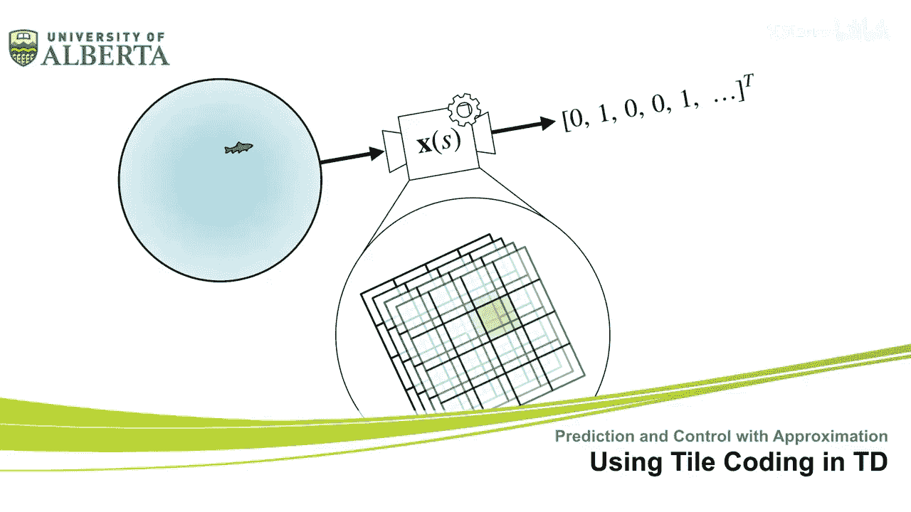
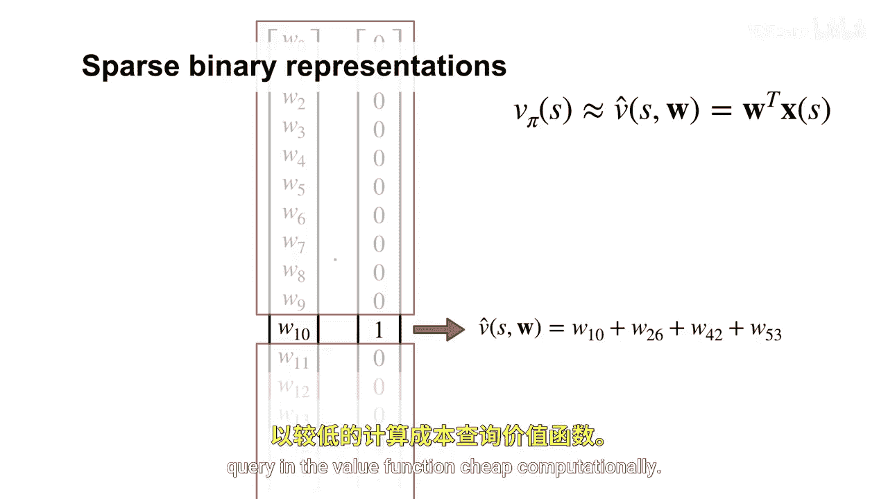
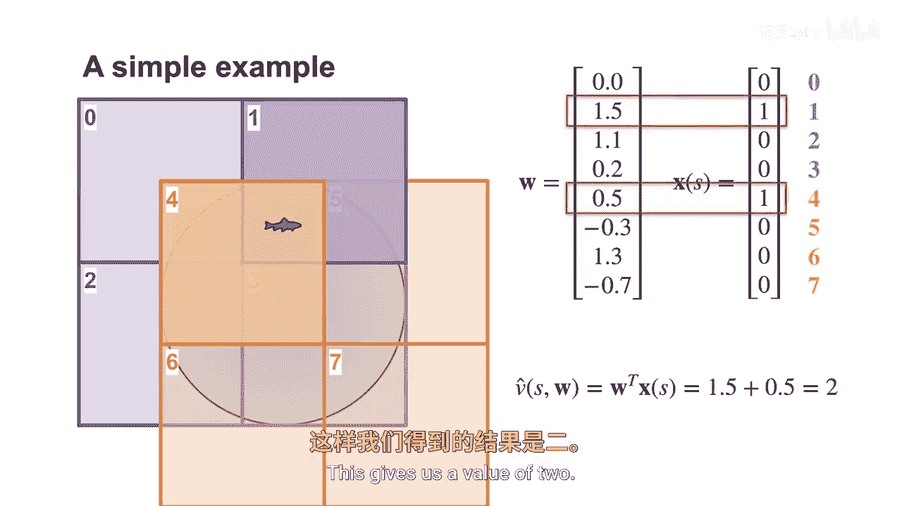
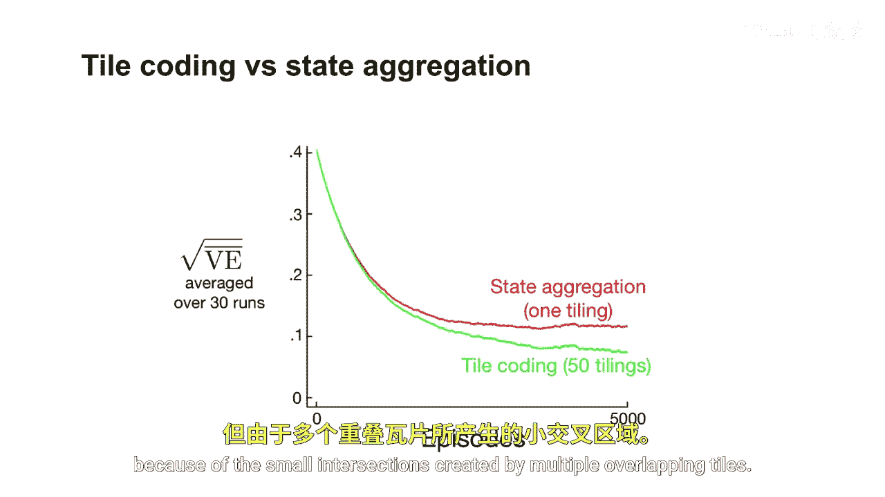

# 阿尔伯塔大学【中英⚡强化学习｜Reinforcement Learning Specialization】 p96 P96 06_在时序差分法中使用瓦片编码 -BV1CdGrzuEJU_p96-

So far you've learned about tile coding， but we haven't connected it back to reinforcement learning yet Well the weight is finally over today we'll explain how to use tile coding together with linear TD。

By the end of this video， you'll be able to explain how to use tile coding with temporal difference learning。

And identify important properties of tile coded representations。

The number of active tiles is always significantly less than the number of total tiles。

We can use this to calculate the value function efficiently。

Recall that with linear function approximation， the value function is a dot product between a weight vector and a feature vector。

Let's see what this dot product looks like with a sparse binary feature vector。

If we were to multiply the two vectors element wise， many of the element Ys products will be zero。

This means we only have to consider the weights at the non zero elements of the feature vector。

Because the features are binary， the weights at the non zeroro features are multiplied by one。

Computing the dot product in the usual way would be expensive。Instead。

 we can just sum the weights corresponding to the active features。

Note that this takes a consistent amount of time because the number of active features is the same in every state。

The feature vectors produced by tileu codinging may querying the value function cheap computationally。

Let's look an example of value function with tile coded features。

 suppose we're back at the old Po with two tilings of four tiles each。

 we've color coded the tilings and each tiling square is indexed as shown。

If the position of the fish and the weight factor are shown， what is the value the fish is position？

We can see the fish intersects square1 belonging to the purple tiling and square four belonging to the orange tiling。

This results in the following feature vector for this state。

Now we simply calculate the state's value with a dot product。The feature vector is binary。

 so we can just add up the weights at the locations with non zero features。

This gives us a value of two。

Now let's run experiment with tilecoing and compare it to state aggregation。

Recall the tile codinging is effectively multiple instances of state aggregation or tilings layered on top of each other。

Our environment is the 1000 state random walk， the states are numbered from 1 to 1000 and all episodes begin in state 500。

At each time step， the agent randomly transitions to one of the 200 neighboring states on either side。

Overshooting states1 or1000 will result in a transition to the terminal state。For example。

 look at the possible transitions to the left of state2。One will go to state one。

And the remaining 199 will go to the terminal state。

Let's talk about how we can use function approximation in this problem。

We'll start with state aggregation。Lexxi use a state irrigation with five groups。

 each corresponding to 200 states。Now let's design a tilecoder for this problem with 50 tilings。

We treat the thousand states as an interval where each tile corresponds to 200 states。

 since each tile has 200 states， you might think we only need five tiles to cover the full space of 1。

000 states。However， each tiling is slightly shifted or offset from the others。

 an extra tile is needed to cover the space left uncovered， because of this。

 each of our tilings contains six tiles rather than five。

Let's compare these two function approximators with gradient Monte Carlo。

The step size parameter alpha is scaled by the number of active features。

 50 for tile coding and one for state aggregation。Let's look at the results。

We plot the value error averaged over 30 runs after each episode。

Both agents learn quickly due to aggressive generalization。However。

 the tile code representation is able to better discriminate between states and achieves a lower value error。

It's interesting that even though the tile codeder has many more parameters。

 it can learn just as quickly as the core state aggregation。

But it also achieves better discrimination。Because of the small intersections created by multiple overlapping tiles。

That's it for today in this video we talked about how tile coding can be used to approximate value functions in policy evaluation。

And we compare tau coding to state aggregation in a simple example。

Next time we're going to move beyond fixed representations and begin learning representations with neural networks。

