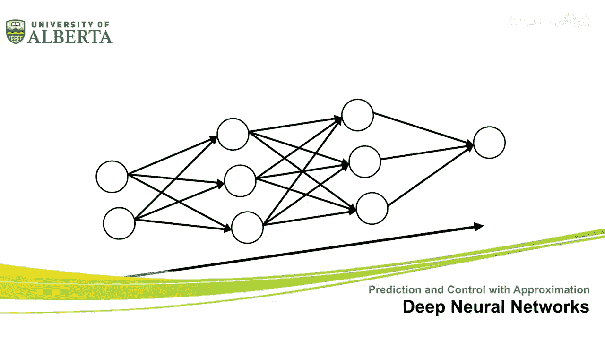
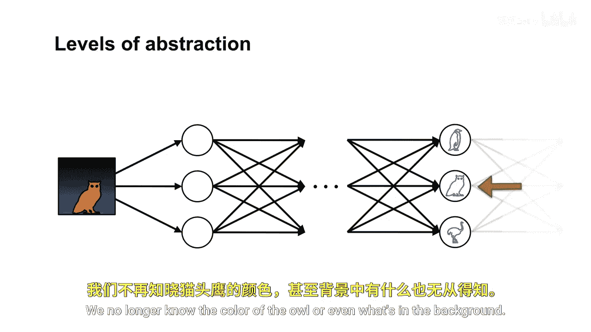

# 阿尔伯塔大学【中英⚡强化学习｜Reinforcement Learning Specialization】 p99 P99 03_深度神经网络 -BV1CdGrzuEJU_p99-

The choice of neural network architecture can have a big impact on performance。

This includes the number of nodes， the activation functions。

 and how the nodes are arranged and connected。Today we will provide some intuition on the role that depth can play in the network。

By the end of this video， you will understand how deep neural networks are composed of many layers and understand that depth can facilitate learning features through composition and abstraction。

We can view a neural network as being a modular system where each layer is a module。

We can add and remove layers and we can change the types of layers that we use。

The depth of the network is defined by the number of hidden layers in the network。In theory。

 a neural network need not be deep， a neural network with a single hidden layer can approximate any continuous function given that is's sufficiently wide。

 we call this the universal approximation property。However。

 practical experience and theories suggest that deep neural networks may make it easier to approximate complex functions。

One reason for this is that the depth allows composition of features。

 composition can produce more specialized features by combining modular components。

Consider an intuitive example， the input is the raw pixels of an image。

The earlier layers might learn to capture low level features， like lines at various angles。

The next layer may learn to compose those lines into various shapes。From these。

 the network might be able to detect objects or animals in an image。

This typically works better than trying to immediately infer these directly from the raw pixels。

By adding more layers or more units to each layer， we can represent more complex functions。

Deathth can also be helpful for obtaining abstractions。

 deep neural networks compose many layers of lower level abstractions。

 with each successive layer contributing to increasingly abstract representations。

Consider the previous example， the network might eventually represent the concept of an owl with a single bit。

A zero meaning the image does not contain an owl， and a1 meaning the image does contain an owl。

At this level all the extra detail in the image has been removed。

 we no longer know the color of the owl or even what's in the background。

In fact， we can explicitly design the network to remove unnecessary details from the input。

 for example， a network can be designed with a bottleneck layer。The idea is simple。

 each successive layer contains less nodes than the layer before。

The representation is the layer with the fewest nodes and contains the key details needed for prediction。

Overall， depth in a network can significantly improve our agent's ability to learn features。

In this video， we described how networks can be composed of multiple layers。

And discussed that depth facilitates composition and abstraction。

Today we discuss some of the potential benefits of deep neural networks in practice picking the right architecture can be difficult and can significantly impact performance we will not discuss the network architectures further in this course there are many good resources on this topic check them out if you want to know more。

Next， we will discuss learning the parameters of a neural network。

