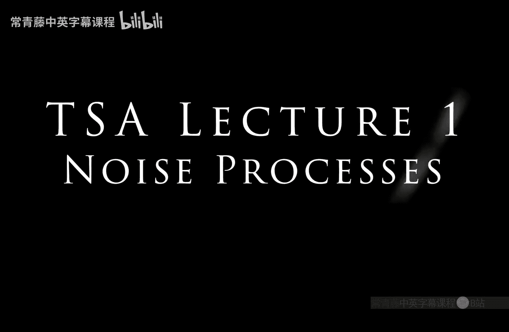
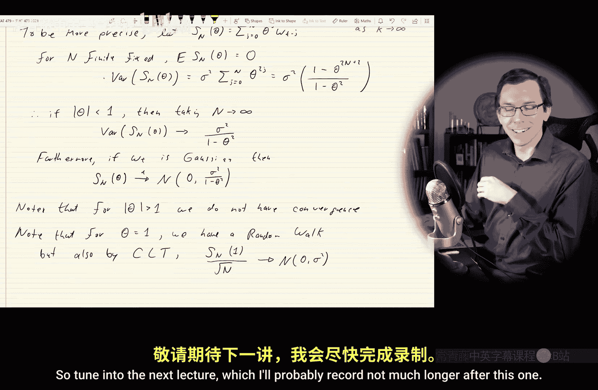

# 阿尔伯特大学【中英⚡时间序列分析｜STAT479 2021 Time Series Analysis】 p01 P1 Lecture 1： Noise Processes -BV1nwqYBDEos_p1-

So things are constantly changing in our world and as statisticians， it's our job to understand them。

 This is statisticstistics 479 time series analysis。Let's go look at the data。🎼あ。

🎼So in our very first time series lecture， what we have to do is discuss different types of noise because when you look at the time series it looks pretty noisy but all of these different types of noise have different properties and that's what we'll be discussing today is trying to understand the the very fundamental building blocks that will make up our time series data All right。

 so welcome to time series analysis Stat 479 this is the first of our video remote lecture is coming directly from my basement to your computer wherever it may be。

So when we begin with time series， we have to kind of set the stage with the idea that time series extends what we've learned previously in statistics about linear regression and stochastic processes。

So。Perhaps to start， we could just take an example say。If you hear some random banging up there。

 that's a toddler who。Likes to run around a lot。All right。

 so let's do an example just to start off before we start getting into definitions and whatnot。

 so let's say we want to predict the temperature。Predict。Let's say example。Example。

 I want to predict the daily。Let's say average temperature。Temperature。In。And let's say Edmonton。

Because why not？Don't really go outside much these days。

 but still might want to know what it's like outside in case I want to open my window say。So right。

 let's say we want to predict the daily average temperature well how could we do that there's lots of things we could try if we were to take a linear regression example or approach。

What we may try to do is。Pick。Some predictors。Some independent variables or predictors like we would do in a regression context。

 so what we might have is something like a citiess。Elevation。

You know how high are they above sea level， we could have a latitude。If I can spell that correctly。

 latitude， a longitude。Yeah， you get the idea， a latitude， a longitude。

 you could have a time of the year。And if we were to try to do a linear regression model。

 we could plug all of these independent， say variables into the model and try to use them to predict what the temperature is in that city。

 in say Edmonton， in this case we would have say a collection of cities and we'd want to try to predict。

 but if we're in a time series context。Perhaps the best thing we have to predict what the average temperature will be tomorrow is the average temperature today and that of yesterday and the day before。

 so in the time series context we use previous。Say temperature。Measurements。To predict。

The future measurements。Future measurements。But this leads to some complications。Basically the。

Problem。Gets harder。And the reason is because in linear regression。

We assume independence between our observations。And that's a strong assumption。

 but often a valid assumption， depending on the setting of our data， however。

 when we're in the time series context， we no longer have that。We're basically doing statistics。With。

Depenency。Specifically， a temporal dependency。Of course。

 there's also other areas of statistics like spatial statistics where you might have some type of spatial dependency and whatnot。

 but here， we have temporal dependency， also， I should say， temporal dependency or causality。Ie。

The past。Predicts。Or dictates the future。Or maybe it doesn't right we don't actually know we have to try to analyze the data。

 we may have data where there is no temporal dependency the past every day it's just a new random temperature but in this example that I have that's not the case we know that temperatures change kind of slowly as through the seasons and therefore we know that the temperatures from the last week are going to give us a lot of evidence to predict what the temperature will be tomorrow and that's what we have to deal with when we're in the time series context。

So what we'll be doing is we'll be watching measurements over time。

 whether that's say the price of some commodity or stock。

 whether that's climate data like temperature or rainfall。

 whether it's the number of COVID cases being reported here in Alberta。

 which is follows of very interesting time series and we'll be looking at that in this course。

Hopefully it age as well because I'd like to use these videos for more than one class。

 but I think COVID will be quite an interesting time series to consider because there are natural fluctuations。

 random effects， but also some very nice trends that you can predict based on the trajectory。

So before we get to ahead of ourse with looking at real data， we have to talk about some。

Mathematical models and that leads to the very first section of my notes which is types of noise because in time series it's all about the noise。

 the stochastic process， the random fluctuations and there are many different types of noise processes that we're going to have to consider so let's take a look at those。

All right， so the first one that we have to discuss is white noise。This is perhaps the。

The groundwork in some sense， for all time series models， white noise is going to be。Well。

We'll say define， let。WT。Be a random。Variable。I guess process。Indexed by time。Indexed。By time。T。

 so we can think of time， I guess in this case will。Put it on a finite interval。

Between0 and some capital T。 So time is going to run from the start to 0 to some capital T。

 and we're going to assume that。嗯。With， I should say， with a couple。Assumptions。

 so white noise is going to be mean zero， which means the expected value at any time is going to be zero。

This is。Zero mean。And we also have a constant variance， so the variance of。WT。

it sounds like someone's playing the bass up there， the variance of WT is going to be sigma squared。

 which is constant variance。Got a nice beat going there。But。Right。

 so we have zero mean and we have a constant variance and then we have that it has zero covariance for two different time points。

 so for time points T and S we have that the covariance is zero and this is for all T not equal to s so if you have two different time points they are uncorrelated。

This is not strictly independent， this is just the bare bones definition that we need。

 which is that they are uncorrelated。And。Correrelated。Times。

So this is the idea that at any given time we just have some random observation。

 it has the same mean and mean zero and fixed variance throughout the time span。

 but they will be uncorrelated so there's not going to be any linear relation。

 so maybe we'll point that out and say that note uncorrelated。Means。Not linearly。Related。

Right you can have some strange dependencies that are non nonlinear and you can still have uncorrelated random variables。

 but this is kind of the bare minimum that we need Of course we can also strengthen this so this is just the。

This definition is going to be our week。White noise。

Sometimes it's referred to that because it's sort of the weakest definitions。

 there are conditions that we need for our white noise process， but we can strengthen that。

 we can strengthen that to IID white noise。And IID white noise is sort of the same。Has above。But。

Replace。Uncorrelated。With independence， so we take uncorrelated and we replace with the word independent。

So this is a stronger white noise setting now we still have mean zero and constant variances。

 but we assume that at any two distinct time points this process is completely independent of each other so that gives us a stronger groundwork to kind of work build from because a lot of the time series models that we'll look at are all going to build from white noise we're going to start with some white noise and we're going to start to mess around with it and we're going to get different types of behaviors which we'll see shortly。

But before we get there， we have one stronger setting， which is Gaussian。White noise。So this is same。

As above。With。In addition。The condition that our white noise process is now going to have a normal distribution。

 WT is going to be normal zero。I guess sigma squared。For all T in our interval。

So now we've strengthened this even further to get a nice normal distribution and if you've taken any statistics class which I assume you have。

 you know that statisticians love the normal distribution because it makes everything a lot easier to handle and in practice it's not unreasonable to assume。

 the normal distribution， of course there's always ways to test for that。

 given actual real- worldorl data， but typically， the normal distribution。

 it's called that because it arrives， it arises just about everywhere in well in data。All right。

 so these are the three different types of white noise from the weakest to the stronger。

To the strongest。Conditions。And then the other question we should probably ask ourselves is why is it white。

 why is it white noise？Why call it white noise？Well， the reason is comes from signals processing。

From。A signals。Processing。Setting。White noise。Contained。Contained I cannot write today。

 let's get this right here。Contains every frequency。So if you have a signal， right。

 you might have a nice smooth wave so let's say。Let's say if we have an example here with what we'll call one frequency in a wave。

 it might just look like a sinusoid right we have one nice frequency in our wave if we have。

All frequencies， well， then it's going to look something。Crazy like this。

 which I can't quite draw in its pure stochastic form。

 given my stylus here it looks a little bit too regular actually but it's just going to look like complete chaos and noise so in a sense it contains all possible frequencies but that's where the term white comes from。

 I guess in a way it's kind of like if you combine all the colors you get white light colors colored lights you get white light。

but we want to go a little bit further than just white noise and what we're going to do is we're going to use white noise to build up to more interesting stochastic processes and the first one。

Or time series processes， or the first one we're going to consider is the auto regressive process。

So the word regressive here is kind of jumping out。

Because in a regression setting right we take our independent variable and we try to use a linear combination of independent variables to predict our dependent or our response variable in time series we use the same variable in the past to predict itself in the future if that makes sense so let's try to write that down。

Mathematically。So the general formula。Is going to look something like Xt。Is equal to the sum。

Of I from1 to P， so this is going to go back P time steps into the past。Of x T or， let's say。

 theta I and x。T minus I plus。WT， so let's take a moment to figure out what this equation is telling us。

I guess what I should say is for。Fixed。Theta I。In our real numbers。 So okay， what's going on here。

 Well what we have here is the。Present value。Of whatever x is right x could just be the price of some stock。

 it could be the temperature outside in the city， it could be the number of daily covid cases and what we're going to do is this is going to be。

A。Waited。Some。Actually， what I should say a linear combination。

 I don't want to say weighted because we're going to talk about。Weight and moving averages。

 so what we'll call this is a linear。Combination。Of。P past values。

And then this last bit is just going to be white noise。Noise。At。Time。Ti。

So in contrast to say linear regression， maybe I'll write that in green here。

 just to recall that if we were to do linear regression。

 trying to use this as a starting point to help with your intuition when you learn time series for the first time。

In linear regression， we would have some response variable Y。

 which would be something like a linear combination of。Independent variables x1 through， say， x。

 I'll use P here。P plus some noise， epsilon right in this case， we have the same idea happening。

It's just that we now have a white noise process for our epsilon， our noise， we have。

 and instead of having a new y variable， a new response。

 we're using the past values to predict the present value。

 but ultimately we still have a linear combination of predictors that's going to try to tell us what the value of our response variable is。

So we have some very specific examples。So we have something called the random walk， which is。Well。

 a very special case that we'll be looking at a lot。So let's say special case。Special case is the。

Random， walk。Which is going to take it's going to have the formula Xt is equal to x t minus1 plus wt。

 so what this says is that at time T I'm just going to take the previous time step and add on some random noise and remember WT even in the weakest sense is going to be mean zero with a constant variance so that basically means that well okay we're going to start at the previous time step and then we're going to either go up and down by or down by some random amount and then we go up and down by some new random amount and so on and so on。

So that's one way to do that， but typically we would also have other coefficients theta out front。

So another thing that we can consider is going to be the random walk with drift。

 so let's say this is one case。We also have the random walk。With。A drift term。

This is important because the random walk is kind of just going arbitrarily up and down without any real pattern in some sense but the random walk with drift is going to be。

 it's going to look a lot like that equation I just wrote down but now we're going to add an A to it so what we do here is we add some constant A this is。

Someam。Fixed。A。In R and in this case， what it means that at every time point we're adding a。

 so if a is positive， that means we're going up by a units。

 but we're also adding in that random white noise， so there is a trend either up or down depending on the sign of the value A。

嗯。But there's still going to be some random fluctuations above and below that line。So。

This is very important because typically we might want to use a model like this to determine。

 say the trajectory of some random process， are temperatures warming， for example， if a is positive。

 then we can see that while there are fluctuations from year to year。

 the trend is that temperatures are going up， or maybe the price of a stock or commodity is going down again with random fluctuations above and below the mean。

So perhaps the best way to illustrate this is to actually look at some pictures of autoregressive processes and rather than me trying to draw them with this you know silly pen here。

 what I can do is copy some graphs that I have already produced in R so here we have four different examples to look at。

The first one， let's number them。1。To。3。And four。So if we look at number。

If we look at number one here， what we have is the white noise process， so this is just。WT。

 it looks pretty chaotic， it's what I tried to draw above。

 but this is what a white noise process might look like if you simulate it in R， for example。

 which is what I did here。And of course we'll look at our code going further into this course。

 but right now we have a lot of sort of groundwork to lay before we get into looking at actual data and simulations。

Okay， so we have our white noise， we have our random walk which we talked about before this one is going to look like random fluctuations up and down。

 notice that any two time points， the values are very close to each other。

 so there's almost a somewhat of a continuity that you can imagine here。

 the idea that two adjacent time points are not going to be too far apart from each other。

 but as we move far away in the future， the time points， the values can change quite a lot。

Just to write down the equation again， we'll put that here。For equation for graph three。

 I have an AR2 process， so the process that I use to generate this is going to look like。Let's see。

 what did I do， I used the random walk。And then I subtracted。0。

2 X T minus2 and then added on the white noise process so in this case there's actually a random walk。

 but there's also some other second order piece in there that's coming from two time points ago dampened a little bit by a coefficient of minus 0。

2。And then for number four， we actually have a third order autoregressive process in this case I think I just kept adding terms on so we have the random walk bit。

 we have that second order bit， then I added on a third order bit 0。18。X， T minus3 plus W T。

 So perhaps one of the takeaways is that。Looking。At。The pictures。It's not obvious。At least not to me。

Not obvious。What type of process we have， what type？Of。AR process， auto regressive process。These are。

Hence what we'll be doing is we'll be using statistical methods and methods from probability and statistics to try to take a good guess based on data as to what type of process we're looking at here so for example in the right column well I have my random walk and I have my AR3 process they both look kind of。

😊，Random wish， stochastic in a way。 So it's not straightforward to me that one of them is order  one and one is order 3。

 and similarly in the left hand column， just by staring at that。

 it may not be obvious that the top one is white noise。

 but the bottom one is not a white noise process， but an AR2 process。

So this just to give an idea visually what we're going to be looking at going forward。

 and at least that's for the AR process， but there's another big piece so the autoregressive process forms one major cornerstone of what we'll be talking about in this course。

 the other major piece is the moving average process， so the second bit that we need to discuss。

Is the moving？Average process。Or the MA process。Right， so how do we look at moving averages？Well。

 I'm going to take one quick break to reset everything and then we're going to get right into that。

All right， and we're back and we're going to be talking about the moving average process now。

 so the moving average process is a type of smoothing process and this is something that you'll see very common in。

The real world， I guess when you hear people say， a we have a seven week or seven week seven day average for something。

 let's say， for example， we're looking at COVID cases。

 the daily number of cases is quite stochastic in the way that it can fluctuate a lot。

 oftentimes when you see the graphs reported， you see a seven day moving average。

 which means the average a window of the last seven days to get a smoother representation of the process。

So。In a mathematical sense， right， this is a。Well， what we'll say off to the side here is this is a smoothing。

Of white noise。And what I mean by that is that we can write out the formula。

And the formula we're going to get is that Xt is going to be the sum。From J from 1 to Q。Of not theta。

 we need to make sure we have unique Greek letters here because we're eventually going to combine these。

So we have Phi JW。T minus J。Plus W T， and this is going to be and。MA of order Q。

 So what does this equation tell us， this equation says that the present。Value。

Is an average or some weighted。Some。Of past white noise values past。Noise。Values。Plus， white noise。

At the present。Time。So this one is a little bit。Maybe less intuitive。

 I think than the auto regressive， the auto regressive is somewhat natural to consider because what it's really saying is。

 okay， we're going to use the past P values。we're assuming that the past P values influence the current value of whatever thing we're watching。

 whatever process we're trying to understand。For the moving average。

 what we're saying is is that the current value is some sort of average or weighted sum of the past noise values。

 so perhaps the。The easiest way to think about this is in terms of a like a market。

 like a stock market， so say。That。X T is。The price。Of some。

Stock say I don't actually know much about finance math。

 so if I am a little bit imprecise with the language， don't get too me。

 but the idea is let's say x is just the price of some stock。

 the current price and if we model that as X T being something like let's say phi1 wt minus1 plus WT。

Then this would be basically saying that WT minus1 is going to be a random。Sck。

Or random fluctuation in the market at。T minus1， and this would be sort of a random。

Sho to the price at T。So what this is saying is that if one time unit ago， one day， one week。

 one month， whatever t is， right， we didn't actually define specifically what T is。

 but one time unit ago， if there's some random fluctuation that goes up or down that affects the price。

 then that fluctuation will still be， in some sense， present at the next time point。

So it's almost like you get hit with a shock and there's still a reverberation one or two or Q time points later if the value of phi here is positive than what that means is that a positive shock will still be kind of present at a later time point if phi is negative then that means a positive shock will come back as a negative shock at a future time point so there's almost like a yo-ying effect in the sense that it kind of goes up and then down than up and then down so this again is a little bit harder to intu it I think but。

It does show up a lot in modeling time series， so it's really another。

 it's the second key piece after the auto aggressivegressive process for modeling time series data。

 so very important to spend some time and think about that and similarly I have some pictures。

Where in the world are those pictures。I'mPretty sure I have some pictures。Yes， here they are。

So let's see if we can get this in here。All right， we have some。

Moving average processes then to look at。And let's see if I can find the definitions。

Which for some reason I。Oh that's right， these are average white noises that's what it is Okay。

 so there's one thing that I didn't mention yet and that。Is that another？I can move my timer without。

 okay， good。We'll say another。Definition。Of。MA is。To take X T and write it as the sum J from1 to Q。

 so we're still averaging， I guess， over Q time points， but oh sorry。

 what I actually meant to say was Q minus1。嗯。They'll say J is going to be minus q over  two to plus  Q over  two。

 and then we're going to have a phi。J and a WT plus J and in this case， what we're saying is。Average。

Over。A window。Which is going to run from minus2q units in the past to plus2Q units in the future。嗯。

I'll say before。And。After。Time point T。So this is another way that we can represent a moving average process and what we'll be doing is we'll be taking the time points in the past and the time points in the future and averaging them in I should say averaging but summing them in a weighted way via the phis。

 so typically it doesn't have to be this case， but typically the phi values here would say sum up to one and then you'd have some weighted average of the adjacent。

white noise process points and that's exactly what we're looking at in this in these plots off to the left hand side here。

 so here we have one， two， three and four again so again as before number one is just going to be white noise。

Number two is going to be this above。Defined process that I put with a little star here where Q。

Is going to equal， I believe three， if I got that right。Let me double check， yes。sorryrry。

 Q is not going to be three， I guess Q is going to be。Two， so the window。Has length three。

Right because we're going from minus q over two to plus  Q over two。

 so in this case they would be minus10 and plus one。

 so I'm taking the current time point and the adjacent minus one and plus one time points and averaging them in this case I'm just assuming that with。

Phi J here just being one over three。So I'm just averaging three time points and what we get in plot number two there is a slightly。

 maybe a slightly smoother， but still pretty noisy looking thing compared to the white noise process。

 but when we extend this into plots three and four where the window，Has length。What nine？And。21。

 then suddenly we start to get a much smoother representation of our white noise process because we're averaging over a wider and a wider window when we look at the MA21 process down there in the bottom right what we see is something that actually kind of looks a little bit like that random walk we saw up above or an AR process so again it's not always straightforward when looking at some data or looking at a picture like this what the type of stochastic process or time series process is that we'll be working with so it's always good to remember that and we will also see later in the course that sometimes one process can actually be represented as the other type of process so there's a bit of a duality here that we'll just make things a little bit even more complicated。

But I'm getting ahead of myself， we should just stick with the basics right now as we sort of enter into this course。

Right。When we talk about time series processes， well， there's a couple things I wanted to point out。

Some things to note。We could。Consider。Time。As continuous。I。e or EG or I。e。

 or whatever the right one is。We could consider xt for T in some interval， like zero to capital T。

 like I said before， for the white noise but。In this course。We're going to look at discrete time。

I say we consider。Discrete。And discrete uniform time steps。Uniform。Time steps。

 because time series data is actually quite messy or can be quite messy。

 so in this case we'll consider t is going to be0，1，2， all the way up to some capital T。

And we're going to assume that all of the observations are exactly the same unit of time apart。

 so a process is measured every day， it's measured every week， it's measured every month。

 it's measured every second， but it's always measured at a uniform time step because you can have time series data。

 which you can imagine in practice， is going to be measured at irregular time steps。

 maybe there's going to be a big chunk of time missing。

 maybe it's just going to be a bit chaotic when it's measured。

We can handle such data but it becomes a lot harder and this is an introductory course for time series analysis so for this moment we're going to assume that whatever we're looking at is going to happen at sort of equally spaced time steps and is going to be discrete so we don't have to worry about all the headaches that come around when you think about a continuous time indexed stochastic process。

Now there are two definitions that I think are worth discussing before we go forward。

 and that's the idea of Markov process。And the Martinale。

So let's consider very quickly what is a Markov process。So the Markov process is a way of， again。

 its it's a way of describing the dependency in some type of in this case。

 discrete time stochastic process so cutting to the。To the end， we'll basically say Xt。Is Markov。If。

The expected value。At time T， given all of the past measurements， and we'll start this at time one。

 I guess。Is going to be equal to the expected value at given just the previous time measurement。

So the point is is that we're here conditioning。Sining on。The whole past。And here， just the previous。

Value。So this notion of a Markov process is important because if we have a process Xt that is Markov。

 then that means that the present value is only influenced in some sense by the previous value in the idea that if I'm going to take the expectation。

 which is what the average， what we think is going to happen at time T， given the entire history。

 well， it's the same as trying to predict or estimate what's happening at time T given just the previous time point。

I'll say for example。And。AR。One process。Is Markov。Because an AR1 process， as we noted before。

 is going to look something like Xt is equal to theta。Xt minus1 plus some white noise。

 so it only depends on the previous time point for what the current time point is going to do and if we know the value at the previous time point。

 then we don't really care about the history that preceded it。And it's also worth noting。Note。嗯。

We can。Consider。Higher。Order。Markov processes。Processes。

There we are so the Markov process is just a nice thing to keep in mind。

 both from a probabilistic modeling perspective but also statistically because ultimately what we want to do is we want to use the press data to understand and predict trajectories that's called forecasting to forecast into the future and if we have a process that's Markov then in some sense we just need to know what the previous value is to predict the future value。

I also want to briefly mention the idea of a Martinale。So the Martinale， in some sense。

 is referred to as a a kind of like a generalized。Random walk。Um。

 or sometimes you'll hear people refer to it as a fair game in a gambling sense。

And the idea of a Martinale is that if。Xt。Or。Forget the if X T is。Hey， Martinale。

If the expected value。At time T， given the past。Values。

Is just going to be the previous value that was observed x t minus1 so this is very much like the random walk if we you know if we want to know where do we expect to be at time T well。

 we just look to the previous time point and we say well it's what we saw one time unit ago so very often this does occur with things like temperatures or。

Stock prices where if they follow this random walk or this Martinale type setting。

 this more generalized random walk setting， then what we might expect is that well。

 the best guess for what we think the value of the process is today is what the process was yesterday。

And there's a ton of nice probabilistic theory that goes into the idea of studying Martin Gas and things like Sub and Super Martin Gaes。

 that's well beyond anything we're actually going to talk about in this course， but it is。

It is very important to at least mention these ideas just so they're in your head as we move forward。

嗯。And now what I want to also mention is the idea of a Gaussian process。So。

We know what the normal distribution is。We know what the multivariate normal distribution is the Gaussian process is in some sense a generalization of the multivariate normal or the multivariate Gaussian。

 so for the moment I'll say。Assuming。Continuous time。Time T in， say， zero to capital T then。

I'm going to write GT for is。A capital G Gaussian。Process。If。For any。Fite。Collection of time points。

Collection of time points。T 1。Through T。I don't know P or k， what do we like K。

 I guess because P was our auto regressive order and Q was our moving average order。 so we'll do k。

 So the idea is that for any collection of k time points then。The vector。G， T 1。Through G T K is。

Multivari distributed as a multi。Varit Gaussian。Distribution。

So the Gaussian process is super important， well almost everywhere。

 but especially in stochastic processes and time series， again。

 we're not going to be dealing with continuous time processes in this course。

 we'll just be looking at discrete time in the discrete time setting well a Gaussian process just becomes。

 I should say in the discrete and finite span time setting the multi the Gaussian process just becomes a multivariate normal distribution。

 but most importantly we want to say that a。Like。I'll say like。A。Multivari。Gausian。

The Gaussian process。Is going to be uniquely defined。Is。Defined or characterized。By。

It's mean and covariance。So if we know what the mean of the process is and we know what the covariance is and it's Gaussian。

 and sometimes we know everything， there's nothing else to know about that process。

And the other thing I wanted to point out is that。Recall。That。Any。Linear。Combination。Of。

I guess a multi。Variate Gaussian。Is。Also。Gausian or normal。So the normal distribution。

 I should say the multivariate， the joint normal or the multivariate normal is a very nice distribution because if I take my the pieces of that and if I combine them linearly in any way in some sort of sum or linear combination。

 then what I get out is also going to have a normal distribution。

 so that's really nice in a lot of reasons， but specifically for time series。Because therefore， if。

Our。WT。Is。Gausian white noise。White noise then what's neat is that every process that derives。

 not every process， every process that we've talked about like the autoregressive or the moving average process that is derived from that white noise will also be a Gaussian process so right if WT is Gaussian white noise then。

Any。AR or MAA process。Basedest。On it is。A Gaussian。Process。

Which is quite neat because that means that all we really need to do then is understand what the mean and the covariances is of our Gaussian process and we can understand the entire thing in some mathematical statistical sense。

All right。So we have all of that。What else do we need to do？Okay， yeah。

 we have one more process that we need to define， which is the idea of a linear process。All right。

 so a linear process also。嗯。Is a general。Idea。That encompasses。And compas is much。Most。Time series。

Moels。So the linear process is going to be something much like the Gaussian process that's going to show up all throughout the time series models that we'll be looking at in this course so how do we define that well we define it simply saying if。

WT is white noise， not necessarily Gaussian or strong in the independent sense。

 it could just be uncorrelated weak white noise。If WT is white noise and I think we're going to need four。

T and this is always a little bit of an intuitive stretch。

 but we're going to run T from minus infinity2 plus infinity。The idea is this is for all time。

 all present， all past， all future time， we have some white noise process。

 we're going to still consider it to be discrete but we're going to allow the index to go all the way to Infinity and all the way back to minus infinity again there's two sides to when we this when we deal with time series in practice。

 we have the mathematical framework of sort of infinite time horizons and then we have the real worldorld setting where okay we're not going to have infinite data。

 certainly not into the future but not into the past either eventually our data has to start somewhere and then stop somewhere else but。

Mathematically， we can think of a linear process as if we have white noise that exists in some sense for all time then。

Xt defined by mu plus the sum。Where we take J from minus infinity to plus infinity of the theta Jwt minus J is a linear process。

So what we're saying is it kind of looks a lot like that moving average process that we talked about before and it's going to turn out that it is actually closely related to both the moving average and the autoregressive process。

 but here what we're saying is we're just taking our infinite white noise process and we're doing some type of weighted sum linear combination of the terms。

 and then there's going to be a constant mu， which is going to be the mean term because we always assume that white noise is mean zero。

So then the first question， if you want to be a good mathematician is。

 does this even make sense to write down？We'll say math check。Does。This infinite。Infinite。

 I should say doubly infinite。If I spelled doubly， right， infinite and sum。Make sense。

Because now I'm summing up in two directions， I'm summing up to infinity of a bunch of random variables。

 so then the question is does this actually make sense and the answer？Which we'll do in green。

 the answer。Is yes。As long。As the sum。Of overall j from minus infinity to plus infinity of the theta j squared is finite。

 so this is and there goes my camera again Okay， so why would that be the case is because if we want to compute the the variance。

 right？So the answer is yes， this sum does make sense as long as。

The sum of the squared theta is finite， and the reason for that is so that we know that the。

This is because。We want the variance at time Xt is going to be by independence， the sum。

Of the minus infinity to infinity of the variances。Of the W T minus J。

 which is just going to be something like sigma squared。

Times the sum of these theta squares from minus infinity to plus infinity。

So we want the theta squares to be square summable， I guess。

 if we want to make sure that this actually makes sense。U。I will say one other note。Note。

The above definition。Is not causal。So we didn't strictly define what that means。

 we have an intuitive sense of causality， the past dictates the future。

 the future doesn't dictate the past right we。This notion of temporal causality。

But strictly speaking， the above definition is not causal because。Xt。Relies。Re。Yeah。Relies。On future。

WTs。The present value Xt is a function of the past and the future。

 so what we often will do is restrict the definition to get a causal linear process。

The restricted definition。Which is going to be a causal。Linear。Process。

Is going to be that X T is going to be we're still going to have mu which is our constant mean term here and then what we're going to do is we're going to take j from0 to infinity so now we're not going into the minus to minus infinity we're just going from zero to infinity of theta J W。

T minus J。Now。One other thing I wanted to note here。Note。We。Typically。Index。

W T back minus J backwards。So as J goes from zero to infinity WT minus J is going to go from WT to WT minus1 minus2 minus3 all the way back to minus infinity。

 it's kind of the convention of writing these things down in a time series context。Again。

 it's just something to be aware of that by writing J from zero to infinity。

 I'm actually considering the past， not the future because of the way we define this。Okay。

 so I'll have little bit of time for an example before we shut down this lecture for today and move on to the next lecture。

 which I'll probably record in about you know， five minutes from now。

 five minutes after I end this lecture， but let's do an example of the AR1 process。The AR1 process。

 which is going to be kind of our standard place to go for an example because it's the simplest。

 perhaps one of the simplest processes we can work with in time series。

 so we're going to consider the AR1 process which is XT， is going to be theta。X T minus1 plus sum wT。

Okay。Is this actually a linear process， well it kind of is， it just isn't straightforward， right？

If we think back to those moving average processes， they were just weighted sums of white noise。

 so they fall right into that context of a linear process。

But it turns out that the autoregressive process also is a linear process。

 and we can see that by using this recursive， this definition recursively， so what I'll say is，Then。

Proceed。Recursively。And what we get is that Xt is going to be theta。

 but if we apply the same definition to xt minus1， what we get is we get theta。X t minus2。

Plus Wt minus1。pl WT and if I write that out， I'm going to get a theta squared x t minus2 plus theta wt minus1 plus Wt a so now we can actually think of this as having a Wt minus one piece and an X t minus2 piece to it so that's kind of interesting and we can actually continue this。

I guess somewhere I need to assume that theta。Is。Less than one in magnitude for this to make sense。

 but what we can do is we can continue this whole thing to basically get the right this as the sum。

Jy。From zero to infinity of theta J。WT minus J。And what we do here is we。Assume。

That theta in absolute value is less than one。So。That our term， we're going to have some term。

 which is going to look like theta to the k。X T minus k。We'll say vanishes。

As K goes to infinity so what we're doing is we're going kind of taking our process into the infinite past but we keep multiplying by some theta。

 which is a value that in magnitude is less than one so geometrically this thing is going to shrink。

 shrink， shrink and kind of vanish in a handwy intuitive sense。Yeah。

 so that's roughly the idea and now what we have is we have our AR1 process written as a linear process。

 but again we have to wonder does this actually make sense and how do we actually understand an infinite sum because up above I think yeah it still didn't run off the top of the screen。

 I was just saying oh well you know we can take the variance of this infinite sum。

 but when you're taking a variance of an infinite sum。

 you're actually flipping orders of integration and you actually you have to be a little bit careful so up here I should have actually should say。

Be careful to make sure that this makes sense mathematically。

 and we're going to look down here to figure out how we can do this in a more precise way。So。

What we'll say is。To be。More。Precise。Let what we want to do is we want to consider the finite sum because the finite sum will give us something that we can work with mathematically without。

Running into trouble。So if we define Sn， capital N， theta to be the sum。

The finite sum J from0 to capital n of theta J W T minus J。Well， okay。

 now we have to consider what happens as we take capital N to infinity so first of all。For。

And finite。And fixed， while we have some interesting things to note。

 the first thing to note is that the expected value of SN at theta is just going to be zero。

I guess if we wanted to， we could include the Xt in there， but we'll just leave it like this。

So the first thing is is that we can take the expected value now we're taking the expected value of a finite sum。

 so this is perfectly fine， just use the linearity of the expected value operator。

 take the expected value of each piece， they're all zero because white noise is mean zero and we get that。

And furthermore， we can also compute the variance。Of S and theta。Again。

 using the fact that we have a finite number of terms being added together and even for weak white noise。

 the WTs are uncorrelated， so we don't have to worry about any covariance terms and what we end up with is just going to be。

Sigma squared。Out front and we're going to get the sum J from0 to capital n of theta to the 2 J because when I take the variance of each piece。

 I square the coefficient right and if you have more questions about this please contact me and ask me and we can go through this in more detail I want to make sure that it all make sense。

But right， when I take the variance， then the theta， the coefficient out front gets squared。

 so it comes to the 2J。And then if I use。Well， what I know about summing geometric series。

 I guess I haven't。Well。Yeah， we don't even need strictly theta to be less than one at this point。

 and we just need to note that if we sum up a geometric series。Like this。

 we get something that's going to look like。This。And this course is going to be a lot of summing of series。

 specifically geometric series， so it's probably good to refresh your memory on that if you need some help。

 we can definitely talk about that in discussion time and office hours。But okay。

 so we sum up the first J from0 to n terms and we get something that looks like that。

 So now mathematically， we can note that。Therefore， if。The absolute value of theta is less than one。

 as we kind of assumed in that green box off to the top right here。Then。Well， what happens？Well。

 then if we take taking。And。To infinity。We get that the variance。Of S and theta。Will tend to。

Be what it's going to be sigma squared。Divided by1 minus theta squared。Excellent。And furthermore。

Furthermore， if。WT is Gaussian。Then， we know that。S and。

Theta is going to converge in the limit in I guess， in distribution to a normal zero。

Sigma squared over1 minus theta squared normal random variable because again。

 if we know what the mean is， we know what the variance is for a normal。

 then we know everything that we want。So if we consider one other point of note is that。Note。That。4。

Theta greater than one in absolute value， we。Do not have convergence。

So typically we don't want our coefficient to be big like that if theta is greater than one in magnitude then this thing will not converge。

 the variance will be infinite in some sense， which is not good， so we don't want that and also。Note。

That。For theta。Equal to one， well now what we have is we have this random walk setting。We have。

A random walk。But also。But also。By the central limit theorem， if I take my。

My let's say my S and theta， and I divide by the square root of n， then the central limit theorem。

 I guess I should。Probably change。Well。No yeah， that's fine， I guess in this case。

 if I just need to normalize it， I guess， but。Oh well theta is equal to  one yeah of course。

 so if we replace this with a1， then we get that， then in this case this will converge to a normal zero sigma squared random variable in the limit。

So that's kind of neat， so what we end up with is the idea that our random walk will actually follow the central limit theorem so it really lies on the boundary between different behaviors for our stochastic process when theta is less than one in magnitude our AR1 process I guess converges in a mean squared sense and actually makes some sense as a linear process when it's equal to one。

 we don't have a convergent linear process， but we have something that satisfies the central limit theorem when theta is greater than one in magnitude then everything kind of falls apart and we'd end up with some kind of infinite variance and that's bad and this type of intuition and these boundary points are going to be very important as we go further into this course。

So I think that's all I'm going to talk about in this lecture going forward what we'll talk about are more properties of time series processes。

 things like， well if we have a covariance now we're going to have an autocovariance just like we had a regression now we have an autoregressive process and we're going to talk about lots of other properties from covariance。

 autocovariance crosscovariance stationity and so on so tune into the next lecture which I'll probably record not much longer after this one so see you there。

😊。

