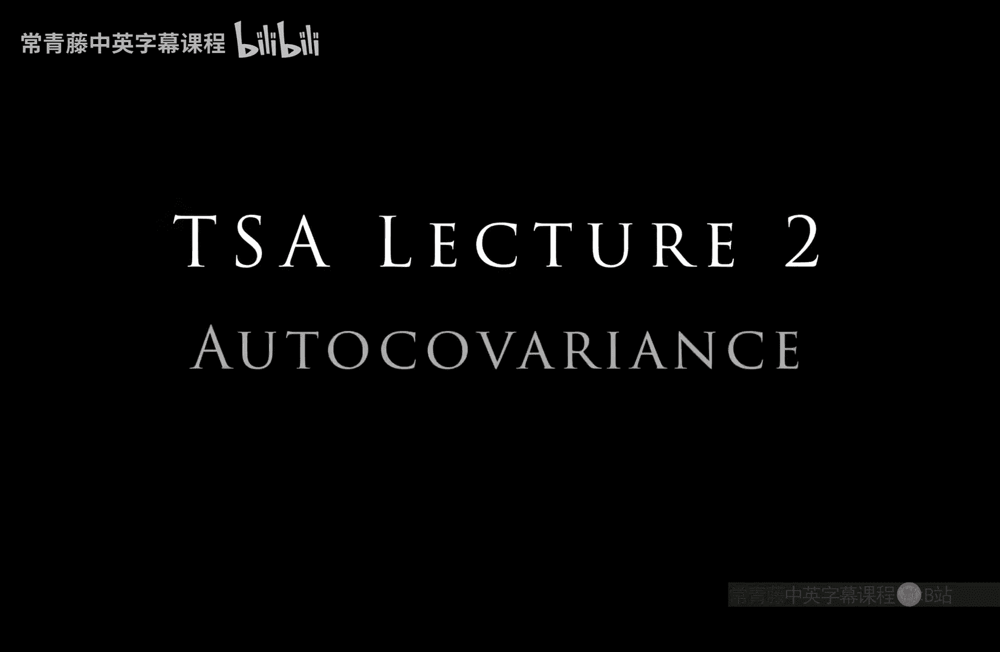
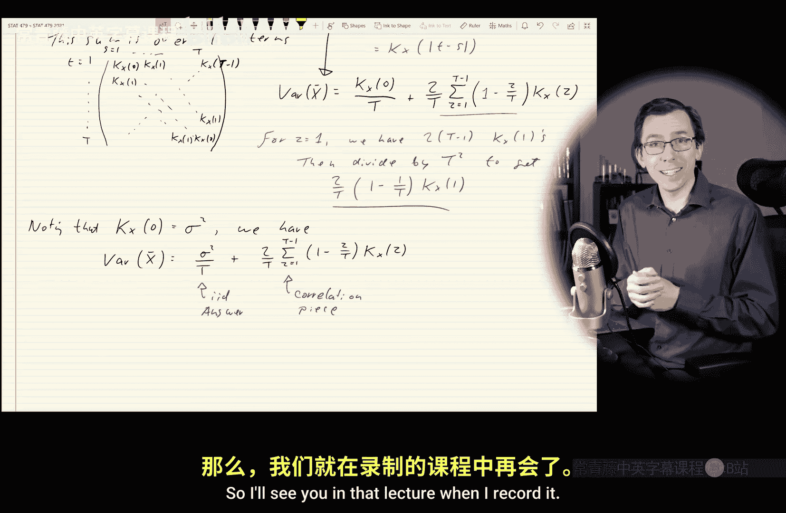

# 阿尔伯特大学【中英⚡时间序列分析｜STAT479 2021 Time Series Analysis】 p02 P2 Lecture 2： Autocovariance -BV1nwqYBDEos_p2-

All right， so now that we know a little bit more about time series noise and how that comes about。

 what we have to do is learn more about the actual properties of time series。

And this is going to take us into the ideas of autocorrelation and autocovariance。

 which is going to be a really key part of everything we do in this course。🎼あ。

We're also going to be looking at the idea of stationity because as much as time series move around。

 they actually stay kind of the same as you go throughout the time。

So let's take a look at that in more detail All right so welcome to time series stat479 lecture number two today we're going to go a little bit deeper into understanding different types of time series by their properties so last time we mostly just focused on different types of processes that we might see things like the autoregressive the moving average white noise。

 Gaussian processes linear processes these are all the different tools that we'll be working with and in this lecture what we'll be doing is going a little bit further and investigating properties of time series and estimation in time series context because right this is a stat course so we want to actually estimate things rather than just understand their properties in some abstract sense。

😊，So the first thing that we'll be talking about today is auto covariance， so let's start with that。

Auto covariance。So the first thing we need to think about as， well， what's the covariance， right？

In probability。4our。X and Y， random variables。What we have is that the covariance。

The COV Cove between x and y to distinct random variables is going to be the expectation of。

X minus the expected value of x times y minus the expected value of y。

Terrible why let's do that better。There we are。诶。So we have this definition， of course。

 the covariance of a random variable with itself is just going to be the variance of that random variable。

 And the idea is that the covariant is going to， in some sense， measure the。Linear dependency。

 which is not the right exactly way to say it， but the linear relation between these two random variables so。

If we were to collect data。X and y from my hypothetical example here。

 and if they had a positive correlation or the covariant were positive。

Or the correlation for that matter， which is just the normalized covariance。

 then we'd have something that looks like this。Right， this would be。Positive。

Covariance and if it's negative， then it'll be sloping downward if there's a zero covariance that is just going to look kind of circular。

 of course， as I mentioned in the last lecture and I'll more formally highlight here that if the covariance of x and y is equal to zero。

 this does not imply independence。That's a common mistake that people make。

 but the reverse implication is true independent random variables do have a covariance of zero。

 but covariance of zero does not imply independence， it only works in the Gaussian case。

 so X Y jointly normal。The joint normality is important here。

Because you could have two normal random variables that have some weird。

Relation between the two of them， but if we have x and y being jointly normal and。

The covariance between x and y equaling zero then。We have independence。

So very good rules to be aware of， we talked a little bit about this when I mentioned Gaussian process in the previous or Gaussian white noise in the previous lecture right because when we go through our tears of white noise we have our uncorrelated white noise which is the weakest。

 we'll start at the bottom， and we get to the next strongest which is IID white noise and then the stronger than that is the Gaussian white noise because the Gaussianity and the uncorrelatedness immediately implies that their independent it's independent as well。

Okay， so we have this idea of regular covariance。 So then what's auto covariance Well。

 if we consider again， let'll say consider。A。Time series。

Xt which is again just going to be some random variable indexed by time I'm not going to discuss we don't have a specific form。

 but you could think of it as anything we talked about in the last lecture。

 a white noise process an autoregressive process a moving average process or something else。

 maybe there's a drift term you know whatever you like。

 but we just have some hypothetical time series XT， and then we can define the auto covariance。

To be the covariance of。Well， what we use is the notation K。Sub X at times S and T。

And what this is going to be is the covariance， not the cosine。

The covariance between the process at time S and the process at time T。Okay。

 so it's really just the covariance of a process with itself at two different time points and hence auto covariance。

Okay， so one， why are we using the notation K， well。

 this can be thought of a little bit like an integral transform or a kernel function so。You know。

 I'll say in quotes here， K for kernel。It's not going to be overly relevant to what we're doing right now。

 but the idea is that you can think of it as a kernel function which could be used for an integral transform。

 but we'll save that for later there are some interesting properties here。Let's say properties。Of。

Auto。Of well to say Kx， so I don't have to write that all out again。The one is going to be symmetry。

In the arguments。So what that means is that the autocovariant of ST is going to be the autocovariance at TS right this is just because multiplication is commutative right I can a times B is the same as B times a and furthermore if we just go up to this definition of covariance at the top of the screen here what we have is that the covariance is just the expectation of the product of X and y after subtracting the mean so similarly down here。

 I can flip the order， it doesn't matter it's symmetric。Furthermore， it is positive。

Possibly semi or just positive definite， positive definite or positive semi definite。

 So what does that mean in terms of a kernel function well。

In this case or a auto covariance function， I guess， in this case， it means that for。Any finite。

Collection of time points。Times being， let's say。T1 through Tk， right， we have。That。

K by K matrix that。The K by K matrix with。We'll say I J entry。Being。Um。Right， K。Oh man。

 I'm reusing K twice al right， well wellll emphasize that I mean little k for the dimension of the matrix and big K for the little K for the matrix and big K for the kernel function。

 sorry about that。😊，But what we have here is we have a TI and a TJ。

So you can imagine that what I have here is a big matrix with entries that happen to be this kernel function evaluated at T and TJ for the Irow and the Jith column right and then this is just a big matrix。

So if we write out this matrix for any finite collection or set of time points。

 then what we get is that I'll say then。です。Matrix。Is positive。Again， possibly semi definite。

 depending on the setting， usually positive definite if everything's kind of working nicely。

So this is the way that we can extend the idea of a positive definite or a positive semi definite matrix into a autocovariance function。

 which could be， in this case indexed on infinite timescales。

It could also be sort of on continuous time， but again we'll be dealing with discrete time for the sake of this course。

Now， just to make sure we all remember， right， little side note。Note。A。Matrix， M， matrix。M is。

Positive。Definite， if。For all。X hidden vectors of the correct dimension so that this actually makes sense for all vectors。

 X x not equal to the all zeros vector， then we have that x。Transpose， let me think， yeah。

 we want row， so x trans capital T。X transpose M X is going to be greater than 0。

 And if I put in a positive。Semi definite， then I'm just making this less than or greater than sorry。

 greater than or equal to zero。And alternatively， write a positive definite matrix means that it's eigenvalues。

 I guess symmetric positive definite matrix is one whose eigenvalues are all positive。

 with a semi definite， you might have some zero eigenvalues in there。

 or I guess you would if it's strictly semi definite depending on exactly how you pedantically define it。

So it's just a nice property and it's something that we know about covariance matrices。

 covariance matrices in multivariant statistics have to be positive semi definite。

 much like how a variance has to be a positive number。

 the positive definite matrix is kind of an analog of a positive number for matrices is one way to think about it。

Anyway， so those are some nice properties that we should remember for our autocovariance function now going forward。

 what we also have is the idea of an autocor。Correlation function。And the auto correlation。

 which I'm going to denote as rh of ST the Greek letter row。

 is going to just be the normalized autocovariance， so we do what we would normally do。

Which is we will take our autocovariance and will'll divide by the respective variances。

 which is just the autocovariance at the same time point。U。It looks something like this。There we are。

So this is just the auto correlation， this is going to show up a lot when we start looking at actual time series data because we like to know。

 well are there correlations in time right if there are no correlations。

 then it looks a lot like a white noise process assuming there's nothing sort of nonlinear going on there but。

😊，Typically， what we'll be doing is we'll be using the autocorlation function or an estimated version of the an estimate of the autocorlation in order to determine kind of what type of stochastic or what type of time series process we have here and what we're dealing with。

嗯。So let's go back and do another example。Example， so in the last class we had an example with the AR1 process。

 so this is going to be a slightly more advanced example we're going to do an AR one with drift。

As I mentioned， we're going to use the AR1 as our standard example because it more or less tells us all we need to know and adding more terms like a second order AR2 or three or whatnot is just going to make everything more tedious to a compute。

All right， so let's consider the AR1 process with drift。So what we have is we have an Xt。

Which is going to be some A， the drift term a constant plus theta。X T， I'm sorry， minus1。

 we want to go into the past， not into the future X T minus1 plus WT， I'll say four。WT。Weak。

White noise， WWN for weak white noise with。The variance of WT being sigma squared。

So we can always strengthen that to independent or white noise if we really wanted to。

 but we'll just deal with it being uncorrelated for the moment。

 I don't think it's going to cause any trouble for this example。Anyway， yeah。

 so like we did last time we can again use。The definition。Recursively。

Much like we did in the last lecture when we were trying to write the AR1 process as a linear process。

 but now what we're going to do is we will do this recursively and use this to help understand。

 first of all， write it as a linear process， but then also be able to estimate two things。

 we want to estimate the mean and we want to estimate the auto covariance or。

I guess we're not estimating and in this case because we're not using data。

 we're going to compute it explicitly in some ideal setting right。

 I should say reserve the word estimation for when we're actually trying to compute something from data。

😊，So make sure I'm precise about all this anyway， if we apply this definition recursively。

 well what happens， well we still have an A here， but then when we apply the same definition to Xt minus1。

 we get another A， then we get another theta with an Xt minus2， and we get a Wt minus1。

And we add to that Wt minus1 or sorry， just WT。Right， and then when we。Move the terms around。

 we're going to get something that's going to look like a times 1 plus theta。

And then we're going to get a plus theta squared x to the t minus2， and then we're going to get a。

I guess a W T plus a theta W T minus1。 All right， so you can imagine what's happening here if we repeat this。

t dot dot， if we repeat this， let's say M times。Then what we get is well we get our A。

 and then we're going to have the sum from one。All the way up to theta to the M right。

 so that's the first bit， the second bit is going to be just theta to the M X T minus M。

And then the third bit' is going to be the sum of a bunch of white noise pieces。

 so we're going to take j from0 to M and we're going to multiply that by theta to the Jwt minus J for our sum going backwards here。

All right， so where can we go from here？Well， we can extend this into the infinite past if we assume that in some ideal mathematical setting that this process can extend into the past indefinitely。

Then。What I'll say is basically taking。M to。Infinity。

 which is going backwards in the past to minus infinity with。

The absolute value of theta being less than one， because otherwise our geometric series will not converge。

 we get。We get that Xt。Can be written as well， what happens when we take this geometric series one plus theta plus theta squared plus theta so on well that just becomes one over one minus theta。

 so we end up with an a divided by one minus theta。Great。

 that second term again just vanishes because we have that theta is going to be less than one and as we multiply it by itself again and again and again。

 it sort of kills off that term， so we don't need that theta to the M xt minus M。

I guess if we want to be more precise about it， we can compute it as a random variable and look at the variance as we take M to infinity and show that the variance disappears and the whole thing goes to zero。

Lastly， what else do we have？Yes， we also have。Um， this infinite sum of white noise from zero to infinity。

 which is going to look a lot like what we had in the last lecture。W T minus J。

So now we have this in the form of a linear process。Linear。Process form。Okay。

 and this is going to allow us to compute the mean and the auto covariance pretty fast， so first。

The mean。So if we want to compute the expected value of xt。

 well we just note that the first piece here is constant。

 so we just get an a1 minus theta and the second piece here。

That's the first piece The second piece is just going to be zero right because what we're doing is we're taking the expected value of light noise and the expected value is zero so it just becomes zero now again if we want to make this slightly more mathematically precise than taking the expectation of an infinite sum we can take the expectation of the finite sum and then take that index to infinity and that will give us kind of the idea of what's happening to this expectation but here we can kind of just hand wave past that and say a it's mean zero so the mean is just going to be this piece。

Which is quite neat， it means what it means that。I guess the mean is going to be dependent on two pieces。

 the a， which is going to be the drift term， but it's also going to depend on that auto。

Regressive piece， theta。So if theta is very close to one， this mean is going to blow up。

 if theta is very close to zero， it's not going to change very much。And then furthermore。

 we can actually look at the auto covariance， which is perhaps a more interesting calculation if we were to compute the auto covariance for this process。

What we end up with is something that's going to look like this。

 while we're just computing the covariance at time S and at time T。

 which again would be kind of annoying at first， but because of this recursive definition or this using the recursive definition to write it as a linear process。

 things become a little bit nicer， so first of all we have to subtract the mean when we use through the covariance。

which we just computed in the last step and what we're left with is just the product of two infinite sums J from zero to infinity of theta J WS minus J and well。

 I guess the exact same thing kind of except at time T。

The sum J from0 to infinity of theta to the JWT minus J。All right， well。

 when we have a double sum or a product of two sums。

 we can write this as the product of all the terms again if you're okay doing that for infinite sums。

 but everything's convergent， we assume that theta is less than one。

 so it's all it's all good to go mathematically。Regardless now we're going to sum over I and J from0 to infinity and we're going to get two pieces。

 we're going to have a theta j and a theta I and then we're going to have a ws minus J AWT minus I okay so now well we have a lot of terms in this summation to deal with but luckily most of them are going to be zero right because expectations linear so we can bring it inside that summation and when we take the expected value of the product of these two ws。

Basically， the expected value of。We'll say Ws minus J and W T minus I。

 it's always going to be zero if the indices differ from each other。Um， so in this case， if the two。

 if we have uh this only， oh， I'll just write it out。We end up with a sigma squared。

 but we get an indicator function that says that S minus J has to equal t minus I， otherwise。

 by the fact that these are uncorrelated， this expectation would be zero。

So that's kind of neat because that means when we put all of this stuff back together。

 well what happens， well first we have a sigma squared in front of everything， now our double sum。

 I guess well become a single sum because we're only we're only summing up the terms where those indexes actually equal one another。

And what do we get Well， what we get is something like。Yeah， I probably shouldn't skip a step。Okay。

 we'll do it in two steps just to make sure that I don't mess this up or confuse everyone。

So what we'll have here is theta i plus J。And we have this indicator function， which。

I can actually rewrite because again， it's just saying S minus j is equal to T minus I so if I rewrite this。

 what I get is。S minus T is equal to J minus I， I guess。If I got that right。Yes， yeah。

 that looks good。Okay， and then the reason why I want to do that is because I want to extract an S a theta to the S minus T。

 if that makes sense， so actually why don't we do this in the side margin to make sure I don't make a mistake and that you can also follow the calculations that I'm doing。

So what do we have here well we have that。What do I want in this exponent here？I have an i+ J。Well。

 what I can do is I can write that as a。Jy。Minus I。Okay， but then I also have to add on to it。

 I think to。I。Is that what I want？Let's say two I something like that mainly because I want to take this and replace it。

 I think I did this slightly backwards than how I did it in my notes。

 but that's okay I can replace this with。S minus T。Plus。2 I。 So when I put this all together。

I end up with。A theta。To the S minus T。And a sum。Of J from0 to infinity of。Now， theta。

 or I should say I， sorry。Of two eye to the two eye power。

Yes because all the other terms cancel out and we're only left in the case where S minus t is equal to j minus I to make this all work out nicely and we can write this out as an infinite series well it's a geometric series and when we put it all together we get something that's going to look。

Like this。All right， so let's take a moment to look at that before we go on further。Okay。

 so where were we well here what we have is the result of our auto covariance function now there's one thing that I realized that I made a mistake when I did this the first time when I worked through this just now。

And that's that I forgot to put absolute values in because remember our autocovariance function should be symmetric。

 I should be able to flip the order of S& T and what I was supposed to get here。

 I will write it in blue is an absolute value。Around the S and T， so that one goes there。

That one goes there， so where in the world did that come from or where did that get lost？Well。

 that got lost from the fact that I have to consider， where is it。

 the indicator function in the opposite way as well。Which is a weird sentence。

If we take this indicator function here。Maybe I shouldn't use green because I'm going to conflict with the other green。

This is also the same as kind of T minus S being I minus J。

 so I have to consider sort of the reverse implication there as well。But everything follows here。

 it just means that we have to remember that。Our answer is an autocovariance function。

 and that means it needs to be symmetric in the argument or else we missed something。Anyway。

 what does this mean？Therefore， let's just write it out here， KxST。

 the autocovariance of our AR1 process with a I guess a drift term to it。

Or a yeah constant term there is going to look something like this。One minus theta squared。Therefore。

 the variance。Of X T is just going to be。Sigma squared divided by one minus theta squared。 All right。

 and there's something that I wanted to point out here。Note。That。T is not。In this equation。A。

So that is actually going to be really important when we talk about stationity that here we have a variance and the variance does not depend on T so we had this for the white noise process we said we define a white noise process to have constant variance。

 but we never said that an AR process has to have constant variance or an MA process has to have constant variance all we did was say that the white noise does but when we compute the autocovariance here。

 what we see is that the variance at time T has nothing to do with T it's always the same which is great。

 so that means that the mean if we go back up here to the top we have a couple things we have that the mean is constant for all t and we have that the variance is constant for all t and that is going to be a really nice property that we're going to discuss in a minute but before we do that I just want to say a quick word on cross。

Correlation or cross covariance。So before we talk about the idea of stationity。

 let's write down the cross。Covariance。And basically， the idea is that for two。Time series processes。

For two time series。What it is。Let's say X T and Y T。We can。Consider the cross。Covariance。

 which is going to look something like K X， Y。Let's say S。T。

 which is just going to be the covariance。Of process X at time S and process Y at time T。

 so in some sense， there's nothing too profound going on here。

 but it is good to write down this definition and even more so the cross correlation。

Is going to be row。X， Y， S T， which is going to be our cross covariance normalized by the respective variances in the denominator。

In my lecture notes， I don't have a square root here， but I suspect I need a square root。

 so I'm going to put it in and double check later to make sure I'm not making a mistake while I'm。

Doing this， but I did mess up the T， though， should be S， S and T T。

Because I should be dividing by the square root of the product of the variances。

 not just the product of the variances， so Ill often make a note to change that in my notes。

So the cross correlation。It's going to be important and it's something like I mentioned with the autocor。

 we're going to want to try to estimate it for two different sets of time series data。

 a textbook example that we looked at last year considers the price of oil a barrel of oil and the price of gasoline at the gas pump and you might be interested in how these two time series are correlated specifically at various offsets so you could have the same time T and T but you could also have the time T and S being offset from each other。

 and that's going to make a difference in how you compute this and what it tells us right if there's a correlation but if the correlation is offset in time it's going to be called a lag but we haven't gotten there yet we're going to get there later so as usual I'm kind of running ahead of myself。

But before we look into actually how to use things like cross covariance。

 we have to talk about stationity and this is going to be a really key concept for time series。

Stationre， gity。Right， so the idea is that this is roughly speaking。In。Variance。To shifts。In time。

And like oftentimes in math， we have different definitions like weak stationity and strong stationity。

 So let's start with the idea of weak stationity。Weak。Stationity。

 so a weekly stationary process is going to be。And X T。Such that， while two things， the mean。

The mean is invariant to time shifts， that is that x or the expected value of xt is going to equal the expected value at xt plus R。

 which is just going to be some fixed value mu， and this is for all R。

The mean at some time is going to be equal the mean at any other time or it could be behind it。

 it could be ahead of it， the point is is that the mean does not depend on the specific time。

 much like we saw in the example we just did。And we're going to apply the same thing。To the auto。

Covariance in this case， what we're going to say is that the autocovariance at time S and T is going to equal the autocovariance at time S plus R and T plus R So in this case what we're saying is not that the autocovariance always equals one value。

 but that the autocovariance between times S and T will be the same as if I take times S and T and I shift them forward or I shift them back。

 but keep them the same distance apart。And then the auto covariance will be the same。

So this is weak stationity， this is the definition that we'll be using mostly throughout this course。

 but there is a way to strengthen it to strong stationity。

And strong stationity basically is the same thing。And X T process。

Such that now we're going to use that same thing that I've written multiple times。For any finite。

Collection。Of time points。Collection。Of times。T1 through T K。Then。The distribution function。F。

The joint distribution function F of x at T1 through x at Tk is going to equal the distribution at X T1 plus R。

Through X， T K plus R。 So here。This is the。CDF function。The cumulative distribution function。

So if I take and I guess I can define it just to make sure we all remember what that is， that f of x。

T 1 through X， T K is just going to be the probability that。X。T。

I guess I should define it for a little， well， we'll just do it like this is less than or equal to some little x1。

And the joint probability of that all the way up to T。K being less than or equal to some x。Okay。Okay。

 so the definition is a little bit imprecise， but the idea is that if we have a finite collection of time points。

 we now have a multivariate random vector and that multivariate random vector will have a corresponding joint distribution function and what we can ask is if we take that joint distribution or we take that vector and we shift it in time does the distribution function change if it doesn't change then we have a strongly stationary process again。

 this is a little bit stronger than what we will be using in this course typically we just need a weekly stationary process which means that the mean and the autocovariant and sort of the first and second moments are invariant to time shifts。

And oftentimes we actually are faced with non stationary processes and nine non stationary time series and we have to。

Modify them in certain ways to make them stationary so that we can work with them and I'll talk about that in a second。

After another sip of tea。So the idea， and we'll talk about this of course。

 more when you do estimation but。I'll say that stationity。Is important。4。Statistics。Because。If。

We want to。Say， estimate the mean， estimate。The mean。Of。X T。We don't want that mean to be changing。

The mean。To change。Right if we're trying to estimate， I mean a mean， what would we do。

 we'd take a sample average， we'd add up all the points and we'd divide by the total。

 that's assuming that all the points are independent of each other here we have some dependency。

 we can still do that but it only makes sense if every point has the same mean if one t has one mean and another t has a different mean。

 then if we start trying to average them all together we can't estimate them all all the different means。

 instead we have to assume stationity or transform a time series to make it stationary so that when we say take a sample average we're actually estimating the same mean at every for every time point。

So that's one of the reasons why we need stationity and statistics is that we actually want to estimate things and we want to make sure that things we're estimating are not changing in time or else things become of quite a big headache。

So also。A。Weak。Or strong for that matter， but specifically a weak or strong stationary process。

Process。Has。A nice。Auto。Covariance。And what do I mean by that。

 we already said that the autocovariance is invariant to time shifts。

 but what that means is that let's sort of follow this through if I have an autocovariance function like this。

At times S and T， then well what I can do is I can shift both points backwards in time T units。

 So this， by definition of stationity is going to be S minus T and T minus T。

 which is just going to be。S minus t and zero。 And what this means is that we can actually rewrite this。

As just。A single index tau where。To is the。Difference。Between。2。Time points。

Or in the language of time series。Tau is a lag。So the idea here is that。

TheIf the time series is stationary， then the auto covariance is only a function of the difference between the two time points。

 so I kind of mention this above that doesn't matter where S& T fall。

 all that matters is that S& T are the same distance apart from each other and that's going to give us our autocovariance。

So if your process is stationary， you should be able to find an autocovariance function that has a nice form in terms of just T。

Or tau， I mean， the difference between S and T。Also。I guess another also。Auto covariance is。

I guess both symmetric and bounded。Both。Symsymmetric。And bounded。Okay， so why is that true？

So for symmetry。Well。What we have is that Kx at lagT is the same as。Adding and subtracting。

Sometime T from that so we can have。To plus T。Minus T so all I'm doing is adding and subtracting T here。

 but if we go back to the definition of a autocovariance， we can do this at two time points。

Tau plus T and just T。Okay， so now we've reverted from the lag definition to just the regular definition。

 and then we can flip the order。So if we flip the order using the symmetry of the autocovariance。

We get something that looks like this， and then if we cram it back together using the definition of stationity。

 we get a t minus。Tau plus T。 And what this means is that we have a minus tau。Cool。

 so what that means is that here。We have that the autocovariance is symmetric about zero in the sense that the autocovariance at a positive lag is going to equal at the same value as it would at the equivalent negative lag。

So that's nice and furthermore we can show that it actually is bounded that is it can't just the autocovariance can't blow up it actually in some sense has to shrink I mean I guess if you're in certain cases it won't shrink completely but we'll look at lots of different examples of autocovariance it's one of the main things we're going to do in this course is compute autocovariance is。

😊，Right， so what are we doing？First， we note。That。KX at lag0 is just the variance of the process for any time T。

For any T because it's stationary， we don't any t is going to give us the same variance。

We'll say then。By Koshi Schwartz， which is。Of course。

 everyone's one of the favorite inequalities that you get to use in mathematics and super useful whenever you're dealing with covariances。

 variances， and the like because it's all just inner products in disguise。

What we have here is that KX at zero， which is our squared variance， right。

 we can write that as the variance。At time T and the variance at time T plus R。

 Remember it's stationary。 So these two variances are the same thing。

 no matter what index I shove in there， then thanks to Koshi Schwartz， we can。

Or lower bound that by the covariance。Between Xt。And X T plus r squared。Which is going to be？K x。

 the auto covariance at lag R squared。Therefore。We have that Kx at lagG。

I guess I'll use R just to keep with the notation is。Well。

An absolute value will be I can erase this is always going to be less than or equal to。

 it should be probably strictly less than or else some weird stuff' is going to happen。

 but we'll just say less than or equal to based on this proof then。KX had zero。

 which also has to be finite， or else you're going to have infinite variances and that's no good。

 we don't want infinite variance。All right。Teas almost out， but that's okay。

 we can keep pushing through。Because I want to do another example to try to show exactly what's going on here。

 So let's do another example。In this case， what we're going to do is consider one time series that's coming from a different time series。

Actually， we're going to stop for one second and I'm going to get something else to。

 oh like now I got this。Never mind， I got something to drink。They're a helpful boost of caffeine。

Right， let's do this。Let's consider a time series XT， which is a constant bit a plus Bt。

 there's no stochastics in there， it's just a linear， it's a line right it's a plus BT。

 it's just a line and we're going to add some other time series to it YT。Um with。Y T being mean0。

And stationary。So what I'm kind of showing is that we can take a stationary process and we can kind of modify it by adding other terms so yt is stationary has mean zero now we're going to add a line to it so instead of the process just sort of wiggling along now it's going to follow some line in a sense。

So what do we have？We have that the mean。So the expected value of xt is just going to be a plus Bt and because there's a T in here。

 this is。Not stationary。So it turns out that if we。

IfIf we add on this deterministic piece to our stationary time series， y。

 we get a non stationary time series X。We can。Right。X T minus a minus Bt as stationary。

Which is okay just why， but the point is is that we might observe Xt in real data now we don't know what y is that's kind of hidden in the data。

 but what we can do is we can take XT and we can say a we have a stationary piece and we have a non-stationary piece。

 a deterministic piece and if we remove the deterministic piece what we're left with is just a stationary piece and then we can do statistics on the stationary piece right so that's the kind of the intuition that we're going to be looking for as we go forward in this course。

And yeah， we have one more thing to talk about， which is joint stationity。

 and then we'll move a little bit into estimation。So joint。Stationary， stationary， stationary， itT。

There we have it。So。For let's say， X T and Yt。If。They are both。Individually。Stationary。

So we need both the processes to be stationary on their own and also。

We look at the cross correlation or cross covariance function。S and T， and we note that。

If we it's equal to itself when we add r to both time points， so this is just the extension。

 this is for all R。This is just the extension of the definition of stationity。

 to join stationity for two time series holding together。

 and all it's saying is that our cross correlation will similarly be invariant to time shifts。

 so there's nothing too much going on here except for more annoying notation than we had before。

All right， we're going to take quick camera break and then we're going to do the last。

 say 20 minutes and we're going to discuss the estimation of the mean and possibly the estimation of the autocovariance。

 because the next thing I want to talk about is the idea of estimation。In time series。So。

The idea is that well first， what are we doing in Statswell， if we have a time series。

 we probably want to estimate the mean， we might want to estimate the autocovariance。

 so what happens？When we do that in a time series context。

 and how does it differ from when we would do that in a non time series or maybe a classical stats 101 type setting where everything's independent？

So let's try and consider that。 So first we're going to do the mean。So what we do is let。X， T 4。

T from， I guess we want one to capital T， let's say。B a time series。I guess we want。More precisely。

 a weekly stationary。Time series otherwise it's not going to get us what we want again。

 we need the mean to be the same at every point so that we can actually estimate it。Then。

Right what we get is that the expected value of x T is just going to be mu Okay， well， that's cool。

 so then what we want to do is we want to estimate mu somehow so。How do we do that？ Well。

 we take the sample average。 We do exactly what you would think to do in regular stats。

 so we consider。The sample average。Wwhich is going to be mu hat and that's going to be one over capital T and the sum of just well。

 I guess I'll index by little t from one to capital t of X T All right。

 so we're just going to take it right this is really just x bar the only differences is that now we think that the x's might be dependent on each other in some way rather than in classical stature where we assume that all the x's are independent of each other So how does that change things well。

First， let's make sure that this estimator is unbiased。 So to do that。

 we would take the expected value of our x bar and we find out that that's just one over t times the sum I from one to capital T of the expected value of our X Is。

 and sure enough， this is just going to be mu。 So yeah， we have a good unbiased estimator。

 but let's consider the variance， okay。So first， let's forget about time series and try to do a。

IID classical stats setting so。In。Stats 101。When。Xts。R IID。We have。What。

 while we have that the variance？Of x bar is going to be the variance of1 over t sum of the X I's or xts。

 sorry。And because of independence， the variance of the sum is going to be the sum of the variances。

So what we end up with is1 over t squared sum of the variances of the Xt。

And this is just going to be 1 over t squared times t times let's say sigma squared if sigma squared is the variance。

 and we find that we get sigma squared divided by T。So in classical stats and if we do things like。

The central limit theorem or the law of large numbers。

 we know that the variance of the sample mean shrinks in terms of the sample size。

 so as the sample size in this case capital T gets bigger， the variance gets smaller。Okay。

 so let's do that in our context。In。Time series。Things change a bit。The variance。

Of x bar is still going to be the same thing as before it's the variance of1 over t times the sum of the Xt。

 but now we can't swap the variance and the sum because the variance of the sum is no longer the sum of the variances。

 Instead we have to consider all covariances present。

 So what happens is we actually get a1 over t squared。 and now we sum T from1 to T。

 but we also sum S from1 to T， and we have to sum up all the covariances of X T and X S。

So things have become slightly more complicated。But the covariance at two different time points is just going to be our auto covariance so we can actually rewrite this。

This guy inside here as the auto covariance KX at time T and time S。

And actually we can go one step further because it's stationary， so by stationity。

 we can actually just write this as the absolute value of the difference between。😊，T and S。All right。

 so now we're making some progress because what we can actually do now is some this。😊。

In a triangular diagonal sense， Okay， so what in the world am I talking about， Well。

 what I mean is is that this sum。Some。Is over。Um。T squared terms。And the terms in this sum。

 if we write them out as a big matrix， let's just say little T from not0 from。1。To capital T and。

S from one。To capital T， then what the terms are going to look like， right， It's going to be。

K X add 0 all the way down the diagonal。And on the off diagonals。

 it's going to be Kx1 all the way down。And so on。All the way out to K X， I guess in this case。

 it's going to be T minus1， which is running outside my matrix， but that's okay。

 And then it's going to be symmetric。 So similarly on the lower triangular part of this matrix。

 we're going to have a K X 1。E cetera， all the way down。

So what means is that we're not really summing T squared distinct terms， in fact。

 we have the same terms appearing over and over again in the sum。

 and if we kind of squint at this and try to figure out how to solve it， what we get。

Is that the variance of our sample mean is in fact， going to just be， well。

 if we take the main diagonal here， we get T copies of。K at0。 So when we divide by t squared。

 we end up with a K X0 divided by T。All right， but we're not done yet because we have all these other terms and these other terms well。

It's a little， I'll just write down the answer and then we'll look at it。So we're going to get a two。

 we're going to get a two because we have the upper triangle piece and the lower triangle piece。

 so we actually have each term appearing in two diagonals。

 and then we're going to sum in this case I'm going to use Z as my index from1 to T minus1。

Which is going to be the lag， the lag is going from1 to t minus1 as we move along the diagonals of this matrix I wrote here。

 and what we're going to get on the inside of the summation is1 minus z divided by capital T Kx at lag Z。

Right so you can kind of stare at this formula and see that it makes sense with respect to the matrix that I wrote down。

So for example， if we look at Z being one， well， what happens？I'll just put it down here for。

Z equal to one， what we're doing is we're summing。We some。Or we have， let's just say。We have well。

 how many kx ones do we have， we have， I guess t minus1 times2。

 we have two times t minus1 K X ones that we have to add together， and then when we divide then。

Divide。By T squared。To get well2 over t and1 minus1 over t times kx1。

 if I take the one t and divide the two by it and take the other t and divide the thing in the parentheses by it。

 so this，Here kind of coincides with what we see in the summation up there。

 so again we can kind of use that to double check to make sure that formula makes sense。

But what we wanted to point out is that。Let's say noting。

That Kx0 is just the variance sigma squared we have。That the variance。

Of x bar is going to be sigma square divided by t， the same thing we would have got in stats 101。

 but then we also have this other crazy bit which is coming out of the lags。T minus1。

1 minus Z divided by T K， X， Z。 alright。So this is the。IID answer。And this is the。Correlation， piece。

And what this means is that our the variance of our sample average is going to be inflated based on the autocovariances that we see in our process。

 so that will change the variance of our estimator。Okay。

 so that's how things are modified now when we're dealing with time series。And。🎼Yeah。

 I think we will just stop this lecture right here and then in the next lecture we'll start up with the idea of how do we estimate autocovariance and then how do we detect white noise because ultimately we're going to want to understand what type of a time series we have I it a white noise process that's a really good thing to know so we're going to want to figure out how to detect that and we're going to look at things like the estimated auto correlation and the estimated autocovariance which is going to be really important for telling us what type of time series we have in our real data so I will squeeze that into the beginning of next lecture and then we'll move into some more it'll be a good way to start before we get into chapter two of my notes where we do more proper time series statistics so I'll see you in that lecture when I record it。

