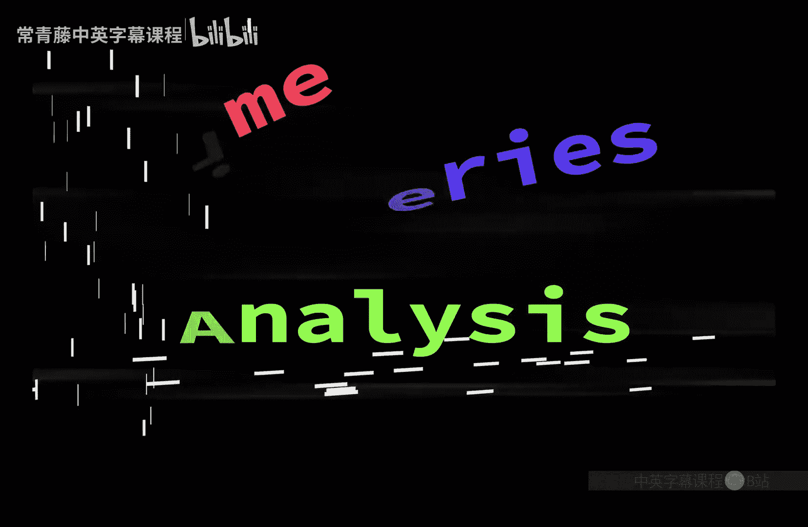
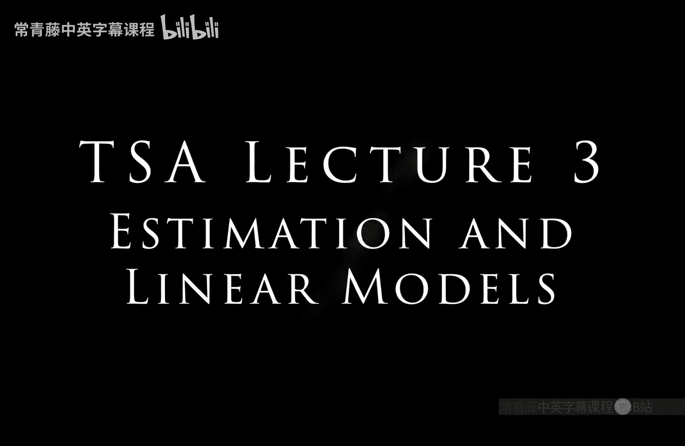
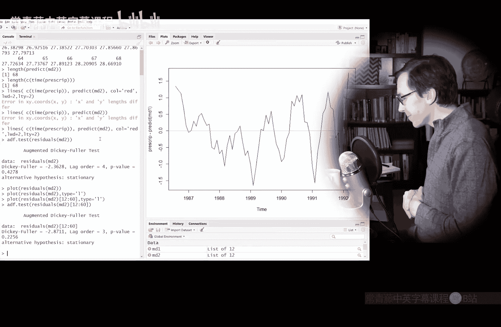

# 阿尔伯特大学【中英⚡时间序列分析｜STAT479 2021 Time Series Analysis】 p03 P3 Lecture 3： Estimation and Linear Models -BV1nwqYBDEos_p3-

🎼Welcome back to another lecture of time series analysis。

 this is lecture number three now we get to actually do some real statistics。

 so let's go see what that's all about。😊。

🎼In this lecture we'll be looking at autocovariance and autocorrelation。

 how to estimate it and what it can tell us about time series data。

 and at the end of this lecture we're going to get to look at our studio and analyze a data of prescription drug prices in the US from the 80s to the 90s。

 I believe。So let's go take a look at that Wecome back to another lecture of Stat 479 time series analysis today will be finishing up chapter one in my lecture notes Last time we ended with the idea of estimating the mean of a stationary process so let's revisit that and remember what we were talking about in the last video lecture。

😊，So。The main thing we were looking at was the idea of a stationary process。

And this is going to be really important because a stationary process in the weak sense。

 which is kind of the only one we need for this course。

 says that the mean that is the expected value of Xt。Is not a function。Of time。And furthermore。

 the idea that the autocovariance function， Kx at time points， S and T is going to equal to， well。

 the same thing shifted by any amount R。This is for， I guess。S and T， and R。I guess whatever there。

I guess integers or numbers will just say numbers doesn't really matter the main point is that the mean is invariant to shifts in time。

 which basically says that it's constant throughout all time and furthermore we have that the autocovariance function is invariant to shifts so it still depends on how far apart the two time points are。

 but it doesn't matter where they fall in the process the time series process it could be at the beginning。

 they could be at the end as long as the two time points are the same distance apart。

 they'll have the same autocovariance and this gives us the idea of a weekly stationary process and this is going to be really important because well again if we want to estimate the mean or the autocovariance。

 we want to make sure it's the same at every time point otherwise we can't estimate it because if the mean starts off at say zero here and it's 22 there。

Then it's hard to estimate it because we can't use these points to estimate the mean at these other points。

 if the mean the same at all time， then we can use those all the data points to estimate the mean。

And that's exactly what we ended the last video lecture discussing so in the last video lecture we ended with the idea that if I want to estimate the sample mean。

😊，Or estimate， I should say， calculate the sample mean to estimate the， I guess。

 population or global mean of the process， the time series process。The mean。

 then what I'm going to do is just use x bar， which in this case will be the sum。

I think I was using I or no little T that's right little T from1 to capital T of X I。

 So if a process is stationary， then our estimator for the sample for for the mean of the process is just the usual sample mean denoted x bar and what we did last time would show that the variance is a bit different now。

 then it normally would be the variance is in some sense inflated a bit based on。

The fact that this data is dependent or the time series， data points are dependent on each other。

So let's go a step further because the mean is great and okay， that's interesting。

 but what we're really going to be interested in is estimating the autocovariance function and specifically the autocor because this is going to give us a key tool for exploratory analysis in time series data。

😊，All right， so now what we're going to talk about is estimating。The autocovariance。

The autocovariance。K， X， Okay， so how do we do that， Well。

 we do that kind of just what how you think we would do that， which is first to recall。

That for Xt stationary。Stationary we。Ken write。The auto covariance function as having a single argument。

 so instead of having S and T we can just choose some value H which will be the offset if H is zero the two points are on top of each other if h is one23 four and so on they start to get further apart so in this case we can just consider。

A basically a single。Argument。For the auto covariance function and then。Say， then。For。I guess any。

H in， well。Okay， so any h from， let's say01 all the way up to t minus1 because if we have t capital t total data points。

 the biggest lag we can have is t minus one because it would be the last point minus the first point we're not going to go that far out anyway。

 what we'll talk about in a second but。Hypothetically。

 we could have an auto covariance calculated for any lag from zero all the way up to t minus1 and。

I'll just point out here。H is a lag。So I'll throw out the term lag on a lot we'll look at that more when we plot the auto covariance or the estimated auto covariance function correlation function that is。

But just to make sure that you get the terminology that I'll keep saying。Right。

 so then the question is， well， what's the estimator well the estimator in this case is going to be K hat？

嗯。At some chosen lag H and it's just going to be the average one over t。

Times the sum t little t from 1 to capital t minus H。

 so that's going to be kind of an important thing to take note of and we'll talk about that in a second and the summan is going to be T X T plus H minus X bar and X T。

Minus x bar so it's going to look a lot like the sample variance or the sample covariance between two random variables it's just that here we have the same x's on each side just offset by a lag or an offset of H units。

All right， so there's a couple things to note here。First of all。

 the number of terms in the sum is dependent on H， so that's one thing to note。We'll say note。

That there are。T minus H terms。In。The sum。Smation。So what does that mean， Well。

 that means that as H gets bigger， the number of。Terms we have to estimate the autocovariance decreases。

 it shrinks， and that means our estimate will actually not be as good as H gets large Now four time series data。

 typically we're assuming that capital T is fairly big。

 something that you've been watching a process for a while， it could be 100。

 it could be 100 or so on， I mean， if you have daily， let's say。

 temperatures or daily stock prices or daily COVID infection rates or things of that nature then you can imagine that even in a year of watching a process or a couple months you'd have at least 10 observations or more。

In contrast， when we're trying to estimate the auto covariance。

 typically we're only interested in the first so many values of H I forget if there's a default in R。

 but I suspect that after about 10 H is equal to 10 or 15。

 you're probably not going to care too much anymore， so this issue is not。

It's not super critical in the sense that it's going to cause major issues。

 but it is something to remember that if you want to estimate an autocor or covariance out at lagG 50 or lag 70。

 it probably isn't going to be as good of an estimate as it would be at lag1 or two and the lags1 and two would be the most relevant ones for statistical purposes。

Right so that's the little disclaimer about how this summation works Also we have the notion of a auto correlation function。

So we also can estimate well we talked about the auto correlation function in a previous lecture。

 but in this lecture。We are going to estimate it。Mr。 N， there it is functioned。Cool， all right。

 so the estimated auto correlation function， which I'm going to write as row hat with an argument of H at a lag of H is just going to be the estimated。

😊，The estimated auto covariance function， it's really easy to switch covariance and correlation I。

Make sure I don't mess that up。 And the divided by the auto covariance at 0。 So this。Guy down here。

 let's do， let's do。Blue。This guy down here is just the variance。Or an estimate， I should say。

 of the variance。Remember it's stationary， so the variance doesn't change。

 so the auto covariance evaluated at zero is just an estimate of the variance of this process。

So really we're doing exactly what you would think to do if you wanted to get a correlation which is take the covariance divide by the variance。

 and now we have a correlation， so that's going to be important because we're going to be using this a lot to understand what our time series data is。

 I guess telling us or what we can learn about our time series data through the estimated auto correlation function。

😊，And that'll come later in this lecture。But before we're done with that。

 there's a couple more things to point out， we can also estimate the cross correlation function。

The cross correlation。Function。And the cross correlation function is going to be estimated well very similarly to what we saw above in this case。

 if we have an x and a Y and at lag H。Then we're just going to say1 over t as the sum t from1 to t minus H again。

And then we have an X。T plus H minus x bar and now a Y t minus y bar and here we're assuming that both X and y are stationary processes and that they're jointly stationary as well。

Otherwise， it doesn't really make sense to do this and lastly。

 before we end our ever increasing list of so I made a mistake already right it's not the cross correlation function。

 it's the cross。Covariance function。Whereas the cross correlation function。

 which I want to write down as the secondary thing is exactly， again， what you would expect。

 which is it's just the cross covariance。Divided by an estimate of the variance， so in this case。

 if we have row hat X Y， H yeah。Then what we're going to do is we're going to take our estimate。

K hat。With the x and the y to indicate that it's a cross covariance function at lag H。

 and we're going to divide by the square root of。Well， in this case， just the variance。

Of x and the variance of y， which is denoted in this way as Kx at0 and KY at zero with the hats。

 indicating that what we're doing is we're estimating the variances。So again。

 the formula a little messy， but it's not too bad and it's kind of what you'd imagine we would want to do。

Okay， so now what we can do。Of course I don't actually have the PDF ready to go so we're going to take a quick pause all right and we're back from our quick pause and where were we well what we were doing is we wanted to again look at some examples of estimated auto correlation functions in R so that's what we're going to do right here。

Excellent， so let's dig into this a little bit， maybe I can expand this slightly so we have a little bit more room to look at it。

Good， so if we use the function in R， so this is the。I'll say from。R function。A，f。

I think that's just in the standard stats package but I'll have to double check that to make sure I'm not missed remembering that so what it does and it looks like here the default or maximum lag is 15 is that it computes the autocorrelation function or I should say it estimates the autocorrelation function from some data that you give it at various lags starting at zero and going by default up to 15。

 but of course you can always change that as a parameter in the function call。Now。First of all。

 at zero， the autocor is always going to be one because you're taking an estimate of the variance and dividing by the same estimate of the variance。

 so the auto correlation。So I'll say ACF。At zero is always。1。

So that's the first thing to note but now let's look at these pictures we have here a little bit more closely so first of all we have white noise in the top left corner now the first thing we notice is okay we have that big spike at one at zero which has to be there but then every other little line there is pretty small and what that's telling us is what we would expect and what we expect is that white noise right is uncorrelatedlate that the very minimum it's uncorrelated noise and that means the auto。

Covariance will be zero at every lag that's not zero。

 so at every positive lag we're going to have an autocovariance at zero in this case we're estimating it from the data so it's not exactly zero。

嗯。But it's going to be close， so here the auto covariance at lag H is going to be zero for h greater than or equal to1。

In practice right k hat at H is going to be approximately zero。

 it's not exactly zero of course because we have a finite amount of data。

 but that's what all of these points in here are telling us what they're telling us is that there's no significant autocorrelation at any positive lag。

 remember the autocorrelation is a symmetric function。

 so we only have to consider positive H if we looked at negative H we'd get the exact same plotted answers。

 but in the sort of a mere image right it's a symmetric function about zero。

Right so that's the first thing and that's one really neat tool usage for the estimated auto correlation is that we can use it to kind of visually say。

 ah， this process looks like white noise because I don't see any detectable correlations at any positive legs。

Now， in contrast， if we try to apply this to the random walk， so in the random walk case， this is。

The process X T is equal to x t minus1 plus WT， and if you recall from， I think the first lecture。

 this is not stationary。So again。RightComputer programs are or any other stats package you're using isn't going to stop you from computing an auto covariance or autocor for a nonstationary process。

 but the results don't make sense。 and in this case we see these giant spikes at all positive lags。

 So even going out to a lag of say 15。 we still see very a very strong positive autocor。

 And if you see that it's kind of indicator that a there's probably some nonstationity here。

 and we should probably investigate that further now。We will be looking at actual tests。

 statistical hypothesis tests for non-stationity as we go further in this course。

 but for now we're just kind of exploring the data visually and graphically and we can use the ACF to do that and identify that okay。

 if I see an ACF that looks like that one there in the top right。

 there's probably a problem with stationity it looks a lot like a random walk Now going forward。

 if we have the moving average process in the bottom left。So the moving average。

 this is the moving average at order nine， so in this case I took white noise and I took a window of length9 of width。

 I guess width nine and averaged all the points and slid that window across the white noise process to create a moving average process like we talked about in the first lecture。

In this case， we see some pretty interesting behavior， what we see。

Is a very steady linear decrease in the auto correlation function so it looks。

Like this basically until it hits zero and notice that it hits zero right around 10 I guess maybe around nine to be exact that's going to be important because what we're going to find out later in this course is we can actually use the ACF function to estimate the order of a moving average process and we're going to see behavior like this where we see steady decrease in the autocor until it become zero so again at this point in the course we're just looking at these pictures and trying to gain some intuition we'll make this more precise in later lectures。

😊，And lastly， if we look at the bottom right， we see an AR2 process。

 I think in this case I used a non stationary AR2 actually I have to double check that because I don't not it might actually be stationary。

 we'd need to compute the auto， we'd need to compute the auto covariance or auto correlation function to determine the stationity of it。

In this case。Okay， we still see a decrease， but if you look closely at this plot in the bottom right。

 it doesn't look as linear， it's not a straight line decrease to zero。

 it looks almost like some type of an exponentially curved。Decrease to zero。

Something like that with a terrible drawn arrow ahead there。

So the AR process is going to have different a different type of behavior when we look at its ACF function。

 in this case it's going to decrease in kind of a geometric fashion。

 it's going to decrease like you know， let's say by a half and then a quarter and then a fourth and an eighth and a 16th and a so on。

 whereas the moving average is going to decrease linearly。

Now it's not always straightforward when you're looking at real data。

 what type of process you have by just computing the autocor or estimating the autocor function。

 especially if you have moving average and autoregressive pieces within the same process but again this will at least give us some idea of how to look at our data and how to understand a bit about what's going on because so much of time series is about exploratory analysis。

 we're not just going to。Coect our data and run a hypothesis test。

 we're going to be staring at it for a while and trying to figure out okay what's going on。

 what type of models are here， is it stationary， is there a moving average piece。

 is there an auto regressive piece， etc， etc。All right， so。That more or less。

I think finishes up what I wanted to talk about about autocor。One other side note。

 though I wanted to mention before we move on to the testing for white noise is note。That in。

The definition。Of。Kay hat。We divide。By。T and when you first look at this。

 you might think to yourself well why are we dividing by T and instead of dividing by say t minus H or because the total number of terms in our sum is t minus H。

 but we're still dividing by capital T。The reason is that we want our estimator to be positive。

 definite。This is so that。Kay hat。Well。B， positive， definite。Definite。

And this is going to be a very important property whenever we're dealing with covariances。

 we want positive definiteness because that's how covariances are defined so for estimating a covariance and auto covariance we're going to want that thing to be positive definite and。

😊，And won't get into all of the details， I believe in the textbook。

 there's a derivation of why this is true， but mostly the idea is just to intuitively understand that we want this property to hold for our estimator and that's why we write our estimator in the form that we chose。

All right so we're gonna to move on to the next part of this lecture which is can we detect white noise because when we have a noisy process the first thing we might want to know is well is it a white noise process or is there more structure here that we want to understand and if you recall from the first lecture we kind of looked at different examples of time series processes and we have white noise next to say an autoregressive or moving average process and it's not always clear that one process has more structure to it and the other is actually just completely uncorrelated white noise so we can use this idea of the estimating the auto the autocorlation function or the autocovariance function to detect white noise so let's talk about that。

This is。Sliding off the page， this is detecting。White noise。Section 1。

33 in my typed up lecture notes。So what we saw from， I'll say from above。Okay。We。Know that。嗯。K。

 that is the auto covariance。Actually， I shouldnt replace the X with a W。

So the auto covariance for white noise。Even weak white noise。

 but certainly for strong and Gaussian white noise as well is going to take on two values。

 it's going to take on one if H is equal to zero and it's going to be zero for all other H Again we only really need to consider positive values of H but it's a symmetric function we can also consider negative values if we really want to it's going to be the same thing。

Um。Basically so。We。Need。To determine。If， okay， Another slight error I made。 this is not。

This is not the auto covariance， again， this is the auto correlation。

 so I'm being slightly imprecise。This is supposed to be a row of W。

We could look at the auto covariance， but then the one would be replaced by a sigma or a sigma squared。

 so of course the same idea makes sense， but to be precise with the way I wrote this down。

 we should be writing auto correlation， like I said it's really easy to flip these two around so I'll try to be as precise as possible。

Anyway， yeah， we need to determine if。The estimated。I'll say K hat W at H。And。The and row beta。

And row， the estimated row hat， the estimated auto covariance at H is small enough。

To be imprecise in the language。4。H not equal to zero because as I mentioned in the picture above。

We're not going to have exactly zero for our estimated autocovariance or autocor instead what we're going to have is some small value and we need to know statistically is that value small enough to claim that it's close to zero and that's exactly what we're going to look at here。

How do we get to that？Where are we here？Yeah， so the first thing we take note of。So。The first note。

Is that？Basically since。WT is mean zero。We。Can write。The estimated auto covariance of WH。

To basically be what we had above， but I'm going to throw away the sample mean。

This is just to make things slightly easier to look at mathematically。

 We can justify this if we really took some time to write it all out， but it's not really worth it。

 in this case， we're just going to say。I'll just put it off to the side this is because。

W bar is really close to zero， so we'd expect the auto， the estimated auto。

Covariance function to be something that looks like this。

And the reason why we do this is so that we can compute the variance of the auto the estimated auto covariance。

 so we're kind of computing a variance， we're going to compute the variance of our estimate for the auto covariance and we're going to show that that will go to zero and how fast it goes to zero in the case of white noise and that's going to tell us。

😊，How small we expect the estimated auto covariance to be when the actual answer。

 the actual auto covariance is zero Okay， so I hope you're kind of hanging on there there's a lot of terminology and excessive use of the word auto covariance。

By， let's push ahead。So what do we have here？Yeah， so first is for。H not equal to zero。

 we have that the expected value of WSwT， I guess where Ill actually I should write this out better Wt plus HwT is equal to zero all right because they're independent or they're uncorrelated at the bare minimum they're uncorrelated and have mean zero。

So the point is， is that this thing is also going to be。Mean zero。Furthermore。

We have that the variance of our K hat for white noise。Well， what's that going to be。

 that's going to look something like well， one over t squared because I can take the T out of the equation。

 and then I have to compute the variance of the sum。

 I have to be careful not to immediately switch the order。Because of correlations or。

I guess potential indices that are the same。Here we have t minus H of Wt plus H WT。All right。

 so now when I apply the variance to this entire thing。

 I end up with a double summation because I'm kind of remember， when I'm taking a variance。

 I'm kind of squaring the thing inside the variance and we're throwing away the mean term to try to save the mathematical headache。

 but if you really wanted to， you could throw a whole bunch of W bars in there and it's just going mess make everything quite messy。

 but you can still fight your way through it。Anyway， where were we？Yes。

 so what we're going to do is we're going。Two， now some T。From1 to capital t minus H。

 we're going to sum S from 1 to capital t minus H， then we're going to look at the expected value of Ws plus HwS Wt plus HwT。

Okay， now what's neat about this is that it's always going to be zero except in very few cases。

 it's only going to be not zero when S is equal to T because。Well， I'll write it out。

So this is actually going to just be t from 1 to t plus H or not t plus H。

 t minus H capital t minus H to be。Precise of the expected value。Of W T plus H squared W T squared。

 and the point that I also wanted to make here is that。All other。Terms。Are equal to0。

 And this is because if the。If the indices don't match between S and T。

 then what happens is we end up with them。The expectation of a W T or a WS and that's going to be0。

 So that's just going to destroy that entire term in the sum in the summation in the double sum。

 And the only time that we're not going to get0 is when S and t are equal to each other because then the only things inside the expectation are W squared and W squared。

 the expectation of W squared is not0。It's actually going to be sigma squared in this case。

 sigma to the fourth because what we do is we take this and because W。

 the white noise process is uncorrelated， we can split this into two pieces。Ass such。

And then we can show that this is， in fact， sigma to the fourth。

 it's sigma squared and times sigma squared。Which means that our final answer ends up being something that looks like t minus h divided by t squared。

Times。Sigma to the fourth， which happens to be less than or equal to just。Sigma to the fourth over T。

I guess strictly less than for H not equal to zero， so I want to be a little bit more precise。

 I'll get rid of that if I can get rid of that oh I guess we're not erasing。There we are。

So this value here is。K。So what it tells us is that right for our autocovariance function。

 when the lag for the white noise process， when the lag is not zero。

 the autocovariance estimator will have mean zero， so it should be plus or minus somewhere around zero。

 and it has a variance that looks like sigma to the fourth divided by capital t。

 so as the data size t， the amount of points in our time series increases what that means is that the variance of our estimator will decrease and we'll expect the value of k hat to be closer and closer to zero。

So how close should we get to zero？嗯。If we go back to the auto correlation function。

 we find out that therefore。For row hat of W at H。We have。Mean。Zero and variance。1 over。T。

 because what we effectively do here is we just。Divide by the divide， I guess by the variance term。

 which in this case be the variance of the variance。

 so it would be sigma to the fourth is a little bit of a pain。

 but that's roughly what's happens here and as a result。诶。So。We can。Look。嗯。

At I'll say plus or minus two standard deviations。Dviations from the mean。From zero。The mean。

And this they'll say is being what it's going to be plus or minus2 divided by the square root of t。

And if we go back up to those plots further up the page。

 we're going to see if you were looking closely， we see these blue lines。

 these blue dotted lines above and below above and below zero and these blue dotted lines are going to be the plus or minus2 over the square root of t for whatever t was I honestly don't recall at the top of my head how I generated this data but that's where these blue lines are going to be and it's just going to be a rough guide again this isn't a proper statistical hypothesis test。

 it's just a rough guide and it says that okay， if the autocorrelation is supposed to be zero。

Then the estimated autocor will probably be within about two standard deviations of the00。

 and that's going to be these plus or minus blue dotted lines that you see in the ACF function when you plot it in R。

So that's what we can use if， for example， if we zoom in really far。

 maybe we find that there's one point that's ever so slightly above the threshold that doesn't mean that it's not white noise again。

 this is not 100% precise， it just says that okay。With probability， say 95%。

 we would expect that the estimate would lie within these to dotted blue lines。

 so it's again more of a。More of a qualitative rule than a proper statistical hypothesis test。

 but still something worth understanding here， let's zoom that back out。All right， so that is。

Really everything we were going to do in chapter one of my online lecture notes， so with that。

I think we can start chapter 2。Okay， and we're back and we're going to start chapter two of my online lecture notes now。

 which is looking at statistical models for time series。

 so now we can now that we have a rough idea of the different pieces that make up a time series。

 things like white noise and autoaggress and moving average processes and notions of the mean and the autocovariance and autocor。

 we can now go a little bit further and talk about actually modeling time series data。

So let's get into that。So the first thing we want to do is， well， first I'll write down the title。

Statistical models。Of time series。And the first thing we need to do is a couple definitions that are going to。

 well maybe be a little annoying at first， but also help to save us some headaches in the future when we can use them for writing down our time series in a simpler manner。

So the first thing we need to discuss is what's called the backshift operator。The Beckshift operator。

And what this is going to be is it's going to be denoted as well， B， B for backshift and。

This is defined。Such that。B， applied to a time series or stochastic or discrete time stochastic process Xt is just going to return Xt minus1。

All right， so that's not the most of exciting thing， but we can also iterate it。 We can iterate it。

To the case power and if we apply that to a time series process。

 we just take it T and we subtract now K， so all we're basically doing is shifting our time series back in time by one or two or k units。

Again， not the most exciting definition， but it will be convenient in the future。

 this also leads to the idea of the forward shift。The forward shift。Operator。

hich can be denoted as B inverse and it just takes Xt and does probably what you think it's going to do。

 it's going to add one to the index。And of course， we can iterate this and we can also write things like B inverse。

 B is equal to B。The inverse is equal to I where I would be the identity operator again at first when you see this it might seem a little silly。

 but it's going to actually be very important later on。So similar to the backshift operator。

 we also have the difference operator。And the difference operator is well， going to be defined。

As our upside down Delta。I guess Nabla， if I'm correct， I forget which one if that's the other one。

 whatever it is， it's our difference operator and this is defined。

Such that if we apply this to X T what we get is we get well a first difference which is going to be Xt minus X T minus one so we basically take the process and then we take the process shifted one unit back in time and we subtract one from the other so we're looking at the change this is。

Kind of similar to like a derivative for discrete time。R。

 we don't have continuous time in our setup here and even if we did。

 we'd have to deal with the issue of a stochastic process。

 which wouldn't be differentiable in the usual sense， but forget about that for a second。

 the idea is that if we have something discreterely that we're watching at fixed time intervals。

 if we want to look at a derivative of that process， we can take a first difference。

And we can write this first difference in terms of the backshift operator。

 so this just happens to be1 minus B。Times X T， so there the backshift operator can actually be used to define the difference operator or the first difference。

The first difference because what we can do is now we can iterate this to get the k difference。

And the easiest way to write this is to write this as1 minus b applied k times to Xt。

 and as a result， we're actually going to get a binomial sum or a binomial series， I guess summation。

Here we're going to take i from1 to k。And we're going to get a minus1 to the I。

 and we're going to get a binomial coefficient K choose I， and we'll have x。T minus I。

So the formula is quite a little bit messy。But what we can do is we can do a simple example just to show that this works。

 we can do this for the second difference。So if I want to apply the second difference， well。

 I know what happens when I apply it once， right， you can write this as the first difference of the first difference of Xt。

Which is the first difference of the process x t minus x t minus1， because this operator is linear。

 I can pass it into the parentheses。And get something that looks like this。

And then I take the first difference of each of these piece one by one。

To get something that looks like。This。Let's say X。T minus two。

 and then when I put it all back together， what I'd get is the second difference。

Which is going to have our binomial coefficients， one， two， and one with an alternating sign。Minus2。

 so here we have our。Binomial coefficient， and we also have our alternating sign popping up there。

And there， using red and green。So right we can do this and again the formula just becomes more and more complicated。

 but it allows us to write this in a much nicer form now if you're reading along in my online lecture notes。

 I put in a fun definition you can actually define a fractional difference operator where here K instead of being an integer。

 a positive integer would be some I guess real number and our positive real number。

 which then it can be written in terms of a summation with a gamma functions so that's always a good times but we're not actually going to need that for this course just a fun fact to keep in mind。

😊，Whenever there's something in math， it always seems to be generalized to。Another level， right。

 That's sort of how mathematics goes。Okay， so now that we have our two kind of technical definitions。

 what we want to do is look at。Time series models versus linear regression models because I think again。

 as I've mentioned before， linear regression is a really good starting point to kind of branch off into a time series so let's pretend for a second that we're in linear regression class。

😊，Linear regression and what we might want to do is estimate our Xt。By some linear model。

In this case， I think I was using， yeah， I'm using。Zed。T， as my independent variable。

 I think I had T and one。And。Beta P， say if we have a P dimensional or P predictors or independent variables。

Then we have something that looks like this。 So this would be our our linear regression model。

 we have our。我死 p。Independent。Independent。Dent variables。And this would be II， I guess。

 errorss or we'll just call it noise。So we have this setup and what do we know well。

 we know that if we were to write this as x is equal to I guess Z beta。In matrix forms。

 z beta plus epsilon as matrix vector multiplication。Then。

We know from linear regression class that the Gauss。Markov theorem。Says。That。The least。

Squares estimator。Squares。Etimator。Is best in the sense of it being a minimal variant， unbiased。

 linear estimator。I。e。We have that。Beta hat is just going to be our。Zed transpose Z inverse。

 Z transpose X。 Okay， so we have that。 But remember what the Gauss Markov theorem wants the。

Gaus Markov theorem。Right， assumes。That epsilon。T is I I D。Yeah yeah。

 we need it to be I guess means zero and all the other stuff。

 but effectively we want it to be completely independent。Now or at least uncorrelated， sorry。

 I think yeah just uncorrelated if I'm。That's just double check that actually。

 I wonder if it is just un I think it might just be uncorrelated regardless。

 the point is that in time series we may not have that。

 so the idea is that that's great if we're in linear regression class。

 but if we're in time series class as we are time series。

It's really easy to make a typo and write Times series and it's just one of those things to watch out for because it just looks bad in writing and I've definitely made that mistake myself when you want to tack an eant time but it's time series and in this case we'd consider in some sense the exact same thing。

 we would have some deterministic piece which we can write in terms of our Zs again and betas。

This is just one model for a time series， by the way。But we would have something like this。

 but now what we're going to do is replace。Our epsilon with a Y T。 So in this case， what we have is。

This is the deterministic piece。And we would have YT， which is some stationary process。Which is not。

I'll say， but。Not。White noise， WN for white noise， not necessarily white noise， it could be。

 and if it is， then we're back in the linear regression setting。

 but the point is that we could have the exact same setup as linear regression。

 but now our noise variable is some stationary process and that's going to complicate matters as it usually does。

So。If。There we go。I'll say therefore。If。We were。To compute。Beta hat。As before。The residuals。Well。

Okay， I guess the residuals would be something that's going to look like Xt。Minus。Let's just say X。

I guess minus Z。Beta hat just to make it a little bit nicer to。To write out。Let's just say this is R。

Then。R T is。I'll say a prox。Approximately going to be Yt， it's going to be again。

 the residuals are not going to be Yt， but they're going to be something kind of close to it。

But the problem we're going to find out here is that。I should say and。RRT may not。U。B吧。Okay。

 so there's some subtlety here， I want to say it may not be independent or it may not be uncorrelated。

 but of course it's actually never strictly speaking uncorrelated。嗯。

The subtlety comes from the fact that even if you have IID airs or white noise。

 then the residuals will actually live in a slightly lower dimensional space。

 so there will be some correlations there， but for a very large sample size。

And a very small number of parameters P， we would expect that the residuals would more or less look like some random noise。

 we wouldn't see any structure。So。The what we get here is that。We can take。The residual。Process。And。

Look at it。As a time series。And that's the key difference between， I guess。

Taking data and applying a time series model versus or。

Thinking of it as a time series versus thinking of it as a linear regression is that the errors could have this temporal correlation and it's something that we want to understand now I should say here'm not considering things like autoregressive moving average process at the moment I'm just looking at some deterministic piece plus some stationary piece which could be autoregress it could be moving average we haven't discussed exactly what YT is other than it being a stationary process but now that we have this framework in mind and we still have about say 2030 minutes left to discuss we're going to take a quick break and I'm going to switch over to our studio and we're going to look at some real data now because I think that's going to help get all of this all of these things that we've been discussing solidified a little bit better so I'll be right back and we're back with a little bit of an art tutorial for the last 20 minutes of the class what we're going to do is。

We're going to look at this prescription data that is first， let's load in the package into R。

 which is the。once again， my。Hero keys decide they don't really want to work， peculiar。

We're going to load in the TSA package， which is time series analysis， it comes from a textbook。

We're also going to load in a couple other packages。

 I forget if I'm actually going to explicitly use them， but just so that they're ready to go。

 we have T series and we have the package forecast。which are all different time series packages in R。

 there's actually a ton of time series packages in R。

 especially if you're using more sophisticated and different methods。

 but these are some of the standard ones that we' have more general methods that we'll be using in this course。

Right， so we have all of that。And then what I want to do is look at the prescription or prescription data and what this is going to be。

 let's plot it to actually see what it looks like。Pscript。

So this is going to look something like well that and what we have here is we have the monthly average prescription drug prices in the US from 1986 all the way up to I think 1993 or maybe 92 I can double check that and roughly yeah it's increasing。

 so yep drugs are getting more expensive and I know the US。

 is not necessarily known for being great when it comes to things like prescription drug costs and's why they all want to come up here to Canada to buy their medicine anyway。

Right so if we use the time command that is just type time and then put our data set into that it extracts the time that is for our time series。

 so notice that the actual time starts。Maybe it does start in 1987， I thought it started in 1986。

 I'll have to double check that because well anyway。

The idea here is that the time is indexed by the year and then split into 12 increments one for every month。

 but the time series data object is a little more sophisticated so you can actually see that it has the months up here up。

 there it is。Sorry I was looking at the top row which doesn't exist here， but it does down here。

 so it starts around August of 1986 is when the data starts and progresses forward from there all the way up to what looks like March of 1992 so sometimes looking at these for the first time can be a little bit confusing so it's worth just exploring what a time series object and R looks like。

Right so what do we actually want to do with this well again。

 if we want to estimate things like the autocovariance or the autocorlation。

 the first thing we want to look at is well the first thing we want to look at is just look at the plot and what do we see well we see that it's increasing so it's definitely not stationary in the mean whether or not it's stationary in the autocovariance is not clear but at least in the mean it definitely does not look stationary at all。

 so it's very common in time series that we want to try to find a trend that is occurring in our data and we can use linear models like we would in linear regression class to do that。

There are other methods that we will look into later。

 things like doing using the difference operator， but for now let's just。Consider a linear model。

 so what I'll call model one。Is going to be what it's going to be。Prescript。

 which is the output and we're going to make that a function of time。With pre so again。

 when I use the time command， it extracts the time variable from the prescription data set so we have something to regress on。

And if we just look at a summary of our model， what we find is that， well， okay。

 it's a little bit cut off here because of my margin。

 but the time variable or predictor or independent variable， I guess in this case。

 is very significant and we get a value of 2。8， meaning that every month the price of drugs on average seems to increase by about $2。

8 now。I think this is I'm not sure if this is on average or per household or what if we actually investigate the data set the。

Our description is actually pretty sparse， it basically just says monthly US average prescription costs for the month of。

 and then it gives the data range， but presumably more information can be found if we actually look up this book on data analysis using regression models。

 but we're not going to do that for now， we're going to go back to the plot。

Because what I want to do is I want to look at the， I think we can just use A B line。

 actually its a line， a simple linear regression to plot。We'll plot this in red。

 the line that we just fit to our data and we'll say line type is two so we get dotted。Nope。

 it's not doing that。Ah， because I call it MD1， that's right。

There we are so there we have our increasing trend in drug prices now what we can do。

 there's a couple things we can do， we can look at the autocor function for the prescription data。

But again it's not stationary， so while we can look at it。

 it doesn't really make a lot of sense to consider it and it's always good to know that you can calculate these things in are whether or not they make sense is a whole other issue so it's something we have to certainly consider again the lag goes out to 15 months we could do say 24 to have two years and you see this steady decrease but again because it has a non-stationary mean we have to be a little bit more careful but after removing the trend that is if we take this prescription data and and we subtract the prediction of our model one actually why don't we let's not do an ACF let's plot that。

I think it should plot as a time series object。 Let's see if it does。 Yes， good。

 so now we have removed the linear trend。 and if I plot a horizontal line to show you where the。

Where zero is a little bit more visibly now it's okay not quite stationary Well it's hard to say right there's definitely some periodicity the mean does seem to fluctuate a little bit still Now there is a test for stationity that we can consider and that's called the augmented Dicky Fuller test it's something that we'll talk about later in this course we haven't gotten there yet and we need a little bit more sophistication in our knowledge of time series before we get there but the ADF test which is in the T series package is this augmented Dickie Fuller test and okay it's going to say something about x having a unit root we're going to talk about that later it's beyond what we've done so far in the course but the key thing to note is that by default it tests whether or not a series is stationary or more precisely the。

😊，Alternative hypothesis is stationary so if we have a very small P value that implies that our series looks stationary and there's one other issue that can be a little confusing when you first use a function like this is that it's stationary after a linear trend is used so you could actually apply this to the original prescription data and it would effectively take out that linear trend that we I did manually so just so you're aware of what happens so。

Anyway。Yeah let's try this thing out but first I want to give you some examples， so if we take。

 let's say 100 normal 01 random variables， this is our Gaussian white noise it's completely stationary uncorrelated。

 independent all that stuff so if I plug that into this test function into this function well what it does is it gives me a lower an upper bound on the P value of  point01 which is saying we should reject the nonstationary hypothesis in favor of our time series being stationary and then it even gives a warning method saying this P value actually might be even smaller than point01 just so you know。

On the other hand， though， if I were to take this and I were to run a cumulative summation。

 aum sum on this， then well what happens if I add a bunch of normal random variables one after the next I'm getting a random walk so this is now a random walk process and if I do that I get an extremely large P value。

 and I'm not able to reject the nonstationary hypothesis so these are the two kind of simple extreme cases we have Gaussian white noise which is very much stationary and we have the Gaussian random walk which is very much nonstationary as like two canonical examples。

So this is what you would expect if you ran this function now if I were to actually apply this to my residuals。

 which。Well I guess I can do that two ways I can use the command I did above or I can just use the residuals command to do it manually and sure enough I get a pretty small P value so if we go back to this plot it's telling me that while it definitely looks like there's it doesn't look like white noise by any means there's definitely periodicity to it and some other stuff going on there does seem to be evidence that this is in fact a stationary stochastic process。

At least based on this one test now we can actually go further。

 if you happen to be reading my lecture notes， you'll see that I fit a much more complicated regression model because there is a periodicity in here and if you look closely and stare at it long enough you'll notice that it actually happens to be every 12 months or one year so there's an annual cycle to this data and we can actually toss in some trigoometric functions into our regression model to take out that trend。

Now alternatively， we can use seasonal time series models to determine this without having to stare at the data and count how far between the peaks。

 so there's a lot more tools we have to use on this data， but again。

 this is just the beginning of the course so we're just going to use some regression methods to see what happens。

So if I go back to the model that I was fitting。And we're going to call this model two now， well。

 what I can do。I actually wait I forgot one thing I wanted to do we just identified that we have a stationary series and if we have a stationary series then we should look at the auto correlation function because that was sort of the whole point of this lecture I took a bit of a break between the written and the R coding part so。

😊，I have to remember what we were actually doing， the magic of video。

 it doesn't seem like any time has passed。But I actually went and got some dinner and came back and more tea。

 of course more tea anyway， where was I？Yes， so if we take the residual process for model one。

 that is we remove that linear trend from the prescription data now according to at least the augmented Dickie Fuller test we have a process that appears to be stationary in that case we can look at the ACF and yeah we actually see this interesting periodic pattern and I can。

Make that a little bit further and let's say lagm is 24 months or two years and yeah you can actually kind of see here that you have this cycle that seems to hit another peak at 12 drop down and hit another maybe smaller peak at 24 Now once you get out here you're kind of below the blue lines or the noise floor but it's still worth kind of noting this pattern and this is very strongly hinting that we have some seasonality and as I was kind of saying before I forgot to plot the ACF function there are methods that we can use to model seasonality in time series that's going to come later in the course for now what I was going to say is that we can go back and fit another time series model but in this case we can actually include some trig functions。

So what I can do is I can take time and I can add， let's say the cosine of time。

 but I'm going to multiply by2 pi， and the reason I'm doing that is so that the cycle or the cycle length of the sine used stoid will be exactly one year。

You know， and again， this is because I know that the cycle is a year。

 so I'm specifically plugging in a cosine function that has that cycle length。

Other ways you can try to estimate the cycle lengthth directly from the data without just staring at it。

嗯。I think it was cosine I wanted and not sine I put them both in I think in my notes but yeah the sine function was very was not overly significant but the cosine was so if we look at the summary again now we have two deterministic predictors that we're using we have our time here which what happened to my oh there's the P value on the next line okay the p values here is still very significant and we get two things we get our time which has now actually changed to 64 so the slopepe changed quite a bit and now we have this cosine piece which is going to be affecting our time series so。

Yeah we still doubt， I guess we have as much time as we want because I can just keep talking and no one's going to kick me out of the classroom last year I got kicked out of the classroom a lot so yeah。

Sometimes I just keep going， anyway， yeah， we have our original plot and what we can plot is we can plot the predicted values of model two and oh。

 I don't want to， I want to say lines。Of the predicted value。

 but I have to do a little bit of our hacking and tell it that I want the time。

 the correct time here。As my x axis and the y axis will be the predicted values by Model2。

 which is linear plus cosine。嗯。What are we doing here， We need a new color。Red and a new line。

 a bigger line and a。Dashed line。To make it look a little bit nicer。And it got mad at me。

What did I do wrong？The lengths differ。That's peculiar。

IFeel like the length should be exactly the same， but let's see if we can debug this in real time。

I mean， the prediction looks about what you'd expect it's 68 long， meanwhile， the time。Not time。

 sorry， the time of my。Prescription data。Is also 68。 Okay。

 so then the question is why is he getting mad at me？X and Y length differ。

Did I make a let's just get rid of all this extra？Stuff。Yeah， that is oh， you know why。

 it's because I typed in precip and not pre script because there's a precipitation data set in R and that is messing me up。

There we go Let's get back our little plot features to make the plot look a little bit nicer。

 even if I'm running off the。boottom of the screen here so we want that we want our line width to be a little bit bigger and we want to use a dashed line and now we have a new trend in our data it's kind of neat it does seem to actually follow if you notice follow the line fairly well maybe at the beginning it's a little bit under reporting but throughout we do get that nice annual periodicity in the data。

If we again look at the residual process。Let's look at residuals for。Model2。

 and let's use that augmented Dicky Fuller test just to see what it says。

Presumably it should still look stationary it's interesting， actually。

 now it does not look stationary。Maybe it's because of the peculiarities at the beginning that's actually quite neat。

 I think that might take a little bit more thought than I anticipated。And It want ACF。

 what I want to do is I want to actually plot this thing and see what it looks like， ah。

 that's why I see。See， this is what can happen when you're playing around with time series。

 let's view this as a line。So what's happening here is that at the beginning。

 it's very much both at the beginning and a little bit at the end。

 it's very much missing the the mean that is or the mean， I'm sorry it' it's。It's under。

Which way we go in here yeah the it's it's under reporting which means that here it definitely doesn't look like a stationary mean because we start up high。

 we' go down low and we go up high again so the beginning in the end definitely don't look stationary but I'm going to take a guess and say that if I were to only take observations 12 through let's say 60。

Like this that we would get something that might look more stationary。

 so let's try and run the same test on that 12 to 60。Okay， we still don't reject the hypothesis。

 so it still isn't happy with that。So that's actually quite interesting。

What are we getting out of all this Well what we're getting is that time series are quite complicated and there's many different ways that we can use to analyze them typically we can use tools like regression analysis to try to extract a trend ideally what we will do is extract some type of deterministic trend like I did actually better before I tried putting the cosine in I think things actually went a lot better so let's go back to that to use for the instructional purposes because when I took that linear trend out of the data now I just can look at the residuals and as I wrote in my lecture notes before I switched over to R we can think of a time series this type of time series as maybe being a deterministic piece like。

I guess a straight line that increases in time and a stationary process and that's what we found when I removed the straight line。

 see I was trying to be too sophisticated with the sinusoids when I remove the straight line I get something that looks like this for my residual process and at least as far as R is concerned it's stationary enough which means we can then go further。

 we can look at this residual process and we can try to understand， okay now that it's stationary。

 what type of a time series process is it like I said there's a seasonality component there could be an autoregressive piece and there's lots of other things we can do to try to understand the noise。

 the time series noise process that's underlying this prescription drug time series。

Right so hopefully that gives you a little idea of some of the things we can do in time series in R we'll be doing a lot more later trying to fit arema models and seasonal models and I'll actually at some point explain what this test is doing once we understand what is talking about when it says unit roots because that's gonna be a really key part of understanding Arma models once we get there in a few weeks until then thanks so much again for listening and we'll pick up again in the next lecture with I believe oh that's right smoothing we have a little bonus lecture in here before we get into that's a fun one before we get into the arema models for time series we're gonna do some smoothing which is actually quite a nice nice tools to be aware of so that'll be another mix of me writing some notes and doing some R coding and I'll see you in that lecture。

😊。