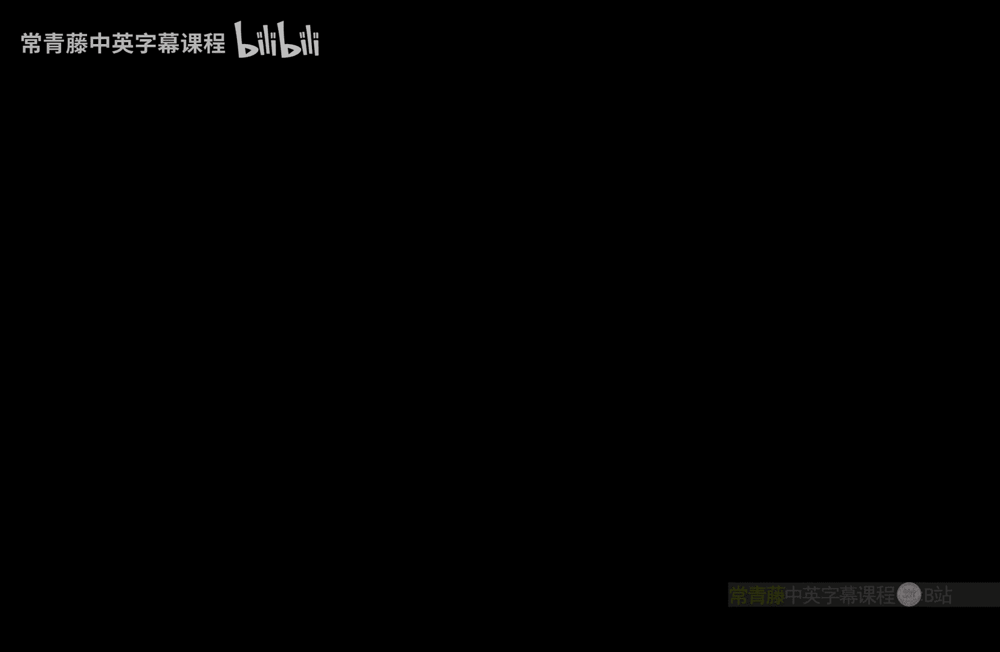
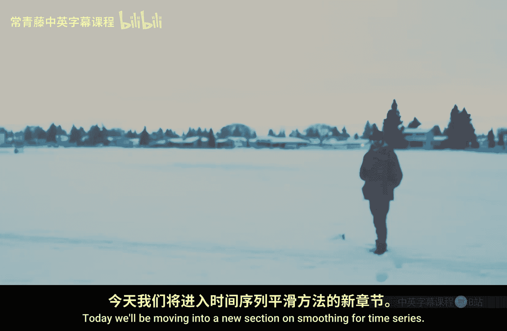
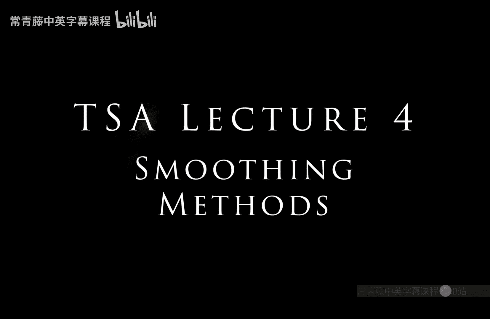
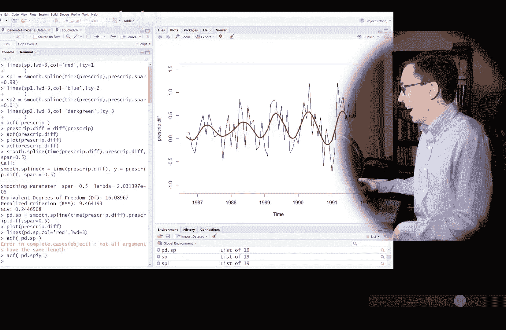

# 阿尔伯特大学【中英⚡时间序列分析｜STAT479 2021 Time Series Analysis】 p04 P4 Lecture 4： Smoothing Methods -BV1nwqYBDEos_p4-

Welcome back to another episode of Stat 479 Time series analysis Today we'll be moving into a new section on smoothing for time series。

 so let's go take a look at what that's all about。

🎼，So data can be quite noisy and quite bumpy and when we look at time series we see a lot of noise。

 it's often really nice when exploring time series data to try to reduce the noise and by doing that we're going to use smoothing methods so today's lecture is very self-contained what we'll be doing is looking at a variety of different smoothing methods for time series that we can then apply to get a sense of the trend or overall patterns in our data by kind of getting rid of some of that noise so let's smooth out some time series and see how that looks。

😊，And we're back with another lecture of Stat 479 time series analysis Today is a really self-contained lecture we're going to talk about smoothing methods for time series and this is a very useful tool for exploratory data analysis when we're looking at time series the idea is that time series are very noisy we've already looked at some examples of them both simulated and real data and what we find is that while there's a lot of noise it's not always clear what's going on。

 what are the trends of what's happening so smoothing methods。

 what we'll be talking about today take the idea of trying to well smooth out the noise to make it a little bit easier to see what's going on in our time series these types of tools show up a lot in data visualization we see them in while the news all the times where we have some noisy data。

 whether it's stock prices or COVID cases and what they do。😊。

They smooth over them to kind of show you an overall average or trend as to what's happening with the time series data。

So with that， we're going to talk about a few methods today of smoothing and again it' somewhat of a self-contained lecture it's not going to directly apply to the topics that we'll be talking about going forward from here。

 but it's still very useful tools to use and something you might have to use yourself when you're working with real data so let's get into the notes。

😊，All right， so today's lecture is going to be about 12 smoothing as I mentioned。

 and we're going to discuss a few different tools that you can use when you want to smooth data and the idea is really just to give you some tools for your toolbox so that you'll know what they are also if people are talking about them in the future。

So the first is actually something that we already saw， it's the moving average smoother。So the。

The first thing is going to be our。Moving。Average。Smooth air。

And this is simply what we did before when we generated our own moving average process。

 but just to be explicit， we'll write it out again， so the moving average smoother。Mt。

Here I'm going to use M to be the smooth process。 so actually just to be precise。

 what I should say of above is that we'll say something like let。X T。Let's say T from1 to capital T。

Be a time series， whatever that means。Right， so we have our time series data for some fixed amount of time。

And what we're going to do is we're going to try to well smooth it out。

 so M is going to be our smooth process。And the moving average smoother is simply something that we looked at before when we applied it to the white noise process and that's that we choose some R。

 R is going to be kind of like the bandwidth we have here。

And we're going to take J our index from minus r to plus R。

 and we're going to sum theta J X T minus J again， time series is kind of quirky and we typically index x backwards。

 which is why it's minus J， you know， for whatever reason that's typically the way that it's done。

Okay， so what are we doing Well， what we're doing is we need to basically choose。Some。Thetas。

Theta Js。So for example， EG， for example， what we can do is we could just choose that theta j is equal to1 over2 r plus one2 r plus one is the number of terms in the sum right so we're just basically averaging now across some window of width2 r I guess plus one for the center point。

So this would be a。This is just an average。So that's one way to do it。

 but you can also define other thetas， you can have them kind of taper a bit。

 you know you could have them taper down， you could choose different different values of theta to determine how to average locally the time series values so this is for example。

 when they say something like seven day moving average。

And intuitively that's something that is useful because again， if we're looking at， for example。

 COVID cases， a seven day moving average will just tell us， well， okay， across a seven day window。

 what what's the average number of cases per day right and this will give us some idea of the overall trend and kind of averaging out some of the noise。

 one day might be a little bit higher， one day might be a little bit lower。

 if we average over seven days， we get maybe a clearer， a cleaner picture of what's happening。

And again， as we saw in previous lectures， this。Is implemented。In。R in the filter command。

And later in this lecture， we will apply some of these methods to some real data。

 so you'll get to see how they actually work。But yeah， this one we've already looked at。

 it's not the most exciting， but it is good to write it down in this context because the next ones are going to kind of build from this one。

Specifically， the idea of kernel smoothing。 So let's write that down， Maybe we have our。

Moving average smoother。And then we have our kernel smoother。

So kernel methods are very popular in statistics you can use them for smoothing。

 you can use them for density estimation， you can use them for regression there's kernel regression methods there's a lot of neat places where kernels show up in this case we're going to do kernel smoothing so we have to first figure out well what's a kernel right so first what we'll do is define a kernel I'm going to use my little Kappa here because I don't want to use k because K is the autocovariance in this course so we'll just use Kappa H to indicate a kernel with bandwidth H a kernel function that is with x and x not okay so。

What is this Well， this is a。Is a， we'll say non negative function。Um， which is。That is。

I think decreasing， you could probably have non increasing， but we'll just say decreasing。

Decreasing in。X minus x n。 So x n here is going to be the center of the kernel。

 So I'll put that here。X not is sort of the center。Of the kernel。And H。Is the bandwidth？

Band so the idea being of how concentrated the kernel is or how spread out it is。

 And then there's lots of different types of kernel functions that we can consider and one that are quite popular。

 Oh yeah， there's also one other requirement， which。I'll say also。We need this to be integralable。

Or yeah， inable。So what we need is we need that if we integrate this thing。

 let's say from minus infinity to plus infinity Kappa H。X， x not dx， well。

 we need this thing to be finite。Yeah， otherwise you can have some weird things so basically don't use like the koshi distribution or something for your kernel it's not going to be a good choice Otherwise most things you would think to use as a kernel function will probably be fine。

😊，Right， so then we need some examples of what a kernel function is。Um。

So there are some popular ones。There's the。Gausian colononel。

Which is well probably what you'd imagine it's a little bell curve right it's basically the normal distribution without all those normalizing coefficients out front because who really cares about those right what it's going to be is it's going to be something that looks a little bit like this。

It's going to be the exponential function EXP of minus x minus x not squared。

 I guess I don't strictly need the absolute value， but that's okay divided by2 h squared where H again is the bandwidth so in this case right what we end up with I'll draw a little picture here。

Is going to be， well， a little。Bell curve。It goes on forever， right in either direction。

 but it decays to zero pretty quickly。The center of it is going to be x not and roughly the。

Right H is going to kind of correspond to the bandwidth or the it's kind of like the standard deviation in this case if you were to think about this as a normal distribution。

But in other cases， it will actually you know the normal distribution keeps going on and on。

 but the smaller hs， the more sharp normal are peaked our normal distribution or our Gaussian kernel is the bigger h's。

 the more spread out it is over the time span。Right， so we have that one。

 we also have the triangular kernel。You can take a guess as to what this one looks like。All right。

 the triangular kernel。Is going to be， well， something that looks like mathematically one minus our x minus x not divided by H。

Plus， so this little plus sign， and I'll define it in a second means just take the positive part。

 it's a shorthand so。We'll say little side note on notation。And the notation is that。U。

That will'll say， I'll just use what I wrote there。Let's say X。What's the best way to write this？

We'll just use maybe a why。Just as something else， so if I say why with in parentheses with a little plus there。

 then what that's going to be is it's going to be why。If。Y is greater than zero and zero， if y is。

 well， I guess less than or equal to zero。So the idea of the plus is just a shorthand to say that if whatever iss inside there。

 if it's negative， just set it to zero， otherwise keep it as it is。

So what we end up with is this triangular kernel。And the triangular kernel。He well。

 going to look like a triangle。It's going to be something like up and down and it's going to stop right it's not going to it's not like the bell curve or the Gaussian where it kind of slowly spreads out off to infinity in this case it actually stops as soon as I guess。

The difference between x not and x is H， so I should say that these axes。The horizontal axis。

 both for my Gaussian kernel and my triangular kernel， are going to be x the variable。

 and x n is a fixed point that's the center of the kernel。And here， the distance between， well。

 I guess x not and where my triangle hits zero is going to be a distance of H so the。

I don't know with the length of the base of this triangle is going to be 2H if that makes sense。

Right so we'll have one more example and there are a few more I think implemented in R and you can go check them out yourself。

 but another one that's very popular， especially in things like density estimation and kernel regression is the Ech。

At the Nenikov Colel， if I'm getting that close enough。At Pan Ech。

Novov try to get that to spell it try to spell that correctly， the Eetnikov kernel。

And this one is basically like the triangular one， but its it's quadratic。

 it's an upside down parabola， what it looks like， well mathematically。Is going to be something。

A little bit like this。 So what we're going to do is going to look a lot like the triangle one above。

Except that now I'm going to take my x minus x n and I am going to square it and divide by h squared。

 and I'm still going to put a little plus sign here with the parentheses So again， using effect fact。

 I'll just squeeze that one in up above because it should be pretty straightforward that the triangular one is the first one and then my epietnikov kernel is going to look like。

Well， a little upside down parabola， something like this。And again。

 x not is going to be the center point， the width or something or the length of the base is going to be2 H。

 so H there from the center to the end， and this is going to be indexed in x here as our。Argument。

Okay so these are just different kernels you can use， they have some nice properties， for example。

 if you use a triangular kernel well then what you're going to get is something piecewise linear。

 if you use the epietniov or like quadratic kernel you're going to get piecewise quadratic if you use the Gaussian then you'll have something that is sort of smooth throughout that is has all the derivatives you'd ever want it to have。

Okay， so then the question is， well， how do we actually use these kernels in time series right because I spent like。

 you know， the last what six or seven minutes just explaining that we have different types of kernels we can use。

How do we actually use them so。Now。I'll say a kernelel smoother。Is in this case。In this。

 I'm going to say finite。Time。Case。What it's going to be is it's going to be a。

 I'll say in its fine time case is。A I'll say MA for moving average smoother。Where。Theta。

Right our argument from above， so it's the same moving average smoother I had above。

 though now I think about I should put a J in here。

Just to try to coincide with what I had before in the notes。And what we're going to do。Yes。

 and what we're going to have here is we're going to have K。H。At J and zero。And K。H， oh。

 this is the sum of them all， sorry， I forgot， I need the summation here。

We're normalizing it so the theta is all sum to one when you sum them all up。

 that's all that we're doing with the denominator。I probably shouldn't reuse J， we'll use I here。

Just to keep it。Somewhat， now I've switched it from my note。

 so if you're reading along apologies for that。Something like this。

So what we're doing is we're taking this kernel and we're Destizing it。In this case， over R a。

 I guess over a。Over a window of length R， so we could take R。

 say to infinity if we were doing the Gaussian kernel， of course。

 well mathematically it would still be non the thetas would be non zero。

 but in practice they would be so negligible that it wouldn't really matter。But。

To try to explain what this formula is actually doing， right。

 what we're doing is we're say taking our， let's say， our triangle。Well， it's centered at zero so。

Here's what we'll do。What we'll do is we'll take this triangular kernel。Like that。

 And then what we what the。U usingsing it as a kernel for smoothing。

 a discrete time series like this。What we end up with is actually a bunch of。Discrete point value。

 something like this。Which are going to be the thetaus。Maybe that。

And similarly on the left hand side。If I got the same number。

Yeah right close enough so the idea right is that this would be the let's put it in red on over here we have the kernel and over here we have the thetas。

I can spell that correctly， thetas， there we go。So this would be like theta zero， theta 1。

 theta minus one， et cetera。Yeah。Yeah， so and then we would just normalize the theta so that they sum up to zero and then the idea is that that would be the those would be the coefficient for our moving average smoother。

So in some sense， yeah， this is just the moving average smoother with a more clever way of how to choose theta than just setting them all to be the same value。

 and it does have a way of emphasizing， say if we had if we used a kernel smoother like this triangular one。

 it would be still averaging over， say a certain number of days of our time series。

 but it would be putting more emphasis on the current day and the adjacent days and less emphasis on those further away。

 compared to the example I did above the seven day moving average which would just equally weight all seven days in the window。

So again， these are different ways that we can apply smoothers and this one is also in R。Has。

The function。AK smooth。Should be a lowercase K， but doesn't really matter。

So you can apply this very quickly to a time series in R and we'll do that in the second half of this lecture。

All right， there's a third method that I want to talk about very briefly。And that is called the Lois。

I'm going to write it in caps because it's actually an acronym。It's somewhat of an acronym。

The lowest smoother， which is the locally。Waited。Scatter plot。Smooth air。

And this one is actually quite effective， it also exists in our。As the function just lowest。

L S there。And yeah， if you I kind of challenge you try to figure out exactly what this thing is doing。

 you can find good documentation on this anywhere， it's quite annoying。

Because it's actually quite an interesting method and it's quite useful。

 I'm not going to get into all of this if you actually read the manual page you will see that it says it is defined by a complex algorithm。

 very mysterious right？😊，Effectively， just to give qualitatively what's going on here。

 so we'll say roughly。It takes a window。Much like all of these methods do， it takes a window。

Let's say X T minus R。Through X。T through X T plus R and。Fits。A low degree。Polynomial。Regression。

But there's a lot of other like stuff going on with weights and。

Other things that are not really well written out anywhere in either the documentation or other places。

 so maybe there's a good source for figuring out exactly what this is without actually reading the R source code which is probably a terrible idea otherwise it doesn't really matter again the specific details of this method I just found it quite peculiar when I was first working through my notes and realizing that I cannot find a good easy way to an easy explanation of what this code is actually doing in R so yeah we'll leave it to the mysteries of R。

But there is another method that is much easier to interpret and also is one of the most popular methods。

 and that's the cubic smoothing spline and we'll be talking about that just in one second when I have a chance to reset things here。

And we're back， and we're going to be talking about one more method of smoothing before we move on to our R demonstration。

And this is going to be the cubic smoothing spline。Cubic。Smoothing， spme。

Right so this is actually quite a popular method， you can do smoothing splines of different orders quadratic or higher。

 but cubic is kind of the everyone's favorite in some sense because it gives you just enough derivatives to make things nice but not too many to make things I guess too overstructured or tricky。

Anyway， first， before we talk about a cubic smoothing spe， we have to talk about just a cubic spe。

 so first。First， we're just going to talk about what to cubic sp？Well。

 this is effectively like doing linear regression with a cubic， but in a local sense。

 so what I mean by that is we first。First， we partition。Time。Well。

 first we partition time and we'll just say。So that's kind of a cryptic sentence what I mean by that is that you know say time into let's say K。

Intervals。And what I mean by that is that we're going to start with our time remember we're going to run our time from one to capital t。

 whatever that is， so we're going to set little t sub1 R first sort of not point is what they're going to be called is going to be just the01 then we're going to select some t2 some t3。

 all the way up to well some t and I'm going to say k plus1。And that's going to be capital T。

So effectively what I just did was I took my interval here。From1 to capital T。

 and I split it into some pieces like this。All so these are all going to be the various knot points if this is T1。

 then this could be T2 and T3， et cetera all the way have to Tk plus1。

 it's K plus1 because that means I have exactly k intervals。

 so the point here is that I have K intervals。And K plus one。Points， which are referred to as knots。

 And this is， I'll write that in。K plus1。Not points。That's K NOT， not， not。Anyway， right。

 So then what do we do if we want to do just a。Where's my。There we go。

If we just want to do a cubic spline， then what we're going to do is we're going to fit a cubic polynomial within each of these intervals。

Basically， what we can do is。We fit。A cubic。Slineline。Or a cubic polynomial， I should just say。

Polynomial in each interval。Something that's going to look like MT， my smoothed process。

 here I'm going to put a superscript eye to indicate that I'm in the I。Interval。

And what we have here is a bunch of coefficients like we would in linear regression。

 we have beta i not。Plus， something like， let's say beta I1 T。 actually， why do the dot dot dot。

 I'll just write the。Missing term beta I2 T squared and beta I3 T cubed So this is effectively what we're trying to do is fit some type of cubic in time。

 cubic polynomial in time in the I interval。And。I will point out things like we can。Yeah。Man my。

Colorors are just not working there we go。All right， and the idea is that we。We can impose。

That they line up。At the knot points。So。If I just fit a cubic into each of these intervals。

 well I might have one here and one there， but what you can also do is you can impose that they have to actually meet each other at the knot points so that we have a continuous curve or possibly a differentiable that is it might meet in a smooth way。

 not at a joint at like a kink， but at like a nice smooth meeting。

 which allows you to actually take a derivative then across the knot points which is something that's nice。

Cubic splines and higher dimensions and things are actually quite popular。

 they even show up in things like computer graphics， a lot of engineering。

 I think it's computer aided design， CAD， I believe is the acronym where you use things like cubic splines to understand the surface or the structure that you're trying to model。

Or if you want to be a gamer right and you want really cool graphics。

 you probably don't want a bunch of polygons， but so instead you can use things like splines to interpolate the polygon points in say a computer game。

Right， well。What we can do， and I'll just say。So thinking。I'll say as in linear regression。

Linear regression。We。Can have。F， B。Per。Design Matri。Which is going to give us something that， well。

 I guess look something like u。That what are we going to have here。

 we're going to have something like。well。Effectively what we're going to do is we're going to have our M hat。

 our smooth process look something like F our design matrix times the estimated coefficients beta hat。

 and if you remember back to regression class， we could just use our least squares estimator。

And we have something that's going to look like F hat F transpose F inverse F transpose X。

So effectively， what we're doing is we're taking。Our cubic splines。

 the cubic sps are going to define the design matrix F。 And then we apply this matrix F。

 or I should say this。 Well， what they sometimes refer to as the hat matrix。 But it's， in this case。

 F F transpose F inverse F transpose。 and we take that thing。 we apply it to our time series X。

 and we get out our smooth M。 So this is right。This is the time series。

And then this is kind of like the smoothing matrix。

And this is the M hat would be the smoothth series。So that's roughly what we have going on here。

 but again， this is just cubic splines， so there's nothing really that profound here。

 we're just fitting a cubic polynomial we could fit really any kind of polynomial we choose to our time series。

But now it gets a little bit more fun when we do the cubic。Smoothing。Slineline。

So when we do the cubic smoothing spling， we're going to do the same thing we did before。

 but with a slight little twist so。I'll say the least squares estimator。Which is just am hat。

Is the minimizer？Of。The wellow。I guess we'll a summit it's the minimizer of the squared error right it's the least squares estimate estimator so it it literally is the estimator that is going to minimize the sum of the squared error so if I take my M hat T and I subtract Xt and I square it like basically we're just trying to minimize that thing we're trying to minimize the squared error。

Right， but what we could do is。Modify that a little bit。But。We could， instead。Try to minimize。

A slightly different expression and in this case we're going to be taking t from1 to capital T。

 we're still going to be minimizing the squared air。

But we're going to add on what they call a penalty term this， again。

 if you remember from linear regression class， its going to look a lot like Rige regression。

What we end up with here is plus lambmbda。The integral of M double prime。I I have S here。

 yet because we're integrating over the entire thing squared DS。So now what we have is we have the。

Squared air。And we have a penalty term。AhSo what the penalty term is going to do is it's going to smooth out our cubic spline or our cubic polynomials。

 so without the penalty term we just have a cubic polynomial。

 the penalty term is going to enforce smoothness and it's doing that by penalizing based on remember not M。

 but it's penalizing based on the second derivative of M。So right what's the second derivative。

 that's how fast it curves right if we have a cubic that has a very sharp turnaround。

That's going to have a very large second derivative。 If we have a very slowly varying cubic。

 it's going to have a small second derivative。 So what that penalty term is saying is don't let the cubic oscillate too quickly。

 Don't let it make sharp turns hence smooth it out。

 And that's the idea intuitively of what's going on here。So。What I'm going to do。

 what I'll do is well， all right， we'll do little side note on a rich regression。

 But first what I'll just say is that。If。Lambda is equal to0 then。We have。

Just least squares regression。Which is just going to fit to the。

the best the cubic in the sense that it minimizes the squared error。If we take lambda to infinity。

Then we have。Well。Okay， what do we have right， what we have is we're telling if we take lambda to infinity。

 then what we're saying is we want you to fit something。

But we can't have a positive second or a non zeroro second derivative。

 the second derivative has to be zero or else that lambda is just going to blow up the penalty term so what we're saying is the second derivative has to be zero and what are the only functions where the second derivative is zero straight line right there's no curvature whatsoever so in this case then we have a straight line。

And that's about as smooth as you can possibly make it， right。

 you can't get any smoother than a straight line。So what I want to do。Yeah。

 what we'll do is I will do a quick review of Rige regression。

 we'll talk about how the cubic blind fits into that。

 and then I'm going to just shut this down and we'll do some R code and you can see what it looks like。

So what we'll say is。A side note on。Ridge regression。So right Rige regression， well。

 we have our usual linear model say y is equal to x beta plus epsilon。And。With。

And we got some banging up there with least squares estimator。Okay。

Estator just being beta hat equal to x transpose x inverse， x transpose y， okay。But again。

 the idea of Rige regression is a shrinkage estimator what it's saying is is that。We can。

Add a little bit of bias to the estimate of beta in order to reduce the variance。

 it's this idea of a bias variance trade off that shows up so often in statistics。And yeah， for。

 and I should say， first of all。Where。What right， where the idea is that beta hat here is going to minimize the square here。

 so if I sum。Over， let's say Y i minus X。Well， we'll just say Xi beta hat squared。

I'll say is minimized。嗯。Now the Rige regression estimator。The ridge estimator。Minimizes。What， well。

 it minimizes again， similar to what I wrote above the sum of the squared air。

I think I should probably write X transpose to be really pedantic about it。

YeahWe'll just leave it like this for now。Right， so what we have here is we have the squared error。

 but we're going to add on a penalty term， which is going to be the sum of the beta hats。We'll say J。

So oh and squared， of course。So we're again， what we're saying is we still want to minimize the squared air。

 but we don't want beta to be too large and what we end up with is a closed form estimator。

And the result。Right is a we'll call it beta hat ridge or yeah。

 we'll just call it beta hat Rige and in this case what we end up with。Is x transpose x plus。

Lambda I inverse x transpose y。So again i'm not going through all the details of why that's true。

 I know that I did that when I taught the regression class here。

 so if you took that with me you probably saw this already and if hopefully they're still doing Rige regression because it's kind of a neat topic I mean I really like it personally。

But regardless， yet。That's roughly what。There we are that's roughly what's happening with Rige regression。

 the ideas we add on this penalty term， and then it modifies the least squares estimator a little bit by adding on this lambda I bit。

Now。How does this actually like how does this work in the case of cubic smoothing splinee。

 so the cubic smoothing spline is still at the top of the page here。

What we want to do is I want to define。And omega， so for the cubic smoothing spline。

 we're going to define omega to be a matrix， I'll say Ij。

Where the IJ entry of our matrix omega is going to be the integral of two things F。

I double prime at S and F。Double prime J at S DS where。F。Is。A。I guess cubic function。

Cubic function at。Interval。I or or FI say， is our cubic function at interval I。So this matrix， okay。

 maybe it's a little bit opaque when I first write it down。

 what we're really just doing is we're doing the second derivative of a cubic。

 so we're basically killing off everything except for the the highest order term there and we're multiplying it by another one and I mean the I and the JF together and we're integrating it over all values S。

So roughly this is going to correspond to our penalty term， which is why I'm running it down。

I'll say therefore， our right， we had a penalty term above that looked something like the integral。

Of M double prime S squared。Ds。And what we can do is we can write this as beta transpose。Omega beta。

 So， okay， again， the F's are just going to be our cubic， our cubic functions and。

The betas are going to be the coefficients， so when we do this integral we're effectively just doing a quadratic form with the betas and that matrix omega Now again。

 the the nitty gritty specifics are not super critical to understand。

 but it's good just to have a sense of what's going on here because。I'll say therefore。We are。

Basically trying。Instead， we're always trying to minimize things。Trying to minimize。Well what。

 we're trying to minimize the squared error between Xt and I'm going to write F beta in the terms of the design matrix and using the norm notation so I don't have to write the sum of everything squared。

Because it looks a lot cleaner this way。And my penalty term is going to be rewritten in this way。

So it's a lot like ridge regression， but ridge regression would be when omega is equal to the identity because if omega is equal to the identity。

 then we just have beta transpose times beta which is just the sum of the squared betas in this case we're not summing the squared betas we're modifying how the betas are summed up based on the functions f that we're applying so。

In some sense， the functions F don't even have to be necessarily cubs for this to work。

 they just need to have two derivatives or else I can't write down the second derivative in any meaningful way。

嗯。Anyway， the result。Is that we have beta hat。Is going to be。F transpose F plus， in this case。

 lambda， and again， not I but omega， this omega matrix。F transpose X， so once again。

 we're doing the exact same thing we have our time series。We have our。Smoothing operator。Well。

I guess in this case， I didn't write the extra F， so I mean， and these are the coefficients。

And if I were to say tack on another F here， then I would have my。Smooth process M hat。T。

 I guess I should probably write x sub T here。Though I guess strictly speaking。

 I'm doing this as a vector， so no， I'm doing it for all tea simultaneously。

 so no I shouldn't have tea there。Right so again， it's the same idea that we're really just applying a linear transformation to the entire time series。

 we have X， our entire time series and what we're doing is we're going to apply a matrix operation to it that's going to give us a smooth out time series and to figure out what that matrix is we have to define a well basis functions in this case cubic polynomials and we have to choose lambda。

 which is going to be our smoothing parameter again our penalization parameter if lambda is zero we just get back to our least squares and we're not smoothing at all if lambda is really。

 really big then we're effectively saying throw make sure all the second derivatives are as close to zero as possible and we're basically fitting a straight line just about all of these smoothing methods if you take them to there。

Extreme conclusion， you end up with just a straight line because that's about as smooth as that is as smooth as you can get。

Yeah。Right so that's the first part of this lecture now what we're going to do is we're going to take a quick break while I reset everything and then we're going to do some R examples just to show how all of this works because I forgot to mention。

😊，I don't think I have it in my notes that yeah you can also do smoothing splines。

 I think it's blind do smooth in our I'll double check that and we'll apply it to that prescription drug data from the last lecture so see you in a second。

And we're back。 we're going to do a little bit of our studio now， so what we're going to do is。Well。

 analyze that same prescription drugs pricing data set that we looked at in the last lecture。

 but we're going to see what happens when we apply some smoothers to it。

 so this was the data that we saw last time right and it's again just the cost of prescription drugs。

In the US from about the mid 80s to the early 90s， and I believe this data is monthly。Right。

 so we have this like you textbook data set that you can use to trial some of these methods。So again。

 the first thing we can try to do is we can apply。 Why don't we say M A， Well， these are months。

 right， So let's do 12。 Well， we can't do 12 because we need an odd number to make the moving average smoother kind of symmetric。

 So let's do an 11。Yeah， let's do an 11 month or how about seven month moving average smoother。

 even though it's not weeks， but。In this case， what we can do is apply the filter。

Command to the prescription data set and what we need to do is well define the filter。

 which is just going to be。One over seven repeated seven times。

 so we do that and then we can plot lines。Um。I think I need time。Prescript。

I don't want lines in there。Yeah， we want lines on the outside。There we are。

 So we have something like this， and we can just say M 7， and we'll。Make it red。

That is not how you spell red。All right， what is happening here？

This is always the problem with doing a live demonstration。That。There we go， I was overthinking at。

Right so now what we have here is we have our moving average smooth process over seven months and maybe what I can do is I can increase the line width so we can really see what's going on there and there now suddenly you can really see what's happening。

 you see this increasing trend and you also get the sense that there's some sort of a periodicity or a fluctuation going on with this data set。

And similar to other methods， if I were to take this。And say， I don't know。

 do something like a 23 month moving average。Then it's probably going to be a lot more。

 even more absurdly flat， we make this blue。and maybe change the line type just so it's easier to see Okay yet notice that we've also truncated it a bit because we're losing the beginning and the end because we don't have any window to go that far back right we need to have a we need to slide this window across our data the nice thing about the other methods that we're going to look at is that they don't fall into this trap they can apply the smoothing at the boundaries of our data as well as in the center。

So again， this is just your boring kind of moving average。

 but it is still quite a useful tool to be aware of。More interesting is the case smooth function。

So the case smooth function is our kernel regression smoother and yeah you can apply it in many different ways。

 you can apply to time series， you can apply it in regression context in this case let's see if we can oh and they have a couple default so for the kernel they have I guess box and then they have the normal or the Gaussian kernel so what I'm thinking is here perhaps they don't have。

Other kernels implemented。So better kernel smooths are available in other package current smooth。

 So yeah， there's a there are more sophisticated ones out there。

 I guess as even the function itself tells you maybe you want to try a more sophisticated kernel smoother。

 but for the sake of just explaining what's going on here I think we'll just use this function now because it's。

😊，意子。😊，All， so what we can do is we can say KS will be our kernel smooth。

Process and I believe it's going to want me to give it a y or an x and a y value in this case。

 the x or the horizontal axis is just our time and once again I changed pre script into preci。

Which is a very easy mistake， which will screw up all of my analysis。

We got that our kernel of choice is going to be the normal or Gaussian。And the bandwidth， right。

 This is it defaults to 0。5。 So again， when you first use a kernel smoother， again。

 this is a very exploratory tool， it's not。It doesn't really have the same feel as you would in the hypothesis test or enough structured testing setting where everything's kind of laid out very carefully before you collect the data and then go in and actually。

And actually analyze the data in this case it's very exploratory I have absolutely no idea what the best bandwidth is so let's start with 0。

5 it might be too small and then what we'll do is we'll expand it so let's see what happens。😊，Right。

 let's plot our prescription data again。And there it is。

 and we can say lines and this time I think I can give it at time。Prescript。Yeah。

 we'll to see what happens if I say plot KS？Every R function is always a little bit different in the way that it wants to plot。

 so let's see if this will do it for us。We'll make it nice and thick lines with a red color to hopefully show up on the screen and there we go so that looks a lot like what we saw with the seven seven month I should say moving average smoother。

 but at least in this case it handles the boundaries so we can extend it all the way to the end。

And yeah， we could always again， we could always smooth that more or less we could turn this to a 0。

25， say if we want to make this a little bit less smooth。

And we can actually just plot that right on top in， say blue。With。A different。Line type。

And now we have a in the blue dashed lines， a slightly less smooth version if we took this to a。

Another extreme， and we decided to change the bandwidth to say two。Then， well。

 let's do one more plot on top of this。 It should look a lot like a straight line or pretty close to a straight line。

And we'll do that in green and。I don't think I did that right because。It doesn't look。

It doesn't look as it looks more because I didn't change this to two， of course。There it is。

 so that green is actually kind of hard to see。It's actually quite interesting in this case。

 it looks like it's actually really under overestimating at the beginning and underestimating at the end。

 probably because eventually it's just going to turn into a straight line and this straight line。

 but it's not quite a straight line yet because I didn't oversmooth it。But that's just again。

 this is really just taking that normal distribution。

 that bell curve and sliding it across our data and smoothing out the process。嗯。Alright。

 so what's the next thing we can do， Well， the next thing we can do is this Lo smoother。

And that's our scatter plot smoothing or locally weighted polynomial regression。

 and it gives you some references， as I said， it doesn't make it exactly clear what the algorithm is doing。

Yeah， and it says the current art implementation differs from the original stopping iteration of this method。

 so yeah I if I had the energy I might want to actually read the source code and see what's going on here or but。

😊，Regardless， it's kind of a neat method for smoothing。

 even if it's not straightforward exactly what it is doing to our data， which is always a little bit。

Troublesome。Regardless， let's plug in our prescription data and see what it looks like。

If I can prescript。Right and in this case， we have an F and it default F our smoothing parameter to be two third。

 so again， I don't know a priori what the best smoothing parameter is going to be。

 so let's just start with two thirds and see what happens。

that's the joys of exploratory data analysis， you sort of just try it and see what you get。嗯。

So I think let's see this one should probably just allow me to plot this。

And we'll change it back to red。And we'll change it back to。

Line type one and now it looks almost like a straight line right it's not quite straight。

 it is slightly curved， but it looks it looks fairly straight。

So maybe we can go back to our lowest smoother and change two third to one third。 because why not。

 you know。And what do we get well， if we change this again to blue。And we change this to， let's say。

 a dotted line。And I hit enter， well， it still looks pretty flat， but it is curved a little bit more。

So let's try even more， let's take this down to like one eighth。And see what happens。

And we'll do this one more time。Just to demonstrate the idea， we can switch this to green。

 even though I'm not sure how visibly visible green is in this case。Com。Yeah。

 green is kind of annoying to look at， but if you can look or pause and zoom in on this。

 then you can kind of see that as I reduce the the the value of the smoothing parameter。

 it certainly does give me a rougher or more fluctuating。Smooth version of my of my data set。

 so we're getting rid of those local fluctuations， but we definitely still have some noise。

 some more ups and downs in there than by default where it looked almost like a straight line。Right。

 and then the。Yes， blind， I think is what I want。And that was smooth Dutch sp here。There it is Yeah。

 so for the last one I had it backwards when I set it in the written notes， it's not sp dot smooth。

 it's smooth dot sp and that is going to apply well a cubic smoothing sp because everybody likes cubic's the best mainly because you get two derivatives so it's just about enough that you can get your two derivatives without adding on extra derivatives that you don't really want and all that。

Side note， typically you don't actually want to fit。

High dimensionional polynomials to data because high dimensionional polynomials are really。

 really good at going through fitting to lots of arbitrary data points。

 but we don't want to model the noise。 We want to model the the trend in our data and not the noise。

 So something like a cubic is going give you just enough derivatives to get some curvature in there without so many derivatives that you're going to start getting some crazy polynomial fluctuating up and down。

Anyway， yeah， that's just the smoothing spline， so we'll say SP for spline。And once again。

We're going to try to apply this to our prescription data。

And you can kind of guess it's going to look a lot like all the other methods。

Which is how these things often go now we just have to figure out exactly what it's doing。And here。

 if we kind of work our way down， all of these have slightly different parameterizations。

 so it's always a little bit tricky to remember what's happening but。Yeah。

 the smoothing parameter here is going to be lambmbda。

 but it can also it says it's kind of an internal parameter。Whereas you can use the spaR argument。

 SPR， which is a value， well it says not necessarily in zero to one。

 and you can use that for smoothing purposes。So it's again。

 trying to figure out exactly how to smooth these things is never quite straightforward。

The joys and sorrows of exploratory data analysis。 So let's just pick it at 0。

5 and see what happens when we do that。 and now we can once again plot our prescription data。

And we can。Well， let's go find my previous line on top of that。We can plot our smooth spline。

And we'll go back to red。And solid line and what do we get？We get， well， again。

 something that kind of fluctuates up and down a bit so。In all these cases。

 you're going to be getting things that look about the same。

There's yeah there's often not a really good reason to use one of these over the other。

 I mean people have their own or their own favorites of smoothing smoothing methods。

 but oftentimes you get a lot of the same results out I mean this does not look much different than the kernel smoother and it doesn't look much different than the moving average smoother but at least it gives you an idea of what's happening here。

And just to take this to the extreme， if I set this。

Let's say if I set this to like99 let's see what happens if we do that。

 so now if I take my smoothing parameter and I increase it a lot。Then。We switch this to blue。

 we switch this to two， and what do we get， we get something that looks almost like a straight line like I'm fitting a linear regression right through this data set。

On the other hand。I should pick a I think dark green is a color in R。

 so let's try that this time if I take this and I make it a very small value like 001。

 let's see what happens。Well， if I do that and then let's try dark green because I don't really like their default green。

All right， now it's still kind of hard to see， but if you notice it's actually really following the data almost exactly。

 so we've barely done any smoothing at all。I did want to point out that when we defined。

Smoothing spline in the notes。Cubic smoothing splines that is。

What we had was this knots so here you notice that in the smooth dot sp method that there's actually a lot of different arguments that I was ignoring。

 you can determine things like the number of knots and different other aspects of this。This function。

I was just using the default， so if you notice that it will just kind of default to。

Some number of not points for your data set。But you can also specify them if you want if you really just want a very co partitioning。

 maybe you want maybe this is annual while it's monthly data。

 but it's maybe we would want to partition for every year fit a separate smoothing splinee for each year at least and then have them join up at the knots so there's lots of different ways that you can go forward of course if you actually go on to something like Cran the R archive network and look you'll find a lot of different methods of smoothing things like smoothing in higher dimensions you know lots of different tools out there and specifically in the time series context because again。

 these tools are really useful in time series。But you have to remember one thing and that's they're really used for exploratory data analysis and not so much for things like。

Statistical hypothesis testing and before we end this lecture。

 I am going to show you an example of what I mean by that so。Okay。

 why don't we first we need a new data set so what we're going to do， not a new data set。

 but we're going to take our prescription data set and if you recall from the previous lecture we looked at the autocor function and the autocor function well。

It's pretty extreme because it's not a stationary process。So what we do。Is we take。

 I'm going to call this prescript。Dot。Diff， which is just going to be applying the first difference to our prescription data set。

And now if I look at， let's say， the ACF。Of my prescript。Dot diff。Well。

 now I have something that's a lot more reasonable。

 it's telling me here that there's some seasonality which we've already discussed in the previous lecture in which I mentioned here。

 but it doesn't look we don't get that sense that it's nonstationary。😊，And if I plot my prescript。

Dot dif。Then I have something that looks like this so that could be a nice stationary time series again I don't know precisely because I didn't go back in and do the proper tests to determine stationity。

 but at least if we have something like this， we could try to analyze this first difference process statistically with things like the ACF。

 which is what I had here。But what happens if I say try to smooth this out， so。If I， let's say。

 apply a。A smoothing function to the first difference。 we can pick whichever one we like。

 Let's do cubic smoothing smooth dot splinee just because I I kind of like smoothing splinees。

I think I can still use the time command， even though I took a first difference。

 we'll see if R yells at me for doing that。And we'll say spa is equal to 0。50。

F because I kind of liked that， Oh and I forgot to save it into it。I'll say PD for prescription diff。

Do S first blind， Why not？Now if I plot my prescript。If I plot the first difference。

 if I can hit the keys without messing that up。We have our first different NFI were to then overlay the cubic smoothing spline。

 which is going to be this thing。Again， in red with。

A nice thick line so we can see it and that should be good， I think okay。

 so that's what it looks like when I apply the cubic smoothing spline and once again we really see that periodicity popping out of our data。

And what I wanted to caution you about is trying to do something like looking at the autocor function。

For a smooth spline because if you do。Well， that's just going to get mad at me。

No wonder why it doesn't like that there's probably something to do with the。The time or whatever。

AhI know probably because it's a smooth spline object and not a time series object。There it is。

 So again， we can look at the autocor and it doesn't look too different。

 but if we started doing some statistical testing， it might tell us something like a this doesn't really look like it's stationary maybe or maybe there's other problems with it and the point is that a lot of these statistical methods that we use。

 they're assuming there's noise in there。 And if I just。If I just smooth out a lot of the noise。

 then we can't necessarily use the statistical methods because it's going to think， wellow。

 there's really no noise in this data because I well I smoothed it， I got rid of it。

What we'll do is we'll look at an example， I don't have it ready right now。

 but perhaps I'll find it for the next lecture when we start doing about lagged processes because if we try or。

When we try to lag a process and then use it to predict or regressing。

 I should say one time series on another， then sometimes we can find patterns that aren't actually there if we smooth and then start trying to fit regression models to our data。

 so you do have to be a little bit careful and just remember that mostly smoothing should be used for exploratory purposes to understand the data but not for proper statistical testing。

Like in this case， we can say a look at that。 we see some periodicity。

 so I should probably try to fit a seasonal model to the data， but fit it to the original data。

 not to the smooth data and that's my little soapbox rant on smoothing， but。😊，Yeah。

 so that basically brings us to the end of this lecture。

 I hope that kind of gave you some interesting tools to be familiar with for when you're looking at time series or even other non-time series data yourself in the future because smoothing methods can be a really nice exploratory tool to understand our data。

😊，🎼And with that， we will end for today and get ready， though， for the next lecture。

 because we're going to get into proper arema models for time series and this is going to be really the big meaty part of the course。

 so I will see you in that lecture。😊。

