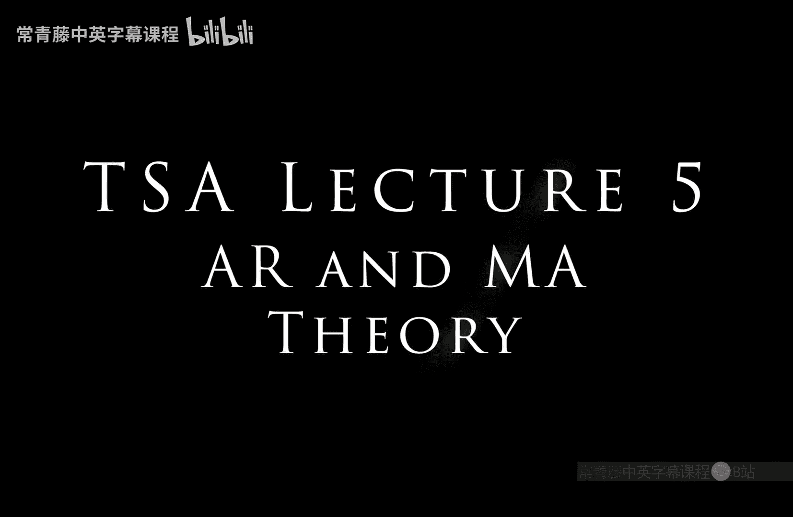
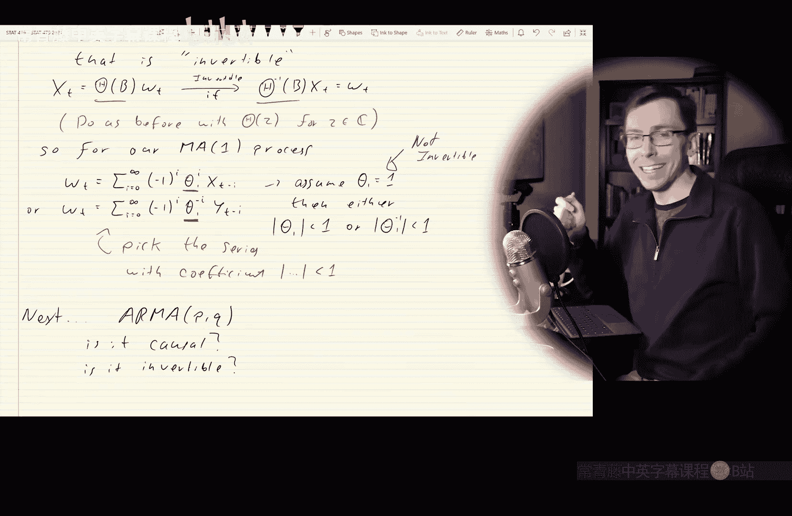

# 阿尔伯特大学【中英⚡时间序列分析｜STAT479 2021 Time Series Analysis】 p05 P5 Lecture 5： AR and MA Theory -BV1nwqYBDEos_p5-

🎼And welcome back to another lecture of Stat 479 time series analysis now we're really going to get into the meat of the course when we look at the Ar model。

🎼あ。

So the Ar model is made up of an AR， an autoaggressive and an MA， a moving average process。

 we're going to look at these in very fine mathematical detail and figure out exactly how they work and what we can learn from them and how we can model time series data using these tools and they are really going to be the building blocks for our time series models。

And welcome back to another lecture of Stat 479 time series analysis in this lecture we're going to be looking in detail at the mathematical properties of the AR the MA and then the ArRma and the Arma process so these are really going to be the building blocks for our statistical model and before we look into things like estimating fitting them to the data what we want to do is we want to understand these types of stochastic processes。

 the these time series models in a little bit more detail first so that's what we're going to do in this lecture。

The overview right， and this is section 2。3 in my lecture notes and the overview is the idea is we're going to look at arema models。

But we're going to start with all of the Im in blue。 Let's try that again。All right。

So what we're going to do is we're going to break this into pieces and try to figure out what each piece is doing because we haven't actually discussed what an Ama model is yet。

So the first thing we're going to discuss is the AR piece。

 but before I get into that what I want to say is that effectively what we're trying to do is we're trying to write some sort of equation to。

Understand what X is going to be or what our time series processes going to be doing。

 and there's many different ways that we can do that。The first tier is going to be our auto。

Regressive。Process or the AR process， so we did see this already。

But now we're going to go through it in a little more formality， let's say。

 because what we can do is we can define Xt to it be an AR process， I should say an ARP。Process。

 so a piece order auto regressive process。 And we're going to say that X T has。

Mean zero this can be this is more for convenience sake we'll talk about that in a second it just makes it a little bit easier to assume the mean is zero so we don't have an extra term flying around our equations which gets annoying。

And we write Xt。In the following form， which is going to be WT， the white noise at the current time。

 plus a sumation of we'll take I from1 to p of now I'm going to use the coefficient phi because the thetas are going to come back in for the moving average piece。

 so the standard notation as you might see in textbooks or other places is to use phi for the autoregressive coefficients。

Anyway， I should finish the equation， which is going to be t minus I。Um， yeah。

 and Wt is white noise as usual， I should just point out。With。WT， white noise。UmWith。Variance。

Sigma squared just so we have that there， and I should say these are the coefficients for our model。

Or our process here Phi 1 through Phi p， which are all going to be real numbers。

Some of them could be zero， usually we would enforce right that the largest one or the one with the largest index。

 I should say that is 5 p is not zero， otherwise it wouldn't be a P order auto regressive process。

 it would be a P minus whatever。So that's just sort of a subtlety here but yeah effectively you can have any Phis that you want now sometimes you will get a nice well behavehaved stationary process other times you may not if you pick the wrong values so one we're going to do is look to see what happens with different values of Phi and then eventually we're going to look into actually estimating them from the data but at this point we're just going to kind of forget about data for a second again there's a lot of buildup in this course with actually looking at the mathematical models before we can work with real data。

There's also a more convenient way to write this in terms of what is called the auto regressive operator。

 so what that is going to be， I can get that thing out of the way。

So what we're going to do is we can actually write this in terms of the backshift operator。

I'll say for B， the backshift operator， that one that I talked about。

 I think in two lectures prior to this one。What we can do is we can define we can。Yeah。

 we can define the auto regressive operator。So the auto。Regressive operator。

Is going to be capital Phi。Of B。And the point is that we're going to apply that as an operator so the operator remember x on the time series Xt。

 if I apply the backshift to Xt， I get an Xt minus1 out the way that we're going to do is we're going to rewrite our equation I should say we're going to rewrite this equation up here。

As capital phi of B applied to X T is equal to W T。 So this is going to be a nice shorthand notation。

And it's actually going to be convenient because this phi capital Phi that is is going to be very important。

 So here I'll say where。Capital phi of B， I want to use B， Yeah， we'll just use B for now。

Is going to be a polynomial in B， so it's going to be one。

Minus the sum never take I from1 to P of phi sub I and B to the I power。 So remember。

 the more times we apply B， the more we shift our time series back in time， so。

I didn't really do anything here， All I did was take the summation here。

And move it to the other side of the equation。Let's do that over here and thenite rewrite the sum of these x's。

 these Xts and Xt minus I's in terms of some more abstract operator notation。

But this thing is actually going to be quite important in a minute。

 so it's why we like to write it this way also it just helps because when we start putting in other pieces like moving average pieces。

 the eye is the integrated part which is a bunch of differences。

 the equation for one of these can be very， very messy， so it's quite nice to use the shorthand。

Now one thing I did want to mention is that I said at the beginning that we had assumed that the mean is zero well。

We do that more so for convenience we don't have to。It doesn't have to have a zero mean。

 but the point is， is that we can always write it in such a way that it's just a。In a zero mean way。

 so let's just try that really fast so。Let's say if。X T has mean。Mux。

 whatever mu is just some number then。We can write。X T。As X tilda T plus mu where。X tilde T is mean。

Zero。Okay， well that's fine right we're basically saying we can subtract off the mean and we'd get a mean zero process。

 but if we want to look at that in terms of the autoregressive formula。

 the one up above the first green arrow up at the top of the screen。Well。

 what we can do is we can plug this definition in and see what happens。So。What we get is that if we。

 well， if we， let's say， just ran off the top of the screen， there it is。

If we try to apply this definition here， what we end up with is an x tilde plus mu。

And that's going to be WT， but we're going to also add in this summation here， I from1 to p of phi I。

 and then we're going to replace x t minus I with x tilde。T minus i plus mute。

So all we're doing here is I'm replacing the x's with an x tilde plus mu Y well what happens is is that we can reduce this down。

2。Well， basically I take put the mu， I subtract mu from both sides。

 and I collect all the mu terms together and I get something。That's going to look like this。

 which is。1 minus the sum I from 1 to p phi I， I guess that's just it Phi I。

 and then I have all the other pieces。Which is the WT plus the sum of。

I from1 to p of phi I X T minus I， but that's a next tilde。 So what did we do here， Well。

 what we said is basically I have if my X T does not have a zero mean then it can be written in terms of a mean zero process with some extra constant added on。

This is a。Constant。Term。And the other things underlined in red here are is just going to be the same definition that's about to fall off the top of the screen here just with X replaced with x tilde so all that's basically saying is yeah we can shift we can shift a process by some mean mu and the definition still works is's just that we' have extra terms to throw around and it would get a little bit messy so for convenience sake we typically just kind of ignore that and just say okay。

 let's just assume it has mean zero it's actually very common in。In statistics。

 even in research to see people just say， okay， I assume the mean is zero。

 assume in regression context， the intercept term is zero because these things are there because they have to be there。

 but they're kind of annoying mathematically to work with so if we can get away with just setting them to zero。

 it's just nicer。So。The next thing I want to talk about is the idea of causality。

We'll say causality for。AnAR process。So we have some intuitive idea right of what causality is causality says that the past is going to influence or have some influence on the future right whereas the future is not predicting or influencing the past or the present that is so we have this idea of an arrow of time and causality says that the past you know influences the present and the future and so on。

 so we can we can consider this in the AR and an AR1 process just for simplicity's sake。

 I'll say recall。A。One process。Which is just xt， in this case I'll use phi 1 to keep with the notation from above xt minus1 plus WT。

Now， when you look at that you might think， well， that sounds causal right。

 because the current time point T depends only on the present and the past， that is it depends on WT。

 which is our present white noise and it depends on Xt minus one。

 which is what happened one time step ago， so it's like saying the price of say a stalker something。

 is influenced by the price yesterday and some random fluctuation。

But that only makes sense in the case that this is。

We'll consider when phi1 is in magnitude less than one。 And we looked at this before。

 that implies stationity。 So let's look at that process again well。

We know from what we looked at before in this course。

That if phi is less than one in absolute value or phi sub1 is less than one in absolute value。

 then what I can do is I can rewrite this process in terms of a linear process。

Here I is going to be from zero to infinity， and we have phi1。To the I power and W T minus I。

So the idea is that this guy here is a causal。Linear。Process。So。

It only depends on white noise that goes into the past， right？Which is why it's causal。Basically。

 this is。T。T minus1， t minus2， etctera When we first looked at a linear process。

 you could index it into the past and into the future， then it would be non causal。

 but at least in this case we have this nice causal representation so。That's nice。

 but what happens when phi one is greater than one in magnitude？And we'll say but。

If my coefficient is greater than one， well， we know from before that there's a problem that we don't have that station or actually no。

 there's even more problem than not the stationary thing sorry that's when when phi is equal to one we know when phi is equal to one。

 we have a random walk and it's not stationary， but we never really considered what happens when phi is greater than one in magnitude。

 So maybe I'll just write that in just to。😊，We'll just squeeze in that。I'll say when。

Phi is equal to one， we have a random walk。Which is a very special border boundary case。

 and it is not stationary。I can't write it in terms of that linear process。

 the whole thing would have infinite variance if I tried to take it this thing into the infinite past that is take I to infinity so that's sort of point numbered that's the little middle case but what happens if p1 is greater than one and now things get well a little weird so let's stick with me on this so we looked at this in some data settings。

 if I try to simulate a process， even if phi is just a little bit bigger than one。

 this thing blows up exponentially it explodes because instead of multiplying by a number over having a geometric series where I'm multiplying by something less than one so we sort of decay geometrically if phi1 is greater than one now I'm multiplying itself by itself。

 I'm blowing up geometrically and thats that's bad but we can still try to understand this as a。

Non causal linear process， so how do we do that？Well， we can apply the definition。Of this process。

 and what I can do is I can say that X T plus one happens to be， well， what phi1 X T。

Plus W T T plus one， sorry， W T plus one。Okay， so now if we rearrange the terms in this equation。

 we could actually write this as X T is going to be。Phi1 inverse。X T plus one。

 and then we have to subtract。A phi1 inverse W T plus1。So now what we're saying is that X T。

Can be written in such a way that it depends on the future value X T plus one okay。

 not great for statistics because typically we want to use the past which we know to predict the future。

 but mathematically we can do this and there is there' is going to be a kind of a point to this it's not just mathematical nonsense but let's let's keep doing this iteratively and see what happens。

So if we continue recursively， as I did in some of the early lectures and as you would have done in assignment one。

 when you had to compute things like auto covariances。

Then what we can do is we can plug in the same definition and we can actually get an Xt plus 2 in here。

The point also to remember is that phi 1 is greater than one in magnitude， therefore it's reciprocal。

 phi 1 to the minus1 is going to be less than one in magnitude。

 so maybe I should write that in on the side。We'll say note。

Phi1 inverse is less than one in absolute value or in magnitude。

 which is good because it means our infinite series is actually going to converge。

In sort of a probilistic sense， I guess。What are we doing Yes。

 so we have a t plus two and then we're going to have a phi1 minus1 w T plus2 and then we have to take so this。

 right？This guy is this。 and then we also need to have。This last piece here。

 which is going to just be the same thing phi。Phi 1。

Minus1 WT plus one so if we kind of rearrange the terms a little bit。

 we get a phi1 to the minus2 I should probably just write phi and drop the sub1 because it's just kind of annoying to keep writing but that's okay the point is that we could have an AR process with more than one。

Term in it， we just don't in this case。And then we're going to have minus。

 and then in the giant minus bracket， what we're going to have is a phi1 to the minus 2 wt plus 2 and a phi1 to the minus1 Wt plus1。

So what we're going to do is the exact same thing we did for the causal AR one process。

 the one above where we just keep iterating until we get an infinite series and if we。

Say dot dot dot keep iterating this thing。 Well the first term is going to end up being zero again because we keep multiplying by a number less than one in magnitude。

 which is going to take this down to effectively a random variable with zero mean and zero variance。

 so it's zero， I guess。Almost surely or whatever， it's zero。

And then what we do is we take I now from one to infinity of phi1 to the minus I w T plus I so there's a couple things going on here first of all this series actually makes sense mathematically in the sense that i'm summing up a bunch of。

Independent or uncorrelated or independent white noise piece random variables。

And because phi to the  -1 is less than one。 this thing will actually converge。

 So what we actually have here is a。Non causal。Linear process。And here the。Index runs T。

 I guess T plus1， T plus2。T plus3， etc。 So this actually can be thought of now as well actually not thought of it's what we have is something that's a stationary process well okay we don't know exactly that is stationary we just see it and we say well。

 this looks basically mathematically equivalent to the one above the only difference is the one above is causal I'm running my series into the past this one is noncausal I'm running it into the future So what we really need to do is compute the autocovariance to show that it is in fact a stationary process so。

Let's do that。Um， because I， well， I know the that it's stationary。

 what we're going to do is we're going to write it as Kx tau。

Where Tu is going to be the difference right between two time points。And。😊。

What we can do as we can write this now as the expected value， and again。

 when we're computing the autocovariants we're multiplying two of these infinite series together。

So when we do that， we end up with a double sum。 we're going to take。

 I guess the two negative signs cancel out Yeah because we'd have minus and minus so we're going to take。

 let's say I from one to infinity and I guess J。From one to infinity and then we're going to have two different pieces here well。

 I guess there's two things we're going to have。We're going to have a coefficient of phi1 to the minus I。

 We're going to have a phi1 to the minus J。 We're going to have a。A W。Let's say T plus J and a W。

T plus tau plus I。So。Yeah， here we have， again our two time series or our two white noise processes and once again。

 the nice thing is is that this expectation， even though it's over a double sum with I guess an index going to infinity this whole thing is convergenence。

 I can move the expectation inside of the summation and when I take the expectation of the product of two white noise terms。

 it's always going to be zero unless the two indices are equal to each other。

So what I get is my sum over I， I'm just going to write I and J here from one to infinity for shorthand。

 I can collapse the phi minus I minus J together， and then I get something that's going to look like sigma squared。

 the variance of the white noise process and indicator function。

Which is t plus J is equal to T plus tau plus I。Because that's the only setting when this thing is going to be not zero。

And then from there， we just kind of well fight our way through the equation。

 the T's cancel out here so we don't need those they and we're just saying that we want。Well。

 effectively， if we rewrite this， what we end up with is something like J minus I is equal to tau。

So what does that mean， well， that means that if we were to， how do I want to write this？Well。

 what it means is that if I were to。This part's always a little。

Make sure I don't miss any terms here， okay， because what I ultimately want to do is I ultimately want to take one of these towels out of the I minus J so or minus I minus J so what I want to do。

Is I want to write minus I minus J as。UI guess what J。Minus I。Let's see if we can do this minus。2 J。

Did I do that right， I think they did that right because what ends up happening then is that I can replace that first guy with a tau minus2 J。

 something that looks like that。Yeah， I think that's。

Good it's pretty easy to mess up these calculations so make sure to keep track of me and well I guess you can't yell at me while I'm doing a pre recorded video。

 but definitely let me know if I messed something up。Anyway， the point of that kind of strange。

Comment。Is that when I have this sum what I want to do is I want to take a tau well I want to take two things first of all。

 we have a sigma squared which is just floating around there doing nothing but being multiplied by every term in our sum so we bring it outside of the summation Okay that's good then what we're going to do is we're going to extract。

嗯。Yes， I did it slightly backwards what I actually wanted to do is I wanted to extract not tau。

 but I guess。Minus tau。I want something that's going to look like this and I want that minus sign there。

 so what I need to do is slightly rearrange the。Way I was writing that。

Because what I ultimately want is not the two。J， but I want a2 I， so。And these terms， I tell you。

 yeah， what I also actually need to do is I need to flip this。I told you these things are a mess。

 right？Tau， well we have minus tau is going to be I minus J。

And then what I need to do is I need to take out。Write this thing。Oh sorry， right？

And then what I would need to do is redo this second line and write minus I minus j as minus2 I。

 I guess in this case， minus tau or something like that yeah。Minus 2i up in the exponent there。

Yeah the manipulations can be quite tedious in time series the reason that I'm trying to do all of this is so I can sum up this last guy as a geometric series。

Let me highlight that in the better color。So this thing in blue here is a geometric series。

 so what I end up with is well just sigma squared， I'm going to have a phi1 to the minus tau。

 and I'm going to divide that whole thing by one minus phi 1 to the minus2 so there's tons of negative exponents floating around。

 but remember phi is greater than1， so in this case phi to the minus1 is less than1 and therefore our geometric series converges。

But most importantly， the auto covariance tells us that this thing is stationary。And we're back。

 I lost the video there for a second I was just too wrapped up in these wonderful tedious calculations and what I wanted to end with was the fact that this geometric series is slightly different than our other geometric series。

 this geometric theory starts with I is equal to one and because of that we have one more term that we have to add in to our auto covariance which is going to be something。

Like this in the exponent。Okay， now we have our wonderful auto covariance。

 it only depends on tau this whole process is stationary， so actually。So， if。

Phi 1 is greater than1 we have。A stationary process。Which is cool， but it's not causal。Oh。

 that's too bad， I guess it's not causal， so it doesn't really make a lot of sense。

Unless there's a way to find a causal process that is equivalent to the non causal process。

And we're going to do that because yeah， this is a this is kind of a a。

bitit of a crazy part of the course I find。So。What we're going to say is let WT。The Gaussian。

White noise。Therefore， Xt。Is a Gaussian process。And there's something very special about the Gaussian process。

 recall that。A GP Gaussian process is。Characterized。By its mean。And covariance。

I guess auto covariance I should write to be precise here。Auto。Covariance。

 so the Gaussian process is quite nice in this case because。

It only depends on it only matters once you know what the mean is and you know what the autocovariance is。

 you know what your Gaussian process is， you're kind of done， you don't need anything else。So。

Is there another process that has the exact same autocovariant as that big green one。

 the answer is yes， and we're going to write it down。 So let's。Now。Consider。YT。

And there really is a statistical reason why we're going through all this。

 so I keep telling you that just to say stick with me and we'll get there。So we have yt and yt。

 we can write down as this process， which is going to be phi1 minus1， y t minus1。

Plus some white noise process V T， I use V because it's not the same as W， I should say where。

VT is Gaussian。White noise。Where。UA variance， it always has mean zero， of course。

 but it's variance in this case。Is going to be sigma squared phi to the phi1 to the minus 2。

 so what we do is we basically take that phi coefficient and we well。

 we divide the variance sigma squared by it。So。What we have here is a causal， so。The point is that。

Y T is a。Casal AR1 process。And if we take the time to actually write out。

We find that the auto covariance of y at lag tau just so happens to be something that's going to look like sigma squared。

Phi 1， the minus tau。Phi1 to the minus2 divided by1 minus phi1 to the minus2。

 which you can use just based on the formula that you would have done back in the earlier notes or in I think we did it in an assignment one as well as earlier in the notes。

So the point is， is that。This process why。Is the same as this process Xs up at the top。

 If the white noise is Gaussian， they are equivalent， I guess。

 stochically equivalent in the sense that。They will have the same distribution for any finite collection of time points。

 and that would be， I guess， a multivariate Gaussian distribution。All right， so。

That's a little weird right， because what we're basically saying is even if we have a noncaus process。

 there is an equivalent causal version of that process。

 at least in the case that the white noise is Gaussian， if the white noise is in Gaussian。

 we don't have this nice equivalentence。But there's something important here， which is。Important。4。

Statistics， which is why I was going through all this craziness， is that if we have。

Xt is equal to phi1 xt minus1 plus Wt， which is our non causal。AR 1。

And if we have yt is equal to phi1 inverse y。T minus1 plus Vt， which is going to be our causal。Well。

 if I have data that's coming from a process that looks like this。

What am I going to be estimating right， am I you know。

 because ultimately we would want to try to estimate this。

 we would want to put some hat on there and say， a。

 I estimated the AR one coefficient or I estimated say。The variant here like sigma hat squared。

But we have two different processes that have the exact same behaviors stochically so we can't actually differentiate between the two of them right well that's a problem for statistics that's called identifiability right when in statistics we want to make sure that if we have data。

And we have a model it's going only one model is going to represent that data in some sense here we would have two models that are exactly equivalent in every way except that one's causal and one's non causal so。

What do we do？What we do is we cross out the non causal one and we say you know what we live in a causal world。

 at least as far as we can tell， so we typically want the past to predict the future So when we try to do estimation for an auto regressive process we only estimate causal models or in the case of the random walk we may get a nonstary model。

 but that's just an important little。ANote to take into account because it can be it is kind of a strange occurrence here。

 but something that is certainly important when doing statistics you want to make sure you know what you're estimating so if we had data from this process we'd be estimating this coefficient here that is phi1 inverse and not Phi1。

Okay。So。We can actually extend this idea。So I'll say now。Let's。Look at。ARP， the ARP process。Well。

 if we go back to our original。If we go back to our original notation。

 then what we had was something that looked like capital Phi B applied to Xt is equal to WT where capital Phi is our autocovariance operator。

Okay。So operators are invertible， I guess in some cases， so in this case。

 what we can do and we'll define it better in a second is write this as phi inverse。B applied to WT。

So this is going to look a lot like a linear process in the sense that I'm applying some type of operator to WT。

U。But now we have to ask the question mathematically。Does。Phi inverse。Exist or make sense。

If I say I have a matrix and I want to invert it well。It may not exist， there may not be an inverse。

 so in this case we need to consider that is there actually an inverse here？So now again。

 we're going to go back to the AR1 process because it's the easiest thing for me to write down to give you a concrete example to look at。

Yeah， so if we look at the AR1 process， this one's a little bit easier to look at what we would have is that。

Phi， my capital phi of b here is going to look something like1 minus phi 1 b based on the definition from the beginning of the course。

Now we're going to get into complex numbers because you probably thought you wouldn't need them right when you learn them in whatever。

 I guess pre calculus or something， but yet we have to use a little bit of complex numbers to make sense of this so。

We can say let。Z be a complex number。And。Consider。Capital Phi。Of Zed。Being one minus5hi1 Z Okay。

 so this is just a sort a monomeial I think or it has just one term in it I forget my I think it's monomeial I need to double check my terminology to make sure I'm not leading you astray here。

But what we have here is we have phi Z is just going to be a polynomial in terms of Z。

 some complex number。Okay， so。Note。That。Phi inverse Z is can be written， right。

 as one over1 minus Phi 1 Z。 Okay， let's just take the reciprocal。 And then the question is。

 does that。Makes sense， can we divide by that？Well， sure， yeah， we can definitely divide。

 but can we write this in terms of an infinite series？And the point is。

 is that we can write this as a geometric series。That looks like j from one to infinity phi1 to the J Z to the J power and this is going to have a radius of convergence if you think of it in terms of like a power series。

 right。If you recall right the radius of convergence is the values that Z can take such that this series converges right if Z is really。

 really big with respect to the value of whatever phi one is then this series will not converge and we can't write it down it doesn't really make sense but here we're going to have a radius。

Of convergence。Of。Phi1 to the -1， which basically is to say， let me make sure I have my。Notes here。

 right。So。What that means is that therefore the series。Converges。When。Our Z here。

 I guess in magnitude because it could take on any complex value is less than phi1。

 the absolute value of that thing， which I guess we're assuming is real valued。

 but could be negative， so we need an absolute value nonetheless。So。Okay， why are we doing all this？

If。Phi1。Is less than one。 Then what we can do is we can。We can use this idea。

 this series here and replace the Z with a B。We can use， I'll say the green box here。

We can use this thing， but what we can do is we can replace it Z with a B and what we write is we write that Xt is going to be。

 well， the same thing that I have the other green arrow pointing to， which is，Um。Phi inverse。B。WT。

And if we have that convergent property， we can replace phi inverse with one minus the sum j from 1 to infinity。

Phi one。J， B to the J。With a WT。And then we can actually just， well， I guess decrement it if we want。

 and we end up with our linear process again， which is going to be Wt minus the sum J from 1 to infinity of phi1 to the J power。

 wt minus j because it's being backshifted j times。All right。

 so that's like a quick kind of shorthand to get back to the linear process。

That we had back in lecture two， or I forget， I think it was two， maybe it was three。Um。Right。

 so again， this is again a lot of kind of craziness with the idea of using the complex numbers。

 but what we're really doing is we're just saying if if we treat this if we take this polynomial phi。

 we shove in a complex number， Z， then we can determine whether or not this inverse exists in terms of a series or at least it exists what it looks like as a series。

Assuming whereas Z is smaller than the radius of convergence。Now。

We can extend this to the ARP process。And what we can do is we can rely on a fun little tool。

 the fundamental theorem of algebra。For an ARP process。

 right what we would have is something that looks like。My back share， my AR。

My autoregressive operator here is going to be， I think I was using I， I forget， we'll just use I。

I from1 to a p of phi subi because we could have multiple coefficients here and B to the I。Now。

 if we were to write this in terms of a phi applied to a complex number Z。

 well I'm going to get the exact same thing I'm just going to replace。B to the I power with a。

Zed to the Ithe power。And because of the fundamental theorem of or not arithmetic of algebra。

 it says that if I have a polynomial in the complex plane。

 it factors so I can write it as the product of a bunch of monoials。In this case， what I get is。

 well， something that's going to look like， I guess there's a couple things I need to do here。Yeah。

 the first thing I need to do is factor out the phi to the P。

UAnd then what I'm going to get is a bunch of Z minus R1， which is the first root， Z minus R2。

 the second root。All the way up to Z minus R P， the P root now I should say where just to make sure it's explicit R1。

To RPp are the roots of this polynomial and they may be in the complex plane because again。

 we need to work in complex numbers so we can completely factor this polynomial。All right。

So we're almost there now， because what that means is that。Yes， so。What we first want to say is note。

Note that minus1。To the P times the phi。P times the product。J from1 to p of R J is going to be one。

So why is that true， Well， it's because if we go back up to our。

If we go back up to this equation for the polynomial here， we know that the constant term here。

 the one that has nothing to do with Z is a one， so that one has to be the product of all of these pieces。

 all of the roots， times 5 p， the coefficient that I pulled out of the front。

Have to multiply together with the minus ones coming in because we don't know if P is even or odd。

 have to multiply together to get one。And。That means。Therefore， we can write our phi。Um。Inverse。

Of let's say， Zed。That should be a minus1， so let's write that again。

So this thing now can be rewritten。As。One minus r to the minus r1 minus1。

 so this is the reciprocal of the first root。And then we're going to multiply by one minus r all the way up to P minus1 Z。

And the point is， is that all the other terms multiply together to get one。

 which is why there's a this one is this one on top。

 which is the point of this kind of silly thing I wrote about the product of all these things being one。

Okay。Therefore。Yes。If。All roots。A。I say， are greater than one in magnitude， then。That is。

 they lie outside the complex disk or the， Yeah， the the complex， I guess， yeah。

 disc is probably the right word。Then。We can take。That phi。B， X， T。Equal to W。

 our auto regressive equation， we can rewrite it as x T phi inverse。BW。

 and we can actually get an expression for what phi inverse is and what is's going to look like。

I'll just write it down on the next line here。Is going to be the product over the piece。

we'll say J from one to I was using I before。Yeah， we'll switch it。

I hope that I don't make a terrible mistake here， we have i from one to P。There's a typo in my notes。

 so I'm going to have to correct that。Just an omission。

Because what we're going to do is we're going to have to take J from1 to infinity of R。Let's see。

What are we doing here， we're taking our。Yeah， this whole equation needs to be fixed。

What we would need is we would need RI， the I root to the minus。J power。

 one of the reasons why I'm assuming the roots have to be greater than one in magnitude is because I have these reciprocals。

 I need the reciprocals to be less than one in magnitude so that we can sum a geometric series and then we're going to have a B to the J here。

And this is all going to apply to WT。Okay， so that's kind of a mess。

 but what it really is telling us right is that we can take each of these I'll underline it in blue。

 so each of these pieces here in the denominator of this in this the reciprocal of this polynomial here。

 each of those， if the root is greater than one in magnitude can turn into a geometric series which becomes one of these。

 one of the I from one to P of one of these terms。So effectively。

 what we're doing is we're doing the same thing we did up here at the top of the screen for the AR one process。

 but we are。But we're doing it p times and we're multiplying p of them together。All right。

 so that's a ton of writing and equations。All right。

 so we just went through this big mathematical derivation to effectively write an ARP process in this form at the bottom of the page so then the question is well why well the idea here is is that。

The main takeaway。Besides all the。Fun with mathematics is that I。If。The roots。Of this polynomial。

Phi R or sorry， phi of Z， the roots are R。A。I guess well， we'll just write it out。

Are I greater than one in magnitude then。We have。A。卡锁。Process， a causal AR process。

And this is going to be important because ultimately when we look at tests， so if you happen to read。

 we we talked a little bit about testing for stationity。With things like the Dickie Fuller test。

 which we'll do in more detail later， but if you just happen to glance at the documentation for some of these tests like that one for example。

 but other ones as well， they'll say something like a。

 we're testing for the existence of a unit root or the not you know or something like that。

So the point of that unit root that they keep talking about is coming directly from this polynomial it's basically saying we want all the roots to be bigger than one in magnitude we don't want them to equal one if the roots are less than one then we have that noncasal problem and we have to reverse it to get back to a causal process so typically the roots here are always going to be either greater than one or I guess equal to one if they're less than one just non-causal and they'd be an equivalent causal process where the roots are greater than one yeah time series is kind of a mess right？

Um。But regardless， that's the main idea。Anyway， we are not quite done yet because the next thing I want to talk about is the moving average process and I think we have enough time to get through this。

I guess I have as much time as I feel like， but I will try to keep it to approximately the normal you know。

 sort of 80 minutes of class time。So we can consider a moving average process。

 the MAQ a order moving average， and we're going to do so in a way very。

 very similar to what we did with the auto aggressivegressive process。

 but we don't have to deal with all those。Crazy root for the time being， for the time being。

 you'll see what happens。Anyway， we can write our moving average process right as a sum of white noise kind of backshifted into the past。

 so what we have is we have the usual setup here we have J from one toq。

 we have theta just so it doesn't conflict with the Phi's that I was talking about in the previous section。

Theta t minus J。And we assume again。Such that that theta。One， through theta。

Q are going to be real numbers and we typically would want。

Theta Q to not be zero so that it is a Qth order moving average process。

Now we can write this once again using the notation capital theta for our。mMoving average operator。

Where this guy here is the moving。Average。Operator。All right。And just to I guess。

 explicitly write it down， capital theta of B is just going to be， well。

 very similar to the auto regressive piece， but it's going to be a one plus。

Because we're not moving anything to the other side of the equation like we did in the AR process。

 it's going to be a 1 plus the sum J from one toq of theta J B J。All right。

 and this is our moving average operator。Okay， so we can proceed similarly， but once again。

 if we wanted to do statistics， we would have data that would presumably come from say a moving average process and we'd want to estimate it we'd want to say to ourselves。

 okay。You know， I want to estimate the thetas， so I have to make sure the things that I'm estimating are unique or identifiable in a statistical context。

And yet again， we run into another uniqueness problem， much like the causal non causal issue above。

 So up here for the AR process， we had the problem of。卡座。Versus non causal。Down here for this guy。

 we're going to have the idea of invertible。Versus non invertible。

So we're going to have a similar issue where we have to deal with the fact that there are equivalent versions of the moving average process that will not be invertible or that will be invertible。

 of course I haven't told you what that is yet， so let's consider again a simple example。

 which is going to be the MA1 process because。Having more terms just makes everything worse when I try to explain it。

It's hard enough keeping track of all the terms when I just have an MA1 or an AR one。

 so let's see if we can get through this one。Anyway， what we have is something like this。

 We have a WT and we have a theta 1 Wt minus1。 Now remember the MA process。

 you can think of it as kind of like。Proroppagating the noise through time， so。If at time t minus1。

 there was some shock to to the process that we're looking at。

 the price of our stock just happened to go up or go down。

 then the point is that shock will still kind of be present one time step later， but decremented or。

Multiplied by some value theta I'm saying decremented because typically we would want theta to be less than one in magnitude。

 though it doesn't actually have to be the case， so let's let's look into that a little bit closer well。

We we know from， I guess from， I think， I don't think I did this in the previous lecture。

 but you would have done it in your assignment。That if we compute the auto covariance for this thing。

The autocovariance is fairly nice。It's just going to be theta1 squared。Sigma squared and this is。

Tal equal to zero。We have theta1 sigma squared。Tau equal to one。

 and we have zero for all other values of tau。 So this thing is going to be stationary process。

This is stationary。For all， theta1， so we don't have to worry like in the AR case when our coefficient equals one and we end up in a random walk setting in this case。

 while we could have theta be kind of whatever it is we'd still have a stationary process so that's good。

 but like with the AR process just because we have a stationary process doesn't mean it's nice in the sense that before we could have a stationary non-causal process。

 that's not good。And。Once again， we can also consider。The process， YT。

You can kind of guess where I'm going here。 I'm going to write down something that's going to be。

Mathematically or stochasticically， I guess equivalent， if we want to say it that way。Not WT。Vt。

Minus1。Another typo， I really got to work on these notes。Where I should say。

VT I's write the variance。Where the variance of Vt is going to be theta。Yeah， theta 1 squared。

 sigma squared， and if we do that， then it turns out that the autocovariance of y at tau just happens to be the same as the autocovariance of x at tau。

Great， so now we have two different processes they're two different in the sense that。

They have different coefficients in front of their moving average term。

 so the problem once again is that if we had data， we would want to try to estimate theta 1。

 but are we estimating theta 1 or are we estimating theta 1 to the minus1 the reciprocal of that and once again。

 yeah that's going to be a problem statistically。So what we want to do is we want to pick the invertible process。

 so then the question is well what is invertible， well it's going to basically do what we did for the AR process。

 but do it backwards。What I mean by that is that。So we。W。To pick。The， I'll say X T or Y T。That。

Is invertible。And what I mean by that is that if we consider that let's just say Xt。

 for the sake of writing one of them down is going to be phi or not phi theta B applied to WT。

Then we say that it is invertible。Invertible， if we can。

 well invert theta and we get theta inverse B。X T equal to Wt。

 So the point is it's invertible if my theta is invertible。And in this case。

 or I guess in this setting， right， it's really just doing exactly what we did above， we can。

So the point is we can。Do as before。With。Say considering theta applied to some Z for Z a complex number。

 and then we can proceed working through that to determine， well。

 do we have a power series representation whose radius of convergence is at least one or are the roots？

I guess is it big enough or small enough we want the root to be in the roots need to be large。

 they need to have magnitude greater than one so that their reciprocals are less than one so that our series works Yeah there's a lot of little pieces floating around here。

So。For our error8 error sorry， MA1 process。What we have is we have。Well。

 two different ways we can write it， we can write WT for x is going to be the sum。

 and this is going to be i from0 to infinity of minus1 to the I theta 1， I X， T minus I。Or。

We can have wT equal to the sum I from0 to infinity of minus I or minus1 to the I theta。

1 to the minus I there's the difference and then y t minus I Okay。

 so the only difference here in some sense is the fact that one of these has a minus I and one of these has a plus I as its exponent and what that means is that。

Point here is that。You， assuming。Theta is not equal to one then。Either。Theta1。Is less than one or。

Theta1 inverse is less than one， which means that one of these series makes sense mathematically。

 that is it converges in a mean squared sense。And one of them doesn't so effectively the point is we。

Pick。The series。With。Coeicient。Less than。One in magnitude and that's going to be the process that we're going to work with that's going to be the invertible one if we are in this special case where theta is equal to one。

 this is not invertible。So typically we never want anything to actually be one。

 I mean in a way that would make things very strange too just because it's almost like there is no。

You don't you'd want theta to be less than one in some sense because。

You don't want the past to be kind of like resonating in some sense and getting stronger as time goes on。

 you'd want the past to kind kind of fade into nonexistence as you go into as you move forward into the future。

 so if there's a shock the process， the system that you're looking at。

 you'd expect that shock to start to dampen as you move away from it in time。

 not to magnify itself in some strange way。Right， so that's more or less everything that we want to talk about in。

In this lecture because the next thing what we're going to do is we're going to take this autoregressive piece。

 the AR piece， we're going to take the MA piece and we're going to cram them together to get an AR an Arma model and now the idea is that well I'm just going to write it down just so you know where we're going with this next。

Is。Armma。P Q， where we take the A piece， we take the MA piece， we cram them together。

 and then we want to know。Is it causal？Is it？Invertible。

These are going to be important things to know because statistically we need these properties so that we can actually try to estimate terms in these models because eventually we're actually going to plug data into a function that's going to fit an Arma or an arema model and we need to actually well we really want to be able to to actually fit something that makes sense so yeah we're going to have one more round of。

Let's say crazy coefficient and complex polynomials when we do Arma and then the arema process。

 but after that things will maybe get a little bit better or there's a lot of math in this course before we actually get into the statistics so what we'll do is we'll do this and then maybe what we'll do is we'll look into tests for stationity because。

Now that we know what these unit roots are， we can actually apply proper statistical testing and I do enjoy a good hypothesis test like all of us do。

We'll work on that， but at this point I think we're done for today， so thanks again for watching。

 see you in the next video。

