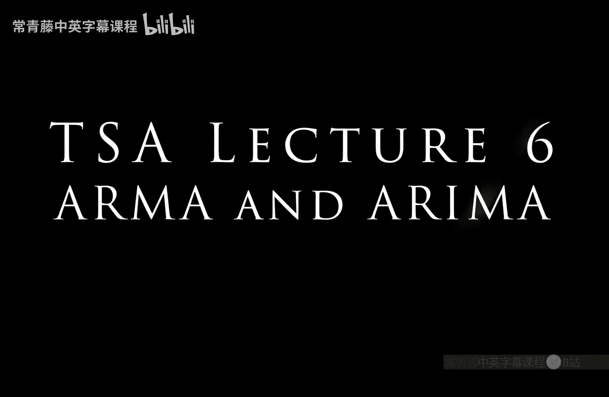
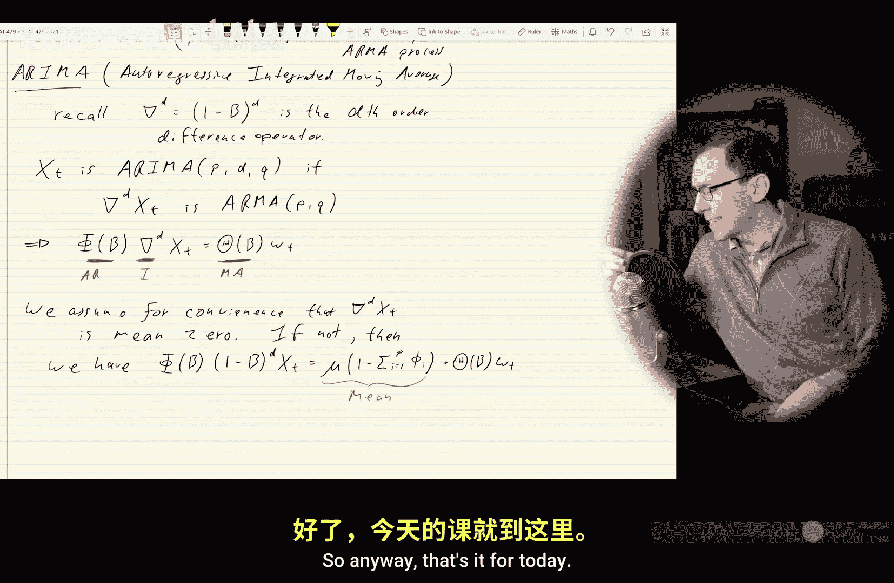

# 阿尔伯特大学【中英⚡时间序列分析｜STAT479 2021 Time Series Analysis】 p06 P6 Lecture 6： ARMA and ARIMA -BV1nwqYBDEos_p6-

It is way too cold outside to do another opening， so instead we'll just stay inside and do sometime series。

🎼Today in our time series lecture we'll be continuing the theory that we did with the autoregressive and the moving average process。

 we're going to cram them together and what are we going to get well the Arma model。

 the autoregressive moving average process we'll also look at the Ama model the autoregressive integrated moving average process and this will give us a lot more theory to understand how these tools work before we get into the actual statistics of trying to estimate and fit data to such things so let's go take a look at that。

And we're back with yet another lecture of Stat 479 time series analysis in this lecture we're going to continue the theory that we were doing in the previous lecture that is last time we went through the AR and the MA process individually Now we're going to combine it and look at the Arma process and then we'll go on to looking at the arema process。

 so we have another day with a bit of theory to get through。

 but after that we'll take a little break and we'll look at some actual data now that we have sort of a new understanding of the AR MA Arma and Arma models。

So let's get into that right， well， what I'd like to do first is just kind of recap what we did last time because there's a lot of stuff in there and I want to make sure that we kind of remember what we did。

So first of all， we discussed the AR or auto regressive process。I should say ARP。Order P。

And what we learned about that is well， first of all， how to define it。

 we defined it in terms of its。The autoregressive operator， which is capital phi of B， applied to Xt。

 and that's going to equal WT white noise。So this is the sort of general form for our autoaggressive process of order P and what we found is that。

Basically， the key thing that we discovered is that this is。

Causal in the sense that it can be written。As a causal。Linear。Process。If。The roots。

 the polynomial roots or the， I guess the roots of the polynomial。Well。

 I'm not going to say of the polynom， the roots of capital Phi evaluated it instead。

For that a complex number。Lie outside。The unit disc。That is their magnitude。

The magnitude of all of the roots， let's say R I is going to be greater than one。 This is for all I。

 So what does that look like in a picture Well in a picture。

 if we imagine the complex plane here we got the reels and we've got the。

I guess imaginary in this axis， then what we have is we have our unit disk。

 approximately a circle there and the roots。Should be outside of the unit disk。

 Maybe they're also on the other side。 But as long as they lie outside the unit disk。

 we have a causal ARP process。 if it has P terms that is ARP。 But if all the roots lie outside。

 then we have a causal auto regressive process， great。U。

If we have roots lying on the disk then we run into the nonstationity issue。

 if we have roots within the unit disk， then we have a noncaus process。

 it may very well be stationary as we discussed last time you can have the case where the process explodes but it's still technically a stationary noncaus process so yeah time series is a bit weird right？

You look at the data and you think oh yeah， it's just watching something over time and then you realize a there's actually a lot of crazy math going on but anyway yeah so that's the ARP the autoregressive order P process now if we move on we can we also discussed last time the MA。

Order Q process， the moving average process of order Q。 and similarly。

 this was defined to be X T is equal to capital theta B。Applied to WT。

So really it's the same thing as before except we're applying the operator to the white noise rather than applying the operator to XT in this case。

 we had a very similar development， but we're going to change the word causal to invertible and that is that this。

Is invertible。Invert。The ball。Um if。The roots。Of。Theta evaluated at some complex numbers Z。U。

Are greater than one。In magnitude。As we just discussed with the auto aggressiveive process。

So what we have here right is that we have really the same setup。

 we're saying that if the roots are at lie outside the unit disc， then it's invertible。

 so what is invertible。Invertible means。That we can write WT in terms of some type of a series。

 let's see we need， let's say J from。I guess one， two。

Zero to infinity of I forget what the coefficients I used， I think they were were they thetas。

 I'm trying to keep the notation the same。We'll just use not only use the。

 because theta is the actual co， we'll use phi even though I think。No P sigh。

 will you sigh the little one that looks like a Trident。There we go， we'll use side J。

What do we do in X T minus J So the idea being that we can like we had the linear process。

 maybe I can write that up above here in green。 So for our linear process， right， we would have X T。

 which is the sum of。Let's say。Tea from a。I guess zero to infinity， I'm going to use Psi again。U。

Not T， sorry， what am I doing？I am getting my indices all backwards that today we have psi I and then we have W T minus I so in this case the size in the green and the size in the blue might be different values but the point is that really if a process is causal then it means I can write Xt as a sum of white noise from present all the way into the past right if a process is inverible。

 then I can write the white noise as a sum of the Xts of the process itself。

 with some coefficients going I guess off to the past as well。

So that's roughly and they both correspond to the same idea。

 which is we need these roots for the polynomial to lie outside of the unit disc。

 so it becomes an exercise in I guess， complex， I don't want to say analysis complex algebra where you're trying to factor a polynomial over the complex numbers。

Luckily computers do that all for you， so we don't have to worry too much。

 but the idea that we got to last time is that when we actually want to do things like estimation。

 we need to know what we're estimating and you can have invertible non-inverttable equivalent processes and you can have causal noncas equivalent processes so we have to know which one we're going to estimate and typically the ones we want are going to be the causal and the inverttable ones and that is going to lead us into the Ar model。

So we have now the Arma。P Q model。Now the ArmaPQ model is kind of what you think it's going to be。

 you're going to take the ARP， the MAQ and you're going to cram them together and you get an armma model。

 but we will take the time to carefully write this all out I mean I could just leave it at that say and say okay you cram them together and we're done but it is good to write this all out in finer detail because I know that probably you're all learning the theory for the first time so it's really good to take some time and slowly work your way through it。

I wonder if that's being picked up by the mic。Sounds like there's a sad toddler upstairs anyway。

 right， so if we want to define an armma PQ process， then again， we say that Xt has zero mean。

Which is really again， just for convenience as we talked about last time。

 we just have the zero mean there so that we don't have to be dragging around this extra term。

 which is super annoying。So we assume it has zero mean we can adjust it otherwise。

 and we're going to write Xt in well a couple different ways。

 the first way we're going to do it is say it's going to be white noise at current time t plus some type of auto regressive summation。

In terms of the Phis。😀你。😊，T minus I， and we're going to have some J here running from1 toq of theta J w T minus J。

So now what we have here is we basically have exactly what we had before。

 we have the ARP piece and we have the MAQ piece。Now we have a couple assumptions。

 so we have our coefficients。Yeah。Oh man， we have our coefficients phi 1 through phi p and theta 1 through theta Q。

 these are all assumed or they're all going to be real numbers and specifically we want to make sure that phi P is not zero and theta Q that's a terrible theta let's do that again theta  Q is also not zero because otherwise it wouldn't be an armma P Q。

 it would be an armma some other order p prime  Q prime process。So again。

 that's the mathematical setup and we can also write。I'll say we also right。5。B。

X T is equal to theta B W T。 So we just take the two things that we had above here。

That is specifically this piece and this piece。 and then we cram them together and we get。

This guy here， which really just says we have an auto regressive operator， apply it to Xt。

 we have a moving average operator， apply it to WT。And anyway， you have all these pieces。

 so this is what the auto regressor the yeah， the auto regressive moving average process is going to look like。

Now there's some interesting little things that can occur。

 The first is going to be a problem of uniqueness or more more so。Non uniqueness。

So there's a chance that well not a chance if you have an Arma model， you could actually write it in。

 I guess effectively an infinite different number of ways there's going to be the best way to write it。

 but the point is that well， let's look at an example。

So the example we have here is going to be that。X T is going to be theta X T minus1 minus theta W T minus1 plus Wt。

 So if I gave you this process。The first thing we'd look at and say， okay， this looks a lot like a。

Arma， I see one moving average term and one auto aggressivegressive term。

 so it looks kind of like an Arma 1，1， I'll say right？Right when you first look at this。

 it looks a lot like that， but let's move some of the pieces around and see what happens well in this case。

 if we if we try to write it in that form above what we actually get is we get something that's going to look like one minus theta B applied to Xt and we're also going to get a let's say a1 minus theta b applied to WT ah。

Okay， so we actually have the same operator on each side。

 so what we really want to do is we want to cross these out and be done and basically say X T。

Is equal to WT。 So in this case， and I should say。Actually， I should make that more precise here。

 first of all。Can。Cancel if。Theta in absolute value is less than one。 Otherwise。

 you can't necessarily divide by it because the power series will have a radius of convergence that is smaller than one。

 So it doesn't work。 But in the case， that theta here is less than one。

 you can cancel out both of these。 And you end up with just X T equals WT。 And that means。

It's actually。White noise。So it turns out that this Arma 11 process that I wrote down is not really an ArRma 11 process。

 it's actually just white noise in disguise and that's the idea that because you effectively have two polynomials。

 you have the phi on the left， you've got theta on the right。

 if they have common roots that is if there are common terms in those polynomials。

 you can feasibly cancel them out on each side and reduce the process from an Arma Pq to an Arma P prime Q prime for P I guess p minus1q minus1 if you reduce it by one term。

So that's another key thing and it's a good little exercise to go through because again。

 if you're trying to estimate terms in a model right。

 you could try to estimate the terms and find that you just get white noise out or if you try to estimate fit an armma 11 process to the same white noise well you might actually do that but you're going to end up with coefficients of theta。

 whatever theta is in this case theta is not even unique it could be any theta as long as theta is less than one in magnitude so again this makes the problem of estimation and very tricky because we want to make sure that we estimate something that's in some sort of reduced form and we want to be able to do that uniquely so。

That's just one of the。There we go， that's just one of the headaches that can arise when you're dealing with Arma。

 an arm process。So basically， what I'll say is in general。

 I should write this out in general before we move on。In general。If。Theta or let's say eta。

 let's say we have Eta B。5。笔。X， T。Is equal to ata B。Theta。B， W T， then。I can cancel。The Adas。If。Ada。

B is invertible。And I know operators like this may be a little bit new to a lot of you going through this course。

 but what you've probably seen， I'm assuming you've definitely seen is some linear algebra。

 and you could have a matrix right and if let's say forget about operators and backshift operators if these were just matrices。

 then Eda could be a matrix and if I'm multiplying on the left by the same matrix on each side of the equation。

 I could feasibly cancel it out， but only if it's invertible， if it's not invertible。

 then it's like dividing by zero on both sides of the equation it doesn't work。

 so I can't do that but assuming that the common factors Eda are in fact invertible。

 then I could feasibly cancel them out on both sides of the equation and reduce the ArA model to a lower order。

So again， little things to be aware of when you're dealing with such objects mathematically。

All right， so what does that mean， that means therefore。We。Assume。That。Phi of Z as a polynomial and。

Theta of Zed。A I'll say relatively。Prime。In the sense。That。They do not have， they don't。Have common。

Factors。Or in this case。Common roots。Roroots。So now we have one more condition for our armor process so if we go back up I'm just going to scroll up and not draw it again。

 if we go back up to our unit circle here， we want to make sure that the roots of Phi lie outside the disk。

 we want to make sure the roots of theta lie outside the disk and we want to make sure they don't have any common roots so they have to have a unique set unique sets of or unique collection of roots。

The roots have to be unique between the two of them yeah you could have a double root。

 I guess within the same， I don't want to make sure that's clear you could have a double root or a higher multiplicity for a root within one of the polynomials phi or theta。

 but you don't want to have a common root between the two of them。All right。

 so if all of this is true， then we have some different ways of writing the process out so。So now。我。

The form here。That phi b applied to Xt is equal to theta。B applied to WT， we say that if theta。

B is invertible。Then。Well， what we can do is we can write。WT as。5。

Be divided by theta B all applied to X T， which is going to be kind of the invertible way to write this process off that was the notation I used before was pi now I remember。

So what we can now on X T， what it's going to look like is something like X T plus the sum。

J from one to infinity。Of pi J X T minus J。So the idea again is that because we assume that theta is invertible。

 then this infinite sum， this infinite summation makes sense in the sense that the pis will decay to zero fast enough。

 I mean， more explicitly， I should say I can I can hand waveve it and say they go to zero really fast。

 but more precisely what I should say is that the sum of the pi's j from one to infinity。

 I should say the sum of the absolute value is finite， so they are absolutely sumable。Absolutely。

Sumable， all right。And that's going to be the property that we need here， I mean。

 wells that's basically what invertability will imply。So once again， we make the。The claim。That。

Basically， the armorma。Arm， Arma， PQ is invertible。And this is， I guess， if and only if。哦。Roots。

Of theta。Let's say Z。Are。Outside of the disk。The unit disk。And we can actually prove that。

 which we're going to look at in a second。 But what I'm also going to do is write the。Complimentary。

The complementary property， which is the causality for Phi， so what I'll say is similarly。Similarly。

Right， we say that if。How do we want to write this？I guess if。The Phi。B is invertible。We can write。

Invertible in the sense of an invertible operator， then we can write that Xt is going to be capital theta B divided by capital phi B applied to WT。

 and we can write that in terms of a causal linear process。

Which is going to look like J from one to infinity of。Pi J， W T minus J。

 So now what we're doing is we're saying that basically if I can， if I can divide by capital phi。

 if it has an inverse that makes sense。 then I can end up writing out my arm process as a causal linear process right。

 and this is。Where。The sum J from one to infinity of the absolute value of the phis。 I think。

 oh yeah， no， we already assume that yeah， good， we're good is finite。 So again， this is， again。

 absolutely sumable。Which basically means the terms。The phi， the p， the psi， know the psi。

 the ones that look like the trident to the psi go to zero really fast。

 they have to go to zero really fast if they're going to be summable in absolute value。

That way you don't have any of those issues with like conditional convergent or conditional sumability。

 if they had alternating signs or anything weird like that， we need a much stronger condition。

 which is they sum up in their magnitudes like that。Okay。

 so we have that good sum ability condition on the phi or the pi keep doing that。 All right。

 we're going to get through this， we're going to get through this。

So what we're going to do now is we're going to， well。

 I'm going to write down the result and then I'm going to reset things and we're going to actually prove it。

What we're going to say is that。Yeah， basically。The next thing we're going to do is prove。That。

And Arma。P Q is。Casle。If。And。Only if。The roots。Of。Phi Z。Are such that。

I guess our eye is less than one or no， not less than one greater than one in magnitude。

Not the clearest of sentences are such that are is greater than one。

 but that's the idea as long as we're going to try to show this rigorously rather than me just kind of handwaving and saying a yeah。

 I can divide by phi and then this all kind of make sense so we're going to do this for causality and if you wanted to show this for invertability it's going to be more or less the exact same argument just swapping phi for theta and the word causal for invertible but。

We're going to take a quick break and when we get back， we are going to prove that claim。

So let's do that。All right， and we're back and we're going to now try to prove this claim about the armor process being causal。

 so we're going to have to do an if and only if proof， which means we have to do it both ways。

 so the first thing we're going to do is say for the proof。Is going to be let。

We're going to try to do this rigorously。Let Phi Z， Phi of Zed have。Roots。

R1 through Rp and they're going to be complex numbers。

 they're going to lie somewhere in the complex plane。

 so first we're going to assume that so we first which way is this going to be going this is the reverse direction yeah。

So we're going to prove the reverse direction。Terrible error， let's try that again。There we go。

 So we're going to prove the reverse direction first， which is to say assume。That。

R I is greater than one for all I。Equal， let's say one to P just to be precise about it。 Okay。

 so let's assume that。 and then we want to show that this armor process has a causal as a representation as a causal linear process。

 So let's see。 how do we do that。Well， first， we say that， okay， if we assume that then。

We'll say without loss of generality， W log dot dot dot dot， so without loss of generality。Assume。

The roots。Are ordered。Well， how are they ordered right we can we don't have a natural ordering on the complex plane like we would on the real line。

 we assume that they're ordered in their magnitude so what I mean by that is that we have one。

 I guess you could define orderings on the complex plane so I shouldn't say there is no natural ordering。

 but it's not as straightforward how to what the ordering should be， but it doesn't really matter。

 I'm just rambling what we really want is we want to say that the roots from one to P are going to be in increasing order。

So they could be equal to each other， that's why I have the less than or equal to sign。

 but most critically they have to all be strictly greater than one。

We have to make sure that they are all greater than one。

 but then after that they could equal each other， they could all be the same or they could all be different。

 doesn't really matter， we just have to assume there's some ordering and without loss of generality。

 they're indexed in their natural increasing order。So given this， we say let。The magnitude of R1。

 the1 plus epsilon。this is。For some epsilon greater than0。Some。Epsilon greater than zero。

So what does this mean， well this implies， therefore， we should say。

We have that phi inverse of Z exists。With。A power。Series。Representation。

A power series representation with radius of convergence。Radius。

 it's all about the radius of convergence here， right， with radius of convergence。

I guess less than or。Raddius of convergence of， I guess one plus epsilon， which means that， well。

 if I write， I can write it out here。The inverse， phi inverse of Z can be written as an infinite sum。

 I'm going to use the coefficient A。A J from1 to or zero to infinity， Z to the J power， the j power。

So what it means is that I can write the inverse。 Remember phi is just a polynomial。

 It's a complex polynomial。 And if I know that the smallest root in magnitude is going to have value。

 a magnitude， I should say one plus epsilon， then what that means is that I can write this inverse in terms of a power series。

 then the radius of convergence is going to be one plus epsilon， which means right。

 let me just make that explicit。I'll say i。e。 if。Z in magnitude is less than one plus epsilon than this guy converges。

I guess absolutely， I believe， is the correct way to say it。No， yeah， no that makes sense。 Okay。

 good。 So that's basically what what's going on here。Now what do we do next， well， okay。

 thats that's just sort of dealing with power series and complex numbers next。We choose。A deelta。

Where Delta is going to be， I need another little bit more room here。

 we need to choose a delta that's between zero and epsilon strictly， so it's still a positive number。

 but it also has to be less than epsilon。 and luckily we have real numbers so we can definitely find some Delta that lies in between zero and epsilon。

Then。Choosing。Z to be 1 plus delta。We have that Z is inside。The radius of convergence。Okay。

So then what are we doing with that thing， well we're going to do is we're going to plug it into the series and we're going to move some terms around to see what happens。

So let's scroll this up， we'll say， therefore， if I evaluate my polynomial phi at one plus Z。

Theyre not one plus Z at Z。Which？Is going to be one plus delta because that's how I chose it to be Then what I end up with is something that's going to look like the sum J from0 to infinity of A J1 plus delta to the J power and because it's within the radius of convergence。

 we know that that sum is finite we don't know what it is。

 but we know it's finite so that's all that really matters for our purposes now。Because again。

 what we're trying to show is that our Ar process has a causal as a representation as a causal linear process。

 so that's what we're kind of fighting our way to through all of these derivations。

 which means ultimately we want to show that something is summable。😊，Right， so what do we do next？

Well， because this thing sums is summable， we say therefore。There exists a C。

 a constant greater than 0。 This is some。Constant。So there exists a constant C greater than zero。

 such that。These coefficients here， AJ。1 plus deelta。To the J have to be less than C。

Remember this series， this series here is convergent， that means that the terms， the sum sumends。

 I believe is the right word， the terms in the series have to get smaller and smaller and smaller they could get big they could get large in a finite sense and then decay。

 but in the long run， these terms have to go to zero or else we not and they have to go to zero pretty fast。

 or else this thing is not going to sum up is not going to converge。

So all we're saying is that because we know that this series converges。

 we know that there's going to be an upper bound， this infinite series of coefficients or this infinite sequence of coefficients of terms in the series has to have an upper bound。

 we're going to define that upper bound to be C。Or it has to have just some upper bound。

 it doesn't have to be like a sharp upper bound by any means， and this is， I should say。

For all J Okay， so now that we have that， we just rearrange the term slightly and we say once again。

 I'll do more three more dots and say therefore， therefore and therefore we have that the absolute value of AJ is bounded above by C。

1 plus delta to the minus J。So what we have here is we have an upper bound on how fast or how。

I guess an upper bound on how slowly the AJs can go to zero and they have to go to zero in this geometric fashion of with a rate of one plus delta。

 so what this is telling us is you know。Just。How fast or slow？AJs。Go to zero。

So that's what we're really doing here we're saying because this series is because this series this sums up。

 it has a finite sum， we know that the AJs have to go to zero at a certain rate。

At least at a certain rate， because otherwise it wouldn't make sense。So what does this all mean？So。

All of this implies。That。Well， what， it implies that。We can take our Arma model。

Which is going to look like this。And what we can do is we can。

Rearrange the terms to get something that's going to look like xt is going to be equal to phi inverse B。

Theta B， WT， and what that means is that we can actually write this out。As a。

Casal linear process in this form。By JW T minus J。And。As。Ajas。Are absolutely sumable。A ball。

I'll say so are。Si Jays。Because you can actually write the can we do that。

 is that going to be a pain to do， let's see if we can actually do that。

 you should be able to write the psi Js in terms of the AJs and the thetas right because I think if we go all the way back to the beginning。

 the AJs at the top of the screen here。UmAre going to。

They're going to be the coefficients for phi inverse， so what we're basically saying。

 let's write that out just to make sure we got。Sometimes， so let's write that out。Um。

 what we're saying is is that if we have something like。Phi inverse。Of be。Beta。B。

 then what we're really saying is that we have， well， the product of two sums。

We have a sum here J from， I guess we were going zero， let me double check， the zero to infinity。

 sometimes it's zero， sometimes it's one， it's always good to double check to make sure don't get that wrong。

So we're summing A J， BJ or B to the Jith power。And then we have。

I think I might have switched my indices， but that's okay I from。

I guess zero to and or not infinity no zero to a Q of theta I B I。

 so if we were to combine these together， well it's going to be kind of annoying to work out what the terms are。

 but you're going to get some type of，Subation， I guess we can say Jay from。Zero to infinity。I from。

Z to Q。 and then we're going to have a coefficient of。

AJ theta I and then Bj plus I right so we have something like that and if we really wanted to we can write this I don't really feel like trying to define exactly what phi is orsi sorry psi is because it would be kind of annoying to do so but。

Yeah， the point is is that we can write it out like that since there's only a finite number of thetas。

 it doesn't really matter， I guess the easiest way would be to just fix a theta and then sum up know that the A's are summable to infinity are absolutely summable。

 so we're all good to go。Anyway， that's the first half of the proof， right。

 which basically says if the roots lie outside the unit disc。

 then we have this causal representation of our Arma process。

Let's do the reverse now and see how that works。So further reverse， it's actually the。

The forward version of the proof based on the way I wrote the statement above。

So now we're going to do the same thing， but we're going to do the。

 I guess the other side of the if and only if I always forget which ways if and which ways only if it linguistically never really made a lot of sense to me。

Anyway。Yes， what we do is。We say let。5。Of B X， T equal theta。B，WTB。And Arma。P Q process。That。

Is causal。Okay， so what does that mean， well， that means exactly how we ended the last proof。

I'll say that is。We can write Xt to be the sum。I guess what I'll do is I'll take out the WT first。

It'll be WT plus the sum of， we'll say J， I'm using J from 1 to infinity of psi J Wt minus J。

 so there's our causal process。Now， what we want to show is we want to show that if this is true。

 then the roots of phi， I'll write that down just so it's clear。1。To show。That the roots。

Of Phi are outside。The unit disc。Often forget when I'm actually trying to prove when I'm going through a proof like this so I'm always have to remind myself what are we actually trying to do so we start with the causal process we want to show that the roots of phi lie outside the unit disc okay so。

How in the world do we do that Oh， one other thing I need to say。That is this。Where。

si J from one to infin the sum from one to infinity of Psi J being finite or again absolutely summable right that's the only way these things make sense is if the coefficients decay fast enough。

As they do， as they do by assumption here。All right。

So that means we basically can do two things well。We write。Well， two things we write that Xt。

Is going to be what is going to be capital Psi。B of WT， this is a causal。Linear。Process。

And we can also write。Phi capital phi b X T equal to capital theta B。WT， which is Arma。

Arma PQ process。Okay， so now that we have both of these， well。

 we can actually kind of plug them into each other and see what we get out right and what we get out。

Double check to make sure we got this right。 Yep， okay， good。Therefore， if I come， let me move that。

Therefore， if I combine the two of these， what I end up with on the left is I get a phi。

B applied to a Psi B。Applied to X T and on the right hand side。

 I just have my capital the to be applied to WT。 so if I take these two and I combine them together。

 I get this thing。Okay， so where's that going well？If we write。5。Z， do I want Z， yeah， I want Z。Si。

 Z。To be the sum。I， I was using in this case， from one to infinity of a。Oh， I did mess up that index。

 I'd need to fix that as well in the notes。J from1 to infinity of AJ Z to the J。Then， this。Has。诶。

Radius。Of。Convergence， that is greater than one。Okay， so why， well？

I guess it could be greater than or equal to one。Or is it greater than one。 No。

 I think it's greater than or equal to one Yeah， all the。Yeah， no， because if it's equal to one。

 then the root would have to lie outside， it doesn't know， they'll just say greater than one。

 that's fine。嗯。We don't yeah it doesn't really matter so all the roots are going to be outside of the unit disk。

 so there's always going to be some one plus epsilon there， so it doesn't really matter anyway。Yeah。

 so why is that true。 Well， it's true， Because we know that Pi has is the coefficientssi are absolutely summable。

 and Phi is a finite polynomial。 So right this。Yeah，I'm running out of。Well。

 this polynomial is this is a finite。Polly。And this guy is。Absolutely summable。

So when I multiply the two of them together kind of like what I was trying to do up here in blue for phi inverse and theta。

 the same thing applies down here if I have a finite polynomial in Z and I multiply it by an infinite power series but with absolutely summable coefficient。

 then I know that I still get something that's summable and if the radius of convergence is greater than one for。

Phi， then it's going to be greater than one for phi times。For P psi。

 if the radius of convergence is these Greek letters I' tell you right。

 if the radius of convergence is greater than one for psi。

 and then I multiply it by a finite polynomial phi。

 then I'm still going to have a radius of convergence， that's greater than one。😊。

Almost going it made it through this。So I'll say hence。We。Ken write。Well。

The point is I'm going to take。This thing here。If thatarrow is that arrow kind of made it good。

Hence what we can do is we can write this as the sum。AndThen we're going to have two things here。

 we're going to have j from 1 toq of theta J w t minus J。

 and we're going to set that equal to the sum J from 1 to infinity of a J W。

T minus J right because that's just that equation up above that I have the big green arrow kind of snaking around to get me to and what it's telling me is that well I have two different series in terms of white noise and they are both equal to each other。

So what does that mean？The short answer is， therefore。Aj is equal to theta J if。J is equal to one。

To Q， and。Aj has to equal zero otherwise。By matching。Coefics。In that thing okay。

 so that kind of makes sense intuitively right if I have two series in terms of white noise。

 I have certain coefficients on one side， I have certain coefficients on the other side。

 it seems intuitively to make sense that I might want to try to match them up why is that true mathematically right is the question we should be asking。

 it's true mathematically because we can compute the covariance of these two between these two terms。

So I'll say this。Makes sense。Mathematically。By computing。Covariances。And noting。That。嗯。The W。

Ts are uncorrelated。So there is an actual mathematical reason why and make sense to do that you can。

 I guess a better intuition would be to note that all the ws。

 the white noise pieces are uncorrelated， so if I have a Wt minus J that has a theta in front of it and I have a Wt minus J with an a in front of it。

 it turns out those things have to be the same because all the other terms are not going to in some sense interact with it in the sum because they're uncorrelated now mathematically we could actually just write this out without trying to hand wave it with intuition。

 in terms of computing the covariances because if we actually were to compute the covariances here。

Then we would find out very quickly that we'd have a bunch of linear equations and that the only way it makes sense is to have the thetas and the A's equal to each other given the same index and then of course all the subsequent AJs being zero。

Okay。So what does all of this mean？That means therefore， so finally。We have。That where is it。

 capital theta， the polynomial in Z just happens to equal。Capital Phi， Z， capital Psi。Said。Cool。

 and this is， I should say for Z within the radius of convergence。

 but we'll just say less than one because we know the radius of convergence has to be at least one。

 I guess I can say less than equal to one to be precise。So therefore。Since。None。Of the roots。Ofsi。

Lie within the disk。By assumption。Right， we started this entire second half of the proof by assuming it's a causal。

Yeah， it's a causal process， which means that its roots have to lie outside the unit disc。嗯。😊。

So we know that that's true。I'll say then。If。There is a， I think I used to z not。Inside。

 or I'll just write in the。In the disc。Such that phi， it is a root of phi。

 such that phi of z n is equal to0， then， well what does that imply by this equation here that I'm about to if I can do that underlin in green？

Well what it implies is that then。They are not in green。It implies that theta Z n is also0。

 therefore。They have a common root。Root。And this is not。Ear therefore not。And。Arma PQ process。

And that's where we get our， I guess， contradiction or our problem here。Since we want to assume。

 we assumed initially that we had an armA PQ process and oh yes， there goes the camera。

 well I'll just finish the thought process and then we'll reset for the last bit。

What I was saying is that because well here what we do is we assumed that we had an armPQ process they don't have。

 they shouldn't have a common root and the only way that a root would exist within the unit disk is if there was a common root among theta and phi and we would just cancel it out。

 therefore that's not the case， we'll say therefore all roots。Outside。Unit。Disk。

 and we can put our little box there and be happy QED。Okay。

 so there is the proof that if we have a causal Arma process。

 then the roots of the autoregressive polynomial Phi have to lie outside the unit disc and that's if and only if。

So if the roots lie outside the unit disk， we have a causal process， if we have a causal process。

 the roots are outside the unit disk。 now， the exact same thought。

 the exact same proof in some sense would work if we wanted to determine if the Arma process is。

Invertible in terms of using theta now。It would be the exact same proof except we'd be swapping the roles of phi and theta。

 but really everything would be exactly the same， so we're not going to go through that but if you want to work through it yourself just to see if you understand how this proof works。

 that's always a good exercise。For the final piece of this lecture what I want to do is talk about the arema process so we're going to go one level deeper into this and then we'll finally have all of our building blocks for the Arma AR MA Arma processes and then we can actually do some statistics with this perhaps so like I said stick with me here because this stuff is kind of dense theoretically but we will eventually get back to statistics so don't worry you got to trust me on that one。

😊，Right， so before we end this lecture， we still have some time left。

 so let's talk about the Ama process。All right， so。What is the are process， Well， the idea is that。

So often， I'll say often。X T from wherever X T is coming from。

 whether it's your stock prices or your Covid cases， your daily temperatures or whatever。

 often X T is not。Armma。P Q， but。Is。Arma。Yeah， is Arma。Pq。Comma P comma Q with。A deterministic。

Determine isistic trend。So what do I mean by that， or what I mean is that we might actually have。Oh。

 I think I was using W or Y， so I'm going to switch Xt to Yt。For example， EG。

 we could have yt equal to beta n plus beta 1 t plus xt where。X T is Arma。Pq。All right。

 so the idea is that in practice we very often have some type of a deterministic trend that is the mean of our process changing like some polynomial the most typical one would just be linearly like I wrote down here so we have some beta not beta1 and we have that there's a line and then there's some time series fluctuating along that line I should say a stationary armor process fluctuating above and below that line。

So then the thought process is。If that's the case， then。If I were to take a first difference of YT。

 something that we kind of did in the first assignment or you kind of did in the first assignment。

Then what you end up with is something that's going to look like beta 1。Plus X T minus X T minus1。

 So we basically lose the constant term beta not， and then beta 1 goes from being a slope to being like a constant term and this。

Is now stationary。And it happens to be， I guess， some Arma。Process。Strictly speaking。

 I don't know off the top of my head if it's going to be armma P Q。

 I'd have to think about that for a second because we have X T minus X T minus1， so the terms could。

Od things could happen if you take the terms， you offset them by one time unit and you start subtracting them。

 but we're not going to worry about that for this example。

 the point is that we would be back in some we would have some type of armor process， of course。

 they would be a nonzero mean which would correspond to beta1 or。You know， something like that。

Anyway， this gets into the idea of the arema。Process or the auto。Reggressive。

Integrated for I integrated。Moving average process。Moving average process， so I never really。

Interesting why they would say integrated， I assume they mean integrated because we're actually going to be applying a first difference operator D times。

 so if we were to in some sense undo the differencecing。

 it would be like we're integrating to get the process that we are studying。

But effectively the intuition is that if we keep applying some differences。

 we'll eventually get down to a stationary Arma process by differentcing out the trend。

 however many times we have to do a difference if it's linear we do one difference if it's quadratic。

 we do two and so on， if we're dealing with real data， even if it has a higher power trend。

 probably one or two differences would be enough to kind of it out kill out the trend anyway。

So what are we doing Well， what we're going to do is we're going to say recall。

That deelta D is going to equal 1 minus B to the D is the D。Order。Difference operator。

Operator there we go so we have that thing and we can apply it to I guess Xt so the thought process is that。

X， T is。Arima。P D， Q， if。Delta。D， X， T is， I guess， Arma。P Q， yes。So that's the setup。

 the idea is that we actually want to do D differences， and then after those differences are done。

 we're left with an arm PQ process。So mathematically， what does this look like， Well。

 what this looks like。Is going to be， well， in terms of operators， we're going to have Phi。Of B。

 the autoregressive piece now we're going to have a delta， I guess a Nala。

 the upside down triangle to the teeth power applied to Xt and we're going to have our moving average piece here theta B applied to the white noise so now we have the integrated so the autoregressive integrated moving average pieces。

A R， I， Am A spells arema， All right。嗯。So in this case， again we can assume zero mean。

 I guess we can work through that just to show what happens because there's not really much more to tell us。

 tell you about the arema process except that we're doing these differences to get rid of any sort of deterministic trend。

 so very often in statistics when we're looking at time series data。

 we'll want to take a first or a second difference to get to a stationary process and then fit an Arma model to it or you can use the nifty function auto dot Arma。

 which will just do it all for you and we'll of course talk about all of these things in later lectures。

But for now I'm just going to talk about the mean and then that looks about enough for I think。

 a good solid， tedious theoretical lecture so。😊，I'll say we assume。For convenience。

If I'm spelling that， right， which I'm pretty sure I'm not that。The depth difference of xt is mean0。

And I'll say if not。Then we can kind of work our way backwards and shove a mean into this equation。

If not， we have。That phi capital phi of B。Applied to well。

Maybe I'll just write it out as one minus B， this is just the different operator written in terms of the backshift operator。

 sometimes it's nicer to look at it that way anyway。We have that。

And then we're going to have two pieces on the left hand side or the right hand side， sorry。

 the right hand side， we're going to have mu。1 minus the sum。I from1 to P of phi I。

And then we're going to add to that capital theta B applied to WT。 so now we have our。Mean here。

And yeah， the idea being that if we sort of difference this out， then we would have。

 I guess that mean still in the equation。Yeah， I'm not sure there's nothing too much more， I think。

 to say about this right now。Right so I think that's more or less what I'm not going to keep rambling on here in front of the camera effectively that's all we really need for the autoaggress integrated moving average。

 everything that we did before kind of can just translate through to this thing so。

We talked about the AR， the MA and the Arma process， the ArA process has two key pieces to it。

 or two key properties and that's going to be the causal representation and that it's invertible in the sense of that the moving average piece is invertible and then what we'll want to do is we'll want to consider the are process。

 which is really just the same thing but in some sense integrated by throwing on some deterministic polynomial trend。

Because now mathematically， what we end up doing is we end up discing out that trend。

And then we can after differentencing it out， we would end up trying to fit coefficients to the ArRma process。

 the Arma PQ process， and all of the same things would translate through we would want to have an are process that has that causal and invertible representation this is really important for estimating the terms because it's going to mean that the terms in our model will be unique and we have a nice way of actually writing them down because again there's so many different equivalent ways to write down these models mathematically we need to make sure we only have one way to write them down so that that's the thing we're going to estimate and at least in this case if we restrict it to being causal。

 we restrict to be invertible and we restrict the Arma to be irreducible in the sense that we don't have the same roots on the lefthand side and on the righthand side and we have something。

We can actually work with statistically and that's what we're going to do in the next lecture or two。

I think in my notes， the next thing I'm going to talk about is autocorlation and partial autocor。

 but I think it might be nicer just to jump in and actually show some examples of the Arma and the Arma process first and then we'll get back and do some autocor because again。

 this whole course is basically Arma and autocor and a little bit of other stuff along the way so anyway that's it for today see you in the next lecture。

