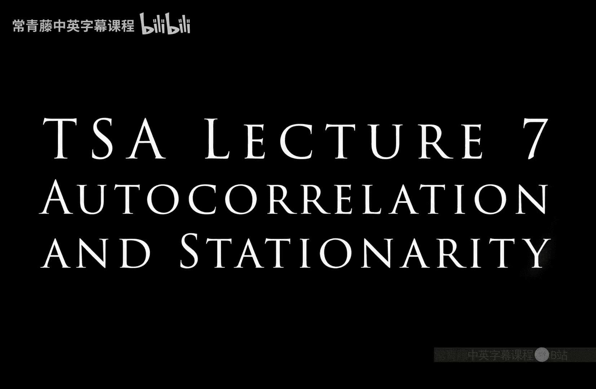
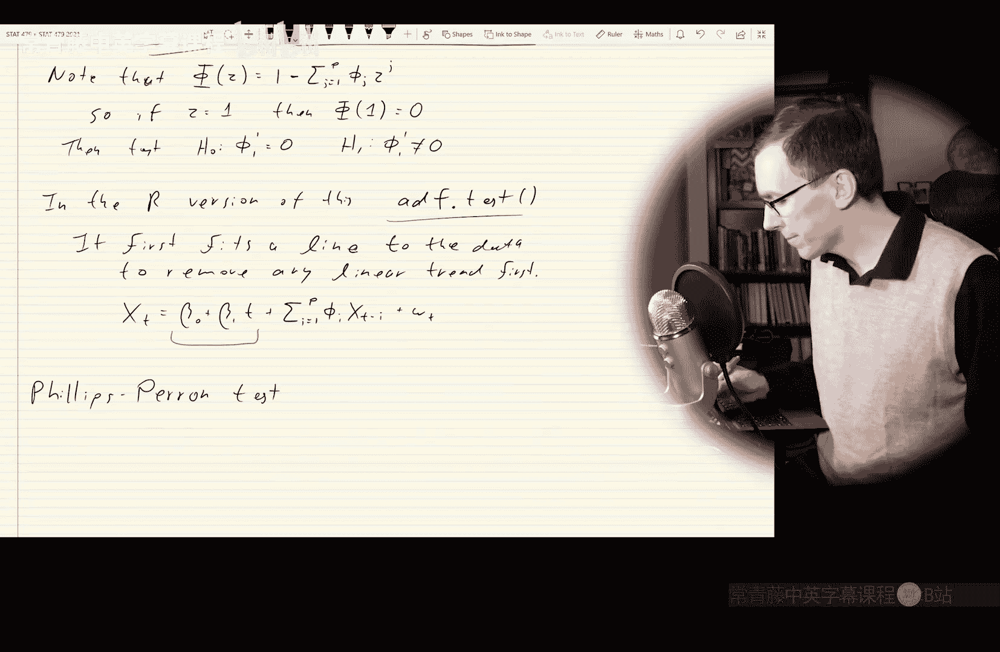

# 阿尔伯特大学【中英⚡时间序列分析｜STAT479 2021 Time Series Analysis】 p07 P7 Lecture 7： Autocorrelation and Stationarity -BV1nwqYBDEos_p7-

Yeah。And welcome back to another lecture of Stat 479 time series analysis。

So far we've looked at a lot of properties of the Arma model。

 but we really need to take a step back and determine if we have some actual data。

 is it stationary and are there any autocors that are not zero， so how do we test for that？🎼あ。

🎼In this lecture we're going to be focusing on these two topics。

 the first thing we'll be doing is looking for testing for non-zero autocorrelations at lags 1，2。

3 and so on right because unless we're in the white noise setting we're going to have some autocorrelations we want to understand and we want to test for statistically from some data then we'll be looking at the idea of stationity because as we talked about before having a stationary process is very important for doing statistical inference and we'd like to know given some data is our process actually stationary or not and there are many ways to test for that we're going to be looking into that later in this lecture so let's go to the notes and welcome back to another lecture of Stat 479 time series analysis。

In the last few lectures we spent a lot of time going through the mathematical details of the AR。

 the MA， the Arma and the arema models， so now we're going to take a little break from some of the heavy theory and we're going to look into actual statistical testing on these models in particular we have two different topics of interest for today's lecture one is the autocorre。

 the other is stationity because these are two key components of time series and of this course for autocorre。

 we talked about how to estimate it， we looked at it when we considered the ACF。

 the estimating the autocorrelation function。In R and we can use that to determine many properties about our time series。

 but for now the question might be is there any non zero non trivialvial autocor present in our data。

 so we have to consider well。What are the various autocors。

 what are the lags we have to compute all of these and besides just staring at those ACF plots like we did in previous lectures。

 now we can actually run some proper statistical tests to determine if there are significant autocorres at various lags。

😊，The other thing we need to talk about is stationity because as I mentioned before。

 stationity is a really important property for time series if we want to do estimation of parameters and components and other things we need a stationary series so that we're always estimating the same thing at every time point otherwise when time change is the things we're trying toest change and life becomes a lot harder so those are going to be the two things we're going to look at today we'll talk about some of the standard tests there's a lot of statistical tests out there if you start doing some digging we'll talk about a few of the standard ones that are popular in R and maybe we'll also look at some actual data and see how it applies to that or maybe some。

😊，Stimulated data so that we can study that and understand how these tests work。Anyway。

 let's get into the notes。 So as I mentioned before， the topics for today are going to be。Stationity。

And auto covariance。Covariance。Or sorry， auto correlation， I guess to be precise。

 it's kind of the same thing， but we're going to be specifically focusing on the auto correlation。

And the first test I want to talk about， well， first of all。

 we're going to start in the topic of autocorrelation and what we want to do is consider what are called well there's two tests in this first category。

 we have the box pierced。Tests and the box。I guess young or presumably or the young。

The young box tests。Assuming that L is silent， which I'm not actually sure if the L is silent。

 So I'll probably need to look that up to figure out exactly how to say that。 But regardless。

 these are two different tests and they're both aiming at the same question。 And the question is。

 are there any non zeroro auto correlations at lags  one or greater。So in this case。

 we're assuming we have a stationary series so that we can compute autocors if you don't have a stationary series。

 then presumably this test statistic will be extremely significant because you're going to have some very you probably would have some very strong autocors in your data。

But regardless， what are we trying to do well what we're trying to do first is。Well， step one。

Step one is going to be estimate。The ACF， which in this case。

 in our mathematical notation is going to be Ro hat X at lag will' say H or something。 So right。

 this is the。Auto。Correlation。At lag H。Okay， so we have that and we talked about and I think the first or second lecture。

 how maybe was the second lecture， exactly how to estimate that from a time series data set。

Now what we ultimately want to test， right is we want to step two or maybe not。I'll say step two。

Is sort of write the hypotheses down， right？はい。rite down the hypotheses and what we're doing is we're testing two things we'll have our h not our null hypothesis and our null hypothesis is not beta。

 it's going to be that row with no hat the true autocovariance at lag let's say1 is equal to all the way up to lag 2 lag 3 all the way up to lag H and is equal to0 so。

This is up。To some。Order。H。Remember when we talked about estimating the autocorlation。

 we can estimate it for any H any lag H that gets fairly large except that the larger it gets the fewer data points we have to estimate it because to estimate a lag of the autocorre at a lag of H。

 we need time points or data points that are H time points apart so if H gets bigger there's fewer of them in our time series to work with。

 so typically we wouldn't take H to be something absurdly large like 100 or whatever。

 but maybe something more manageable like 10 or 20 or whatever。

 but regardless the idea is that we want to do this test that all of the lags up to some order H or sorry all of the autocorres at lags up to some order H are equal to zero versus our alternative hypothesis that there's at least some index。

We'll say Jay， such that。Row x of j is not zero， and I guess specifically I should say that j is in1 to H because we're not testing outside of our maximum lag H in this case。

Okay， so then the question is， well， how do we do that， how do we test this hypothesis？

There's a couple different ways there's our box Pierce and our young box tests， which we will try。

 so the first one is box Pierce。And box Pierce basically says note。That。

The square root of n times rh hat X at some lag J is。Approximately normal0，1。

By the central limit theorem so why should that be true well that could be true because remember that our definition of row hat is just going to be the sum of a bunch of terms of a bunch of data points so in a sense if we sum up a bunch of things and we properly scale those things that we're summing up very often the central limit theorem will kick in and we can say okay。

 this is approximately normal again not perfect， but at least it gives us a starting point。

And if we have that these things are approximately normal zero1， then。We know that N row hat。

X at lag J squared is going to be approximately chi squared1。

With one degree of freedom right if I take a standard normal random variable and I square it I get a chi squared random variable and if I have a bunch of IID chi squared to one random variables and I sum them up I get a chi squared with H or with I guess how many did I say if we have H of them we sum them up we get a chi squared with H degrees of freedom so the test statistic。

Becomes and I use Q because there's a whole bunch of these Q statistics that you can see people talk about so I use the notation QBp for box pierce and that's just going to be n times the sum j from1 to H of rh hat x evaluated at J squared so basically I compute H auto correlations from one up to some value H I square them I sum them I multiply by n and we claim。

That this is approximately。Ki squared with H degrees of freedom。Yes。All right。

Is it perfect well not exactly we're dealing with a lot of asymptotics and approximations we're saying okay。

 this autocorrelation is approximately going to look normal and then if I squared it should approximately look chi squared and strictly speaking the estimators are not all independent because they're based on the same data set。

 so there's a little bit of handwaving going on here。

 it's still very valid in some sense but it's not perfect by any means and that's why there's actually a lot of other tests out there。

Including。Yeah， including the young box test。And in this case， we're really doing the。

 I'm going to say doing。The same thing。As。Box Pierce。That is we want to test the same hypothesis。

 we're going to pick some H and our null hypothesis is that all of the autocorres from one to H are all going to be zero versus our alternative that at least one of them is not zero。

But what changes is the test statistic。You're going to do the same thing， but。With。A new。

Test statistic。And in this case， our test statistic， which I'll call QLB， is going to look， well。

 slightly different， it's going to be N。N+ 2。Times the sum。J from one to H of row hat X。

J squared divided by n minus J。Okay， so what we have is something that looks almost the same as what we did above。

 right， we have the same terms here， but now we're multiplying by an n plus2 and we're dividing by an n minus J。

Why are we doing that Well， if you go and read， there's actually not a lot of information on this。

 I was looking at some textbooks， but if you go and read what young and B actually wrote back in 1978 they take these two test statistics。

 they take the box Pierce one and this new one， and they study it， they basically say okay。

 we have this idea that asymptotically I should say and actually finish the thought here。

 asymptically this thing should be chi squared H as the data size goes to infinity in some central limit like convergent sense。

But for finite samples， that's not true。 But what we can do is we can look at basically， we can。

You know。We can compare。To the same thing。N plus 2。But with。

With the actual auto correlation in here instead of the estimated auto correlation。

 and we can ask questions about， you know， basically what's the。Mean。And variance of this statistic。

 and at least in that short paper they kind of say a。

 the mean invariance of this modified test statistic。

 the young box statistic actually works better than their box peer statistic box is the same box he's sort of everywhere in stats。

So it's a way of refining it， that's not so much that one is wrong and one is right。

 both of them are going to asymptotically have a chi squared distribution。

 the question is because we're never asymptotic we never have infinite data which one is going to perform better in fight for actual finite sets of data like we would actually work with in practice if you read their 1978 paper they claim that this second statistic。

 the Young box one is actually better I haven't tested it myself and if you pick up a book on time series or econometrics they might have other conclusion so I can't claim more beyond what I saw in that one paper。

But it's just a way to say that， yeah， there's different ways to basically test the exact same thing。

Now there's one other， well， I'll point out this actually does exist in R so。Basically these tests。

Exist。In R。And the I think this one， I think is just in the stats package。

I'm going to say stats package with a question mark because I'm pretty sure that's the case。

 but I should probably double check that because I actually don't quite remember。

 but it's kind of a standard test， so it would make sense if it just appears in the standard stats package which just comes with the R distribution any distribution of R that I know of。

Anyway， so if we actually look at the implementation of this。

 it's in the function called box dot test。And it allows you to do either of the two you can give it an argument that says either do the box pis or the young box test depending on which one you want。

 but there's something else that's interesting to note here that。Often。We don't apply these tests。

To a time series。You're thinking， well， wait， what isn't that the whole point， Well， no。

 we don't apply it to a time series X T， but instead。To the residuals。Of X， T， after fitting。

Let's say fitting。An armma model to it。 and Arma。I guess you could do an arema as well。

 but we'll just say Arma PQ model。To it。Okay， so the idea is that this this function in R will just take a sequence of data。

 you can give it any sequence of data you want and we can apply it to actual time series but。

In some sense， this is like a test for white noise we're trying to。

Determine whether or not any of the autocors or non zero of all the autocorres are zero。

 we have an uncorrelated stochastic process which kind of falls back into our white noise again I'm not making any assumptions on the mean being zero here。

 but effectively it it kind of throws us right back into the white noise category。

So more likely what you'd want to do is you'd have a time series。

 it's not going to have zero autocors。But what we want to do is fit an armor model to the data Now we didn't talk about how to actually fit an armor model。

 but in R， for example， you can just run a command that will fit an armor model to your data。

 much like fitting a linear model in regression now。After you fit the armorma model。

 you're going to get residuals out and those residuals should if the model fits。

Correctly or well they should look like white noise or they should look uncorrelated。

 so the point is is that typically what you would do is take your series XT。

 fit an armor model to it， then take the residuals and shove the residuals into box test。

But when you do that， you have to adjust the degrees of freedom。 So the point is that in。This case。

Weed。Estimate。P plus Q parameters。So。We。Should。Instead。Test。I'll say QBP or Q LB。With。

A chi square distribution， but now we're going to have H minus P minusq degrees of freedom。So again。

 I'm not going to get into the finer detail of it， but the intuition should come a lot from what you learned in linear regression in linear regression。

 typically the degrees of freedom for our standard error or for our residual sum of squares is going to come from the data size。

 minus the number of estimated parameters， so in this case if I am estimating P and Q parameters for my armor model。

 then when I want to run this test I need to subtract that from the degrees of freedom for my chi squared distribution and this can be done in the and we'll doing a demonstration later in the lecture but this can be done in the box test function。

With the argument。It's like fit Db， I think， yeah， fit or fit Df。F I TD F。

So the point is you would have to manually tell are how many degrees of freedom should I remove from this from my chi square distribution based on how many parameters did I have to estimate before I got these residuals and I should point out that if you look at the box test。

 it doesn't just have to apply to time series， you can apply this to a lot of linear models if you have say if we go back to linear regression class and you fit a linear regression to some data。

 you'd expect that the residuals would not have any autocorrelations。

 you can use the box test to check for that because if there are autocorres then you might be worried about the assumptions being put on your model because in classic linear regression。

 we want uncorrelated errors so we definitely don't want that to be the case。Yeah。

Also because we're subtracting P and Q， we would。need。To choose。H。

Such that H is greater than strictly greater than p plus Q right。

 otherwise it's not going to work because you can't have a chi square distribution with zero or negative degrees of freedom。

I don't think there's any crazy way to generalize a chi squared that way。

 oftentimes in math you get some weird generalizations right where you think oh that doesn't make sense and then you like when we talked about our differentcing operator you can have a first or a second difference but you can also have fractional differences because of course you can。

Yeah， but basically， yeah， you need to make sure that H is larger than p plus Q or else it's not going to work and R is probably going to throw an air at you。

All right， so。Moving on from that。The next test we're going to look at is called the Durban。

Watson test。So let's。Block this off。 And this also falls into the case of testing for auto。

Correlations。Most of the things we're going to talk about today are testing， well。

 the next two things in the previous two things were all autocor and then we'll talk a little bit about stationity at the end of the lecture or at least the written part of the lecture。

😊，Right， so the。The Durban Watson test and the name Durbin' is going to show up again later when we talk about how to estimate the parameters for our Ar process。

So it's doing the same thing， but it's specifically focusing on order one auto correlations。

 so what am I saying I'm saying that。Basically， tests。4。The presence。Reresence， yeah of。Order。1。

Autocors。So unlike above for our box test collection。

 we're not going to be choosing some H and we're going to be testing for autocorlations for lots of values in this case we're just testing for autocorrelations at lag1。

 but in some sense those are the most important ones because very often if you're going to have higher order autocorrelations you're probably going to have one at lag1。

 you don't have to right you could have a peculiar series that ignores lag one。

 it's almost like in that case you'd have two time series kind of on top of each other because if you had say an auto if you had an autoregressive process。

Of order two， where the order one term was zero was not there。

 then basically you're saying two time steps in the past is influencing the present。

 so it's almost like you would count2，4，6，8， whatever you know，1，3，5，7， etc cetera。

 and you'd almost have two time series that are running two AR1 series that are running sort of like flipping on and off from each other So that's kind of a very peculiar case but。

Effectively that little rant is what I'm trying to say is is that typically the autocor at lag one is going to be there if you have higher ones。

 it doesn't have to be， but it typically would be there。

 so the test itself is still very useful even if it only looks for order one autocors。All right。

 so how does it do that Well， what we need to do is it basically does it for linear regression and it looks at the residuals。

 So kind of like I mentioned above with our box tests in this case。

 we're going to look at the residuals after fitting a linear model to our data。

 So if we arem going to say consider。😊，The model， the。Time series。She。X T， and we're going to have a。

Peith order。Deterministic peace。Peef order probably overkill。 You typically wouldn't have you know。

 high order things going on here， but you could and mathematically we'll just include it。

 So the idea is we have this big deterministic piece here。

And then we have our residuals process R T is the。Residual process。So what we would do first。

 this is before we run the Durban Watson test， actually I think in the syntax and we'll double check this I think in the syntax for the Durban Watson test you just give it at a linear regression formula so it would take care of this for you but what we'd want to do is well first compute。

The least。Squares。Estimator。Beta hat just like we would do in regression class and then we would。

Get residuals。Wwhich I'm going to justote as our hat right because they're the estimated。

 maybe I shouldn't call Rt the residual process， it's more like the air process and then R hat T would be the actual residuals that we compute from our data right the residuals are just the difference between the observed value and the estimated value which I guess I can write as a dot product between beta hat。

And my vector of1 T。T to the P， whatever。So again， this is the。The observed。 And this is the。

I guess predicted。And the difference between the observed value and the predicted value is going to be our residual process。

 so now that we have these residuals and again this is just doing linear regression like we would have done in linear regression class。

Now that we have this， we assume。The model。That are。Hat。T is equal to rh R hat T minus-1 plus W T。

 so that is。That is an AR1 model。For the。Resids。Okay， so if we have an AR1 model for the residuals。

Well， what do we do， We want to look at row and determine whether or not it's going to be0。

 If it's 0， there's no auto regressive process， If it's not zero。

 there's some auto regressive process going on here。 So let's look at that。 right。

 And actually now that I look at my notation。I realize that。

I probably shouldn't have used row because I was using row for the auto correlations and now I'm using row for my parameter here。

 so I wont change that。To， I guess Phi because Phi was what we were using for our auto。

Our auto regressive process parameter。Um， but yeah。

 so basically the idea is that we assume this model and then we want to then。Test。H not。

 which is that phi is zero versus H。1， the alternative， that phi is not 0。 So right， this is。No。Auto。

Correlation， and there is。And maybe yes， auto correlation。Et cea。Um so that's what we want to test。

 right we're turning this into just a simple hypothesis test is phi equal to zero or is it not equal to zero？

So then the question is， well， how do we do that， well， what we do？

Is we compute another test statistic？She。And our test statistic this time is going to look like Q。

 well， we're going to denote it as Q DW for Durban Watson。

 and what it's going to be is it's going to be the sum。

T from two to capital T and by the way you don't have to memorize all of these crazy test stat formulas。

 I mean this time we're teaching the class remotely so I have to assume that everythings going to be open book when it comes to things like a final exam but in practice just it's not worth trying to memorize all these things。

You can always look them up in textbook or notes。Anyway， in this case。

 what we have is we have the sum of the squared differences at lag1 in the numerator and the denominator is just going to be the sum of the squared residuals。

R， T hat squared。So this in the denominator is actually the。Residual。Some of squares。

Like you would use in regression class and in the top here we have the in some sense。

 the first difference。Different summed and， I mean squared and sumbed。

So what does what happens like what does this Q do Well。

 there's some interesting properties here of this thing Q so first。Q DW has to be in between0 and4。

Okay， why would that be the case Well because if you imagine the fact that on the top the most you can really have is if R hat t and R hat t minus1 well first of all。

 it has to be positive that's the easy side of this logic everything squared so it can only and it can only be0 of all the Rts are exactly the same value so we know it can be at least at the smallest value can be a zero。

Now， if we go the other direction， if the RTs are equal to each other， but with a flipping sign。

 that's as big as this thing can get and the numerator is going to look something like four times RT squared and the denominator is going to be RT squared and the when that you cancel all of those out you end up with just a four。

But what do these numbers mean， right， eventually we want a P value， but we can look at basically if。

Qew。DW is close to zero。Then。RRT is close。To Rt minus1， I guess with hats everywhere。Therefore。

 we have positive。Autocor。She。If in contrast。Our QDw is close。2，4。

Then we have that our hat tea is close。Two minus R hat t minus1， and therefore we have negative。

Autocorrelation。And lastly， if you kind of follow the intuition。

 we have that if Q Dw is right in between zero and4 or is close。To2， then。We。Don't。

Have any auto correlation。She。So in this case the insignificant value of our test statistic is two whereas zero and four are both very extremely significant values for our test statistics so this is a little bit strange right because oftentimes we're used to thinking of test statistics at zero as being insignificant and as they get big they get more significant in this case the the center is actually two I mean you could subtract to I guess just to offset that if you really want。

😊，But yeah。So then the question is， well， can we actually get a P value out for this test statistic。

 The answer is yes， but it's not a straightforward calculation。 So we're not going to go through the。

The gritty details of where the P value comes from， but just note that note oh my。Now it's too big。

 I lost my。The size of my pen here。There we go， that looks better。 Okay。

 so then what I was going to say is note。That a。P value。Can be computed。But。Distribution。

I think I put the quote here into my。Notes， it's a linear combination of chi squared random variables。

 which is。Let's say is a linear。Combination of。Ki squared。ranandom variables。

 which means that it's actually super annoying to compute the P value for。

 I mean a computer can do it， it's not annoying for a computer， but if you have。

 let's say a weighted sum of chi squared random variables。

 it's not always easy to get a nice tail probability out for a P value like you would if you just had a single chi squared random variable。

Luckily， the computer can take care of that for us and my understanding from reading the documentation in the code。

 I should say this。Is in。Dw dott。Ano no dot， sorry， just DW test。This is the DW test in。

L M test package and R。Yeah。And according to the documentation， if the data size is really。

 really big， it doesn't really want to do some massive combination of weighted chi squares instead it just uses a normal approximation and says okay if the data is large enough it's close enough to normal that we can just forget all those chi squares and just do normal so you do see this a lot in practical implementation of test statistics where it's like we got this great test statistic how in the world do we compute a P value we have to use some computational power or tables and that's going to come back we're going to see that again in some of the next things we look at as well。

But yeah， so just to summarize again， we have a test statistic we can compute。

And we compute it and we use that to determine if there's an autocorrelation at lag one for the residual process after doing。

 say a linear regression。Now the next statistic we're going to look at。

And we'll see if I get this name correct as well。Is the。Brush， I guess， Godfrey test。B， R， E， U， S。

 C， H， Bush。Godfr test。I wouldn't mind so much if I were just presenting it in class but now this recording of my possible butchering of all these names will be recorded forever。

 so I'll enjoy that。But anyway， the idea is that this test。

 and I'm not going to go into all of the gritty details， but basically。Does。The same。Thing as。

The Durban Watson test。In the sense that it is going to take a linear model like I started with up here。

 look at the residual process and then try to determine if there's significant autocors in the residuals but。

Here's the butt， but it does it。4。A R P。Um modelsels。On the residual process。

Process R T hat so the nice thing about this test is that it will allow us to look at autocorres beyond just one lag one。

 so it has a little bit more applicability in that sense。Now， mathematically， what is it doing？

Mathematically。We。Basically fit。A linear model。L squares regression as usual。

AtLeast squares regression。And after we fit our linear model， we。Basically， get。The R squared value。

So do you remember what the r squared value is from linear regression， right。

 the r squared value is going to be the， I guess regression or explained。

 I'll say regression sum of squares。Sometimes I like to use explained sum of squares。

 so I don't get confused with residual sum of squares。

 it's the regression sum of squares divided by the total sum of squares。So typically。

 it's interpreted as the amount of。Information that we're learning about the relationship between the inputs and outputs of our regression model。

 I guess from our regression model， it's sort of saying how much information about our output is explained by our input if the regression sum of squares is very close to the total sum of squares。

 that means our data probably looks like it's in a straight line and just about all of the variation in our data is explained by the model if it's just a lot of random noise then this value would be very close to zero。

But still needs to be positive or at least non negative。Anyway， the ideas is that。

The I'm just going to write Bg test。Compares。N， I think it's n times r squared。2。

A chi squared P where p is the number of parameters in the model。No wait。

P is the order of the auto aggressive process C， I'm running into trouble I knew I shouldn't have used P up here。

Because it's going to be confusing see this is the problem I used P up here。

So maybe I should change that to I want to use Q。That doesn't really matter。

 Maybe I can just throw in like a。D or something just to indicate that that P has nothing really to do with anything that we're doing。

 so I don't want it to be confused with the order of the autoregressive process because in our Durban Watson test where we just consider an AR1 and I didn't actually go through the greedy details of the computation of the P value anyway。

 but in the case of this bru Godfrey test，What we have is we have an a we compare n times the residual or the r squared value。

 sorry， the r squared value to a chi squared P where I'm going to say P is the order。From。B A P。

Model。Um， and that's kind of it like it just does that， I will say that in R。In R。

 specifically in the function， what is it should be like， yeah， BG test。BG test。U。It。

Can alternatively。Use。B。Standard。F test。From。Linear。Regression。嗯。So that's the idea is that。Oh。

 I should emphasize， I don't think I emphasize this that we fit linear regression model， this is。

For the residuals。Just to make it clear， we're fitting that model to the residual is what we'd expect。

What we'd expect is the r squared value to be very small if there's no autocors。

 if there's no autocorres then we say， well， the r squared value should probably be pretty close to zero。

 we scale it up by n and claim that it has a chi squared distribution under the null hypothesis that is there are no autocorlations up to lag P。

But。But yeah， and then we can also do the classic F test and the package does allow you to sort of switch between the two of those。

And just to add in one more test before we move on to the next section about testing for stationity。

 I'm going to say note。There。Is also。A。Brush， pagan， pagan。 Yeah， pagan or pagan test。

Which is effectively the， well， it's effectively a similar idea， I'll say which。Tests。4。Hetterero。

Sasticity， let's see if I can spell that right。 I think it's a K， right。

 I always want to put a C in there， but。Sasticasticity in。The residuals。Of a linear regression。She。

And this is also in the same R package under the term BP test。

 so this is different than what we'd want to use in time series。

 but I thought it's still worth noting that there are other ways to test the residuals of a linear regression model and that seems to be this entire package LM test。

 maybe not the entire package but a lot of LM tests seems to be dedicated to testing the residuals for linear regression again。

 the BG test is very relevant to time series but it is also useful outside a time series as is the box tests and these other ones we looked at because ultimately if we fit a linear regression model。

 we'd hope that the residuals would look uncorrelated。

 but very often there may not be specifically in a time series context and that's why these tests are very good to use。

Okay， so now that we've done all of that。Let's talk about。Testing。For stationity。

Because this is going to be， give it a capital T because this is an important section。

 or at least important tests that need to be done because we already looked at them a little bit in the lectures and in your assignments。

 I said， for example， well， we haven't discussed this yet。

 but you can try running something called the augmented。😊，Dicky Fuller test。

To see what that does and that should tell us at least give us some evidence if a time series model or data I should say if time series data is stationary or not so then the question is well what is that doing because I hate running statistical tests and not having at least some intuition about what they're actually doing so let's talk about what they're doing now。

😊，And first。We will drop the augmented。And just consider the Dickey Fuller test so start with the first one and again。

 the similar to the Durban Wats and the Dicky Fuller test considers。The A R1。Process。So if I give。

Actually， I should probably explain the concept of a unit root test first。 Okay。

 so I'm getting a little bit ahead of myself。In this case， these tests。I should say。

That the following。A what are called unit。Root。Tasks。And this。

 if you recall what we talked about in the last two lectures。

 gets right back to the idea of the roots of the autoregressive operator or polynomial。

 because as we noted in the previous lectures， if you have an autoregressive operator and if you have root。

 you want the roots to all be greater than one in magnitude。

 if they're not greater than that would give you a causal process。

 if they're not greater than one in magnitude， if they're equal to one。

 now we have a non-stationary process。So the point is。

 is that we want to determine whether or not the roots of the auto regressive operator have a magnitude of one or if they're greater than one。

And that's why we have the concept of unit root tests。

 basically are my roots units or are they larger than units。

 ideally they'd be larger and then we would have a stationary process。

And the Dicky Fuller test does this， but it does it by just looking at the first order auto regressive process。

 So what it says is that。Basically， if。Xt is equal to phi xt minus1。Plus WT， then well。

 what do we know we know that if well we don't want phi to equal one， if phi equals one。

 we have a random walk， it's not stationary， if phi is less than one， then we're good in some sense。

 right， or even if it's greater than one， it's explosive。

 but it still means that we have a stationary causal or stationary noncas process。

But what Dicky Fuller test says is that if this is our process。

 then if I consider the first difference of this process。While there are different ways to write it。

 effectively when I take the first difference， I'm going to this above equation and I'm just subtracting xt minus1 from both sides of it。

So what I can write this as is phi minus1。X T minus1 plus W T。 So this is what the first。

 this is a representation of the first difference process。And if I take。This coefficient and denote。

As phi prime。Then what I have is a new type of time series equation and what I want to do is I want。

To test。H not， which is phi prime is equal to0 against h1， the alternative。

 that phi prime is not equal to0， so when I write that down。

 it looks a lot like just a classic statistical test I want to know is my parameter zero or is it not zero。

 the alternative being not zero， but what's interesting here is that this is equivalent to saying H phi is equal to 1 or h1 phi is not equal to1。

 so the null hypothesis is actually non。Stationary。And the alternative is going to be stationary。

So in this case we'd actually want to have a very small。

 significant P value to reject the nonstationary null hypothesis and say oh。

 our data looks stationary， which is a little confusing intuitively because typically when you do things like goodness of fit in statistics。

 you'd want an insignificant P value to say， oh yeah， my data looks like it fits the model。

 but in this case we actually want a in this case we want a significant P value to reject nonstationity。

 so again， it's a little confusing just because it's a little backwards from the intuition that we would often have when we approach statistics。

う？But okay， so we have that。 So then the question is， well， what do we actually do？Well， effectively。

 we test this。Keep changing that， there we go。So we test this。By estimating。Fhi hat prime from。

The data。The first difference process， so we would take our data。

 apply mean the function does this all for you。 so we don't actually have to do anything。

 but what it's doing is it's taking our time series。

 applying a first difference Now we have our NaBla X T and then it's using that time series to estimate the first order autoregressive parameter phi prime or phi prime hat in this case。

 we didn't talk about how to estimate these things， we're going to do that in a later lecture。

 But if we just assume that it knows how to estimate that value。

 then it takes the data it estimates it it also。Computes。A standard error。4。

Phi hat prime it divides one by the other that is divides the estimate by the standard error and it does a standard hypothesis test from that。

 I think the distribution if I recall is a little bit non standardard。

 it's kind of like a t distribution but I'd need to double check the actual documentation to see what the distribution is a lot of times with these tests the distributions under the null are not the greatest things to work with compared to like I don't know just a classic chi squared test or something like that。

But that's roughly what's going on， right， And the point is。We're testing。Does。

The auto regressive polynomial phi Z， which is going to look like one minus little phi。Zed。Have。

A root。At Z is equal to one。 right That's what we're trying to test here。Now， of course。

 we might be interested in not an AR1， not just a polynomial based on the AR1 process。

 but on an ARP process and that's where the augmented Dickie Fuller test comes in。The augmented。

Dicky Fuller。Test is basically。Do the same thing。 I feel like I'm saying that a lot in this lecture。

But for。An A P model。Okay， so yeah we can do that right。

 so what we do is we basically go through and do the same thing。

 but now Xt is going to be written as the sum I from1 to p of phi I X T minus I plus w T。Okay。

 so that's just our auto regressive process of order P。And then when we apply the first difference。

What we get is a well a slightly more complex form of this thing so we're not going to just write it in terms of doing the first difference like we did before。

 what we're going to do is we're going to write it in a very special way we're going to write it with a phi1 prime at X t minus1 which is not a typo there's no NaPla there。

Yeah we were writinging down this equation here， so what we have is we have our phi prime at phi1 prime times x t minus1 and then we have the sum i from1 to p minus1 of phi i plus1 prime times。

The first difference， Nabla X。T minus I， and then we still have a white noise term here。 So again。

 this is， oh and I didn't define what these things are， I should say where。Phi1 prime。

 which is the thing that we're actually interested in here， is going much like in the last case。

Is going to be the sum j from 1 to p of phi j minus1。And。Phi I prime is going to be。

 this is for I2 and larger is going to be the sum j from 1 to p of the phi j。

 this is4 j greater than equal to2。Okay， so then the question is， is that actually true， Well， yeah。

 you can work your way through it。I think there's an angry toddler upstairs。

Not sure if that's being picked up by the mic or not anyway。Oh boy。Yep，Btime's not going well。Anyway。

 where were we？Where we were is that if we actually wanted to double check to make sure that I'm not just making this up。

 we can plug in these parameters into the above equation and work our way through to show which terms cancel out with which other terms。

Which would look something， I guess I can take the minus sign out because they all have a minus sign。

We'd look something a little bit like this， which is the sum J from1 to p of phi J。

And then we would need the delta or Nala x upside down triangle x。

 which is going to be xt minus I minus X t minus I minus1 so we look something like that and we can start to if we really wanted to cancel out terms and show that we just get the first difference process because what we're going to have is we're going to have a。

I guess in some sense， if we go all the way back to I is equal to one here。

 then we're going to have an x t minus1 times all the sum of all the phi's and then we're going to subtract all the phis and we're going to get the extra minus one in there so you can kind of work your way through it if you really want to it's nothing to exciting to do and in some sense we really don't care about anything on this side of the equation。

 what we care about is this term right here because much like what we did above what we note。That。

The autoregressive polynomial evaluated at Z is going to be 1 minus the sum j from 1 to p of phi j Z to the J。

If。Z is equal to1 then。Phi evaluated at one is going to be zero and we're going to use the same intuition that we did for the Dickie Fuller test for this augmented Dickie Fuller test and what I mean by that is that we basically well we do the same thing we did up here and what did we do up here well we said we're going to run a hypothesis test for Phi prime being zero or not zero。

 which is going to tell us if it's nonstary， or if we reject nons stationary in favor of our process being stationary。

Nontationary， not nonstationity， that's not a word。Got to keep track of that。Anyway。

 so effectively we would do the exact same thing， then test。H not。

That phi prime1 is zero against the alternative， that phi prime 1 is not zero and yeah。

 we can just do that again as before you can estimate that thing from the first difference process。

So basically I'm not going to write it again， it's exactly what I wrote up here。Somewhere， yeah。

 right up here where I said we estimate that thing from the first difference of the data。

 and then we compute a standard error， we compute a test statistic， we compute a P value。

 and we can determine whether or not our time series is stationary。

Now there's one more thing to note about the ADF test， the augmented Dickie Fuller test。

 and that's in。The R version。Of this， which is the AD D F， I think， dot， yeah， dot test。

So in this version of the test， the ADF dot test。Well， what happens is that it。First。Fits。系。Line。

 I say line because it's a linear model， but it's literally a straight line。

 not a more complex linear model。To the data。To remove。Any。Linear trend first。

So what it actually is doing is it's considering。Xt is equal to beta n plus beta 1 t plus the sum。

I from one to P and now the autoregressive bit comes in phi I X t minus I plus wt。

 So what it does is it includes a deterministic linear piece in the fitting of the data to this model so it does that to basically remove any sort of line that might be in the data So if there's an increasing trender a decreasing trend or or whatever it takes it out and then it runs the test to determine if the series is stationary or not So it can be a little confusing because you know if you don't realize that and you apply it to some data with a linear trend in it it might say yep。

 this is this look stationary and you might say well wait a minute it can't be stationary it's increasing。

That's why because it has one extra step in it that it does when you have that implementation in R。

Well so we're really working through the lecture what I might actually do is then just save the R code for a mini version of the next lecture and maybe I'll expand on it rather than just rushing it at the end here I mean technically I could go on for you know 90 or 100 or more minutes but at this point I'm like I might as well just wrap up what we're talking about and to do that I have one more quick example of a different unit root test for stationity that I wanted to put in here I'm not going to give a lot of the mathematical details because well it's a little bit opaque to be honest if you try to dig up the mathematical details。

😊，But there is a Phils proone test。

And the Phils Perone test is an alternative。Alternative。Unit。Root。Test。

To the Dickie Fuller test above。And I should note these both exist。

 I actually forgot to point that out of here。Both。In the。Tea series package。

So both of these exist in the T series package are you can apply both of them to your data fairly quickly and see what sort of results you get now the Philip proone test kind of goes a little bit beyond I guess you could say what the augmented Dickie Fuller test does it basically tries to be。

Um it。I'll say tries。To be more robust。To deviations。From。The linear。Regression。Assumptions。

In particular， two things which are。Heer or the header scasticity。Sasus。

If I'm not really spelling that ripe， that's close enough and well， correlated errors。Correlated。

Eirs。So again， the augmented Dickie Fuller test， right is a little bit based on the idea of， well。

I guess it's kind of based a little bit on the idea of regression。

 but the idea is that at least squares regression may not make sense if you have heteroschastic errors if you have correlations in your airs so instead the Philip proonet tries to take an alternative approach。

 it uses different technique， something called the newy West estimator for the variance。

 it's basically a different way to estimate the variance in linear regression or the covariance in linear regression where the classic assumptions are not met because remember if we go back to like linear regression 101。

 we have the Gaus Markov theorem it tells us that we want to have uncorrelated errors。

 IID well not IID uncorrelated equal variance， homogenous variance errors。

To to sort of do the classic least squares theory since that's not the case typically in the data that we'll be looking at in time series you have things like this Philip Perone test which try to account for that when it uses tools from when it borrows things from linear regression and says we don't really want to do linear like the least squares estimator doesn't make sense if we have strong correlations in heteroscaastic errors so we should try to correct for that and that's where that does now to be honest I haven't spent a lot of time in my own career actually running these tests one versus the other so i'm not sure what the best one would be it's something that might be an interesting excursion to actually run this on some test data and see how they actually work in practice now since I've more or less used up the approximate 80 minutes that I've been aiming for let's say 70 to80 minutes for these lectures I think I'm going to stop for now also it's getting quite late on the clock here and。

the next what I might do is try to do a mini lecture where I test some of these some data with these tests in R。

 because all of these data， all of these functions are in R。

 I should say the Philip Perone test is the PP test in R， it's also in the T series package。

🎼So you can run all of these on different toy sets of data to see what actually happens。

 so maybe we'll do that in the next lecture， so stay tuned for that and I'll see you there。

