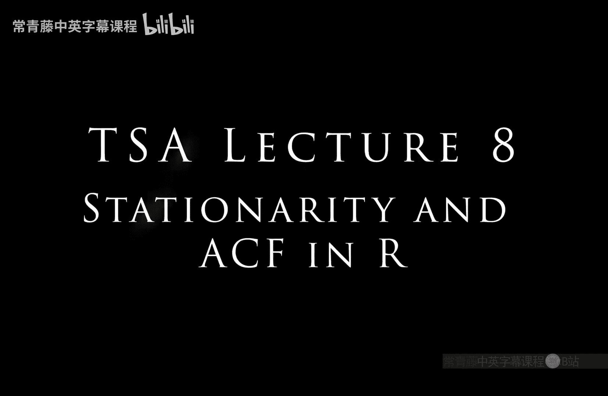
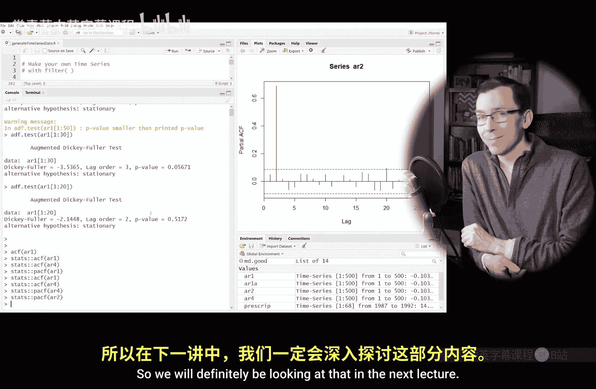

# 阿尔伯特大学【中英⚡时间序列分析｜STAT479 2021 Time Series Analysis】 p08 P8 Lecture 8： Stationarity and ACF in R -BV1nwqYBDEos_p8-

Welcome back to another lecture of Staistic 479 time series analysis today we're going to be doing what we did in the last lecture。

 but we're going to be doing it in R so it's going to be a whole lot more fun。🎼あ。

So in today's lecture what we'll be doing is testing for autocors and testing for stationity of our time series process and we get to look at real data which is a lot of fun because we're often interested in whether or not there's going to be significant autocors at various lags we also want to know if we have a stationary process because that's going to allow us to actually do statistics so how do we test for that well let's go find out。

Welcome back to another lecture of Stas， 479 time series analysis。

 we're going to do a part two to the previous lecture because in the previous lecture we spent the entire time looking at all of these different statistical tests。

 mainly for two topics being autocorre testing and testing for stationity or the lack of stationity。

So what we're going to do is jump right into our studio from the start and try to see exactly how this works in practice and try to take a little break from some of the heavy equations and actually see how to do time work with actual time series data so let's take a look at some of these packages。

All right， so here we are in our studio and the first thing I want to do is generate。

let's say 500 time points of WN， which is going to be our white noise。All right。

 that's going to be the basis。 So what I want to do is I want to generate some sample。Time series。

 some simulated， I should say time series data so that we can work with it and we kind of know what the answer is supposed to be before we go forward。

 so once again I can also create an AR1 that is an autoregressive order one process by picking up value like let's say 0。

7 as my coefficient and I need to tell R that the method that I'm using is recursive。Cursive。

 cursive there it is excellent。So these would be two things we could also create a more complex。

Model。And I'm going to pray that if I just。Arbitrarily choose some values here that I don't accidentally create something that is either nonstationary or explosive if I make the values small enough presumably it should be okay。

 but we'll double check by just looking at the simulated data to see what happens。

So let's look at AR4 and make sure it doesn't just blow up， okay， now that looks pretty good。

 it didn't blow up because if I pick the wrong， or if I choose certain values for this filter here。

 I can very easily cause the entire thing to blow up and fail。Okay。

 so now that we have these three series， we have to think about well a couple things we want to do is we want to test for autocors。

 we also want to test for whether or not these series are stationary and lastly we also need to know about how to fit time series models to our data so we didn't actually discuss this yet in the course。

 this is something that we we'll be doing later in the course when we talk about how to actually estimate the coefficients in fourtime series data because this is statistics and eventually we actually want to fit coefficients to that crazy noise on the right hand side here。

So。What we want to do， well there are multiple functions that we can use。

 we can use the AR function and this just fits an AR model an autoregressive model two time series data so if I give it white noise for example。

 it says okay I basically have an order0 so it kind of identifies that yeah this looks like white noise and because I have 500 data points and it simulated data it should do a pretty good job at guessing the coefficients here I put 0。

7， it came up with 0。7108 so it did a pretty good job at estimating the correct coefficient and AR4 let's see how well that does。

 yeah it actually did a pretty good job it got this is supposed to be 0。

7 this is supposed to be minus4。4 that is this is supposed to be plus 0。

2 and this is supposed to be minus0。1 so it did a pretty good job at getting most of those coefficients。

And in all cases， it's getting the fact that the variance is one because the white noise process I started with has a standard。

 well， a both， I guess， a variance and a standard deviation of one because I didn't change it from the default value。

So that's one way， but another way that we can actually fit models。

 more complex arema models to a data set。Is to use the aromama function and the are function here。

Is going to want us to give it some data like white noise， and then we have to specify an order。

 So the AR function there decides what the order of the autoaggressive process is。

 the arema function， you have to tell it exactly what you want so I could say fit an AR to MA1 Arma model to this white noise process and it does that it's not a good one。

 but it does it right， And if we spend some more time looking at these coefficients using things like model selection with AIC。

 we could try to figure out what the best model is for our data。

 We're not going to go into that right now。 I'm really just introducing these functions because eventually we'll want to look at the residuals after fitting a model to our data。

Actually， we could even do that with the prescription data。

 so maybe we'll do that in the real data sense too。😊，But anyway。

 and there's actually other functions like autoarma。

 which will determine the order for you as well as look at seasonal models。

 though actually now that I look at it， this one does seasonal models too， so we're good there。

But what we really want to do is look at some of these statistical tests that we talked about in the last lecture。

The first one。Is box dot test。And box test or the box pierce versus the Liion box tests or young Ling long。

 yeah， I can never get that right。Box tests， regardless。

 this box dot test function is going to give you the ability to run either of these two tests like we talked about in the last lecture and remember the point of these is to look for autocors at a specific or up to a specific lag。

 So remember what we're going to do we're going to say the null hypothesis is that there's no autocors。

At the first， whatever H lags that I choose， and the alternative is at least one of those auto correlations is non zero。

If。If I put the white noise time series into this。Then let's say， well， it just default to lag one。

 but I'm going to write it in anyway， lag one。And we'll do the box。

Perce method recall that box Pierce is just the sum of the squared auto estimated autocors and the box youngng test is the young test is or is going to be the sum of the squared auto correlations with different weights based on the total sample size and and the index J。

 So it's a slightly different thing。 Both of these are supposed to be chi squared。

 The claim is that the latter of the two tests is better in the sense that it better gets the moments of the null distribution that you would want at least in the null setting。

Regardless， when I hit enter， we run this test and what do we get an extremely insignificant P value just as we would expect。

 because there is no autocorrelation at lag1 and I can bring this up to 10 if I wanted and I still get a insignificant P value and so on。

 I probably shouldn't make it really big but we can do it big anyway。 and yeah。

 now you're getting a slightly smaller P value， but you probably shouldn't put 50 in there and either it would actually be really interesting to run a simulation test to see how this performs especially when you give it very large lags remember。

 this is all based on estimated autocorrelations and the bigger the lag is the harder it is to estimate accurately that autocorrelation and I have I do have 500 data points。

 but 50 starting to get kind of big in that sense， it's 10% of the way through the time series。

 So again， typically you wouldn't go out that big but。It's just something to notice。In contrast。

 if I give it an A R one process， then wow， we get an extremely significant P value as we certainly should。

 and even if I increase the lag to 10 while we still get an extremely significant P value because remember what we're doing is we're looking at the。

The sum of the first the squared first 10 lags。 So as long as one of them is significant。

 then we have a very significant P value here。Of course I can change this to the other test。

By changing the type， it's not going to make a huge difference， the test statistic。

 the value of x squared the test statistic has increased slightly。

 so yeah in some sense it's I guess slightly more significant but it's already absurdly significant so at that point it's like who really cares。

But now that I think about it， maybe what we should do is try to come up with a little bit of a harder test for it。

 so I'm going to call this AR 1A and we're going to make this just zero point。0，5。

So now I'm going to make it a lot harder to detect it because it is technically an AR1 process。

 but the coefficient is very small， so is it too small to detect， I don't know。

 we'll have to find out。 Secondly， I can create an AR2 process。That。

Doesn't have an A1 coefficient in it， so ember an A2 would have a phi 1 and a phi 2。

 so what I'm going to do is I'm going to set phi 1 to0 and just leave phi2 there and that's what I'm doing here by putting a zero first。

So there's two things going on here。 The first is， let's see if the box。

Pierce test can actually detect that there is a non zero auto correlation at lag1。

And now it missed it yeah， sadly， it did not detect it。 the value is too small。

 let's see if the other one， the young box test。Can do it and nope it looks like it gave just about the exact same test stat size。

 so in this case it was not able to detect it because I made that coefficient here too small to be detectable even with 500 data points。

 maybe if I created 5000 or 50，000 we might have enough data to detect this。

 but at 500 we don't have enough。Now the reason why I created this AR2 is that remember there is no autocorlation at lag1。

 so I did this on purpose to point out。That if you did this test and a default to lag one。

 then you'd say， a， well， that's not significant at all， I got a 0。24。

 so maybe there is no autocorrelation here。But if I switch it to lag two。

Now suddenly I get an extremely significant P value。

And we can see that if we look at the auto correlation， the estimated autocor function for this AR2。

Because if we do that， see， we see nothing at lag one， we see this tiny little like Demi spike here。

 but then at lag2 we see a quite a big spike and notice for future reference that this spike looks to be right around the value of 0。

7 which oh happens to be the exact value that I set the coefficient to be。

 so yeah that might be relevant later in the course。

 similarly if I look at the AR1 process I generated first。

 it looks like the exact same autocor but without that alternating sort of zero significant zero significant。

 zero significant thing going on。Yeah。And also if I look at the AR1 here with my extremely small coefficient of 005。

 yeah it falls below this noise floor so we would need to probably be above that noise floor if we hope to detect any significant autocorres and as far as we can tell from this data。

 this process here is going to look just the same as white noise does at least given 500 data points again。

 maybe if we had more we'd be able to do a better job detecting that significant autocorrelation。

All right， so that's just the box test function again a and there's one other thing that I did want to mention though about the box test function before we stop。

And that is， remember that it is often applied to， as you says here。

 it's often applied to the residuals after fitting an Arma PQ model to the data。

 and then what we need to do is subtract the number of parameters fitted from the degrees of freedom which comes into this fit DF function。

 so remember if we're actually fitting a model first we need to subtract those the number of parameters from our degrees of freedom。

Now this can all be made more properly rigorous， but roughly is the same thing we would do in linear regression if you think about it when you have degrees of freedom。

 you're typically subtracting them when you for everything that you estimate in your model so let's try that with our AR4。

Because remember， I generated this AR4 process。At the start。And it looks something like that。

 so again all these processes look kind of noisy， I mean that's what they are right they should be stationary processes if I did everything correctly。

But what we can do is we can actually fit a model to this using the arema function。

 so what I want to try to do is fit a well I'll fit a good model and I'll fit a bad model。

 so we'll call this model dot good。And I'm going to fit the correct model again a priori I wouldn't actually know what the right order is to fit。

 I would have to do some model selection， but in this case because I simulated this data I know it's an AR4 process so that's exactly what I'm going to fit and if I look at my model。

 good well yeah it did a pretty good job at estimating all of the terms。Now， what if I？

Fit a model dot， we'll call it model dot bad。And I'm going to fit an AR1 model。

 which is not the correct model to fit to this data set。 So first let's just look at it。 Well。

 for one， the AIC is a little bit bigger。 So again， if we actually were trying to do model selection。

 we might come back here and say， a this model looks better， but。

Let's forget that for a moment and just look at the residuals because remember this box test。

Is very much interested in the residuals for our or our Arma process。

 so if I were to just take the AR4 and then say lag is equal to I don't know1 or even four。

 and if I said fit Df is equal to0 because this is just the original process， not the fitted。

 the residuals of the fitted model， then yeah I get my extremely significant P value。

But let's see what happens if we try this on the residuals of model。Did I fit and oh yeah。

 model dot good， that's what I wanted。And remember what I need to do is I need to subtract four。

 which means I can't do lag4。 so presumably this is going to give me an error。

 Nope it's going to do something with zero degrees of freedom which actually really baffles me because I have no idea why that's actually fascinating that R will do that with zero degrees of freedom I didn't think that would work Let's try five just to see what happens Now there we go So it's not happy with minus1 degrees of freedom。

 but for some reason the chi squared。That's actually really funny。

 we're going to do a quick diversion live on the air。Yeah， so apparently non negative。

That's amazing so why in the world can the degrees of freedom be zero when I guess that would just be a degenerate distribution if the degrees of freedom were zero then presumably it would just be a spike at zero。

h， that's actually really peculiar。Regardless， you don't want to do that if you're fitting a model like this so what you'd want to do is you'd want to increase the lag。

 it just has to be bigger than four so that you have at least one degree of freedom and now youd get an insignificant P value as you would expect because remember what I did was I took my AR4 process I fit the exact AR4 model to it and then I just extracted the residuals and that case the residuals should look like they are uncorrelated。

And sure enough they do， whereas if。I accidentally didn't do it right。

 I'd either get an error if I had negative degrees of freedom or if I got zero degrees of freedom。

 I'd actually get a really significant P value which is completely erroneous which means that you got to really be careful when you plug things into R because if you're not paying attention you would look at this and say a look that looks really significant I guess there's some significant autocorres but no it's just because zero degrees of freedom like why。

 why anyway before I rant about that let's see what happens if we do the same thing to model do bad I don't actually know what's going to happen here it might actually be fine nope it's not fine。

Excellent that's what I was kind of hoping for so yeah if you notice that compared to the value of the test statistic now here is extremely large it's close to 40 for a chi squared with one degree of freedom which is absurdly a significant value compared to the test statistic here。

 which is 0。033， which is incredibly small。So this is where you can kind of see where this test could be useful you fit an Arma model in this case Arma。

 but we didn't put a different term in here， so we fit an Arma model to our process to our data then we look at the residuals and we can use the box test look to tell us are there any significant autocorrelations and sure enough it says yeah。

 there are， which means we probably didn't fit the right model and model。

 bad is the correct way to I guess the correct name for that model。

We can also just look so again the box Pierce test is nice in the sense that it's doing some type of proper statistical test based on a chi square distribution。

 but ultimately you can just stare at the autocorlation function and again it may not be obvious you look at this and you say okay well this looks like a little spike but that doesn't look very significant this spike at lag too looks like it is a bit above this blue dashed noise floor so again it kind of says yeah there might be something here but it's not。

It may not be immediately obvious like it would be if you just fit， for example。

The AR4 process itself， or you put the AR4 process into this and then you got some incredibly large spikes。

 at least this one is incredibly large。So that's really the。

The thought process here and how you can use the box test and why these tests are useful and again the two different methods。

 whether it's pie or young， they're both going to do about the same thing just out of curiosity though。

Why don't we try the other one just to see what happens if we get a more or less significant。

Statistic， so our statistic in this case is slightly more significant at 40。1 versus 39。

7 so yeah that still doesn't change our results， right。

And presumably we'll have a very similar yeah very small P value that is basically the same test statistic that I got in both cases and a very。

 I should say large P value or insignificant P value So all right that's the box test and that's one tool that we can use to analyze both time series data and the residuals after fitting a time series model to our time series data。

See how many times I can say time series in the same sentence。

And the next thing we're going to talk about is the Durban Watson test and that one we need to load in a library which is LM test。

And yeah， everything's good it's just giving me some other information about packages it has loaded in。

So remember the Durban Watson test as we talked about last time。

 is applied to the residuals and again， it's looking for the same。

 it's kind of doing the same thing in the sense it's looking for those correlations。

 but specifically at lag1。U。Let's try it out and see what happens DW test dot or DW test no dot well first let's look at the documentation so when we look at the documentation it actually wants a formula so what it wants is it wants some type of a regression like formula。

But we can apply this just to a time series without a linear regression if we well give it a null formula。

 which I'll show you in a second。Otherwise， we just have some other arguments here。

 which things like specifying alternative hypotheses which we're going to ignore for the time being。

So if I wanted to run this on my white noise process， I can use the formula Tilde1。

 which basically says Fita an intercept， it's a regression。

 basically a linear model which is just an intercept term so it'll shift it up or down to make sure it's mean zero but otherwise it's not doing anything and what I get is well a very insignificant P value and it says the alternative hypothesis here is that the true autocorrelation is greater than zero so what I could do maybe I should change this alternative to be it should be twosided。

It doesn't have to be， it could be I think you can have it as greater two sided or less。

 so you can look for strictly look for positive autocors， negative autocors or run a two sided test。

Either way， this is extremely insignificant。 remember， as we talked about last time the most。

Insignificant value for the test statistic is2 Again。

 this is a little bit weird because so many test statistics。

0 is insignificant and big is significant。 In this case。

 two is insignificant and getting close to zero or4 will be very significant。So for example。

 if I put in my AR1 process here， then yeah， it turns out that I get a value pretty close to zero and sure enough it's very significant。

Now the nice thing about this is that I can actually put in a formula here。

 I don't have a formula to put in at the moment， but we will maybe。

 yeah actually why don't we do that now rather than go back later。

 I was going to say what we can do is we can load in some time series libraries。Like our TSA library。

 we can load in our T series， which we'll need later anyway， and I believe that we should have our。

Prescript。Data。Which we looked at in the previous lectures。That I occasionally write preci。

 which is the wrong data set。 So there's our prescription drug data。 So again， if I come in here。

 then what I should be able to do is fit a， well， first of all， if I just type in prescript。

 I should get something that's absurdly significant， It's not even stationary。 So that's。

 that's no good。 it's increasing， but。We'll see if this works。

 I think I should be able to tell it to do a regression based on the time。

 which is really just fit a line to this data， a straight line。

 so it's going to remove this positive trend as we go through the years。

 the increase in prescription drug the increase in the cost of prescription drugs。Okay。

 so that's still really significant， so what it's telling me is that even after I fit the a linear model to this。

 I still have a very significant autocor at lag1。And we actually can look at that in the ACF function by this is going to be terrible coding。

 by the way， but I'm going to nest everything because I don't really feel like writing it on separate lines。

 so we want the ACF of the residuals of a linear model that is。For script。Time。Pscript。 Okay。

 that's looks nasty。 but let's just do it。 And yeah， sure enough， if you run this。

 you do get kind of a spike here again， it's not that high above the noise floor。

 but it's high enough that the Durban Watson test says， y。

 that definitely looks to be very significant autocorlation in the airs in the residuals。 therefore。

 we're going to reject our null。And this was going， I think， a two sided test， but either way。

 yeah it's still a very small test statistic there。Okay， so we have that。

I guess while we're at we could try fitting using the box test on this just to see what happens。

 it shouldn't be that much different remember Durbin Watson is looking specifically for an autocorrelation at lag one。

 whereas the box test we can extend to other lags。And B test is looking at the estimated auto correlations。

 whereas the Durban Watson is looking at the residuals of the or the fitted or just the time series data itself。

Anyway， let's try， I don't know， lag five。Yep， so that's also very significant。 I guess technically。

 we should probably note that we fit two parameters here at a slope and an intercept。

 So I should probably remove those。 But yeah， it's still going to be really significant。

 So that's not going to change anything。Yeah。All right， so that was Durban Watson again。

 it's not much different in practice than what we did Actually。

 there's one more thing I do want to check though with Durban Watson while we're doing this is that what would happen if we looked at that AR2 process I believe we should get an insignificant P value because it's only looking at the autocorrelation at lag1 so let's see if that's true。

It is true we get an insignificant P value because at lag1。

 nothing is happening interesting with this process but at lag2 we have something very significant happening so again you have to be a little careful when you're using a test like this it's only looking for autocorlations at lag1。

 though granted typically you wouldn't see a time series like this AR2 that I generated because this AR2 is basically like interweaving two time series together that are AR ones and we're just observing them alternating and alternating。

So again， it doesn't， I don't know， I mean， maybe there are cases in practice where it does show up。

 I don't have any off the top of my head， but that doesn't mean they don't exist by any means。

All right。Now we'll move on to the next one， which is this Bruce Godfrey test。

I'm just assuming that's how you pronounce it。Anyway， let's look at the BG test。

So the BG test again is higher order serial correlation when you see them say serial correlation。

 that's what it's autocor， it's a synonym， at least I don't believe there's any real difference there but yeah in our text we use autocorrelation in other text。

 you'll see them say serial correlation， but the approach is the same thing as the DW。

 the Durbin Watson test， but now there's an order here that we can work with。

 so I can change the order and that will give me well the ability to test for autocors beyond lag1。

Furthermore， we also have a chi squared and an F test version。

 remember these are two different ways to approach this， the chi squared is asymptotic。

 it looks at the r squared value where the F is just the classic F statistic。

Let's just see how that works， so I think we kind of know。

All these tests ultimately kind of do the same thing。

 so there's not a great reason why one might be necessarily better than the other。

 but it's worth knowing what they all do， it's kind of like when you do goodness of fit tests。

 you've got like Kmalrov Smyronov you've got Anderson Darling， you've got Jupiro Wilkes。

 you've got Kramar von misesis， they all do the same thing mathematically yeah。

 they're a little bit different but they're usually going to agree and similarly here。

 at least with this data， these data sets they all kind of agree。Anyway， yeah。

 let's say if we try this， but let's just do order like six because we can and yep。

 we don't see anything significant with our white noise as expected， so even up to order six。

We see nothing significant here。This is also let me see where are we Yeah。

 we have type is chi squared I could change type to be F and we get a completely different test statistic here。

 but we similarly get a very insignificant and oddly similar P value。

Although the test statistic does change because the distribution we're looking at also changes。

From chi squared to F， of course。Now， if we have our AR1， let's see what that does Well that is yeah。

 really， really significant as we would expect and probably even if I increase the order unnecessarily。

 it would still be really significant and even if I presumably。

Even if I presumably changed the type to an F test， it should also still be significant yep。

So that's all what we would expect。The nice thing about this method is that if I switch to that AR2 at order one with let's say a chi square。

 the standard chi square test， well it's not significant just like the DW test before it but the nice thing about this one is I can switch to order two and now I get something that's super significant at order 2 so that's again why this BG test is a little bit nicer than the Durwin Watson because I can actually go beyond order one。

And yeah， otherwise， I don't think there's anything that exciting to report about this。

We could go back and look at that prescription data。

That's something interesting to note this one doesn't give you the option of doing a one sided or two sided test。

 I think it's just two sided because we're looking at just the R squared value in terms of a chi squared distribution。

 so in this case the BG test does not give us the ability to do it。

Yeah it shouldn't give us the ability to do a one sided test。

 it would just be a twosided test because it's a sum of a bunch of squared things whereas with the DW test we can look to see if we're getting above two or below two and if it's one sided so there's one reason why you might prefer the DW test if you're particularly interested in something like a one sided test like I only care about positive autocorrelation。

 then you can get more statistical power for detecting that if you use a one sided test which is why somebody might want to use a one sided test otherwise。

 yeah there's nothing much going on different and in this case all the examples I have are so significant that there's nothing to exciting there to take note of。

Regardless， the BG test still gives me a very significant P value here and presumably if I increase the order even up to like。

6 or something。 I still get a significant P value。 So yep， nothing in some sense， interesting。

 I mean， the results， of course， interesting， but it's just telling us that， yeah。

 fitting a line to that prescription data is not telling the whole story。

 There's more stuff going on there， which of course， is， in a sense， kind of obvious when you。

If you plot the I don't want to delete that， if you were to plot the residuals。

 it's kind of blatantly obvious that there is something going on there， right if I just said。

Residuals。And then。Sa plot these things。Well， then yeah， I guess。

Maybe I should give it to type lines。Yeah， so when you look at this and you say， okay， yeah。

 though that does not look like a nice uncorrelated residuals。

 there's definitely a lot of stuff going on here that needs to be dealt with。

 so it's not surprising that we're getting these incredibly significant P values but it is still nice to have a good hypothesis test。

So the next thing we're going to look at is the unit root test for stationity。

 this gets into the idea of the augmented Dicky Fuller test。

 which I believe is in the T series package。Which I already loaded in， so we're all good to go。

So here we have the ADF or the augmented Dicky Fuller test again we have。Sort of different arguments。

 the main one is we plug in the data， it can determine the lag that we want for testing again remember this is the augmented Dickie Fuller test。

 not just the regular Dickie Full ir regular Dickie Fuller was just for the AR1 model augmented Dickie Fuller goes all the way up to ARP for whatever you want P to B it defaults to choosing actually a fairly large value in the sense that it takes the length of the data。

For some reason it subtracts one and then takes a cube route。

 I'm not sure why the programmers decided that's the best default value。

I guess because it corresponds to the suggested upper bound on the rate at which the number of lags k should be made to grow with the sample size for a general Arma Pq setup。

 so I guess that's the reason why。Yeah， luckily they actually tell you sometimes they don't actually tell you anyway now that we have this。

 let's see what it does So if I plug in my white noise model again what we're doing is we're testing。

😊，For station if we're stationity， whether or not our distribution is stationary。

 but that is the alternative hypothesis。 The null is non stationary that a unit root exists because remember in statistics typically our null hypothesis。

 we wanted to be that，Some parameter takes a specific value and the alternative is usually it doesn't take that value。

 so in this case we're saying we have precisely a unit root that is one of the roots is one。

 I guess is a unit。Or it's not a unit which is all our alternative。

 So when I run this what I get is well， a couple things first I get a it tells me what the lag order is。

 which is， I guess the cube root of 500 or something like that， which。Is that right， yeah。

 I guess maybe it is。Anyway， what we what we get is a P value of 001 and a warning message saying。

 you know what that P value is probably smaller than what was printed。

 so then it makes you wonder wellh like what is going on there it's because remember that the the distribution that we compare this to is not。

It's not necessarily easy to work out， you can fight your way through the source code and you can see some amazingly amusing stuff going on here because if you read about the Dickey Fuller test。

 they don't usually tell you what the distribution you're comparing it to。

 but if you fight your way through the source code you might notice something interesting which is that somewhere along here。

 they start to define a table and then they get these P values here。

And I believe somewhere in here we actually interpolate。

 we do a linear approximation within this table， sorry， table P for our。I guess test statistic value。

 so what we're actually doing is we're taking these tables and we're interpolating and the smallest value you get here is 0。

01。Hence presumably if you could， I guess try to figure out what this distribution looks like as you go below 001。

 but the coders here did not do that I'm not very familiar with what this distribution actually looks like it's just quite amusing to me that when you look at the source code。

 one of the best things about our is you can always look at the source code and what's great about looking at the source code is you can see this crazy interpolation thing linear interpolation using the arx function that they're doing in here。

 and then of course spitting out warning saying yeah you probably have an even smaller P value we just can compute it。

You know， just take note of that。U。But while we're at this。

 what we could do is we could shrink our data size just to see what happens because 500 white noise observations。

 yeah that's pretty significant， what if we did 50 well we still get a significant P value now but it's well okay I say significant we get a P value less than 0。

05 if you like that then you can call this significant otherwise yeah don't but it's still a fairly small P value which seems to be indicating that we might be able to reject the null hypothesis that a unit root exists hence except the alternative hypothesis that our data is in fact stationary。

Um。But yeah， so that's something to take note and if we reduce this further down to like 20。

 we don't have a significant P value anymore and that's quite interesting what it's telling us is saying you know what。

 I don't know if there is a significant root here or not， I mean。

 we don't have enough evidence to reject the null hypothesis that there's a unit root to reject the null hypothesis that our that our time series is nonstationary。

I want to see what happens if we we can't do lags equal to one。Oh， it's K， that's why。

Yeah if I change this to lag one or lag order one， then I get back my let's say much more significant P value。

 so in this case， actually choosing the lag order can kind of save you a little bit and still tell you note note this actually looks looks like looks like it could be significant meaning that there is no unit route again。

 this is a little bit confusing because it kind of is the opposite of what you would think you'd want to do in statistics。

 you think you'd want to test with the null hypothesis that your distribution is stationary but in fact in this case our alternative is that it is stationary。

Okay， so what else can we do with this， Well， we can test our AR。4。What in the world did I do oh？

Oh no， that just gave me the usual standard warning that yeah。

 we have a really small P value and even if I let it go up to lag order7， it still says yep。

 we have a really small P value。Now what I can do。To show you what happens in the other case is that I can use the cube sum。

Function， which cumulatively sums。A vector of numbers in this case if I take white noise and I start adding white noise to itself。

 I get a random walk right this is like the cheap way to just create a random walk in R generate a bunch of normal IID normal random variables using R norm and then just cumulatively sum them up and what we should get is something that's yeah extremely not significant。

Because this is white noise or this is not white noise。

 this is a random walk now and the random walk is our sort of standard non stationary process that we like to use as an example。

In this case， it default the lag to be one if I let the lag grow to seven。

 which is the the I guess the default for this， then yeah。

 we still get more or less the same idea a very insignificant P value。

 which is kind of hinting it yeah there's probably a。

There is probably a unit route somewhere in here and sure enough if I use the AR function to try to estimate the parameters。

 I get a value， it's not one， it's 0。9924 because the AR function will only estimate for stationary processes。

Yeah， it should be causal， I believe it should only work for causal stationary processes。

 so in this case when it sees this it says okay， well I'm going to pick a number that's less than one。

 but it's really close to one and sure enough if we do a statistical test saying is this any different than one。

 it says no up to the errorss， this is effectively one sort of statistically。

So that's that another interesting thing though， is to look at is what we can learn about that prescription drug data now I think we did this a little bit in a previous lecture。

But let's look at it now that we understand this test a little bit more。

 let's look at it and see what happens。So if I take the prescription drug dataset set and I run the augmented Dickie Fuller test it actually says。

 yeah， you know what， it looks stationary， I'm going to reject that null。

 but you might remember and say to yourself well wait a minute， what did that plot look like。

 that plot？Looks like this， that's definitely not stationary， it's increasing right。

 it can't possibly be stationary because the mean， maybe the autocovariance is。

 but the mean is certainly not stationary。And that's where you also have to be careful and carefully read the documentation here because what it does。

 it doesn't just fit。AIt doesn't just run the augmented Dickie Fuller test on the time series X it first。

Tries to remove a constant and linear trend。So that's another key thing to note that what it's actually doing is it's fitting a straight line to that data and then it's kind of well looking at I guess the residual process after it does that。

 so what that means is that in this case after we were to remove if we were to remove that linear trend we would get something that looks stationary which is nice because it means if we go back to our。

I think I already had it over here in the plots if we go back to this auto correlation。

 we can kind of say， yeah， this looks like a stationary process that is。

This thing that I plotted here looks like a stationary process according to the augmented Dickie Fuller test now。

There's still a lot of behavior there， there are a lot of significant autocors。

 but it still gets to be stationary。All right， so we have。

I think that's all there really is to say about the augmented Dickie Fuller test。

 we have one more test to look at the Philips Perone test or the PP test in R， so let's look at that。

This is also in the time series or T series package it is。Kind of effectively looks the same as the。

As the augmented Dickie Fuller test and presumably it's going to give us a lot of the same results now again。

 it says the general regression equation incorporates a constant and a linear trend so in that case what we're doing is again we're removing those that constant and linear trend so。

While we're at it， why don't we just try running it on the prescription data and what do we get？Well。

 we get a small is P value below the magic 005 threshold don't always go with the 005 threshold it's just it's just not worth it you got to kind of think on your feet。

 but。At the very least， the P value is kind of small。

 which is hinting that the after removing that linear trend that the residual process looks kind of stationary。

 again， not super strong， but it is still getting there。

And why don't we try running the same thing on， say the white noise process？

And hopefully we get an extremely insignificant P value， and sure enough we do at 0。9118。

 we have a very large P value， which is kind of saying， yep。

 there is probably a unit route somewhere in this time series data。Now。

 I think I had a couple other examples that we could try just to see what happens。

 while we could run it on white noise itself， we should definitely see something in。Yeah。

 in this case， it's giving me the same error saying， you know what。

 the P value is probably a lot smaller than that， but we can't actually compute that far because if we look at the source code again。

 oh look it's doing another table and I think this also does another approximation。So。

Computing P values is not an easy thing， so I don't want to like knock them for this。

 I think it's actually quite interesting and at some point I'd like to read up myself and understand exactly what the programmer decided they would do。

Um， while trying to come up with this because it is quite interesting and I find computing P values to be a very interesting subject。

Yeah。hDy Fuller type anyway， I wonder if the test can be run together somehow。Anyway。

 what I wanted to do was to try to truncate this and see what happens because remember before I said that okay。

 if we have 500 white noise observations， well that's definitely significant but what would that's that very detectable but what if we start to reduce the number of observations so at 50 we still get a well as small of a P value as this thing will possibly return and even at 20 we still get an extremely small P value so if you recall I think when we did。

This test we now no longer so augmented Dicky Fuller does not detect the stationity of our process with only 20 white noise observations Meanwhile Philips Perone does still return a very small P value so that's quite an interesting difference where we see one now the tests are actually not agreeing with each other we know what the right answer is the right answer is Philip Perone which says it is stationary so again it's good to try these things out just to see okay。

 what can these tests actually tell me what if I change my data size。

 What if I know what the right answer is but I still kind of mess around with it anyway。

We can do the same thing with the AR1 data set that I have again this should look very stationary。

 but maybe if I reduce the amount of data， then suddenly， oh。

 we're not sure if it's stationary or not anymore， even with the Philip Perone test and presumably also with the augmented Dickie Fuller test。

Yeah。In this case， remember， we have an AR coefficient an AR1 coefficient of 0。7。

 it's not close to one in the sense that， but it's still。Large。

 and that means that if I need more data to detect that there's a difference between that number and one。

 so presumably we'd actually need a decent amount of data to detect that。 So 100 seems to work。

50 actually gave me a smaller P value， just sort of dumb luck。But。

Yeah you can kind of see what happens as we go down to 30 then suddenly we have a P value slightly above the magic 5% threshold if we go back to 20 we get something that now looks like a P value of 50% which is horrendously not significant so again playing with these you know I can play with these all day but playing with these allows you to get a sense of how they work on real data with real time series processes we can use。

you know， real data like the prescription drugs or we can generate our own by simulating our own。

 it gives us the ability to kind of understand how these tests work。

 what kind of data sizes do we would we expect to need to be able to detect significance or lack thereof in these different tests。

And similarly， we now have two different things we can do， we can look for significant autocors。

 we can also look for unit roots in the autoregressive polynomial and unit root means it's not going to be stationary。

 which is again， what we discussed in the past lectures。😊，So with all of that。

 I think we're going to just end this and call it a short lecture because after this what we're going to discuss is we're going to go back and we're going to discuss autocor and something called partial autocorlation so actually why don't we do a little sneak preview of that rather than switching over to the notes right now。

 let's look at what the PACF is。This is a little off script， so we're just going to run with it。

 but here's the idea if I have an auto aggressivegress process of order one。

I get an auto correlation that looks like this。As I noted before。

 and what I should do is use the one from the stats package because I like。Get better。Okay， so again。

 the autocor function at lag zero， it is， well， it's going to be zero or sorry。

At lag zero it's going to be one because it's always going to be correlated perfectly with itself at lag two again I noted I said hey。

 we're actually getting a value of 0。7 which is kind of what we set that value to be so that's kind of interesting。

But if I were to look at say the AR for process it's a little bit less obvious like what's going on here。

 I have a spike here at。At lag 1。 But then I have some kind of noise after that。 So then you think。

 well， what can that tell us。Well another thing we can look at is the PACF which is something called the partial autocor function。

 I didn't tell you what that is， we're going to talk about it in the next lecture。

 but let's look at a plot of it anyway。And if we look at a plot of it， we see a。We see at lag one。

 so this one doesn't have a zero at lag one， we see a big spike at7 and then nothing after that。

 so in contrast。At 0。7 I should say a big spike of 0。7。

 whereas here we see this steady decrease and that's actually quite interesting because that's going to say。

 hey， what it's actually telling us is that we have an AR one process here by having a big spike at lag1。

When we switch to our AR4 well now we get a spike at one。

 we get a spike at two and then we kind of lose it so it's not as obvious that this should be a fourth order AR process but we can kind of see what's going on oh sorry that's the。

Of course that's the ACF， what I wanted with the PAF。

 and there we have something that I was hoping for， which is we have a lag one big spike。

 two big spike， three， not so much， but four， we have a big spike and then everything else doesn't look that exciting。

The spoiler for the next lecture is that the PACF function will be able to tell us something about the order of our auto regressive process。

 so what we can see here is that for our AR4， the last significant spike is around lag 4。

And if I switch to this AR2 I see a really big significant spike at lagG2 and I don't see anything else here after that that looks very significant at all so again that's very handway I didn't even define this so I do apologize for that but the ACF and the PAF can tell us a lot about whether we have an AR or an MA or some type of more complex Arma model that we're working with it's quite a neat topic it's a little complicated but the pictures are really nice so we will definitely be looking at that。

🎼In the next lecture。