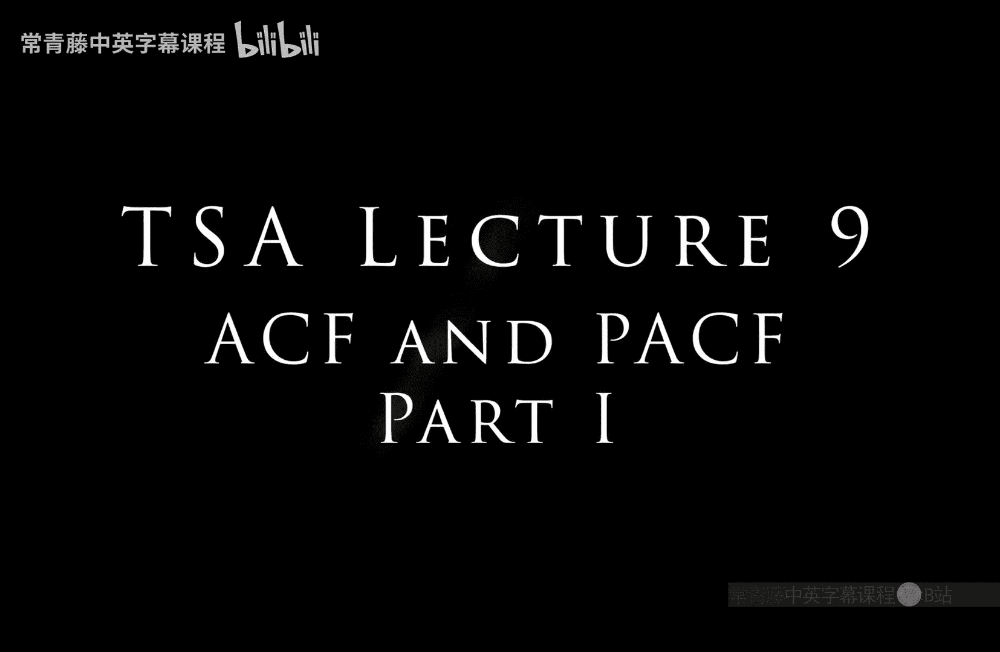
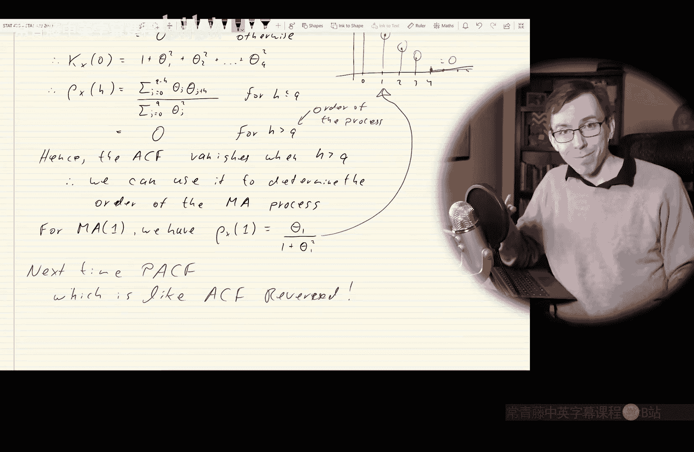

# 阿尔伯特大学【中英⚡时间序列分析｜STAT479 2021 Time Series Analysis】 p09 P9 Lecture 9： ACF and PACF, part 1 -BV1nwqYBDEos_p9-

🎼Welcome back to another lecture of Statistic 479 time series analysis today we're going to be looking at well auto correlation again。

 but we're going to be going into its more complex brother the partial auto correlation。

 let's go take a look。🎼う。

So we already learned that the autocorrelation function is a lot of very useful for doing statistical testing with time series and just exploring time series data now we're going to find a dual tool that we can use which is the partial autocorrelation function or the PACF in R and we're going to understand its theoretical properties as well as look at some actual PACF plots and figure out exactly what they can tell us about our time series data。

 so let's go take a look at that。And we are back with another lecturer of statistics。

 479 time series analysis today we're going to be looking at autocor yet again because it's a really important part of understanding time series。

 but we're actually going to go a little bit further and look at autocorlations。

 half brother partial autocorlation， which is going to give us a different tool， a similar。

 yet different tool for analyzing time series data。

And the partial auto correlation is a little bit harder to understand。

 so we're going to take some time and look at it outside of the time series context before returning to time series to see how we can use partial autocor to understand the behavior of time series data。

So。Let's just jump right into it。And see where we get。

 So the first thing that I want to discuss today is not partial auto correlation。

 but just the notion of partial correlation。Correlation， there we are。Because before we include the。

 you know。I'll say no auto yet。So we'll start with a slightly simpler setting。

 which is just real valued random variables。So what we can say is that for x and y， let's say。

 real random variables， well， we can compute the correlation， right？We can。Compute。

The correlation between x and y， which is just the covariance between x and y。

 but normalized by the square root of the product of the variances。Though the denominator is not。

Super important the main thing we're interested in is the covariance bit the denominators there just to normalize it so right what is correlation well correlation says that。

If I have an X and a Y， then if they're highly correlated， they're going to look。

Like there's some sort of linear trend， either sort of up or down or otherwise。You。

 both of these would have a high correlation。This might be close to one。

 this might be close to minus one because we're going in a negative direction。Um，And then of course。

 we could have the setting where we just have a bunch of points in a。

Circle and then we don't really have any good way to go through it。

 there is no obvious trend line that is going through it and there we would have a correlation close to zero。

There we are so we have this idea of correlation， something you've probably been exposed to before just being students of statistics and mathematics。

 but you may not have seen partial correlation and it's slightly different。

So before I define it more mathematically， let's just consider a setting。Let's say x is the price。Of。

Your house。Apartment， whatever， we'll say house。And why is the price？Of your car。So now you have two。

 let's say we have data， we're collecting data from people in Edmonton。

 we have the price of their house and the price of the car sitting in their garage if their house。

 I guess has a garage。And the idea is that there's probably a correlation here you can imagine there's going to be a bit of a correlation。

 people who have more expensive houses probably have more expensive cars and vice versa it doesn't have to be that case you could have some outliers somebody who lives in a mansion with a piece of junk in their driveway and somebody who has a real fancy car but you know living in a tiny little like one bedroom condo type setup so of course therere going to be different outliers。

 but roughly we would guess that the there would be a positive correlation here。

So we'd be in say the setting like this。But why would these two variables be correlated？

They're correlated because of something else。They're correlated because we're assuming that the person who owns the house in the car has either a high income or a low income right so there's actually a third variable kind of hiding in here。

 which is the your income。So presumably， if you have a higher income。

 you have a more expensive house， if you have a higher income， you have a more expensive car。

 so in a sense， x and Y are not so much correlated。As they're both related to some other variable。

 that's kind of。Dictating both of them， in this case， it would be the person's income。

So what we could imagine is that we have a graphical structure， so we have our X。And we have R Y。

 and we might think that there's a correlation here between them。

 but actually what's happening is we have some other variable Z that is influencing both of them。

And the idea is that。We could claim that I'll say perhaps。

 because I don't actually have real data to test this， perhaps。Conditional。I can spell that， right。

 conditional on。Zed， we have that X。And why are uncorrelated。Again。

 I don't know if this would actually hold true for real data based on the prices of house cars and a person's income。

 but you can imagine this story and what it tells you is that you have these two variables。

 they look like they I mean， not that they look like they're correlated。

 they are correlated if you just plug in the data and you type CO R R in， but if we condition。

 if we condition on a third variable in this case， the person's income。

 then we can kind of destroy or remove that correlation。

 the fact that these two variables are only correlated because the person we're considering is either has a lot of money or only has a little bit of money to spend on such things。

So。We're going to take this notion and we're going to extend it into a time series setting。But first。

 the question is， well， how in the world do we work with this？In this case。To understand。

Such relationships。Between。We'll say。X。Y and Z。We used， well。

 one of the statisticians's favorite tools， regression。

Its always seems to come back to regression very often in statistics。

 it's a fairly important thing to learn。Right， so the idea is that。

We can define the partial correlation。 So what we want is we want to define basically the。Partial。

Not2 Ls， core correlation。Which we can write as the correlation between X and Y given Z。

 So now we have a third piece of the expression， which is the given Z part。

And what we're going to do is we're going to consider the residuals of both x and y regressed on Z。

 so this。Ends up equaling the correlation of， and I'm just going to write。

 I'll define this in a second， but we're going to write x minus x hat。Why minus Y hat。Where。

X hat and Y hat。Are fitted values。4。Regressing。嗯。Exon Y， water， no， exon Z or。Yeah， X。X and Y。On Zed。

 respectively。There we go， let's get some more room here to write。

So what's actually happening is you're not computing the correlation between x and y。

 you're computing the correlation between residuals。4 x。

And why so the thing that you're plugging into your correlation changes a little bit specifically I should write out that we would have two linear models。

 we would have something that's going to look like。X hat I is equal to。

We'll say Al hat n plus Alpha hat1， Z I。And we're going to have Y hat I。

 which can be beta not hat plus beta hat 1 Z I。 So in this case， we just have。Two， simple。Regression。

Models。So it's simple in the case that we just have a single predictor variable being Z here。

Not simple in the it's easy to understand sort of colloquial sense。

So what we have here is the idea that we're going to take Z， we're going to fit。

 we're going to try to predict x and y given Z individually。

 we're going to do that for each x and for y， then given that we have these predictions the x hats and the y hats。

 we will then compute the correlation between the residuals and again。When I write it down like this。

 it might seem like okay， what does that mean and what it really means the picture to keep in your mind is this one in the blue box up here because that's really going to tell you what's going on if Z is able to do a good job predicting X and Y and that their residuals don't seem to be interacting at all or have any correlation。

 then we have that graphical structure if we compute the partial correlation。And I guess no。

 that would be correlation if the two are connected。 if the partial correlation is zero。

 it means that probably Z doesn't do a。Very good job at predicting them at all。

That's actually interesting yeah， again it's not always exactly straight like you know trying to interpret this can be a little bit challenging。

 so we'll do definitely do some examples to make sure that we sort of build some intuition about how this thing works。

😊，Yes， but we're not quite back yet because we don't want to know zero is yes， sorry。So we have some。

 let's go through and actually write this all out。So。Here's some settings。We have， if。

The partial correlation between x and Y given。Z is zero， or we'll say close to zero。

Because statistically， it's always going to be， you know， about zero given real data， right？Then。X。

And why are conditionally。Uncorrelated。Hence。That picture that I drew that just fell off the top of the screen that looked like this。

Yeah， so that's where I was confusing myself between correlation and partial correlation in this case if we have a partial correlation thats zero。

 what we're saying is that the residuals look uncorrelated。

 so the only reason why x and y would be related would be through some other variable Z。

Which is kind of an interesting case。Also， note。I'll put this in blue note。That if X。X， Y。

 Z R normal or Gaussian。Then。We have。Conditional independence。Which is a stronger and。Resolult。

So very often you have data that falls into this Gaussian network type data。

 the nice thing about that is that the conditional correlation graph becomes a conditional independence graph。

 so if there is no link between the two between two nodes like X and y it means that they are conditionally conditioned on the other nodes。

 they are conditionally independent， which is even stronger。

 remember correlation is really just telling you there's some linear relation between two variables。

 independent means there could be any relation between two variables so having conditional independence is stronger but we only get that in this case if we have normal data。

All right， so。We can also actually write this all out mathematically。

 so also in this case that if we have that joint normality。

 then we can actually write this all out as one giant conditional expectation so again we have I'll keep it in blue to emphasize that we're still in the normal case。

Then what we have is we have a the correlation， we have sorry x minus x hat。Why minus y hat？

Is going to be the。Correlation here， again， using the different notation conditioned on Zed and we can actually write this as some big expression。

Which is the expected value。Of X。Minus its expectation of x。

Y minus the expectation of why that looks a lot like a y that looks a lot like the covariance。

 but we're going to condition on the random variables Z and then in the denominator we have the exact same thing。

As we would expect， we have the variance， the expected value。

Of x minus or x minus the expected value of x squared。

 but again we're conditioning on z so really this is exactly what I would have I wrote above for correlation。

 we're just shoving in a conditioned on Z term to every expectation or at least every all the three main expectations。

 not the internal one there。So really， this is just， again。

 the you could think of it as like the conditional covariance， x。

 Y given Z divided by the square root。Should there be a square root in there。

 I'm pretty sure there should be a square root in there， I think I missed as a typo in my notes。

I'm going to plug that in because I'm almost certain that there should be a square root in the denominator there。

All right， so we have something that looks like that。 It's really just our correlation。

 but with conditions thrown in that conditioned on， said thrown in everywhere。All right。

 so hopefully that is a good introduction to the idea of partial。Correlation。

 because now we're going to go back to time series world， that's the class we're in。

 and we're going to talk about partial auto correlation。So now。We'll say back。Two time series。

And what we get is we have the idea of the partial auto correlation。And the partial auto correlation。

 well， first of all， we have to say let。X TBB stationary。Otherwise。

 we're going to get ourselves into trouble and then。We have the partial autocorlation。

 which we denote by this。I guess。What is it， it's var Phi in Laek， so it it's just phi。

 but it's like script Phi。Here， so I think that's right。 Phisi， I always get them backwards。

 I'll double check to make sure I'm getting there actually to get the right Greek letter。

 I think it's Pi。Varsci， v5 doesn't matter it looks like that and。Basically， it's going to be， well。

 two things。If we have it at。Yes， because I used row for the auto， sorry， the auto covariance。

 not the partial auto covariance。 So H， it's at one。So if H is equal to one。

We just return the auto covariance。So remember this is or autocor， sorry。Row is。Auto correlation。

Yeah。And this guy here is going to be our partial。Autocorlation。Yeah。So what we get， though。

 is that's not really that interesting that at one， it's just equal to the same thing 1。

 which is also， it's equal。 So at the partial autocor at lag。 Oh， no， sorry， that's lag 1。

 I was thinking of lag 0 We just ignore lag 0， because it's just not interesting， but at lag 1。

The partial auto correlation and the classic auto correlation coincide。

 so if the two time points are just one apart， then they're the same thing。

 but once we get more than one apart， what do we do well we compute the correlation between X T plus H。

And X T。 But what we do is we condition。Yeah， I have it written slightly differently。

 but I think I'll write it like this and then。Yeah no I should write it like that， Okay fine。

 we'll write it the the correct way。Just to be precise because things change slightly when you have Gaussian or non Gaussian white noise。

So。We'll have to write it out。Like this。If。H is greater than one。

 So we're going to have partial correlations。 If H is great， the lag is greater than one。

 but I didn't tell you what we're regressing on yet。

 What we're regressing on is all the intermediate terms。 So I say where。😊，X hat。T plus H。And X had T。

Come。From。Regressing。On。X T plus H -1 all the way to X T plus 1。

So what we're doing is we're taking all of the terms that come in between t and t plus H and we're trying to use them to predict Xt and Xt plus H in a linear regression setting。

 then we take those residuals。And we shove them into the correlation function。So。I。e。

 we would have two equations， we would have a。Oh that's right and they have the same that's right there's an interesting subtle here but。

We have X hat。T plus H is going to be。Beta 1 x。T plus H minus-1。Plus， all the way。To beta H minus1。

X T plus one， and similarly， we will have X hat T。And beta。1， x。T plus1。Plus， all the way to beta。

H minus1 x。T plus H -1。 So the。Betas are the same betas in both equations。

 We'll talk about this a little bit later when we get into more details on how to look at partial autocorlation。

 But for now， all we're saying is is that you can forget about that for a second。

 All we're really saying is that we are going to try to use the intermediate terms to predict the X T plus H and the X T。

 and then we're going to shove those residuals into the。Into the correlation。

 function to compute the partial autocor。Yeah， we can go into more detail on this in a second。

 but basically I want to point these are the same。Betas。Due to symmetry。Of。Autto。Correlation。Yeah。

Mainly the right the auto correlation is going to be symmetric。

 So remember when we computed the autocor， whether mathematically or in R with the ACF function。

 we only care about positive legs because it's going to look exactly the same if we go to negative legs so you can in some sense。

Flip everything if that makes sense。And I guess yeah， there's also specifically， I'll say also。If。

Xt is Gaussian。I'll say a Gaussian process to be more precise。Basically。

 if the white noise is Gaussian and this is some， say Arma model based on Gaussian white noise。

Then we can write this in terms of conditional correlation。X hat T plus H， X hat。

 T conditioned on everything that comes in between。

We'll draw a picture of this to try to see if it makes more sense。So right。

 the the picture that I kind of want to draw before we move on to。

Before we move on to actually discussing how ACF and PAF can be used to understand time series data。

If we have， let's say， a bunch of nodes。And we have， let's say X， T， X t plus 1， x t plus 2。

X T plus H minus1 and X T plus H。 so right we're trying to figure out what the correlation is between this guy and this guy。

 but what we're going to do is we are going to condition on all of these intermediate bits。Condition。

 so， for example， if we had。We'll switch back to blue if we had something that looked like a。

Like a Markov process where just the previous term is telling me all that I need to know about the next term right in the Markov process case。

 then if I condition on all these intermediate bits， we lose。

 we have there's no more correlation between Xt and Xt plus H。Um， but if I had other arrows here。

 like if there was some long term kind of dependencies， then I would have some。

 I guess partial correlation， even if I take out all those nodes because you can。

 you can think about partial autocor as basically throwing out all of the intermediate nodes in a way and saying。

 is there still a relationship between Xt and Xt plus H。

 even if I cut all of these ones out and you can imagine that there's going to be a bunch of arrows。

Between various time points saying which time points are directly influencing which other time points and if we throw out those middle ones and there's no more arrows connecting Xt to Xt plus H。

 then our partial auto correlation should go to zero if there is a direct relationship between the two of them。

 we would not have a zero， partial auto correlationlation。

Right I'm going to stop drawing  errorss now and we can let's try to get into。Some more detail。

 So the first thing we're going to do now is we are going to go back to just auto correlations。

 now I've introduced the idea of partial auto correlation。Okay。

 so the next thing we're going to do in this is we're going to look at four different things。

 we're going to look at the ACF function， the autocor， we're going to look at the PAF。

 the partial autocor， and we're going to apply it to two different things。

 the ARP and the MAQ process and we're going to look at all of these and see what we can learn about how these what the autocor and the partial autocorlation look like for each of these two types of time series processes。

So let's begin with the。So we'll say setting number one is going to be ACF。4 A P。Okay。

 so we need a simple setting so what are we going to do we're going to use the AR one process because it's so much easier to work with than having extra terms so we're going to consider。

The A1。Model process。Which is just going to be。X T is equal to phi。X t minus1 plus Wt。

 and this is going to be， we'll say where。Of course， we want phi to be less than one in magnitude。

 so we have， therefore we'll say stationary。And。We'll say mean zero。

Just so we don't have to worry about any any non zero mean if we're computing auto correlations。

 we're just going to subtract off the mean anyway， so who really cares right？Okay。

 so we have that setup then what we note。So。Note。That if I multiply by xt minus H。

 then what I get from that equation is xt。X T minus H is equal to phi X T minus1 X T minus H plus W T X。

 T minus H。 So all I did was。Multiply by x t minus h on each side of the equation Okay， y， well。

 because I'm going to end up taking an expected value of each side， so if we take the expected value。

Of each side of this equation， well， by linearity， we can just take the expected value of each of these terms。

T minus H。Plus， the expected value of W T X T minus H okay。

 and now we can actually just start to well， stare at this and see what comes out。

 So the on the left hand side of the equation， we're just computing the auto covariance。At lag H。

This is just the autocovariance at lag H。On the right hand side， we have the phi， of course。

 times the auto covariance at lag h minus1。And then what happens to that last term？Well。

 that last term is zero， it's zero because， well， we have white noise WT。White noise。

 WT is uncorrelated with all the other white noise pieces and。

X T minus H kind of lives in the past it happens before WT。

 so WT is noise at time T X T minus H is again a stationary AR1 process。

 but specifically its because of this it's also causal。I don't know what I'm holding here。

 but I'm still holding my imaginary time series in my hand， so because it's causal。

 that means it only depends on the present and the past since WT is in the future。

 it happens after time point t minus H， there's no these two variables are or not independent uncorrelated or in this case。

 they're going to have a expectation of zero here。So hopefully that kind of makes sense you can think of it as again WT is in the future of Xt minus H and therefore there's no correlation regardless we get this nice expression here and we actually have what's called a first。

Order。Difference。Equation。And the first order difference equation looks something like f of H where f is just some function is equal to phi F。

H -1。 So this。In a way， when you see first order difference， right。

 it kind of feels a little bit like。Like a derivative or a differential equation。

 but it's a little bit different。And for our first ordered difference equation。

 we also have a characteristic polynomial， so the characteristic polynomial here。Is going to be just。

 let me write that down。Characteristic， polyly。And that is just going to be， again。

 the same thing we would get from our auto regressive。This is our auto regressive。

Polynomial or operator。With。Root。Zed or not Z with root。Phi， I guess。Phi to the -1， right。

 So we have a single root， which is when Z here is equal to phi to the -1。

And by solving this equation。Therefore。We solve。The difference。Equation。To get。Well。

 what are we going to get we're going to get？F of H。Is going to be。

Where was that yeah some constant C much like in differential equations you're going to just have some arbitrary constant out front C which can be whatever you want oh I see what I was doing now I denoted phi inverse to be Z1 because when we get a little bit further on we're going to have more than one root and we have to account for that。

So I can write this as Z1， the root to the minus H。Power or。C。Phi phi is to the minus1 is the root。

 so we would have phi to the H。And we can even check that。

To make sure that I'm not just making this up and when we check it what we see is that we get on the left hand side。

 we would have a C phi to the H on the right hand side we would have a phi times C phi to the H minus1 and sure enough the two sides are equal to each other so again this is the solution to this first order difference equation and it looks just like C some arbitrary constant right where we can say here I'll put that off to the side here。

With。C。Any sort of constant。Yeah， I think any even yeah even zero or negative numbers would still be fine yeah so there's nothing nothing we doesn't have to be say positive or anything can just be whatever。

Yeah， I should say that C。Is the initial condition。

Whi is F of zero is equal to c so you can think of I guess if we're actually talking about auto well no。

 autocorrelation could be negative so we're okay， we're fine just。

Thinking off the top of my head here， but。There is a lot of intuition based on the idea of a differential equation where you might have some initial condition that will determine these coefficient or constants that pop up when you solve the equation anyway。

 yeah in our specific case， this is what I was kind of mumbling about maybe 30 seconds ago is that。

I'll say for。Auto correlation。Or auto covariance， I guess I should say we have that Kx at0 is just the variance。

Of X。Tea for any。T， right。So if we。So row of x， that is the auto correlation。Of age。Has。The same。

Diff。Equation。But with。C equal to1。Right because what we said。

 if we kind of go back to what we're as still at the top of the screen here。

 what we have is that the autocovariance function that is up here at the top has follows this first order difference equation。

 the solution to the first order difference equation is going to be this thing here in the middle where the constant C is going to be the variance now。

 if I change autocovariance to autocorrelation， I'm just dividing by the variance everywhere。

 it's stationary， so I just divide by the variance and I basically get rid of C C becomes one and we have that row follows a first order difference equation。

Therefore， the grand conclusion is therefore。Row x of H is simply just going to be phi well to the H。

Yeah， if I had minus H in there， which I think is a typo， yeah I'm going to have to correct that。Yes。

Yeah， it should just be to the positive age。Because phi is less than one。 so what does that mean。

 Well， that means that if we were to plot the ACF function。Let's say this is lag。

And this is zero and this is one。And this is the。ACF。Yeah， for A R1。

 then what we're going to get is well at。At zero， we're going to have a we always get a correlation of one because the process at the same time is perfectly correlated with itself。

That's not quite that interesting。At。Lag one， we're going to get a value of phi here and I was kind of hinting at this when we looked at the ACF functions before I said。

 oh look， if I just picked a value like 0。7， like I did in a previous lecture for Phi。

 then the very first auto correlation estimated autocor is going to look like it's very close to 0。7。

And then we're going to have something like this。Which is going to be phi squared。Phi cubed。

Fhi to the fourth and so on and so on and so on。Again， phi to the H。 So again。

 because this is also assuming， I guess here that phi is greater than0， but less than one。Otherwise。

 you can have it flipping right if p is negative but still in magnitude less than one。

 then what you would see is you would see it flipping below the horizontal axis and then back again。

 so there'd be an alternating look to this， but in this case we have this geometric decay in the autocorrelation function as phi as H gets bigger。

So that's kind of nice behavior and it's something that we can see from our data again。

 when you have actual data， you're going to be estimating all of these things。

 so there's going to be some noise involved but that's roughly the pattern you should expect to see if you plot the autocorrelation for an AR one function now what happens。

If we take this up a notch and look at AR2。So I'll say what about？A R2。Well。

 things become a little bit more complicated because now we're going to end up with a second order different equation and yeah it's a little bit harder to work with。

But not impossible， so we're going to fight our way through it and we're definitely not going to do AR3 because it's just going to be a super headache so。

For the AR2， we're going to have the same setup， but now we're going to have X T is going to be。

Phi 1， x t minus1。Plus phi2， x t minus2 plus Wt。Okay。

 so we have those bits in there and then using the same trick from last time。

 what we're going to do is。We are going to multiply by X T minus H and take an expectation of the entire thing and what we get is the expected value of x T X T minus H。

We get a phi yeah Phi 1 expected value of x T minus1， X T minus H。

We have a phi2 expected value of x t minus2。X T minus H。And we get that white noise piece。

 which is just going to be zero， but I guess。Almost always going to be zero depending on what the value of H is。

No， no， it's WT， it's always going to if H is positive in never mind， if H is positive。

 which it should be， then of course this will always be zero。Excellent。

 so we have all of that and then this simply reduces to。The auto correlation at lag H。

Being phi 1 times the auto correlation at h minus1。

Plus phi to the autocor at H minus2 and this last bit is just as zero so we can just forget about it。

So this is also why we really need the process to be stationary because otherwise I can't write HH minus1 h minus2 and I won't have a difference equation。

 I'll have some massive headache that I can't deal with so in this case that's why this is well it's important to have a stationary process if we're going to be looking at the autocorlation or eventually at the partial autocorrelation function。

All right， so。This gives us a， we're going to do the same thing we did last time。

This gives us a characteristic polynomial。That is going to look like one minus。Phi1。

 Z minus phi2 Z squared with roots。We'll say Z1 and Z2。They may be complex numbers。

 depending on what Phi 1 and Phi 2 are。Phi1 and Phi2 are going to be real。

 but we might have a quadratic that yields a pair of complex solutions。And yeah， we're going to away。

Basically， assume。That。Sa one is greater than one in magnitude and。Z2 is greater than one。

In magnitude， so that。X， T is causal。And stationary。Otherwise it's not going to work。

 so again I didn't have specific values that it's really easy in the AR1 case。

 we just say we need phi to be between minus1 and plus one to have a causal stationary process。

For an AR2 model， it's not as straightforward what Phi 1 and phi2 should be if I recall somewhere in the textbook。

 they actually worked it out on a grid and said we can have phi1 and phi2 in this specific region。

 but it takes a little bit more effort to write down what that region is。

 I don't remember what it is off the top of my head。

 but again I'm pretty sure you can find it in the textbook if you really want to。

 but for our purposes we're just going to say P phi1 and Phi2 are such that they yield a polynomial whose roots lie outside of the unit disc therefore we have a causal stationary process and we're happy about that。

So again， we would have。We， again。Solve。A now second。Order。Difference。

Equation and the second order different equation is it's going to look exactly like what I wrote above。

 but we can just replace the K's with H's or with F's， sorry， the K's with F's。

To get something that's going to look like this。H minus1 plus phi2 F H minus2。

And depending on what the roots are， we get different behaviors。I'll say there are three。

Possible solutions。Based。On。The roots。The values of the roots。

 So solution number one is Z 1 is not the same as Z 2 and。In R。

 so real valued roots that are not equal to each other then。What we get is that， well。

 F or in our case， row。Our auto correlation。Is going to be the sum of the basically the two things we had last time。

 which is going to be C1， Z1 to the minus H。plus C to Z2 to the minus H。Okay， again。

 I don't want to go into trying to solve all these different equations。

 so I'm just going to write down the solution so that we can build some intuition on it with respect to what happened when we type in ACF into R。

 but yeah you can spend a lot of time looking at。You know where different equations come from and how to solve them。

Oh yeah， where。C1 plus C2 is equal to 1。And of course I wouldn't expect you to memorize all these solutions either。

 it's really just to help build that intuition so that we can interpret the ACF function and eventually the PAF function when we get to that part of the notes。

Though at this rate， that's probably going to be in the next lecture so。😊，Okay。

 so we have this solution。Well， what does that look like again。

 Z1 and Z2 are real numbers and they are greater than one in magnitude。

 so this is going to look again like。I'll say geometric。Dey。In。ACf。Like in A R1。 So really。

 it's like the solution that I had up here for A R1 circled in green。

 But instead of having one geometrically decaying term I have now two geometrically decaying terms。

 but effectively the look will be about the same again， the。I should also point out。

 I didn't explain why I wrote this down， this is the sort of initial condition。When。

H is equal to0 when H is equal to zero， we have that the autocor is equal to1。

 and then C1 plus C2 then has to equal1。U。Yes， so that's the roughly the idea is that if you have two real valued roots that are not the same。

 you're going to see behavior that looks very similar to what you saw in the AR1 process for the ACF function。

 but it's not going to be straightforward how to interpret the values because。Over here。

It was very easy to note that we were just going to go phi and phi squared and phi cubed and decay like that based on whatever that auto regressive coefficient is。

Here it's not exactly straightforward how the roots depend on phi 1 and phi 2。

 yes we could solve a quadratic equation， I don't really want to。

 it's going to be well annoying to do that and it's not going to really help us interpret it。

So roughly in that setting， we'll just know that there's going to be a geometric decay in the ACF function。

Now， what happens if Z1 is equal to Z2？In this case。They must。Be real。

 So do you remember what happens when you look for roots of a polynomial in the complex plane。

 If you have real valued coefficients for your polynomial。

 you can factor your polynomial over the complex numbers。

 but the roots would come in conjugate pairs， do you kind of remember that bit from complex variable theory。

 the idea is that if theres a a plus。IB， there has to be an a minus I B corresponding conjugate root。

 So if the two roots are equal， if Z1 is equal to Z2。

 they have to be real numbers because the complex part must be zero because you have to be able to apply the complex conjugate to them so。

Right， because。We would need Z1 equal to Z2 complex conjugate。

 and the only way that a number is equal to it complex conjugate is if it's a real number。Anyway。

 if we do that， what we end up with is something that's going to look like。Row H。Of X。

We'll say Z1 to the minus H。 and then we're going to have a C1 plus C2。H。Now that I stare at this。

 I didn't actually write it in my note， but presumably C1 has to be。One， right。

 because if I plug in H of zero。Then I get， I guess I would need two initial condition。

 oh and I'd need another one though for C2。Yeah， we would need well。

 I'll just leave it like that for now， it doesn't really matter what C1 and C2 are what matters is the general form。

 So this is again。We have two things going on in this equation。We have a。Geometric。Decay here。

But we also have this peculiar kind of linear piece。Overall。

 you're probably still going to see the same behavior， which is that decay。

 that geometric decay in the autocorrelation， but it just so happens that you also have this extra little piece that will be affecting how the autocorrelation bits decay。

And then lastly， and I think we have enough time to write this down and then we'll go on to maybe one more section is what happens if you have。

Complex conjugate roots。These are。Complex。Conjugate。Roots。Well， now things become a little bit。

More interesting， you get the exact same thing you did up in the green box for Z1， not equal to Z 2。

 but。But because they're complex conjugates， you can get some interesting behavior out。

So what I'm going to do is write down exactly what I had before， which is。Z 1 to the minus H。

 And then we're going to have a C 2 with a Z， not2。

 but Z1 bar because they're complex conjugate roots。 So we have the same thing there。

 just a Z 1 and a Z 1 bar。 And if we。Do some complex number manipulation what we end up with is something that's going to look like C1。

Z1 to the minus H in magnitude。And then on the inside here。

 we're going to have something like an E to the IB。E to the minus I theta H。Plus。E to the I oh。

 it's minus I b minus I， yeah， E to the I b plus E I b and plus i theta H in the exponent。

And we can write that down in terms of a trig function so let's do that all right。

 so what we're going to do is write this down well actually why don't we just stare at this for a second why does this make sense well what we did what we did to go from line let's say one to line two here is we noted that we can write Z in terms of。

Let me write that out， where are we here？This comes from noting that I need more room。

Z1 can be written as the magnitude of Z1 times some complex。E to the。I theta H。

I guess the H also has to be， sorry， the H also has to be， and there's a negative H。

 so there's minus signs everywhere。Yes， so we have something that looks like that， right。

 This is just the。Complex exponential way of writing a complex number where now I have the magnitude of Z1 and I have an angle which is telling me where in the complex plane I am and then。

The complex conjugate of that is going to have the exact same magnitude。

 but the angle is going to be negated， which is where that minus sign now drops out the H is everywhere。

 Oh sorry。I forgot to put the H in on over in this side。

The H is just there and the exponent everywhere， so I could actually even drop the H if the minus H if I really wanted to。

 just to write out what these two things are。And then the idea here is that I also factored out the C1 and what I'm left with is some coefficient here that's going to be kind of left over。

Yeah， because C。Yeah， I'm basically doing the exact same thing for C1 and C2 here。

 and it gets me another coefficient out front。C1， I guess in this case could be complex。

 which is why we need the absolute thatte value around it。Okay， so now that we have all this stuff。

 then the question is， what happens when I add these two。

These two complex exponentials together within the parentheses， well， when I do that。

I get a cosine out。And what it looks like is。Z1 H minus H。

And then we're going to have something like the cosine。Of theta H plus。B。Right。

 so this is kind of neat， remember。I'll just write it off to the side。Recall。That。

E to the minus i theta is going to be sine。Data。Plus， I cosine theta and that。

What am I trying to say here is sine is an odd function。

 so the minus sign would pop out front and cancel out。

 whereas cosine is an even function so the minus sign would just vanish and we'd add two cosines together。

 which is why there is a two out front， the signs would subtract from each other and cancel out。

 which is why there's no sine function in this expression。All right， cool。 So what does this mean。

 Well， it means that yet again， we still have a geometric decay。In the auto correlation。

 but when we jump over here。To the cosine bit， we're going to have an oscillation。In H。

 so this is quite neat what it means。Is that if we have complex conjugate roots。Well。

 what's that gonna look like， What's that gonna look like。Let's say zero，1，2，3。Well。

 what it means is that we're still going to have an auto correlation of。One at lag zero。

But when we move to lag one， well， now we're going to start to get some cosine bit in here so we can actually。

 I might need some。More room here。What we might see is something that looks like。This。Now。

 in the long run， these things are all supposed to be geometrically decaying to zero。

 so we're going to see some rough。We're going to see some。Kind of sinusoid little bit。

 but the sinusoid should start to dampen geometrically to zero or decay to zero because of this Z1 to the minus H bit out front。

So that's kind of a neat behavior actually， and you can see that popping up in some time series if you have that complex conjugate roots。

So something to be aware of when you're analyzing AR1 data。All right， so。Going forward。We could。

Consider。ARP。With。Row x of H equaling sum。Basically equaling something that's going to look like a bunch of geometric decaying bits。

With， I guess in this case， R， I say R should be。OhI guess R because they could have multiplicities。

 yeah that's that's right things get really complicated when you get an ARP process。

So the point is that if I had a general ARP process。

 I could write down some equation that looks like this。Where。Root。Zed I。Has multiplicity。

Am I remember multiplicity is the number of times that root occurs in the polynomial。

Such that the sum I from one to R of。MI is equal to P the order of the auto aggressivegressive process and。

FIH is an M。An MI degree polynomial。In H， so again。

 I don't want to get into the I'm not going to try to actually write this out。

 it's just going to be a real pain if I do that。But roughly our intuition for AR1 and AR2 can extend up to ARP and we're going to get stuff that's going to look the same because remember I forgot to put a green box around this one。

 we'll put the green box around this one for consistency's sake。So remember what we started with。

 the AR1 simply says we're going to have a geometric decay。Based on phi， the coefficient then for A2。

 we're either going to get some type of linear combination of geometric decays or we might have some degree1 polynomial here or we might even have this cosine sinusoidal bit happening。

 but ultimately there's still going to be a geometric decay to0 of our autocorlation。 So in a sense。

 for the a for an autoregressive process， the autocorlation never is equal to0。

 I guess in some very peculiar cases like if the cosine actually vanishes。

 but roughly the point is is that it doesn't ever go to0。

 it just goes asymptotically to0 as the lag increases now because。

Because we're never actually going to be computing this from mathematically。

 we'll be estimating this from data， eventually the autocorrelations fall below the noise floor and we can't determine if there's any difference between them and zero or just random noise。

But the point is that even if we go to an ARP process， we're still going to see the same behavior。

 we're going to see this geometric decay based on the value of the roots， if the roots are bigger。

 then in magnitude， if they're large in magnitude， the decay will be very fast and that autocorrelation will sort of die out quickly。

 if the roots are very close to one in magnitude， they're close to the unit disk。

re not we're going to see that decay。Be much slower。And yes。

 depending on root multiplicity and complex conjugates。

 you can get some strange things coming in here for the F。For the F functions。

 if all the roots are real valued and unique， then you would just have a big linear combination of geometrically decaying terms。

 much like this green box at the top of the screen here。All right， so that's a lot。

 but it tells us what we should see when we。Look at and the auto correlation for an ARP process。

I think we have enough time now to do autocor for an MA Q process because that's going to be a lot easier and a lot shorter。

 so let's do that now and then we'll save the PAF stuff for the next lecture。

Because that's going to take a little bit more time to go through。In retrospect。

 I probably should have defined PAF in the next lecture。

 but it's good to start off by defining it so we know where we're going。

So now we're going to do one more topic， ACF。For M A Q。 and don't worry。

 this one is going to be fairly short compared to all those first and second and P order difference equations。

 this one's not going to be too bad。And we're going to jump right in with a。MQ right away。

 we don't need to do an MA1 or an MA2 to kind of ease into it like we did before。

So we're going to say let。X， T B the sum J from 0 to Q of。Theta， JW。T minus J minus J with。Theta。

Z just equal to one， right， We need theta0 equal to one because that's the the current white noise term。

And everything else theta is going to be well， it can be somewhat arbitrary。I mean。

 we would eventually want to consider things like if we have an invertible process。

 but for now we don't have to worry too much about that。Because we just need to compute the autocor。

Then。Well， what do we have， we have that the auto correlation function。

At lag H is going to be the sum。I or J will say J from0 toq minus H。Of theta J。Theta J plus H。

 and this is for。H being zero。To queue。And this is equal to zero otherwise。

So remember the easiest way to see this is just to note that I take the series and I offset the term。

 the coefficients and I multiply them term wise together。And。😊，Basically。

 whenever white noise is squared， then I oh， you know what I didn't include， I probably need。

 actually， I probably forgot that up above too， I probably need a sigma squared in here。

Just like actually up above， I didn't include the sigma squared， but I guess in this case。

 we can just assume。Sigma squared is equal to one for convenience because it doesn't change anything。

 It just means there'd be a sigma squared floating around out front and then inevitably we're just going to。

Switch to correlation， which would just divide by sigma squared and then it vanishes anyway so it's one of those like who really cares what sigma squared is。

 it's not going to bother us when we compute autocors。

 but just to be precise yeah there should be a sigma squared floating around。

Evenless I define white noise to have a variance of one。So。What I'll say is therefore。

We have K H or Kx at0 is just going to be1 plus sigma1 squared plus sigma 2 squared plus。

All the way up to Sigma h or Q， sorry， Q squared。And。We get that the auto， not beta row。

 the auto correlation function at lag H is going to be， well， the ratio of these two things。

 it's going to be the sum j from0 to  Q minus H。Of。What theta J， theta J plus H divided by the sum。

J from0 to q of theta j squared。Okay， so that's just writing it down like we would have done way back。

 this is4 H less than or equal to Q。So what can we learn about this well， in some sense。

 the equation that I wrote down is not the interesting part。

 the interesting part is the fact that it's equal to zero。For H greater than Q。 And Q， right。

 is the order。Of。The process。Hence， what does this mean？ACF vanishes。When。H is greater than Q。

 therefore we can use it。To determine。The order。Of the。AA process。So what we would have。

is something that if we go， let's say zero， one， two， three， four。

What we might have is an auto correlation that starts at one， maybe it goes down。

 oftentimes it looks like it almost looks linear。And then maybe just goes to zero after that and then zero zero is zero so if we have say and。

MA3 process， we might see that it's non zero， non zero， non zero， non zero。

 and then it's just zero after that。Equal to zero。And as a result。

 we can stare at this and we can say， hey， look， this thing vanishes after lag three。

 therefore we probably have an MA process of order three。Now， of course。

 the ARP will also eventually decay to0 below our noise floor。 So this isn't perfect。

 but it'll help give us some intuition as to what's going on with these。Processes。Yeah。

 because ultimately it's， yeah， ultimately it's going to。

It'll kind of tell us where we're going and it'll help us learn， do we have an AR process。

 do we have an MA process， or do we have an Arma process？Two things to note before we're done。

 the first is that for。M A 1。We have just to give a simple example for MA1。

We would have that the row X。At lag one is just going to be， well。It's just going to be， I guess。

 theta1 divided by one plus theta1 squared。Right， so you can kind of get a sense that， okay。

 you can kind of figure out from that what。This value here should be in the case of an MA1 if you even have an MA2 or an MA3。

 you can explicitly write down what the autocor will be in terms of all of those at all of those lags and if you really wanted to you could use it to try to sort out what the thetas look like but we're actually going to be doing estimation later。

 so this that's not exactly what we want to be thinking about now in the next section we'll be doing estimation。

Right， so I'm not going to go on to PAF today， but roughly we'll say for next time。

Next time we're going to look at PAF， which。Is like。ACF reversed。

And what I mean by that is that for ACF。We saw that for autoaggress， we have geometric decay。

 for moving average， we eventually just vanish and go to zero after a certain order in our after the lag surpasses the order of the process。

The PAcF is going to be the reverse， the auto regressive。

PAACF is going to go to0 as soon as the lag exceeds the order of the process。

 whereas the PAF for the moving average is going to decay geometrically and using these two tools together will give us more information given some data。

 whether we have an MA A or an AR process， because they're going to look。

They're going to look similar but they're going to be flipped right。

 the ACF will look like the PCF and the PCF PACF will look like the ACF depending on what type of process we have。

Now that's a little bit weird sounding out loud。 So what we're going to do is we're going to stop for today in the next lecture we're going to look at the PAF in detail and then I think I'll go into R and we'll plot lots of ACF and PF functions to try to get an idea of what's going on there so。

😊。

🎼See you in the next lecture。