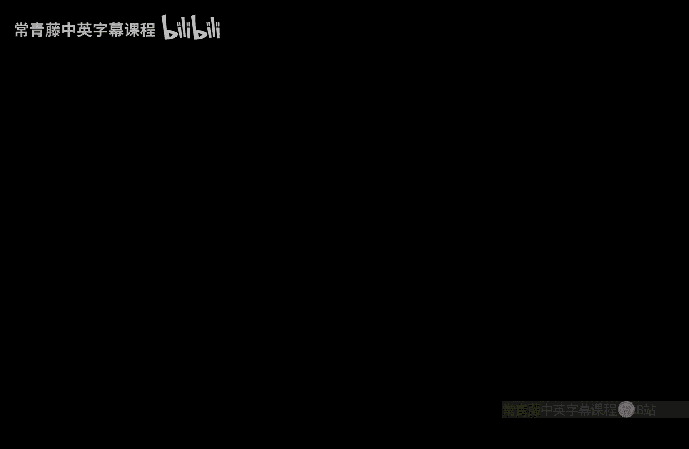
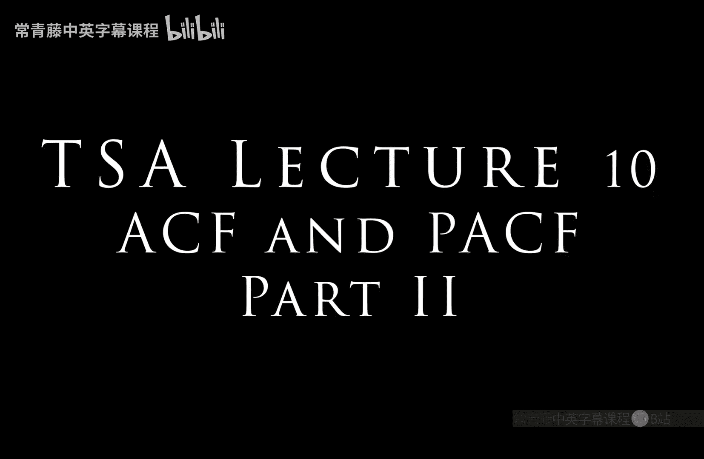
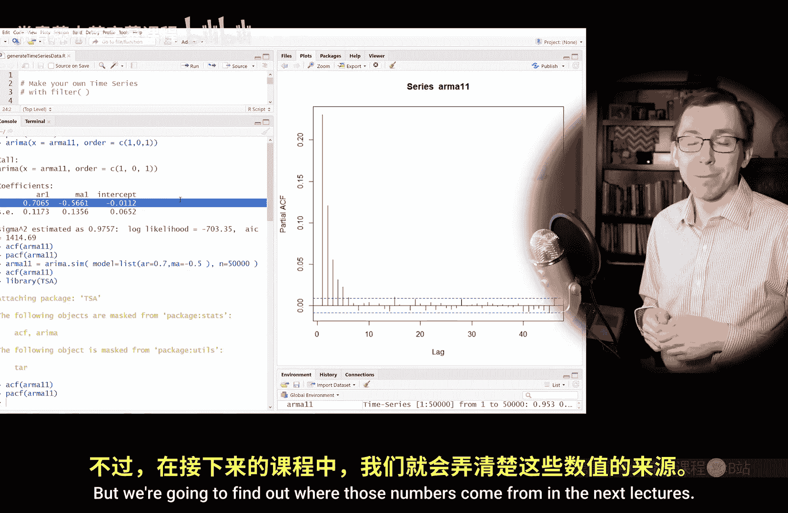

# 阿尔伯特大学【中英⚡时间序列分析｜STAT479 2021 Time Series Analysis】 p10 P10 Lecture 10： ACF and PACF, Part 2 -BV1nwqYBDEos_p10-

And welcome back to another episode of Stat 479 time series analysis In this lecture we will be continuing what we did in the last lecture last time we looked at ACF and PACF today we're going to be going further into PACF the partial autocorre function。

🎼あ。

So the Bar auto correlation function is a really useful tool for trying to understand time series Now the question is what is it actually doing what we're going to look at what it does when we try to compute it for both the AR process and the MA process and this is going to give us two different looks at each of those types of time series so what is it going to do well let's jump into the notes and find out。

AndWelcome back to part two of our lecture on ACF and PAF Today we're actually going to focus on the new thing being the PAF or the partial autocorrelation function。

 but first let's see what we did last time so last time we introduced the idea of partial correlation just in a general statistics context and then defined partial autocorrelation what we're going to be looking at in time series。

 we will revisit that again just to make sure it's clear before we go through with these notes and we also looked at the autocorrelation for the hundredth time。

 but this time we looked specifically at what happened when you try to compute an autocorrelation for either the ARP or the MAQ process and we found that the behavior of that function is different and that different can tell us a little bit give us some ability to do inference about our time series data that we。

Ma be studying。A lot of time series is really exploratory， a lot of this exploratory data analysis。

 we have some data， it is a time series， what is it， I don't know。

 but we have to try to figure it out and using tools like ACF and PAF will give us some information about the time series now we'll look a little bit later in this lecture at what happens when you apply these tools to actual time series data in R but for now we're going to jump back into the notes and we're going to look mathematically at what happens for partial autocorrelation when it is applied to an ARP or an MAQ process so let's take a look at that。

But the first thing I want to do is I want to recall the definition from last time for partial autocorlation。

We'll say recall。The partial。Autocor。Or the。P没了B。P。ACF， all right。

 and the way we defined it last time is for X T stationary， a stationary time series。And。

We'll say lag。H， then what we get is we get our。Partial autocor function， phi x at lag H script phi。

 that is at lag H。Yeah， to be just the auto correlation itself， that lag one。And if it's not at lag1。

 then we compute the partial correlation between Xt plus H。

And X T and the partial auto correlation is going to look something like this。

It's going to not no hat there。It's going to look like the correlation between the difference between the。

Time points of interest， X T， Xt plus H， and different those with their estimated value based on the intermediate。

Data points， this is H。Let's say greater than one。So again， where。X hat T， and。X hat T plus H come。

From。Regressing。X。T and X T plus H respectively on。The intermediate。Mete。Points。Which are X？

T plus1 up to Xt plus h minus1 so again what we're doing here is we're trying to understand the relationship between Xt plus H and Xt that is we're looking at this how the series is correlated with itself T or not TH time points apart at a lag of H but when we're looking at partial autocorlation。

 we're going to condition， we're going to take into account all of those intermediate points。

 so what that means is that if the partial autocorlation is equal to0。

 it means that time point T and T plus H are only related。

 they're only related through their intermediate points otherwise they don't talk to each other it's sort of like it's a friend of a friend of a friend they kind of know each other but they aren't directly friends with each other they just kind of know each other through mutual acquaintances。

That's kind of what's going on here we。All of these intermediate points that we will be conditioning on or doing a regression against。

 and then instead of just looking at the correlation， the absolute correlation。

 we're going to be looking at the correlation between the residuals， the x minus the x hat。

 the fitted value that is。So we talked about that a lot at the beginning of last lecture last time。

 so I just wanted to reintroduce the definition because now we're going to start to actually compute these things and it's going to be good to see what happens。

Now what we're going to do is we're going to compute the PACF。For the A R。

P process and in continuing our alphabet soup here of various time series jargon jargon acronyms。

All right， so the first thing we're going to do much like last time is we're going to consider。

The simple。Simpler， I'll say it's not simple， but it's easier than anything else。

 the AR1 process because let's start with a single auto regressive term rather than having two or more。

 it's just going to make things worse。And yeah， you have probably seen already in this course。

 presumably you're watching all the other lectures， the notation， the mathematics。

 keeping track of all the terms， it can get quite messy so。

Try to keep it as simple as possible to build our intuition about what we're doing here。

Right so what we're going to do is we're going to look at just the AR1 process here we have the standard AR1 process we're going to assume well yeah we're going to want with as usual phi micro coefficient to be less than one in magnitude。

 so we have a causal stationary linear process all the good stuff that we've wanted since the beginning of the course now。

What we're going to do is say first。Compute。The correlation。Between Xt。And X t minus2。

 So before we get into the partial correlation， we're just going to take the correlation itself just for so we can contrast what's happening here。

So when we take the correlation between Xt and a time point2。In the past that is xt minus2。

 well what's the easiest way to do that， there's lots of ways that you can approach computing this。

 I think the way that is probably easiest is to just apply the definition itself that is apply the definition。

 the equation for the process itself twice。To get recursively that this is still just the correlation of Phi。

X T minus1 plus。W T with X T minus2， okay。Well， if we apply that one more time。

 then we can get further down into this recursion and we end up with a phi squared。

X T minus2 plus in this case， we'll have a phi W T minus1 and the Wt is still just sitting there unchanged from the previous line。

 as is the X t minus2。 Now the reason we did this is because the correlation is bi linear。

And what that means。It's actually interesting， the covariance is bi linear。

 the correlation would have a different denominator I think。

 but in this case it'll be okay because the two terms that were not， that's an interesting point。

 yeah， the two terms that were're going to be the white noise terms are just going to be zero so it's not actually going to matter。

 but strictly speaking， the covariance operator or the covariance function is bi linear it's linear in each of its two arguments whereas the correlation would not necessarily be so because the denominator would change。

Because of the variance， that's interesting。Anyway。Yeah。

 maybe we should actually write it out as covariant。

 but we'll just write it out like this because what's going to happen is。There isn't going to be any。

There isn't going to be any correlation between。X t minus2 and Wt or W t1 because remember X t2 is a causal linear process。

 that means it depends on white noise at time t2， t 3， t minus-4， t 5 and so on。

 it doesn't depend on any future white noise values and both T and t minus1 lie in the future of t minus2 right if you have that kind of intuition going on so because of the causality bit all of this stuff ends up just being0 and we don't have to worry about it。

So。To simplify things， now we just end up with the idea of well。We can just take this and say that。

 well， we have phi squared here and then the correlation of x t minus2 with x t minus2。

 which is just one because it's correlated。One with itself， if we were doing covariance。

 we would have to compute the variance x of xt or xt minus2， which we've done before。

 but in this case we can just kind of skip that and jump right down to the fact that the correlation should be about phi squared。

 which does make sense because as I kind of mentioned last time， just to make sure that。

We're still doing the same thing that we think we're doing。

 I was kind of hinting that for an AR1 process， what you should see for the ACF。Is a value of one。

And then a value of phi and then a value of phi squared and then phi cubed and so on。

 this is for the A1 and specifically where in phi is a positive number less than one because otherwise there'd be this alternating bit where all of the odd legs。

 you would have a spike below the horizontal axis， but it's just easier to draw it this way so。Yeah。

 so this kind of coincides with what I mentioned。Last time。Okay。

 so we know what we get for the correlation or the auto correlation now。In contrast。

 what we're actually interested in， though。Is the partial？Autocor。For the partial。Auto correlation。

We have。What， well， what we have。Is a new equation that we're trying to compute。

 we're going to compute the correlation now between Xt。But not xt， but xt minus phi。X T minus1。

 and similarly， we're going to take X t minus2 and subtract phi X T minus1。So remember。

 as I mentioned in the previous lecture， the coefficients we get are going to actually be the same due to symmetry。

 so we get a phi on in each piece of our on each half。

 I guess of our correlation that we're trying to compute here now this is quite easy it's actually even easier than the previous one because if we use the definition。

Of。Basically the one that just ran off the top of the page there underlined in green。

 we know that this thing in the left argument is just white noise WT。

 and we're not going to even bother touching this thing on the right hand side because this thing on the right hand side lies in the past of WT so this is just zero。

 right？Just to emphasize， as I kind of said above with those blue lines， right？This is。Caa。Linear。

Therefore， not。Correrelatedated。With。WT。Or any future white noise WT plus1。

 t plus2 etc so this is a really quick way to compute this without trying to actually write out the definitions and look at the white noise terms it's just okay X t minus2 only depends on white noise from t minus2 into the past X t minus1 only depends on white noise t minus1 into the past therefore they don't depend on WT all the white noise has to be at a minimum uncorrelated very often independent。

 but at a minimum uncorrelated therefore we get a zero there and we're done and we just said oh that's kind of neat so at a lag2 the partial autocorrelation is0。

so we can take this further， but。Therefore， for the AR1， we get something that's going to look like。

Dot x， sorry， H。We get the correlation at lag1， which is just going to be phi and then0。

 so this is h equal to1， this is H greater than one， and our plot。Looks quite。

Nice because now what we'd have， I guess technically。Technically， I guess at lag zero。

 we would have a one there， but typically when you compute the PACF， you just start at one。

You don't have。A lag of you don't consider lag of zero。

Well I guess you could probably define as just to be one， much like we do in the ACF case， but。

Basically what we have is we have a spike at Phi here and then we just have zeros all the way off to infinity。

This is， again， for。A R 1。That's kind of neat because we're not going to get all this extra junk in here with like phi squared and phi cubed and phi whatever in this case it's just phi and then it's just zeros all the way。

 which is nice we can use that then to identify the AR1 process。

But we probably want to go a little bit further with that so。Yes。

 what we're going to do is determine well。Basically。

 I guess the question we need to ask ourselves is。Why。Did。Make sure I'm doing this right。Yeah。Why。

 well， why did we？Choose。X。T hat。To be phi x t minus1。Right， because if we go back to the definition。

 this thing that I'm subtracting here should be the fitted value and。For both X T and X T minus2。

 so let's look into that a little bit further and see what's going on here。So to get this。

We basically are doing regression， so we're going to compute a least squares estimator。A least。

Squares。Etimator 4。U。I guess or at least squares estimator being。X hat T for just the X T。

Based on those previous time points。So。I guess， for example， we would have something like XT hat。

Is equal to beta hat times X T minus-1， right， because we're trying to use X T -1 to predict X T。

 and then we would。Choose。Beta hat。To minimize the least squares equation。美女。Mise。Well。

The expected value。Of the difference here。X T。Minus beta X T。Minus one， I guess。Well。

 I guess I'm minimizing over beta here。嗯。Let's do a double bracket just to if oneNote decides it will allow me to era。

 there we go。We'll do a double bracket here just to indicate that。

I'm taking the expected value of that thing， the expected value of the square of that difference。

Yeah， just to make it as。Hopefully as clear as possible。

 so what do we do while we just break up all the terms， expand the quadratic。

what happens when we expand the quadratic， well we get an expected value of xt squared。

 we get a minus2 beta， beta is not a random variable， so it pops outside of the expectation。

 and we get the expected value of Xt minus1。And then lastly， we get the last term squared。

 which is going to be beta squared。Expected value of x t minus 1 also squared。All right。

 and then we can actually compute this because。Assuming。Mean zero for convenience。

 otherwise we can translate everything by subtracting off the mean and getting an extra term floating around and making things a little bit messy it's just easier to say assume mean zero and again it has to be stationary so the mean is something you can just shift your line up and down until the mean is equal to zero and then we can kind of proceed forward with this。

Anyway， assuming the mean is zero， this first term here is just， well。

 the auto covariance at lag zero， that's just the variance。Then we're going to have two beta times。

 oh， what's this， This is the auto covariance at lag1。

And then lastly beta squared times oh it's the autocovariance at lag zero again。

 so that's kind of neat right because then we can combine these things and we find out that what we're trying to minimize is one plus beta squared times。

K at0 minus two times。Beta K evaluated at a lag of one。All right， cool。

So what do we do Well we can actually take a derivative with respect to beta to find a critical point。

 so now。Find。诶。Critical point。As in cc class。So what do we do， well we take a derivative。

With respect to beta of。That thing， which I'm not going to rewrite。

And what we end up with is something that's going to look like。To beta。K X0 minus2， K X1。

 and by setting it equal to 0， we solve and we find out that。Our beta hat， our critical point。

Is going to be what it is going to be just K X1。Divided by Kx2。

We know that it has to be a minimum because this thing that we're trying to minimize is quadratic in beta and the leading coefficient is positive because the variance has to be positive。

 therefore it's a parabola right it's an upward a which way is it convex。

 I always forget concave convex， yeah convex parabola。

 so we have a convex second degree polynomial a parabola。

 it has a single minimum and we found it right here。Wait， that's supposed to be an X。

I was so excited about the parabola I forgot to。Say that this is Kx0 and the twos cancel out。

All right， now we're pretty good to go because we know what these things are， right？

We know from before that this is just going to be。Re。That is。

 this is just the auto correlation at lag1。And that happens to be just phi。

That's kind of neat so that。Is explaining why way up here we chose phi to be our coefficient right in the green lines that I under the green。

 the terms that I underlined in green up here at the top of the page。Okay。

So that kind of makes sense， but it also just makes sense because。This is。Intuitive。As。

We had that well x T is equal to phi x t minus1 plus white noise。

 so if I told you that I gave you x t minus1， how would you predict the value for x T well you would multiply it by phi and then that's a really good guess for what Xt is。

 it's I guess unbiased because white noises mean zero， so it's about as good as you can do。

But then the harder question。But why。Did we also use。Phi X T minus1，4。

X hat t minus2 because phi X t minus1 predicts Xt， but now we want to predict the time point。

 the previous time point X t minus2 So then the question is well why would that be the case Well。

 we can do the same thing again and solve it I kind of handwa past this before I said a symmetry symmetry。

 there's symmetry in the autocovariance function and that's why but don't take my word for it。

 let's actually write it out and see what happens？So。Making sure Mike。Good， we're still recording。

 I hate it when I lose my audio。Then we're going to be back on camera mic and it just sounds terrible。

Right， so where were we Well we're going to do the exact same thing I did above only I'm going to change the first T to a t minus2。

 What I mean by that is I'm going to say the expected value of。

X t minus2 minus beta x t minus1 squared。All right。

So what we're going to do is we're going to do it exactly as before。

 we want to find the beta that minimizes this least that minimizes the expected the squared error in some sense。

 I guess it minimizes this least squares equation。Though I feel like saying minimizes least squares is already a。

Kind of like a redundant， right？I'm finding the Lee squares estimator。

 which is the one that minimizes this thing Anyway。

 we're going to do exactly what we did before expand the quadratic step one。

And we get something that looks like。Well， did this。X t minus1。

 and then we get the last term beta squared。Expected value X T minus。1 squared。

And when we put this all together， we end up with a Kx at lag zero。We end up with a Kx at lag 1。

 and we end up with a beta squared Kx at lag0， and sure enough。

 we're going to get the exact same equation from last time that we need to minimize that same parabola。

That looks like that。So again， the idea is that there is a symmetry to this。

 whether I have a t minus1 here and a t minus2 here or a t and a t minus1。

 it's still just the stationary auto covariance so let's look at this again and what we see is that whether we have a t minus1 and a t minus2 or a t minus1 and just a t we still just get kX at0。

 the stationary auto covariance， which is just the variance at lag zero that is。

So we either get one plus beta squared or beta squared plus one， but ultimately it's the same thing。

 so by symmetrytry， we get the solution out， which is。Therefore。Same。

Beta hat equal to phi in this case。 and I mentioned that。Way back before in the first。

 the not the first， but the previous lecture， the first of this two part series。Where I said， recall。

Or。I am recalling that I said that X hat。T plus H is just going to be some linear combination of the intermediate terms。

That looks like this。W might not。Oh yeah， each minus one， yeah。X T plus one。

 and over here we would have a T and I claimed from last time without actually explaining it that we would have the exact same coefficients here。

 we're just going in reverse order。D plus H minus1。

 and that's without going through it in full generality。

 which would just be really annoying to do with all the terms。

 this is really the reason why is the fact that whether I basically go one way or I go the other way up here at the top。

 I get the exact same equation that I need to solve。

 and there's that symmetry in the autocovariance function which translates then into everything else。

Cool， so we got that。Yeah， but this is just for the AR one process。

 so what we really want to do is go a little bit further。So now the question is。What about？ARP。

I always want to say AARP， but that's a different thing that I don't have to worry about yet and probably most of you don't either。

 especially since you're watching this on YouTube， but anyway，Yeah。

What we have here is we have Xt is going to be white noise WT。Plus， the sum。I from1 to P of Phi I。X。

T minus I， where we have that。We'll say， assume。Casaw。

So again I don't have a nice expression for what the Phis should be to ensure causality。

 we just need to make sure that the corresponding auto regressive polynomial has roots that lie outside the unit disc and that gets me my nice causal ARP process so whatever the。

FiR， we're just going to assume they were chosen in a nice way to be causal so that all of this。

 and then we'll have a stationary process and everything kind of makes sense。

So now what we have is that。4。Lags H， which are going to be greater than P。 Well， what happens？

We'll say if。We assume。That。The least squares estimator。Is。

 I say assume because I really don't want to have to compute it myself in full generality。

 so we're just going to use our intuition and extrapolate from what we did in the AR one case。

If you don't believe me， I guess we could try to go through it in more excruciating detail。P。

X T minus P， but I think this intuitively makes sense， much like I said last time。

 if we want to predict X T given the previous P measurements。

 even given more measurements right because effectively what I have here is I have。

I'm going to write it in green， technically I have a bunch of other stuff like zero times X T minus p minus1。

Let's zero x。T minus H plus1 because remember what I'm actually trying to do is I'm trying to predict X T hat。

 I'm trying to predict X T， I'm trying to compute Xt hat。

 which is a prediction for X T and I'm trying to do that based on the previous H H minus1 observations now。

Based on this equation here。The autoregressive equation of order P。

 it tells me that well if I just take the previous P observations， that's a pretty good。

 that's about as good as I can do right because I take those P observations， I multiply by their phi。

 the corresponding parameters phi and then I can use that to predict what Xt is and get my Xt hat and then the claim that I'm not going to go through and prove is that anything prior to that is irrelevant these green terms that I drew down here at the bottom and multiply by a coefficient of zero。

This。Very much as like the idea of a Markov process。

 I mean the Markov process would be the one above the AR1 where if I know the previous time point。

 I don't need to know anything else to be able to predict the current time point。

 this would be a more general P order process where if I know the previous P terms。

 that's all I need to predict the current term and anything further into the past is irrelevant。

Of course this is also assuming that I know exactly what the Phis are now we haven't talked about estimating Phi from the data。

 this is still not proper statistics yet because we're assuming we know what Phi is and in the next section we'll be doing that we'll be trying to estimate Phi but for now we're going to just ignore that because there's a couple different things we're doing here and in this case we're just trying to understand what the PACF function would look like so。

Okay， that was my rant about trying to say that this is the correct way to predict or to write down X hat T without actually trying to solve the least squares equation for P parameters。

 which I don't really want to do。And therefore。By symmetry， we would have。That at t minus H。

I guess I'm doing it backwards now before I was doing no， no， this is about the same we're good。

 we're good we would have the exact same coefficients。

 but we would be going forward in time so we would have a t minus H plus1 this is sub1。

All the way up to 5 p。X T minus。I guess。Whit， which one are we doing？Oh。

 this is going to be annoying I see T minus H。Plus P。Yes。Yeah。

 the most recent or the most recent T or H not or sorry P time points coming after t minus H。

 so t minus H plus1 plus2 plus three all the way up to plus P， okay， good。And then。Yeah， in fact。

 in some sense， we don't even really need to write that down because， well， no。

 it is good to write that down just to make actually to make sure that we're clear what we're doing。

 but therefore when we compute the correlation between，X T minus X hat T。

 I'm not going to write that out again and X hat。T minus H， not X hat， X， t minus H minus x hat。

T minus H。Then what I get。Is simply the correlation between white noise at time T and this whole thing。

And this whole thing on the right hand in the right hand argument is a causal linear process。

 it does not depend on WT because WT occurs in the future， so it's zero and once again。Therefore。

PAACF is equal to 04。A R， P， F。H is greater than P。

 and that means we can use the partial autocorrelation function to try to determine the order of an ARP process because as soon as we cross that threshold of P and we get to p plus one。

 it goes to zero。 Now statistically it's not going to be exactly zero。

 It's going to be a small noisy value because there's always going to be a little bit of white noise in there it could be above or below when we try to compute it。

 But the point is is that we can look to see when the partial autocorrelations become negligible or very close to zero and we can use that to determine the order then of our。

In the order of our auto regressive。Time series， yes。Um。On the other hand， I'll say。Computing。PAf。4。

Legs。Less than or equal to P is。Hard， in general。So it's not something that we're going to do unlike last time in the AR one case where I actually explicitly computed what the。

What the partial autocorlation is at lag1 well that's I guess kind of trivial anyway because it's just going to be the autocor at La1 but the idea is that if I took something else。

 I would have to compute a least squares estimator it wouldn't be as straightforward as this one here so there would be a couple steps involved。

 compute least squares estimator then compute the correlation based on that。It's doable。

 but it's going to be probably a pain。I assume it's doable just based on the mathematics。

 I actually haven't tried it myself， so it may actually be intractable。

But I don't particularly care what I care about is being able to use the PACF function to determine the order of the ARP process。

And now before we look at some examples， we should also see what happens when we take a。

PAACF and apply it to an MAQ process。Got a better looking queue there。There we go。All right， so。

Once again， let's consider just the。M1。Once again， consider。MA1。

 because one term is complicated enough。And this is going to look like X T plus W T plus theta W T minus-1。

 and again with。Theta less than one， so invertible。 so it's。Inverible。Okay。Remember。

 this is kind of like the dual property to the causality that comes out of an auto regressive process。

 we want an invertible process MA process because we're going to well invert it。Yeah， almost。

Therefore。We。Can write。X， T equal to。WT plus the sum of from I from1 to infinity of theta to the I X T minus I。

So again， the invertible process is saying I can write white noise WT as a linear and infinite。

 I guess linear combination of my X's going back into the infinite past now all I did was do that but kept XT on the one side and WT on the other side。

So。Therefore， once again。We。We get that。4。Trying to predict X hat T from the previous。

Observation X T minus1。 Well， we're going to get， in some sense。

 the exact same thing we did last time。We get that beta hat is going to be the ratio of the autorecovariance at lag1 to the autocovariance at lag zero。

嗯。Which is。Just going to be。Beta hat as theta。Divided by 1 plus theta squared。This is。Yes。

 simply what we're saying is that if I wanted to compute， say something like the。

The partial autocorrelation at La 2 then what I would need to do is take Xt and predict it that is based on xt minus1。

 so I get this exact same equation as last time with a single beta hat。

 I can solve for the beta hat the exact same way I did last time the only difference is now K is different。

 the autocovariance is no longer the autocovariance for the AR process it's now the autocovariance for the MA1 process which gets us this new value for beta hat。

All right， so now that we have that， well， we can just fight our way through computing a。

Covariance or I guess a correlation， well covariance。Yeah， so now if I compute the covariance。

Between Xt。I want the covariance because it's easier to work with than the correlation and then we can always normalize at the end if we really want to。

If I compute the covariance between。Xt minus Xt hat， which is going to look like this。

And x t minus 2 minus xt minus2 hat， which is the same thing， again by symmetry as we saw last time。

We get the exact same thing here。X T minus1。I always do find that a little bit surprising， right？

You're kind of predicting。T and t minus two using the exact same thing because of this peculiar symmetry。

 but anyway。What we end up with。Is something that's going to look a lot like what we had last time。

But。Not exactly， so what happens now， well， now when we compute this covariance。

 we're going to use the bi linearity of covariants and we're going to compute the covariance between each pair of one of those guys。

With one of these guys。 so when we do that， well， the first one is going to be xt xt minus2。

 maybe I should just write this all out。So that all of you listening from home will hopefully it won't be too confusing。

X T。not expected value， sorry， the covariance。Between X T。And x t minus2。And。The covariance， well。

 bi linearity， so I'm going to take out that。Coeicient。And we're going to have X T。X T minus1。

And then we're going to have another thing that looks kind of like that。

 but we're going to get a minus sign over here and we're going to get a minus。Oh。

 I should have had a minus sign there as well。Minus that。And then we're going to。

Subtract the next guy， the next guy is going to be theta 1 plus theta squared。

Covariance of what X t minus1。And x t minus2， and the very last term is going to be theta squared over one plus theta。

Squared squared and the covariance between x t minus1 and x， well， t minus1 all right。

 so we got all of that。What in the world is this， well we can replace these with a bunch of ks because it's stationary so we get a K at lag2。

We get a two theta over one plus theta squared at lag1。

And we get a theta squared over one plus theta squared， all squared and a K。

Autocovariance at lag zero。All right， so now we've got。3 things going on here。

 What in the world is that。 Well， we can actually just plug in the values that we know， right。

 because we already know what the。Double checking this， yes。

 we already know what all of the auto correlations and the court。Everything should be。

If I remember off the top of my head， let's see if we can do this for memory because I didn't actually write it down at lag two。

 the autocor is zero at lag one， the autocor should just be。Theta。Yes， just should be theta。

So we end up with something like two theta squared1 plus theta squared。

 and over here we should get a one plus theta squared。

 which means I get a theta squared divided by one plus theta squared because one of them in the denominator cancels out。

And when I put this all together， I get a minus。Theta squared， divided by1 plus theta squared。

And yep， that's exactly what I had written down， good。All right。So what were we doing oh yeah。

 we were trying to compute the partial autocor here， so what we did was we got the covariance。

 we're almost there， we're doing this in two pieces， we've got compute the covariance。

 compute the variance， divide one by the other and we have the partial autocor。So that's step one。

 put a little dot up here。And then we'll put another dot down here and then say step two is compute the variance so that we can have something for our denominator。

We want just Xt。Theta over1 plus theta squared。X t minus1 here。

And when we expand this thing and we compute the variance， basically， well， what do we get。

 we're going to get at lag zero。We're going to get two things。 We're going to get the first term。

Squared， which is just going to be a coefficient of one。

And the second term squared is a coefficient of theta squared。

Over one plus theta squared all squared。Yeah， I think that looks good。And then for the cross term。

 when we do xt times xt minus1， we're going to get a minus sign， we're going to get， well。

Two of them， right， yeah， so I'll just write this down first。

We're going to get the auto covariance at lag one， and we're going to get a coefficient of。2。

Theta over 1 plus theta squared。There are a ton of derivations in time series， aren't there？

You think it's all going to be just like cool stocks。

 let's calculate a whole bunch of stuff and see if we can predict the market。Now。

 it's a lot of thetas and Ps and keeping track of all of them。Anyway。

 where were we yep now what we do is we just plug in our definition so we have again for this guy。

 we would have a one plus theta squared for this guy。

 we would just have a theta itself and we end up with something that's going to look like one plus theta squared plus。

Theta squared divided by 1 plus theta squared minus。2， theta squared over one plus theta squared。

Alright， and。Yeah， no， we can simplify this a little bit。If we。

 well I'm just going to skip the step and we're going to simplify it to be one plus theta squared plus theta to the fourth divided by one plus theta squared right basically what happens is this guy cancels out with that two and then I can divide this by one plus theta squared and multiply it by one plus theta squared and then I just shoveel all that stuff together。

 the minus theta squared over on the right side cancels out with one of the theta squares that comes out on the left side here and we left with this kind of crazy looking expression。

Okay， now we can actually finish this right because what we're going to do is we're going to say therefore with a big。

Therefore， dot， dot， dot。你。PAACf。Or what I should write is to use our math notation Phi x。

 script Phi x that is at lag1。Is going to be what Well， it's going to be。

Minus theta squared1 plus theta squared divided by。

1 plus theta squared plus theta to the fourth divided by 1 plus theta squared。

 the theta squareds cancel out， and where the one plus theta squareds， I should say， cancel out。

 and we're left with a minus theta squared over one plus theta squared plus theta to the fourth。2e。😊。

And then this guy is the PAF for an MAA1 process。Yeah。

 I'm definitely not doing MA2 or three or MAQ for that matter。But。Yeah， basically。

 what are we getting here？The point。Is that the PAf4 MAq decreases？To zero。But。Well。

 I guess it doesn't strictly decrease to zero， it might alternate because of the signs。In magnitude。

I didn't prove that I just kind of am going to claim it， but doesn't。Vanish。I。e。

 it doesn't actually equal zero at any point。So that leads us to a table。

 which I'm going to write down， and then we're going to actually look at some examples。So in summary。

 we have ACF， we have PAF。We have。A R。P and we have MA Q。 So what happened in this case。

We still got seconds or so。This。Basically， decreases。Geometrically， in this case。

 we also get a decreased geometrically， I didn't actually prove this one。Not that I'd strictly well。

 I guess the other one we kind of showed it。But and more so you can just trust me on that one。

 it decays to zero， but it does so in some asymptotic or geometric sense。Over here。

 it is equal to zero， four。H greater than  Q， and here it's equal to 0，4。

H greater than P and thus we're going to use these tools to try to figure out what our actual time series data is doing by estimating the ACF。

 by estimating the PAF and staring at it and trying to get some sense about what's going on。

Let's do that now。And we're back， we're in our studio now。

Let's see what this PAFN ACF functions are really going to be able to tell us about our time series。

 so first thing we're always going to need if we're going to be generating some time series data。

Is we need some white noise and our white noise now will be。Our norm， let's say。500， let's do 500。

We need an AR one process， so we're going to use the filter command and the filter command we're going to stick in our white noise。

 we are going to tell it。To give us a coefficient of。Let's say 0。7。

 something big enough that we can obviously detect it。And the method。Is going to be。Recursive。

 if I can spell that correctly， good。Then we're going to do the same thing for an MA one process。

 I'm going to keep the same coefficient of 0。7。wonder if I think I need to tell it。

Let's see if this works recursive and。Convolution， I think it was。Yeah。

And there's one other argument I'm going to need， which is sides。If size is equal to one。

 the filter coefficients are for the past values only if they're two， they're centered。

 so I want the past values。So I think that should have given me what I wanted。Let's double check。

D filter command。Yeah， the convolution filter is going to be。

T plus O plus the offset all the way to offset where offset comes from the sides， so。

Is that what we want？I think that's what we want。Well， we're just going to check it。

I think I might have to put a one comma 0。7 to get what I want。

Why should I take a guess when I can just use the ACF function that we kept talking about？

See now that case， this looks more like white noise， which means I made a mistake。

What I should be doing， I think， is put a one there。Effectively。

 I'm taking the current time and giving it a coefficient of one and then taking the next time point。

The previous time point， the white noise that is in giving it a coefficient of 0。7。Of course。

 it has missing values。That's sort of the whole point。Okay， N。Well， just。Get rid of the first value。

There it is， okay。All right， so we got kind of what we want that's right of course it's not going to be exactly 0。

7 like it is in the ACFK so we're good。I just needed to modify my R code here to make sure that I'm actually producing an MA1 process and not just a scaled white noise process like I did up here where I didn't put the one in。

And we already got our first result， which is， well look at that。

 of course we have an autocorlation of one at lag zero， but we have something that's about 05 or so。

When we have at for lag one now， if I recall off the top of my head。

 I think it should be something like。Theta。Divided by one plus。Theta。

Squared should be the value and sure enough， that value is 0。469。 So basically047。

 and I don't know exactly what this is。 We could compute it exactly from our data。

 but it looks pretty close to。47， so yeah， it looks like our ACF is doing what it's supposed to be doing。

Now， similarly， well， maybe not similarly but。In contrast， if I plug in my AR1。

 I get that nice geometric decay that we talked about， it starts at 0。7。

 then it goes to that thing squared， which is going to be about 0。49。

 then it goes to whatever seven cubed is， which I kind of forget off the top of my head， I guess 340。

 whatever， doesn't really matter。343 yeah， 。343 and then so on down the line until we get down below the noise floor。

 so notice that we do have a nice geometric decay eventually though we start to just get random fluctuations here as we move off to infinity because well the actual ACF value is equal to some very small number。

 positive number， but because there's noise in the system， we don't quite capture it。

We actually could plot this if I said lines。And said， let's say， I don't know， one2 15。

And then said0。7 to the。1 to 15。And then gave it a color like red so we can kind of see what's going on here。

Yep and there it is so that's what the actual autocor should be doing and the black lines remember are estimates based on our 500 data points and that's what they see so that gives you an idea of what the true auto correlation should be I guess we could have started it at zero to get the full effect of the geometric decay。

Yeah， that looks better。Right so you can see the red line is what the autocor is doing in mathematics world。

 the black lines are what the data is telling us， it looks like it's doing。

But the important thing is it lines up with what we would expect。Now， if I switch to PAF。Hey。

 that's pretty good except that one thing to note is that we didn't actually compute the PAF at lag0 as I mentioned。

 so we're starting now at lag1， we only have one lag that is lag1 that has a spike that's anything larger than our noise floor and it's about 0。

7 really close to 0。7 here so it's exactly what we saw from before which is that the PACF function should tell us exactly what phi is equal to in this case 0。

7 at least for the AR1 process in contrast if I plug in an MA1 here。

 it's going to yell at me because I forgot to delete the first NA entry and then well we get something alternating and decaying geometrically so this is kind of neat it's doing what we saw in the equations the sign is flipping so it is decaying in a geometric fashion below the noise floor but。

The sign kind of flips where it goes positive， then negative， then positive， then negative。

 and we saw that a little bit when we wrote that equation on the previous in the notes。

Where we had that sign flipping happening。All right， so that's PAF and ACF。

 but let's go a little bit further because， okay， we already kind of know what the MA1 and the AR1 looked like。

 let's see if we can take this up a notch to an AR3。

And then I'm going to try really hard to pick some coefficients that are not going to give me。

A non stationary or non causal process will see if I can make it work out。

Let's just plot it to make sure it doesn't look like it's going to explode， nope， looks good。

There is a function in R that allows you to compute the roots of polynomials， I forget what it is。

 it might very well be roots nope。Maybe Po or Poly does orthogonal polynomials。

 which you can use in various places and statistics。

I'll look it up later I know I have it somewhere in my notes for later in the course so we will look at that then I'm going to put the exact same coefficients in here just to contrast what's going on I think it should still be fine except i'm going to have to delete more。

Entries。When I try to compute these things。So now if I compute my autocorrelation function for my AR3 process。

 well， it can be deceiving right because it does， it's supposed to be geometrically decaying to zero and I guess in a way it does but it also looks like it vanishes after lag1 so when you see this you might think to yourself a that could actually be an MA process。

 but in our case it's actually an AR3 process。We're actually going to find out later that you can flip MA and AR processes too。

 so just to make estimation even more of a headache。

 if you're trying to estimate an MA as an AR you can do that and an AR as an MA you can also kind of do that too so yeah there's a lot of weird headaches in in time series but。

At least when we stare at this， the first thing we might think is we have an MA1 process， but no。

 tech actually we have an AR3 process because that's how I generated this data。嗯。So it again。

 this is useful， but we also have to be a little bit careful now if we go to the PAF and look at this we say oh look well this one seems to vanish also after lag two so that's kind of interesting because here we actually have three nons an order three I mean up here we have an order three process。

😊，But this third coefficient， I guess， is kind of small and it doesn't really detect that we have an A 3。

 It kind of looks almost like we would have an A2。 So again。

 these are some of the shortcomings of these methods It's good to look at。 It's good to understand。

 but you also have to think a little bit on your feet and not be too。

Stringent or strict with the rules， right？These are supposed to guide you。

 but not tell you the answer， but help your intuition， I guess， guide your intuition。

Let's look at that MA3 process and it's going to yell at me of course because I have to say delete the first three entries because the first three entries are NAs。

And now we get something， well， remember what's it's supposed to do。

 it's supposed to vanish after order three。So we have， well at zero it zero then we have one， two。

 three， and then nothing， so it kind of works but some of these spikes are so small that you might even consider that they are not significant。

 they're not significantly above the noise floor anyway。So again。

 this can give us some evidence as to what's going on here， but it's not always clear。

And if we compute the PACF function， wow， okay so we got something crazy going on there。

 but we do see some interesting stuff， we see some alternating terms and we do see some decay to zero even though it's not completely going to zero。

That one at least is kind of telling us maybe we do have an MA process here if。Yeah。

 why don't we look at them all at once？While we're rolling with this。We say MF row， C2，2。

And then we're just going to plot all of them。So we're going to get。ACFAR3。PAACF AR3。

We're going to get。Or is it ACF， MA3 and PAF？M A 3。All right， so this is what we have to work with。

Again， it's not always straightforward what kind of time series you have even given these rules of thumb that we talked about in the notes。

 but it is still useful to know what you might see and how they might differ the bottom and MA3 process the top and AR3 process so especially and the。

PAACF plots the right column we definitely see some difference。

 the ACFs are not obviously that different， I mean yeah you get a slightly different spike here but it doesn't seem to be too different whereas at least over here here we just see one alternation here we see a bunch of alternations so we do see something looks a little bit different at least on the PAF plots。

And if that wasn't confusing enough， what would happen if we actually had an Arma plot now？

I didn't actually prepare this beforehand， I'm pretty sure there's a way to。Generate Arma data。

 I just forget what it is， and of course it's not going to tell me it's probably ama。

LikeArima fits the arema model there it is Arrima Sim is what I want。So what we can do。

 let's see if we can do this without me。Messing this up since I'm doing this on the fly。

 we'll say Arma 11。And to generate that， what I need to do is I need to give it a model。

 the model is actually going to be a list with components AR。And AR is just going to be。Let's say 0。

7。And MA is going to be minus 0。5。And I guess we'll just ignore。

 I think everything else should be good， oh wait have to tell it。

We need to tell it how many data points we want， so let's say 500。And is 500。

 I'm going to make sure it knows that this is the model。

 even though it's the first argument so we should be good， our noise is going to be random。

 let's see if that works。Okay， that looks like it could be an arm plot why not let's do one other thing we need to use the par function to set this back to a single plot because I don't like looking at the one up in the corner I want to get a nice big plot of our noise of our time series that is。

And lastly， what I want to do is actually check to make sure I simulated this thing correctly and to do that。

 I'm going to use the aromama function。And try to fit a。

I'm going to try to actually fit a model to it and I should get two coefficients well I'm going to tell it to give me two coefficients。

 so itd better give me two coefficients， but it should get something close to 0。7 and 0。5 and。Yeah。

 that looks pretty good 0。7 and I should say minus 0。

5 so just using the arema function in R I was able to at least show that yeah。

 I simulated this data correctly。So again， a priori， we wouldn't know what the order is。

 we would have to be looking at things like AICs and log likelihoods to try to get a sense of what the order for our time series process actually is。

 our Arma or our Arma model。But in this case， let's just look at the ACF and the PAF and see what we get I actually could have used this function to simulate the AR and the MA process more easily than the filter process。

 but that's okay。😊，Anyway， let's look at Arma 11 and say ACF， well， okay。

 so once again it's not clear exactly what it's doing。

 what it's doing is well it has a few non-zero spikes and then it falls below the I mean nonnegligible spikes then it seems to fall below the noise floor if we look at the PAF let's see what we get we get yeah。

 so at least one spike above the noise floor， I don't know what's happening with these two and then the rest kind of disappear in general what we should have is something that decays geometrically in both arguments or non both arguments in both the ACF and the PAF again because we're estimating this from real data it's not always clear。

What we could do， I guess， is go back to where I generated the data。And。Yeah。

 we're about done with the lecture so let's just stress my computer out and see what we can do instead of 500 let's give 50。

000 and see if that just is super annoying to work with。There we go。

 Now that looks a little bit better。 So by giving it 50000 data points。

 we can much more clearly see the geometric decay。 I mean， when we you know what I should do。

 I should。😊，Let me load in that library， I think it's TSA has the alternative version of the AR。

 the ACF yeah。There we go， so now if we ignore the lag of at the ACF of one at lag zero here we actually can see that we do have quite a geometric decay the way it looks with the way it's kind of going down but it's decreasing as it gets closer and if we go back to PAF。

 we should say something similar yeah。So once again we do see something similar。

 so I guess the moral of the story is that it's not always clear from your data what you have going on with the ACF or PAF。

 but if we have an absurdly large amount of data， then we can get a much clearer picture of what's happening with our time series if we see geometric decays in both the ACF and the PAF。

 it's telling us we'll probably have an arm process there's an MA and an ARP that we have to work with if we see that it drops off immediately at some order in the ACF that's telling us we're in an MA setting。

 if it drops off immediately in the PAF， then we're in an AR setting and wherever it drops off is kind of hinting at what the order should be。

So with that alphabet soup over， I think we're going to stop for today。

 hopefully that was kind of clear these are really good tools to play around with。

 so I'd encourage you to try to simulate your own data and see what it looks like after running this code on it。

And while you do that， think about all of this and we'll be back next time and next time we'll be starting the next chapter in my notes。

 which is great because we're actually going to be doing estimation so so far we haven't actually talked about estimating coefficients for these models besides me just running this command and not telling you where those numbers actually came from。

 but we're going to find out where those numbers came come from。

🎼In the next lectures， so see you there。