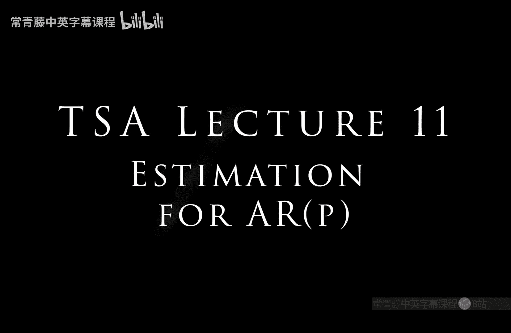
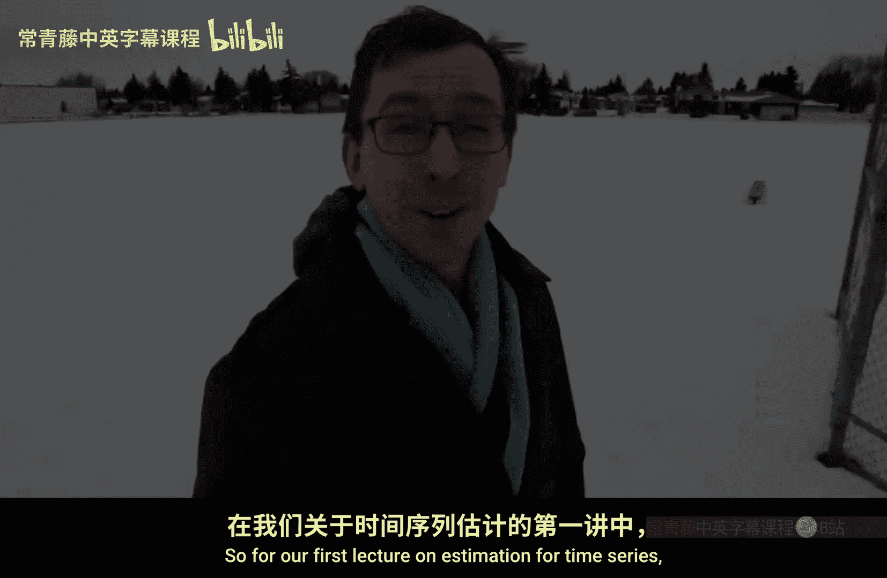
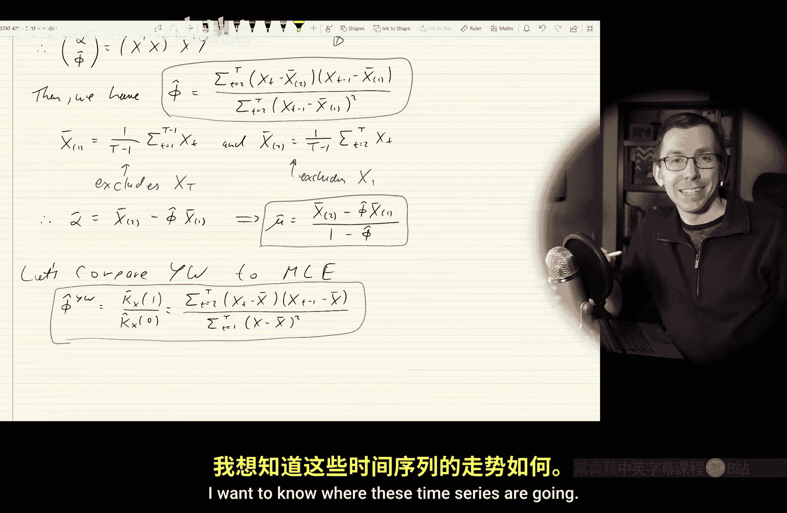

# 阿尔伯特大学【中英⚡时间序列分析｜STAT479 2021 Time Series Analysis】 p11 P11 Lecture 11： Estimation for AR(p) -BV1nwqYBDEos_p11-

Welcome back to another episode of Staistics 479 time series analysis。

 now we're starting the real part of the course we're about halfway there and we're finally going to be doing something great。

 it's called statisticsistics specifically estimation with time series。🎼あ。

So for our first lecture on estimation for time series， we're going to be looking at the AR process。

 the classic autoaggressive process， it has a bunch of Ps in it。

 how in the world are we going to estimate all of those Ps。

 well we're going to find out now in this lecture。

And welcome back to another lecture of statistics 479 time series analysis today we will be continuing on with the notess and starting chapter 3 Cha 3 is on estimation and forecasting so so far we've talked a lot about the properties of different time series the Arma process。

 the AR， the MA we've even discussed very briefly the idea of an arema model where we include different now what we're going to do is we're actually going to figure out what the parameters are in the model because this is statistics and in statistics we want to estimate things and what we're going to estimate are the Phis we're going to estimate the thetas in the ArRma process but to get there we're going to have to take some time and work our way up to it today we're going to start with just the autoregressive process which is going to be enough work just to get through that and then we'll start talking about how to estimate parameters for more general Ar。

Processses after that。Let's get into the notes and see what it's all about。so again。

 what we're aiming for here is the idea of estimation。So the goal。Is。We'll say given。

An armma PQ model。Process X T。We want to estimate， well， let me write down what Xt is first。

Before I tell you what we're estimating X T， of course， it going to be our usual Ar process。

 which I will not write like that， which I will write as WT white noise plus the A piece。

 which is I from1 to p of x。And I keep getting ahead of myself， Phi I X T。Minus I。Plus， the MA piece。

 which is going to be J from 1 toq of theta J or not xw Tj。T minus J to be precise。Okay， so again。

 what we have is we have the。A P piece。 and we have the MA。Q piece。 And what our goal is to。

Basically estimate。Phi hat1 through Phi hat P and。Theta。Hat 1。

Through theta hat P so much like we all do in well just about all areas of statistical modeling。

 we have a parametric model now we have p plus Q that's supposed to be a Q p plus Q different parameters that we need to estimate so then the question is how do we do that well。

Unlike say linear regression where you do your least squares estimator。

 you get out a nice answer in this case there's actually there are different ways to do it and if you've been experimenting at home with some of the estimation functions in R specifically the arema function and the AR function where the AR just estimates autoregressive models and the are will fit and the a model to your data。

 you might notice that the answer you get out is slightly different in each case and it's because they use different ways to estimate the parameters in these models。

 so we're going to start with the AR process。Because again。

 that's going to be complicated enough just for the beginning and our goal will be to estimate。

 well effectively I'm not going to write it again， we want to estimate the phi one through phi P we put the hat on to say that they're going to be an estimator so there are。

Well， we're going to consider two approaches。There are actually more。

But two is going to be enough for us for right now， we'll take the two most standard or at least。

Perhaps the most standard or at least the most interpretable methods based on your past knowledge of statistics。

 so the two approaches that we will consider are going to be the E walker。Equations。And the maximum。

 maximum likelihood， the MLE or maximum likelihood estimator。

 if you recall back from linear regression class， what we would have learned is that when you do at least squares estimation in linear regression and you do a maximum likelihood assuming normal errors。

 you get the same answer， you get the ordinary least squares estimator。In this case。

 things are going to be slightly different， but let's see what happens， you know。

 don't take my word for it， let's jump in and see what we get。So step one is， well， look up the mean。

We'll say step one。Is estimate。The mean。Okay， that's easy。

 that's X bar we talked about that back in like day one of this class， it one over capital T。

I should emphasize here just for precision， if it's going to let me do it， there we are。

So just to be clear， we're assuming that we have。Observations x1 through x capital T。

Where capital T right is just some finite amount。 So again， unlike when we're dealing with these。

Processes as general stochastic processes。In this case。

 we're working with the fact that we have a fixed and finite amount of data that we'll be working with。

 so everything's a little bit rougher in that sense。We don't have an infinite past。

 which interestingly enough will come back to affect what's going to happen in this。Anyway。

 X bar is pretty simple， we sum up all our data points。And we divide by the total。 Okay。

 we've done that before。 we talked about it in the first lecture。

 So the point of pointing it out is to say thus。We can。Instead。Work。With。The series x T minus x bar。

 or just assume。That the mean is 0 of xt。So the point like we've done a lot in this course is let's just assume the mean is zero because it's going to make our lives a lot easier and if it's not zero。

 while we estimate it and we subtract it and now it is zero so oh， okay， good， you know。

 we can do that。So then the question is， where do we go from there？Well。

 before we jump in and try to estimate those parameters phi hat。

 we should probably try to estimate the variance。Let's say estimate。The variance。

Sigma squared of the white noise process WT right WT white noise process。

 it's going to have mean zero， it's going to have variance sigma squared and well we want to know what the variance is and if you run in one of these functions in R it's probably going to calculate a variance so then how does it do that Well let's look at that。

So to figure that out， what we're going to do is we're going to start with the idea of saying， well。

X T。Is going to be， let's just write it out。 It's WT plus phi1。X T minus1。Plus。

Some all the way down to phi p X T minus P that's just our autoregressive model。

Now what we're going to do is we're going to multiply actually no sorry we're not going to multiply yet。

 we're going to compute the covariance of each side right this is equal。I guess the variance。

 all right。I'm being imprecise here。What we're doing is we multiply。Both sides by Xt。

And we take an expectation outside of that。So what does that mean， well。

 that means that on the right here at the sorry， the left hand side of the equation。

 we're just computing the variance。Of Xt。And。In our on the right hand side here。

 we're going to have the covariance between xt minus1 and Xt。

Summed all the way up to phi p times the covariance of x t minus pxt。 Well。

 we can rewrite this in terms of the auto covariance function k evaluated at zero。

 and then we have wt plus。I'll just write it all out。We could use the sigma notation。

 but let's just write it like this， which is K at lag one。Summed all the way up to p5 p K。

 the autocovariance at lag P。Okay， so then the thought is， well， if the。Right hand side is basically。

Well。Oh， I forgot one other thing。I forgot to do it for the sorry for the。

I forgot to do it for our poor little white noise guy here， WT。

What I should have put in for WT here is the。Covariance between W T and X T。 Well， in that case。

 by using this equation above for what X T is， it only at time T， it only really depends on。

It is WT at time T， and then it depends on the x's at t minus1 and so on。

Using some of the properties， we find out that this is in fact just sigma squared。

Because it's effectively。Let me write that in here， the covariance between WT and W Nope。NWT。

There we go。Okay， so can we do anything with that？Well。

 we can rearrange the equation of it and we find out that the variance of the white noise sigma squared is going to be what it's going to be the auto covariance at lag zero minus the sum。

We'll say let's say I from 1 to p of phi I times the auto covariant at lag I。All right。

 so does that help us at all well， it kind of does because what it means is that well。

If we want to estimate， we'll put some green hats on everything。If I want to estimate the。

If I want to estimate the variance， that is sigma squared。Well。

 I can estimate all of the auto covariances。So now what I'm saying is that I can determine sigma squared。

 then an estimator sigma squared hat is going to be a linear combination of the estimators of the autocovariances K0 hat all the way up to KP hat。

But there's one problem， we don't know what the linear combination is because these guys here are still unknown。

So like I said so far， we need to make sure that when we're estimating something。

 we're estimating it based on known quantities or functions of the data that we're given。

 we can't estimate something if it has a bunch of unknown parameters in it。

 so we have to figure out what the Phis are in order to figure out what sigma squared is or sigma squared hat is。

So then the next step is， let's try to estimate the Phis。I guess the point is。Therefore。Find。Fi hats。

To find。Sigma hat squared。All right， cool。So then， well， how do we do that？Well， we could try。

Is to do the same thing we did up here。But instead of multiplying by xt。

 we can multiply by xt minus1 and see what happens。So what we're going to do。

Is we're going to say step， I guess we never really finished step 2。

 We got sidetracked because step 2 said， estimate the variance。 But， oh， no。

 we didn't quite finish that。 but step 3 is going to be。Estimate。Fs。So if we take that。

Equation up above， but instead we write the expected value of xt minus1 times xt。Is equal to。

Let's say the expected value of x t minus1 times wt plus again， phi 1 x T minus1 plus。5。P X。

 T minus P。All right， so we have that， well， what does this become。

 the left hand side is the autocovariance。At lag 1。The right hand side。

 well what happens well first of all， the WT just becomes zero here because it's not。

 it's uncorrelated with xt minus1 because again it's set time T x t minus1， we're assuming okay。

 we're assuming causal linear process so that this is equal to zero。I'm going to write that in the。

And I'll put it over here in the margin。Note。We assume。X T is causal。ARP。As noted。

In the previous lecture， there is for any A causal ARP process， there will be an equivalent。

 stochically equivalent non causal ARP process。I think it should still be the same order ARP。

 but regardless there will be a non causal， yeah， it should be ARP。

 of course it would be there will be an equivalent non causal ARP process and vice versa so。

When we're trying to estimate， we're going to just work under the assumption that we have to pick one of them to estimate。

 so let's estimate the causal one because we live in a causal universe to the best of our knowledge。

 I guess so far the future has yet to dictate the past， at least to the best that I know of。

 whereas the past seems to dictate the future in the world that we live in so。

What we will do is we will always assume that what we are estimating is going to be a causal ARP process。

Now the other interesting thing， site tangent is that if you didn't have an ARP。

 if you had an MAQ or an armmaPQ process， but you try to just fit an AR process to it without any MA piece。

 you can still do that but certain weird things will happen we'll look at that later but just keep that in mind that right now we're assuming that what we have is。

What we're looking for， what we're trying to estimate is what actually is there。

 that is we picked the correct model， but in a priori。

 we wouldn't know that we have an ARP process besides maybe taking a good guess and looking at things like the ACF and the PAF plot。

Anyway， that was a big tangent。Getting back to what we were actually doing as we were trying to compute the expectation of the right hand side of this equation。

 the first term is just zero。 the next term is going to be phi 1。Well。

 it's going to be the expected value of xt minus1 times xt minus1。

 that's the autocovariance at lag zero。Then continuing on。

 we find that we would have I'm going to write the next term in here。

We're going to have the auto covariance at lag one。

And then we're going to sum all the way up to Phi P。Times the auto covariant at lag P minus1。Okay。

 so that。Kind of interesting， we haven't quite figured out what we're doing yet。

 but we have another equation。Think your Walker equation。

 we have another equation here that is in terms of Phis and autocovariances。

Let's try it again and this time we're going to do the same thing， but if we multiply by。

 I'm going to continue to skip more steps with each。Time I do this。

If we instead try multiplying by Xt minus2 and doing the exact same thing we did before。

 then what we're going to get is a t autocovariance at lag2 on the left hand side。

 on the right hand side， we're going to get a zero for the white noise。

But we aren't going to get a zero for the x t minus1。 we're going to get a phi1。

Autocovariance at lag1。Then we're going to get an autocovariance at lag0。

 and then we're going to sum all the way up to phi p times the autocovariance at lag p minus2。

So you're noticing kind of a pattern here， there's kind of a diagonal pattern thing going on。I guess。

We'll just do that。So what happens if we push ourselves all the way to？T minus P。

 So let's do this all the way down to multiplying。By x t minus p on each side of this equation。

 then what we end up with is an xk。At lag P， right because T and t minus p are p time points apart。

And when we jump onto the right hand side here。We're going to get a Kx at lag p minus1。

We're going to get a KX， oh I put a K0 there， a KX。At lag p minus2。And this will continue up to5 p。

 which will be a Kx at lag and zero， right？Double checking， yeah。

 one to yep zero just making sure it's not one sometimes it's like is it one or is it zero。

 no in this case， it's zero， okay。So now we have a whole bunch of equations。

It's a system of linear equations and we can solve that， so let's look at that。All so let's recap。

What we have？Is。A system。Of P linear。Equations。With。P unknowns。Which is phi1。Through phi。B。So。

We solve it。With linear algebra， our good friend。That is sort of everywhere in statistics。All right。

 so let's think about how we can write this out in a better way。 What we can do is we can write。

So what I'll say is we write。K， capital K is going to be gamma。Times phi， where。

Capital K is the vector。Of auto covariances。From lag one。To lag P。

And I like to write that this is in RP， just so I always remember where we're working。

 we have a P dimensional vector of autocovariances from1 to P。All right。

 the next thing we get is we get our gamma matrix。 So gamma， actually， let's do P first。

 it's easier gammas。😊，Big。So phi is going to be our vector of unknowns。That's just going to be phi1。

Through Phi P。And then we have gamma， the big matrix。And gamma is going to be， I guess again。

 this is in our P dimensions， and then we're going to have a P by P matrix。

 which is going to have the auto covariance at lag zero at lag1 over here at lag1。

On the main diagonal at lag zero and what we're going to do is this is going to continue all the way down the matrix down at the bottom here we're going to have。

I think P。Minus1， let me double check yeah P minus1。And K， X at。P minus2 and so on。

 and then over in the corner we're still going to have a KX at zero on the main diagonal and if we really want it。

 I can write。Kx p minus1 up here in the corner。So we have a giant matrix which is coming from all of the autocovariances that exist within this system of equations。

So now， well what do we do， well， what we do is we solve this。And what we can say is that therefore。

We estimate。K， X。At lag zero up to Kx at lag P。And。Compute。Sigma hat or not Sigma， Phi hat。

To be what is it， it's going to be gamma inverse。Gamma hat inverse。Times K， hat。

Where the hat just means that I'm estimating all of the elements within that matrix。

 gamma and within the vector K。Right， so now we have a way of doing this because we know how to compute the auto covariances and what we found out is that our。

Basically。Let's change the color。Basically， what we showed here is that。Our ps。Hats are just。Linear。

Combinations of。Autocovariances。Excellent。Remember when I said this whole course is basically just autocovariances。

 autocorrelations and so on， mainly it's like the only thing we really do and what we found here is that we can just take a big matrix of autocovariances a vector of autocovariances multiply the two together will inverse gamma first inverse gamma。

 multiply it by 2 k hat and we get out Phi hat an estimator and this is the your walker equations。

This。System。Is the。Your。Walker。Equations。All right， that's actually pretty cool。

 I always found that kind of neat。But we're not quite done yet。 Where are we going to go next。 Well。

 the first thing is we never finished step 2。 We never actually finished estimating the。

The variance sigma squared of the white noise process， I now。We can finish。Step2， above。

Which is to say that we can now estimate。Phi hat squared by。K hat。X at lag 0。Minus。

I guess we can say the vector Phi hat。Transpose， it's just the dot product times k hat。Right。

 because if we go back up to where we were in step two way up here。

 what we said is that we have two things to consider， we have K hat。At lag zero。

 and then we have a linear combination of the K hats at lags1 to P。

So that's basically just what we're doing down here Cool。

 so now we can really just estimate everything。We have that。

And we have that and of course we have x bar is the mean， but that's super boring。

 so we'll just not worry about that because we don't have to， we already did it。In fact。

 we can actually also write this as k hat x at lag zero minus because if we look at the definition of Phi hat above。

 we can write it as a quadratic form now as K hat。Transpose。Gamma， hat， inverse。It's symmetric。

 so I don't need to transpose it。Yeah， technically， it would be gamma hat inverse transpose。

 but gamma hat symmetric， it's inverse symmetric。Therefore。

 I don't need to transpose it and have terrible notation。

Because inverse transpose and transpose inverse just looks terrible on paper and stuff like that。

So we'll avoid it so we can actually write this as a quadratic form。And thus， we are。 yeah。

 we're good with that。 So then the question is， does this estimator。Makes sense。

 we often in statistics want to know properties about the estimator that we have is it。Well。

 does it have nice it converge， for example， to the right thing as the data size gets bigger。

 you want to think the answer is yes， because intuitively we know that it's based on the autocovariances and as the data size gets large the estimator of the autocovariances converges on the true autocovariance so hypothetically if that's converging you would want to think that the phi hats would also converge in the sense that the better estimate we have for autocovariances。

 the better estimate we'll have for phi hat， but we can actually write down a theorem which will formalize this a bit and I don't think I want to actually prove it。

We'll see if we have time or if we actually want to go through it。

 I'm pretty sure it's in the back of the textbook。Where。I was using to organize this class。

So in the notes， it's theorem 3。11， and it's the asymptotic normality。Norality。4。

YW being Yuule Walker。And basically， given。F hat。And Sigma had squared as above。4。A causal。

ARP process。Then。What we have is that the square root of t。It's always square rooted the sample size。

 right， at least in parametric stats。Times phi hat minus phi。

Will converge in distribution to a normal random variable with mean zero and covariance matrix。

 This is a vector。 remember， it's not a sigma squared。Times gamma inverse。And。

We get convergence and probability for。Sigma hat squared to sigma， stringent probability。

 and this is both as capital T goes to infinity。So what does that mean well， that means that。4。

Large tea。Fi hat looks。To be。Multi。Varit。Normal。Or Gaussian。So that's quite nice， it's not II。

 it's not like an independent or in anything because we're going to have this gamma hat inverse。

 which most likely will not be diagonal。Unless no， and that would only be the case if all the of course。

 it would almost never be diagonal， right， because gamma hat。Or gamma。

 the matrix here would only be diagonal if all of the autocovariances are0 up to lag p。

 which means we have something that looks uncorrelated。

 at least up to lag well lag P minus1 like some type of white noise process so that would be really boring so basically you have a vector but you have and you have a normal distribution but you have a nondiaagonal covariance matrix meaning that the estimates the phi hats have some dependencies between them so it is good to be aware of that these are not independent estimators。

 there will be some dependencies between the phi hats。Oh yes， and we get a crawlery from this。

Core for I what I say。Crollary。And the crawlery is that basically。The PA， CF，F is also。

Asymptotically。Normal。Remember in the last lecture， yeah。

 the last one when we looked at the PAF function for the AR1 process， we saw that the。

PAACF for the AR1 at lag1 will have a value。That is effectively what Phi one is。

 or it's an estimator。 So in that case， we have that the estimated Phi hat。

Is also the PAF now for larger P ARP processes， we do not have that nice kind of like correspondence。

 but there's still a very close relation between the PF and the。

Fi hats and everything and what we have again i'm'm not going to prove it now。

 but just so you know the idea is that。I'll say with。The same。Set up as above。

We have that root t times the estimated this isquiggly or。I guess scriptify at lag H。Will go。

Converge in distribution to a normal 01 random variable。For。H， greater than。P。Which means that again。

 if the if the lag is greater than the order of the autoregressive process。

 then it means that the PACF should look after rescaling by the sample size should look like a normal random variable。

 and hence we can use that fact to look at a PACF plot and determine whether or not the value is big based on comparing it to the normal distribution。

 assuming the sample size T is large enough。So that's a nice extra bonus that we get a little bit more of a formality than what I was doing in the last lecture where I was just kind of writing stuff down and saying。

 okay， the PACF， the true phi， basically right the last lecture。

 what do we do in the last lecture we said in the last lecture that，Phi。

 no hat at lagG H will equal zero。If。H is greater than P。

So now we've kind of strengthened that to the idea that the estimator phi hat will will have like a central limit theorem going on。

 and it'll look like a normal random variable for large values of T。

So just learning more about the PACF function as we go forward。All right， so。

I have some examples of how this will work， but we're not going to do that right now。

What we will do is we will jump into the idea of maximum likelihood estimation and then we will revisit all of this in our code。

So the next idea is。Maximum。Likelihood。Estimation。All right， so then how do we start？

An MLE problem well we want to maximize the likelihood we need the likelihood。

 what's the likelihood going to come from it's going to come from a distribution in this case the normal distribution so for this section。

Here。We assume。That。WT is Gaussian。White noise。Because we want a distribution to work with if it's not Gaussian white noise we're going to get a different likelihood and it means we're going to have to well work a lot harder。

 it's already kind of annoying with the Gaussian distribution let's not go outside the Gaussian distribution in this course but it is worth noting that up above for the E Walker equation we didn't make any distributional assumption all we said was that we have uncorrelated white noise so that we could write down all of the U Walker equations if it's not uncorrelated well all bes are off so we definitely need that。

In this case， we're going to strengthen it a bit for maximum likelihood estimation assuming that we are white noise as Gaussian。

 it's a pretty good assumption because it happens a lot of the time。

 but you could have some heavytailed noise or other issues or other types that you might have to worry about。

And because this is， well， super annoying to do， we're going to once again start。With。AR one process。

Because it's a lot easier for me to actually write down and it's not going to be as much of a headache。

So what we're going to do is we're going to write down Xt。I is going to be mu。

 the mean that I like to ignore， but this time we're going to write it down times phi x t minus1 minus mu。

 it's kind of a weird way to write it， yes plus Wt the idea is that if xt has mean mu。

 and it's stationary that x t minus1 also has mean mu。

 therefore this piece in the parentheses is a mean zero process。

 so what we have is white noise mean zero thing in parentheses mean zero mu is just mu。

 so it's not a random variable， but it could be any real valued。Mu can just be some real number。

So now what we need to do is we need to write the likelihood。

 but we don't want to just write down the likelihood。Well。

 we want to write down the joint likelihood of the entire data so we want。The joint。Likelihood。

Which is going to be L of mu phi。And sigma squared， right。

 these are the three unknown parameters in our model， the mean the phi parameter。

 the autoregressive parameter phi， and the variance of the Gaussian white noise process。

 sigma squared。And we're going to condition that on the entire， I guess I use semicolon。

 so we'll use semicolon。Semicolon， the entire data set x1。Up to X， T。Okay。

um now if we were to just use the definition of likelihood， we know that this is just the joint。

Probability density function。With x1 through Xt， given the parameters。Mux phi and sigma squared。

 So again， this is。Likelihood。This is the。Joint。Probability， density。All right。

 well it's Gaussian right because if WT is a Gaussian white noise process。

 then any of these derived processes from WT will also be Gaussian。

 so F is going to look something like a normal distribution but I have no idea what the parameters are going to be so that is the mean and the covariance right for a Gaussian process we just need to know the mean and the covariance and we're done。

 but I don't know what it's going to be in terms of mu phi and sigma squared so instead what we're going to do is we're going to decompose the likelihood into a conditional into some conditional distributions。

So instead of trying to attack this joint distribution directly， what we're going to do。

 and I'm going to drop the conditioned on the mu phi and sigma squared because it's just going to make it look messier if I don't。

We're going to start with just the density function for x1。

Then we're going to consider the density function for x2 given x1。

Then we're going to consider the density function for x3， given x1 and x2。

 or maybe I should write x2。Oh， that's right， Yeah。

 I guess well I'll write it out like I'll write it out like this and then we'll we'll simplify that。

And then we can write out X。Tea。Given x capital T -1 all the way down to x 1， but。

What we have is that X T is。A Markov process。That is order one。A R。

So because it's an order one auto aggressive process。All of the information about time little T。

Comes from。Time， little T minus1。 and the rest of the past is irrelevant when it comes to conditioning。

 So what we can actually do is go back in here and we can。Drop out anything but the most recent。

 I shouldn't be doing X's in red because。It's just going to be confusing with the fact that I have X's all throughout here。

 so we'll just slash it out。 so we get rid of that guy。

 we get rid of everything in here and what we're left with is just a product of。😊。

A big product of conditional densities， we're going to have an f of x1。

 and then we're going to not say equals， but we're going to multiply that。

We are going to multiply that by T little T from。2 to big T of F of x little T conditioned on x t minus1。

 so now we have a much cleaner way to write this and we have a bunch of simpler conditional Gaussian density functions rather than one giant joint Gaussian density function。

All right。Hopefully that actually helps us。All， so。What we can say is that step well。

 the first thing。Stop saying step one， step two， well to say the first thing we're going to note is that。

Note。That。X 1。Our first guy here is just going to have a normal distribution with mean mu。

And with variance term being sigma squared， divided by one minus phi squared。Okay， why is that true。

 Well the mean is just the mean， it's just mu this。Came from。Is just the。

The variance or the auto correlation at lag zero covariance at lag zero。4。A R 1。

We did that already and one subtle note。Which。Is assuming。An infinite past。

So if you recall when we actually computed this， that's where the one minus phi squared in the denominator is coming from right it's an infinite geometric series going I guess into the infinite past。

 it's a geometric series going into the infinite past， when we sum of all the terms。

 we get a one divided by one minus phi squared and then the sigma squared who's just floating around there when we take the。

When we compute the variance of the white noise process。Okay， so we have that from before again。

 technically our data is finite， but mathematically， we're assuming that this。

Casal AR1 process can be extended into the infinite past for the sake of estimation or mathematics。

Anyway， this will be what we have for x1。And then the question is， well。

 what in the world do we do for the rest of these things， well， luckily Gaussian distributions。

Are super robust。 You can kind of torture a Gaussian distribution and you still get out of Gaussian。

 You can add them together you can。Take conditional expect， you can do conditioning。

 you can do product distributions， you can do in certain cases， yeah。

 you can do a lot of things and you still get Gaussian distributions out。So。

The claim right is that this X T conditioned on the previous guy Xt minus1 is also going to be Gaussian and in fact。

 if we recall that。Well， I'm going to write down the answer and then I'm going to explain why is the answer。

So the claim is that this thing， Xt conditioned on the previous observation is also going to have a normal distribution。

 the mean is still going to be mu。And oh， no， it's not going to be mu。 sorry。

 it's going to be mu plus。5。Times X。T minus1 minus mu。

And then the variance is just going to be sigma squared。So where's that coming from？This。Is because。

We have X T is equal to。WT。Plus。Phi X T minus1 minus mu。 So if I condition on X t minus1。

Conditioned on X t minus1 what do I have on the other side of the equation， Well。

 if I condition I get that WT is still WT， I get the exact same thing except for the when I condition on X t minus1。

I'm treating this guy here as a constant。We're treating。This。As constant。

And this guy here is just normal zero sigma squared。

 so all I'm saying is I have a normal zero sigma squared distribution and I'm shifting it by that thing phi x t minus1 minus mu and hence y when we go back up to。

What my claimed answer was， I have a mean， which is going to just be。Oh。

 I forgot my extra mu in there。That's why I'm like something's missing。We need an extra mu。Here。

But that thing is still just constant。And then the sigma squared from the white noise is just going to be the sigma squared in the distribution here。

So ultimately， I can write down what all of these joint。Sorry。

 all of these conditional density functions are combine them all together and I get the joint density function。

This is a trick that is quite useful when you have anything。Like a Markov process that has a finite。

I guess horizon for。What's the right word causality I guess the fact that we only care about the previous time point to predict the current time point in this case that means that I can throw away all the complex conditioning and I'm left with just a single a nice a very nice simple way of writing down the joint density again rather than trying to attack it all at once so then。

Then we put it。Altogether。And what do we get， Well， we get our likelihood。

I'm not going to write in terms of。All the x's。Well。

 I'll just write it like this and let's just write it out。I have a lot of room on my page。

 I can just keep creating more room so。We'll fight our way through it。Anyway。

 what is this going to be， It's going to be a big equation。 It's going to be the。Well， what。

 it's going to be the variance。It's going to be one over the square root of two pi times the variance。

 so what we're going to get is we're going to get in out front。

 we're going to get something that' looks like。I guess I can just take the square root of the whole thing。

 so what we're going to get is we're going to have a one minus phi squared that's coming from01 up here。

Density function for x1。Now， when we move to the denominator， we're going to get a。2 pi。

And we're going to get a sigma squared and we get one of these for all of the terms in that product。

 which is。Right there now at the top of the screen。

 there are t terms in the product so we get T of them。

 but if you recall what the density function for the Gaussian is。

We get a big square root over this whole thing。Maybe I should write out the。Side margin。Right。

 normal。Mux sigma squared has a density function that's going to look like one over the square root of two pi sigma squared e to the。

 we'll say EXP。Minus。I guess I need a。Argugue with love。What are we doing？We'll say T， I guess， Yeah。

 we'll say X。X。Minus mu squared divided by sigma squared。Gu。

 there's my that's my multi that's my Uniivari。Gausian density function， right。

 It's always hard to make sure I get all these correct。 Oh， there's a two。

 I knew there was something I was missing。 We're divided by two sigma squared。 Okay。

 now I feel better。 felt like there was something wrong there。😊，Okay。

So this square root bit is just out front， then we're going to have a big， big exponential。

So what is up in the exponent well？Couple things， first of all， we're going to get the magic。

One minus one divided by two sigma squared， that's usually there。But there's a lot more to go。

So we have our minus1 over two sigma squared。And we're gonna have a big summation in here。Well。

 what do we get for the first term， which is just F。Of x1， right， that has a mean of mu。

So and a variance that also includes one minus phi squared。

 So what we end up with is something that looks like x1 minus mu squared times1 minus phi squared。

 That's going to be this bit over here。 I take my x， I subtract the mean， I square it。

 I divide by the variance。 The sigma squared is in all terms。

 So we're just going to leave that in front of this giant curly bracket。

 but the one minus phi squared。Only applies to the first term here， it's only in the variance for x1。

 it is not in the variance for xt conditioned on xt minus1， so that's why that's there。

And then we're going to sum up all the rest of the terms again， we're an exponent。

 so the nice thing about that is that our product becomes a sum。

And we're going to sum T from2 to capital T。And then。We need a couple things。

 we need xt minus the mean。Mu。And we're going to subtract from that。

 basically what we're doing is we're doing xt minus it's mean， it's mean is here。

 but the way I'm going to write it is I'm going to take the first mu and attach it to Xt and the second mu is already attached to X t minus1。

And this whole thing is squared and we end the curly bracket， and we end the giant square bracket。

 and we have this grand joint density function， like I said。

 I wouldn't want to have to write this down from scratch without first using this conditioning approach。

Okay， so what do we do with this thing， we want to find the maximum likelihood estimator and if you recall from say linear regression。

 the thing in the exponent is actually the sum of squares that we want to minimize， right？

The E to the something。 It's an E to a big sum of squared terms。 We want to minimize that。

 So what we can do is we can consider。That this thing here。Is a。Some of squares。So。Minimize it。Right。

 question mark。Well， kind of， let's。Let's look a little bit more at this。

So what we're going to do first is write down the exact same thing I had in the exponent in here。

 and we're going to denote that as S。Let's make sure we got this right S sub U。

 and this is going to be the unconditional sum of squares。

So the hint is that if I call this the unconditional sum of squares。

 there's probably going to be a conditional sum of squares coming around。

The unconditional sum of squares in terms of parameters mu the mean and phi the autoregressive parameter。

Is going to be， well， it's exactly what I have there， but I will rewrite it。Just。

To make sure it's exactly clear what's going on here。 The squares on the inside there。

 And then we sum T from2 to capital T of。X t minus mu， the centered process， again。

 this is why it's kind of nice to not just assume that mu is zero。

 but here we actually want to estimate mu， so we're going to bring it in everywhere。

X T minus1 minus mu。Squared， okay， so this is our。 And let me write out under here。

 we'll say this is the un。Conditional。Some。Of squares。All right， so what do we do with this well？

Let's see what we can happen if we well I guess we got a couple more things we have to do。

 another thing we need to do is consider the log likelihood and use that to get sigma squared because in our unconditional sum of squares we have mu and we have phi。

 we don't have sigma squared to get an equation for sigma squared， what we're going to do。

So this is the first thing we're going to look at， we need that defon defined。

The next thing we're going to define is the well not define。

 the next thing we're going to do is we're going to take a partial derivative。Of the log likelihood。

With respect to， I'm not going to write out likelihood of whatever。

 it's the log likelihood with respect to sigma squared。Okay， so that's。What's that going to be？Well。

 let's write it all down and see what happens。So what do we have here well the first thing we're going to have is we're going to have a lot of terms that don't actually matter going to this square root bit over here。

The first thing we're going to get from the numerator is a one half log。1 minus phi squared。

 That's the numerator bit。 The denominator bit is going to be a minus T over 2。Log， I guess。

We'll break it into two pieces， the one we don't care about， which is the two pi。

And the one we do care about， which is log of sigma squared。

 that's going to be one of the important pieces。And then the last bit is we take a log of the exponent and what happens while what we end up with here is just。

I guess minus because there's a minus sign in front of everything。

 this is just the what's in the exponent at the unconditional sum of squares。

Mu phi divided by two sigma squared。Okay， so I'm going to take the derivative of each of these terms。

 Luckily， two of them just vanish this one gone， this one gone。 and we're left with。Well。

 two things were left with the derivative of the log of sigma squared。Which is。

Im going to be t divided by minus t， sorry divided by two sigma squared。

 then we're going to take the derivative over here and we're going to get a plus。

SU unconditional sum of squares。Mu， sorry， not Sigma phi。And into the denominator。

 when we take the derivative of this， I guess what a two。Oh no。

 we're taking it with respect to sigma squared， so it's like the derivative of 1 over x。

 which is minus1 over x squared， so we're going to get a2 sigma to the fourth。All right， and then。

If we set this equal to zero and solve。We get。Well。

 simply what we get is we get that sigma hat squared， which is going to be now the MLE。

I want to emphasize this is different than the sigma hat earlier in the lecture。

 so maybe I'll just write here this is the。M L E。In this case。

 it's just going to be the conditional sum of square or the unconditional sorry。

 sum of squares divided by the total sample size。So again。

 it looks a lot like what you get when you want to estimate a variance。

 you get the thing in the exponent from the normal distribution divided by the sample size。

 and if you recall back from CalC，101， when you compute the maximum likelihood estimate for the normal Uniivariate normal distribution。

 you get the sum of squares divided by the sample size。

 and then what we say and stats of 101 is that well wait a minute。

 we should probably divide by the sample size minus1 to account for the fact that we estimated to make it an unbiased estimator since we estimated x bar as the sample mean but effectively we're getting the exact same thing is happening here。

 it just looks a lot more complicated， but besides the complications and the nasty formula。

We basically have the same thing， which is our maximum likelihood estimate。

 is the sum of a bunch of squared things divided by T。Okay， so then the question is， how do we get？

I'll say but。How。Do we。Get。Me hat。And P hat。Well， it's not that easy and there's not going to be a nice closed form in this case。

 sadly。So the answer is， this is a question， so we question market and the answer is， well。

 it's not that easy because。If we。Basically。We get。Me hat。And P hat。By solving。

A linear system of equations。And。In math， right， linear things good nonline bad right it's whenever you have a linear system like we did with your Walker。

 it's great inverter matrix， we can do that。 no problem right No nonlinear system that says a well that's annoying It means we probably aren't going to have a nice closed form instead what we're going to have to do is try some numerical solver and hope that it doesn't fail miserably I will write down the equations。

😊，Just so that you have them here， the equations are going to be two full。

 there's going to be two equations because we have two parameters where we have two things we're trying to estimate phi and mu。

And if we go back to our。I'm skipping the step， but if we go back to our log our log likelihood。

 we take derivatives with respect to phi and mu， we get out two different equations。

 it's not really worth writing out all the details because it's just an exercise and calculus that's kind of boring and we're eventually going to find a better way to estimate these in one second from now。

 but I will write them down so we can stare at these equations。

And the equation is going to look something like this。

Assuming because I'm actually just copying this now rather than driving it like I did with the last thing that hopefully what I did when I derived it the first time I derived it correctly。

I trust me more or less。Anyway。We're going to get something that looks like this crazy equation。

 that's equation one and then equation two， if we take the derivative and then set it equal to zero。

 I think in this case with respect to phi， we end up with something like minus phi1 minus phi squared。

Minus1 over to sigma squared and then。2， phi。X minus， x1 minus mu squared。Minus2。Its the sum。

T from 2 to capital T of X， T minus phi。Yeah， time series is just the worst when it comes to equations。

 right？It's just equations。Add nauseum。And then I think there's an X。T minus1 minus mu。 So again。

 not the nicest thing to look at or to solve。 Now， the point that I was trying to make is there are some nonlinear things to worry about。

 The fact is， we have a couple terms that look like， well， that's switched to red。

That look like this where we have a mu times a phi， we have a phi divided by a one minus phi squared。

 here we have another mu times a phi， so again it's not the easiest thing to just work with。

So what we're going to need to do is come up with a better approach。

And that is where the conditional sum of squared comes in。I think。Yeah。

 thisll be a little bit of a long lecture， but we'll just get through all of this and then maybe we'll do some nice R code in the next one and take a little break from all the crazy equations。

😊，Right。Instead。We can condition。On。X1。To。Effectively remove。F of x1 from。The likelihood。

And this is where the problems come from。From this guy。

So that's where our nonlinear problems are coming from if we condition on the first。

Basically what we're doing is we're just throwing out x1。

 but what we do is we write a conditional likelihood so the conditional likelihood is going to be mu phi。

Sigma squared， conditioned on x1。Which is why I had to be careful I write Demico。

In the other case because technically there's what I'm not writing here because the notation would be terrible is a semico and x2 through Xt and then conditioned on x1。

And what we do with that is we effectively throw out the first Gaussian bit， the F。

 we just take F of x1 and it's gone， why not， it's just one data point who cares。

And what we're left with is the same equation from above， but we don't have。

A couple things for note the first thing to note there is， well。

 I guess we have a t minus1 over two here or the square root of this whole thing。

 there's no one minus phi squared in the numerator that's good and then when we look in the exponent。

We get the sum。T from 2 to capital T。That's another typo man。

I think I wrote these last year during the first COVID lockdown。

Things were became a bit messy with my course notes。

 I will try very hard to update them hopefully by the time you're watching this or。Well。

 by the time someone's watching this。We'll see how fast I can get to the updating anyway。

 the idea is that we still have a minus one over two sigma squared there。

And then what we're going to have is an xt minus mu。Minus phi。X T minus1 minus mu。Squared。

Maybe I shouldn't trust myself now this makes sense what we basically did was we took this so if we look at what that formula looks like and we go back up to the one that just fell off the top of the screen。

 what's missing Well what we did was we got rid of。1 minus phi squared in the numerator there。

 and we got rid of this term， these are the two terms that came from f of x1。

 they are the nonlinear pieces because now when we go back here。

 we have a nice looking sum of squares without any strange issues arising。Well， yet。

I'll show you what happens。So。What we get here is。I guess we yeah。

 what we need to do is we need to call this thing in here。Yes。See。Of mu and phi。

 which is going to be the conditional。Some。Of。Squares。Cool， and we get a new。嗯。Another sigma hat。

 so this is now the third estimator sigma hat that I'm going to have in this one lecture。

 sorry about that， but I really don't want to start writing Sigma Tilda and Sigma。

 other crazy Sigma prime and other things is just going to get confusing。😊。

This time we estimate it by looking at the conditional sum of squares。Divided by capital T。

 but we have to subtract one because we have one fewer data point， we threw out the first data point。

 so that one is no longer there。So now we have yet another estimator for sigma hat squared。

 but this one， a claim is easier to actually solve。So first of all， what I'll say is we。Rewrite。

What is it， the conditional sum of squares？To be the sum。Tea。From2 to capital T。Of X， T。Minus。Alpha。

Plus， phi。X T -1。Squared， where。Alpha is going to be mu1 plus。5。So now what is this。

 this is simple linear regression， simple in the sense that it's one input， one output。

 not simple in the sense that it is easy by any means this。Basically， this is just。Least。Squares。

Regression。In the sense that we have something that looks like y is equal to。Alpha hoop。

Alpha plus phi x where y here would be xt and x would be xt minus1， et cetera。

 and then we I guess we would have like an epsilon noise term in there。Yeah。

 this is just a sum of squares like we would see in linear regression。So we can solve that。

So now we get a matrix。We can say let。X be the matrix， the design matrix。

 using the terminology from linear regression where we have all ones in the first column corresponding to the intercept。

And in the second column， we have a bunch of x's。hich are're going to start from one， yeah。

 of course， because we're using one through t minus1 to predict2 through T yeah。

 so we have to do the predictors are going to be x1 x to x capital t minus1。

And the response variable， let's see what notation was I using here。

I didn't actually use a notation for that。 I'm going to write it out like regular linear regression the response vector Y is going to be x2。

X 3。Through Xt， again， it's like linear regression except we're using x1 to predict x2。

 x2 to predict x3， x3 to predict x4 and so on all the way up to xt minus1 to predict xt。

But if I have this， then I know what my answer is so then。Therefore。

 we can just write down the least squares estimator and we get alpha hat and we get phi hat。

And that is just going to be everyone's favorite x transpose x inverse， x transpose y。

Which is just going to be a big product of a bunch of points in the time series。

 but that's a really nice and simple thing because I have my time series X1 through XT。

 which means I can really quickly compute Alpha hat， Phi hat。And then。Then。We have。

That after a little bit of maneuvering。We find out that a Phi hat actually can be written。

As a ratio of the sum。T from2 to capital T of。X T minus X hat。m sorry， x bar two。

 I'm going to explain this notation in a second x bar。Two in brackets。

X T minus1 minus x bar1 in brackets and parentheses。And in the denominator。Yeah。

 we're dividing by that thing squared。So I have a， will'll explain this in one sec once I write it all down。

Okay。All right， so I have to tell you what x bar1 and x bar  two are。

If my voice holds up for just another few minutes。X bar1 is the mean。Of the data。

 excluding the last point。It'sT minus1。Times the sum little t from 1 to t minus1 of xt and x bar 2 is the average of all the data excluding the first point。

T from2 to capital T。X T， so again。Excludes。X， capital T and this one。Excludes。X1 and。

This phi actually， you would have seen something that looks like this in linear regression class because in linear regression class。

 you would find something like， oh， beta hat just happens to be the sum of x or y we'll say。Yhy I。

X I divided by the sum of X I squared so that's exactly what this is what we have here is we have X I is the predictor。

 it's t minus1 Y I is the response， it's T， and we're dividing by the sum of the X squares in some sense。

All right。Okay， so we have that， we're almost， almost done， let me circle this in a big green box。

And then therefore。Alpha hat， which is just an intermediate that we're going to use to get mu。

 is going to be x bar2。Minus。Phi hat x bar1， and if we go back to whatever alpha is supposed to be。

 which is mu times1 plus phi， we can just well， divide by one plus phi and what we get。

Is that mu hat， our estimate for the mean， is going to be the average of the data excluding the first point。

 minus the average of the data excluding the last point a， but I forgot to multiply by Phi hat。

Oh come on one note， there we go。Phi hat x bar1， divided by1 minus。Fhi hat， it is minus right， good。

Okay， so we have that。This is so much better than last year。

 last year I used to get kicked out of the class all the time because I'd be talking too long and the next class would try to come in and get in when fair enough right but still now I can just keep talking as long as I want and you can decide whether or not to tune out but we're almost there and we're getting to the good conclusion which is before we're done with this lecture I want to say let's。

😊，Compare。Y'll Walker to MLLE。Well。The Phi hat for the Ule walker in this case for an AR1 right。

 is just going to be the ratio of the auto covariance at lag 1 to the auto covariance at lag zero and when we write that down。

We end up with something that looks like the sum T2 to capital T X T minus x bar。X， t minus1。

Minus x bar。And the denominator。Because this is just the estimate of the auto covariance， right？

T from1 to capital T。Of x minus x bar squared。Okay。

 so that looks pretty similar to what we wrote above。

But it's not exactly the same above we have an x bar with a sub1 or a sub2 because we're excluding a point in the UA Walker case。

 we don't have that we're just taking entire the mean of the entire dataset set X bar。

UmAnd similarly in the denominator， we're summing T from2 to T， wait that。Yeah， no。

 of course it is2 to T and the denominator here we're summing over the entire data set T from one to capital T。

So asymptotically， as the data set gets really big， these two estimators are the same。

 but for a finite set of data， and especially for a small time series set of data。

 you will get slight differences because of how they deal with the edges。

 the edge or the boundaries of our data。Beyond the x1 and the x capital T everything else that happens in these two methods is the same。

 but how they deal with the boundary condition， the fact that our data doesn't extend infinite and infinite past into the infinite future that's where the differences occur and that's where we have to just be aware of that they're both very reasonable estimators and in general they will give you more or less the same thing we will look at that a little bit more。

 but we're going to do that in the next lecture after I have a chance to rest my voice and come up with some good R examples for us to look at we'll look at the AR what we'll do is we will look at estimating models using the AR function and then we'll jump back into the notes and we'll talk a little bit about forecasting because。

🎼You know， if you have a time series process， you don't just want to know what it's doing。

 you want to know where it's going right， it's a stock I want to know is it going up or down。

 is it the climate do I want to know if it's gonna to get better or worse right I want to know where these time series are going so we'll talk about forecasting in the next lecture。

