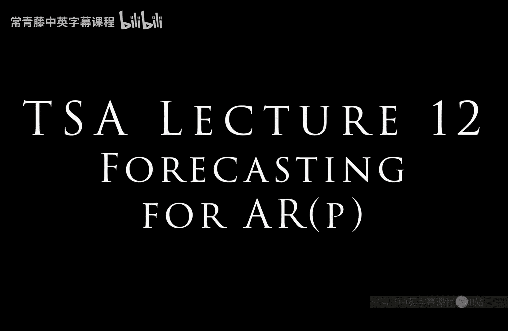
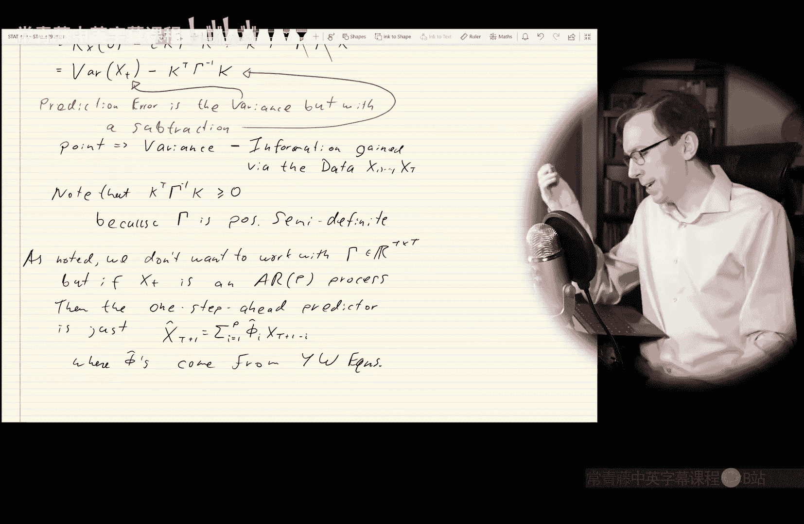

# 阿尔伯特大学【中英⚡时间序列分析｜STAT479 2021 Time Series Analysis】 p12 P12 Lecture 12： Forecasting for AR(p) -BV1nwqYBDEos_p12-

And welcome back to another lecture of statisticstistics 479 time series analysis。

 so we already talked about how to estimate terms where that is parameters for the AR autoaggressive process。

But we typically want to know not just what the terms are， but where is the process going。

 that's forecasting， that's what we're doing today。🎼あ。

So we're going to look at forecasting for the autoaggressive process In this case we're really not even going to assume that we have an autoaggressive process。

 we're just going to have to try to use the data that we have to predict the future Can we do it or is it not going to work Well that really depends on the data we have So what we're going to do is take a deeper look at that in today's lecture。

 it's going to be very similar in the sense that we have to solve a big linear system of equations and this one is really big not like the Walker it's really big and we're going to have to figure out how to deal with that so let's jump into the notes and welcome back to another lecture of statistics 479 time series analysis today we're going to continue what we were doing in the last lecture which was looking at the autoregressive process specifically how to estimate coefficients for the autoaggressive process because we're finally at the point in the course where we're going estimate things like a true statistician now。

In the last lecture， what we did was we discussed two different ways to estimate the coefficients。

 we had the U Walker equations， which was a linear system of equations that we were able to solve。

To get the coefficients。Then we looked at maximum likelihood， now maximum likelihood。

 we assume that we have a Gaussian， we have Gaussian white noise that's kind of underlying the time series process。

 it's a reasonable assumption since a lot of times noise is actually Gaussian。

 but it is key to remember that we were strictly making that Gaussian assumption when we do maximum likelihood estimation because we have a whole lot of normal distributions。

 so what we did last time was we looked at the joint distribution of our data。

And that led to something called the unconditional sum of squares。

 which led to a nonline optimization problem， which is hard to solve， I mean， okay。

 a computer can probably do it， but we can't get a nice closed form。

 and it's nice to have a nice closed form， I mean the U Walker equation was a the U Walker equations give a nice linear system to solve。

So instead， we looked into the idea ofal the conditional sum of squares where we condition on the first data point to kind of account for that weird boundary condition。

And then this is all for the AR1 by the way， if it's for an ARP we'd have to condition on the first P which we'll talk about later。

 but in that case we had a now we had a linear problem that we had to optimize and we could find a solution and what we found was that the MLE and the UL Walker equations gave almost the same thing but slightly different the MLE and the UL Walker equations behave a little bit differently around the boundary so then that leads to the question of well what should we actually use to estimate our autoregressive model and that's why we're going to start in our studio today to actually look to see what the AR function does there's always a good day when we get to start in our studio rather than writing lecture notes so let's get into our studio and see what this is all about。

All right， so we are in our studio now。And the first thing we're going to well。

 the main thing we're going to be looking at is the AR function。

 which is available just in the stats， the package， the standard package that comes with R。Now。

Well let's just see what happens when we run it right first what we need is we need some random data and as it was pointed out to me by one of you listeners at home。

 it would be really nice if we could set the random seed first so that when you go home and try it yourself you get the exact same results that I do so we're going to do that this time and we'll set the seed to be 479 because why not you know。

Okay， so now that we've set our random seed， let's generate some data。 First。

 I want a white noise process because I love having a white noise process and willll make。😊。

We'll get 500。Standard normal random variables， there's my Gaussian white noise right there。

 Now what I'd like to do。Is use the。I think it's ama， yeah， arema Sim so。

I need to double check the notation for this to make sure I do it correctly。Yes。

 so what we're going to do is we're going to simulate an AR1 process。

 I think doing it with this function is probably better than in the previous lectures when I used the filter command because the filter command。

 well， it throws around some NAs because of the way it works。

 whereas this will just kind of clean up everything for us so。What do we need well we need a model。

 which is a list component with AR， and or MA。Okay。

 so what we need is model is equal to list and then we're just going to do an ARP。For the first one。

So let's see if they have an example just to make sure that I type this in correctly， yeah。

 see we're going to do AR， we're going to pick some coefficients。

And we're not going to do MA just yet。But don't worry， we will。Okay， so going back to the top。

 we're just going to do 0。7 like we did last time， so pretty simple AR order one process。

And we're going to， let's see。What else do I need？I think somewhere there is a standard deviation。

I'm prettyty sure I saw that down here， S。Which is not part of the list object， the list here。Yeah。

 it's just for that， okay。I'm not sure what the default is it's probably one because it's always one。

 but oh I see what it's doing sorry， what it's doing is it's generating the innovations。

 which is basically the noise but we haven't talked about innovation yet with R norm and then presumably you can throw in you can throw in extra arguments that you would pass to functions like our norm like mean and a specifically the standard deviation because you wouldn't really want a non-zero mean but that means we can skip that but just for the sake of。

Accuracy， I will just put that in there， even though it defaults。Oh yes。

 and we also have to tell it how many we won， so we'll stick with 500 that should give us enough to work with without going overkill。

All right， so there's our AR one and while we're at it。

 let's just create an MA one with the exact same coefficient of 0。7。

 so we're going to switch this to MA and hit it again。And while we're at it。

 let's pick a more complex AR process。Like。Let's see we can have our 0。7， maybe minus 0。4 and plus 0。

2。Which probably is is causal， a causal linear process， I hope it is。

I guess we can plot it just to make sure it looks reasonable。Yep。

 that looks reasonable if I got it wrong， it would probably blow up anyway。

 so that's always a good quick check to make sure I didn't do anything。That wrong， and lastly。

 let's do an armor。Oh， I don't know how about one， one we'll just put together。The AR piece with a 0。

7 and the MA piece with a 0。7 and this should give us lots of different time series to look at。

Now remember so far we're just going to do estimation for AR processes。

 so we want to see what happens if we try to estimate fit an AR model to our data when it's not an AR process。

 that's another thing we want to learn about。Okay， so。Now， why don't we look at all our time series？

So we have MF call。MF row is。2 two， and let's just plot them。We have the AR1。

And it looks like that Okay， cool。 We've got the M1， and it looks like。😊，That okay， also cool。

 kind of looks similar。At least from our eyes， right？

Though I guess it does have a little bit different。

 the AR one almost is starting to tend towards a random walk as the coefficient gets bigger。

 whereas the MA1 doesn't do that what else did we have we had an AR3 process which I already plotted but we'll plotted again in the big grid。

And we had an Arma 11。And we get something that looks like that cool。

 so at least the armor of 1 one looks a little almost emaciated in the sense that it's kind of like。

Dancing around a bit a little bit thinner than the other ones。

 the other ones look like good hardy noise processes， except maybe AR ones on the fence。Anyway。

 now that we've done that， well， let's go back and look the point I guess I wanted to make by plotting them is when you just plot them。

 it's not obvious what's going on， right？They all look pretty noisy。

 but ape you know just by staring at it， I can't tell what process is it is maybe some brilliant person who does a lot of financial analysis and stare at time series 24 7 can spot identify it。

 but I can't， so we're going to use a function to figure it out for us。Now。

 going back to the AR function。Well we see a couple things in R， if you see this dot dot dot。

 what is telling you is that there are lots of different versions of the same function and you might see YW and remember a you walker Berg。

 I don't think we know what Berg is， but then effectively the idea is that you can take the AR function and you can specify the method and it will kind of jump into one of these other。

Method， so。We see you a walker， that's the default。

 that's pretty good because that's the one we learned about， then there is something called Berg。OLS。

 which is probably ordinary least squares because it's statistics， we have MLE and then we have YW。

 which I assume is also just。An alternative way to specify your walker and nothing actually different。

But let's go look at the method。Yeah， default to your a walker。Yes。And here we have so。

What are we doing well it talks about the AR model here， it centers it by M。

 the mean and then it fits P parameters， notice that it's subtracting M from every piece。

 which is centering the process。And it says that AR is actually just a raper for these other methods。

And let's see if it's going to tell us what they are。Okay， so first of all。

 the the AR function is not just going to fit A and AR model。

 it's going to fit a lot of them and it's going to use AIC a standard model selection criteria and which you probably saw especially if you took regression with me。

 then you would have seen that because we talk about it when we do model selection and specifically variable selection in。

Linear regression in this case。嗯。What we're doing is we're going to be using AIC， I guess。

Well it says true，'ll see how much maybe there's a way to change it。

 but basically it defaults to using AIC to select the best model。Now。

It has a couple little things where it says MLE performs true maximum likelihood estimation。

I'm not sure exactly what means by true maximum likelihood estimation。But yeah。

 I was hoping you would give more information on the actual methods。AR Brg。

 it says allows two methods to estimate the innovations variance。

 which is just the variance of like the noise process here。

One is based on an algorithm that we haven't talked about yet， but we will talk about。

And method two is the mean sum of squares and a forward backward prediction， so basically。In summary。

 fitting these things is not straightforward because it's actually also a big linear system of equations。

If you can ever avoid actually doinging a matrix inverse。

 you probably should and what we're going to learn about later is that even solving the U walker equations。

 you don't have to necessarily invert a large P by P matrix now， okay。

 if P by P is not that big then who really cares， but still， it's worth taking note of。

Anyway i'm going to stop meandering around let's see what this function can do right I want to see what it can actually do with some data so let's give it white noise and what does it do all right order zero we did it and it finds that the estimated stigma squared variance is is a little bit less than one the answer is supposed to be one so it's pretty close I think that'ss that's a win。

And let's try AR1。All right， so it got the coefficient pretty close to 0。7， didn't quite， I mean。

 it's a little bit higher， but it's within sort of the air and it did get a pretty good estimate of the noise。

I wonder what would happen if we gave it an MA one right it's not an it's meant to only fit auto aggressive processes so what happens if we do MA1 wow it's a lot of coefficients so。

It actually gave us a bunch of different coefficients here for our MA process。

 which seemed to be decaying towards zero fairly quickly what in the world happened here。

 seven kind of got let's no good。Let's see if we give it a little bit more room there we go。

 that just looked odd。Okay， so we notice a couple things。

 one is the sinus flipping and two is that the coefficients seem to be roughly going to zero in magnitude okay。

 they jump around a little bit at the end， but at least for the first bit they're kind of decaying the first one is kind of close to 0。

7 the next one。Kind of close to 0。7 squared which would be 0。49 and hey， I wonder what 0。7 cubed is。

 I'm pretty sure7 cubed is was it three， no two4 way， I we'll just do it。Oh343 okay。

 so this isn't quite 343， but it's looking close， you know。

 statistical error and all that and what's seven to the fourth oh well 024 okay。

 so that's kind of tracking。And if we do this to the fifth。

 I think we're at oh168 well this is 159 that's pretty good what i'm trying to get at here is that we actually have a geometric decay。

 the idea is that if you recall，That if we have an AR process and that AR process is causal。

 then we can write it in as a。As a linear process， a linear process is an infinite sum of white noise terms going into the past。

 so it's kind of like an AR process。Is an infinite MA process。Right？

And the reverse is kind of true too， remember that if we have an MA process that is invertible。

 that means we can write it as an infinite sum of some coefficient times Xt where Xt goes into the past。

So what we actually have here is we're showing that if we try to treat an MA1 process。

RAs an autoregressive process， what we get are coefficients that will geometrically decay to zero。

 they have to have some nice fast decay so that they're summable， absolutely absolutely summable。

 I think it's absolutely summable。At least square summable。

 but I think absolutely summable is what we want regardless it's geometric。

 it decays really fast so you can definitely sum these things up。

But where was I yeah the point is is that you can treat an MA process as an infinite AR process and you can treat an AR process as an infinite MA process。

 so if you try to fit one to the other， you probably get something that looks like this where it just picks a really big order and fits as many coefficients as it can because in some sense。

Every coefficient is non zero， but eventually the value of the coefficient is so close to zero that the noise overwhelms it。

So it's kind of a neat thing to see that happen， and we still got a pretty good estimate of our variant sigma squared。

Anyway， let's see if it does a good job with the AR3 process。Okay， so it almost did。

 it gave us an AR4 so can't win them all， but it did get the coefficients pretty close。

 it found my 0。7 my minus 0。4， my plus 0。2， this one's supposed to be zero again can't get them all every time but it is。

 but it did do a fairly good job and it just decided that this should have an order for based on the AIC criteria that it is using。

 which is kind of behind the scenes I think。If we fit this， if we save this off。

 we might be able to look at more information。Because if you notice the fitted thing is not just the model。

 but it'll give us a value for like the AIC so presumably what this is telling us is the AIC I guess normalized at this one so you can see how much I guess worse every other model is doing so three the third order and the fifth order or not much different than the fourth order but you can see like a second order process has a much higher AIC six and seven start to get higher as well。

 so you can use that to kind of gauge that remember AIC is just telling us what the best model is with respect to AIC if you have two models where the AIC is really close okay one might be a little bit smaller than the other but if it's not a big difference then the models are pretty close and pretty equivalent so you have to remember to kind of think on your feet a little bit when you when you do this right we don't want to restrict。

ourself to say， a it has to be four because that's the smallest AIC Well。

 three and five also had kind of small AIs too， so they'll probably give you a very similar fit for the number of parameters。

Anyway let's see what else we can get out of this thing so we have all of that I'm not sure if there's anything else really interesting。

 we can look at the residuals which would be nice because we can take the residuals and plug them into some of the things we looked at last time to see if our residuals look like they are uncorrelated and if our residuals are uncorrelated that's more evidence that we have a good fit to our model right we can do that later。

I forget if there's a summary command， so let's just see if it does anything interesting sometimes in R we get nice summaries。

 so nope it's just going to tell me it's a big list with a bunch of junk in it so yeah。

 they never implemented that， but that's okay。Oh， and we have one more to do。

Which is fit an AR model。Two my Arma 11， so what do you think is going to happen here？

We have the AR one piece， but we also have an MA one piece。

 so in a sense the two are going to combine。And what we should see is something very similar to fitting for the MA piece。

 but we're going to have in I think they should add together if I'm doing the math in my head correctly。

 so the first coefficient。I would guess would be around a 1。4 if you have 0。7 plus 0。7。

Unless the two things， no， I think that would actually make sense， unless they cancel out。

 I forget if there's a minus sign in there， let's just see what happens。Ah。

 I overwrote my other model with it。Now it was 1。4 good， my intuition was correct。

 which is now we actually have something about 1。4 here for our first coefficient。

 but we still have that geometric decay being realized as we move further out so again when you see something like this like an AR process with a very high order you have to ask yourself is this an AR process with a high order or is it just an ArRma or an MA process with a low order right it could very well and often is the latter case but this AR function is only fitting AR models and that's why we might end up with lots of coefficients so it is something to be aware of in practice you're probably just going to use something like autoarma to fit an ama model to your data it's faster and it fits much many more models but it's still good to know what's going on here。

And once again， it does a really good job at estimating the variance。

 which makes me think it's probably going to do a good job at getting the residuals。Yeah。

 let's check the residuals， why not？Let's see what they look like， so I think I saved this already。

 but。Let's go back to AR3。And maybe we'll do Arma 11。So I'm just running on the fly here。

 let's see what happens if we run our box test。So what we can do is we can do MD AR3。

 which is the fitted model for the AR3 process， we can extract the residuals from it。

And now we can run this， but I think what we need to do is identify that we actually fit some。

 we fit some parameters so we have to subtract those degrees of freedom。

 in this case I believe it fit four if I recall right。

 because it wasn't AR3 but it the AR function decided I'm going to fit four parameters so there should be four here。

Unless it' one for the mean， we'll just stick with four。And all right。

 that did not work at all because I got a negative three degrees of freedom because I forgot to change the lag rookie mistake right。

 So if we change the lag to four well now I have zero degrees of freedom that's no good yeah I change the lag to five now I have one degree of freedom and a very uninteresting P value。

 which is telling me that yeah， we probably have a uncorrelated residuals。Now we can。

 if I remember the。This gonna do it for me Yes， excellent okay。

 we can run either test we still get nothing that interesting out I could bump up the lag to something crazy like 20 and yeah now we just have an absurdly high P value close to one so yeah nothing interesting to see here but we don't see at the very least if we try different lags out maybe ones that are more sensible we don't see any significant P values here so it's a good sense that we actually have a good fit for our data even though it's the wrong order it's an AR4 whereas we know the answer is an AR3 it's still fitting the data well enough that the residuals look like they are uncorrelated which is what we want right we want our residuals to look like white noise uncorrelated white noise。

For fun， why don't we see what happens with that MA or let's do the RO because I already saved it。

If we look at the residuals for the Arma， now in this case， we have to consider the fact that we fit。

 I think it was 11 coefficients。Let's go back up and find it。Yeah， it fit 11 coefficients。

 so we have to subtract 11 degrees of freedom， which means let's bump this lag up to 12 and see what happens and okay。

 yeah we still get a。Insignificant P value， that's good。

 we could try a few more just to see what happens， but nothing seems that exciting here。

So that's good that means that even though we fit an AR process to an Arma 11 data set。

 we still get a good fit and it's because if we actually wrote out that AR process we would realize that it's really close to an ArA process mathematically because again the coefficients。

Of the Ar process as written as an AR process will'll go to zero fairly fast。

 which means that we actually have something we can work with here now， yes。

 we have lost too many degrees of freedom than we should have because we should only be fitting two parameters。

 one for the AR and one for the MA instead we fit 11 parameters for the AR and0 for the MA because it doesn't fit MA but。

Yeah， so that gives you an idea of what the AR function does。

 but there's one thing we didn't talk about yet， what I kind of talked about in the beginning。

 but we didn't try， which is that the AR function defaults to you Walker but we might want to know well what happens if we change that so why don't we try that again fitting an AR3？

So again， if we try to fit this AR3 or fit in an autoregressive model to an AR3 through our AR3 data。

 we get something that looks like that with our order for autoregressive process but this is the U walker equation。

 I wonder what would happen if we change this to MLE。

 which is the other method we talked about and okay it did basically the same thing。

 but if you notice the coefficient or slightly different now they're different in like the thousandsth and the 1000th place。

 so okay they're not that different but the point is that they're slightly different and they're slightly different based on the edge behavior。

 so because this is an AR4 process， I guess that means that it's going to be the boundary conditions on the first four and the last four。

Data points。It gives us a very slightly different estimate for sigma squared， but again。

 nothing noteworth nothing really that noteworthy different。

But we could try some other ones just to see what happens， I think OLS， oh。

 so OLS went a little bit crazier and decided to include lots more parameters。

That's kind of noteworthy。 it decided it's order  seven but parameters five through seven。

 especially seven are all quite small， so that one is a you know， suspect， but that's okay。

We can do Berg， Berg gives us， I'm not actually sure what Berg is doing。

 like you probably look that up in the documentation I think they cite。

 I think I saw before that they cite a paper or something here。Or oh， Berg is okay。

 I doing something with the Levin and Durban recursion。Regardless。

 we're getting something that is again extremely close to the other ones like MLE and the U Walker equation。

 which I think just fell off the top of the page so let's do it again yeah so we can look at comparison wise so again。

They're all kind of doing the exact same thing and you see this a lot in statistics where it's oh look。

 we have four different ways to fit this model。They all kind of give you the same answer。So okay。

 there's nothing too exciting going on here， but it is worth noting what is happening here and yeah maybe you might find a situation where you actually get some significant difference in the model fitted now thus far I usually have not been able to find anything like that but you never know maybe for the MA model why don't we try that before we go back to the notes you Walker gives us a ninth order autoregressive process MLE gives us a ninth order autoregressive process。

I think OLS sometimes does weird things， this one gave us a six order。

 so it actually gave us fewer terms this time around。So yeah， that's something to just be aware of。

 again， the other thing to note is that most of these models are so close to each other that even if you have some extra terms that are extremely small。

 because the coefficients are so small， they're not going to make a huge difference in the fit。

 you're probably in all these cases going to get decent residual testing with things like the box test function。

So overall， yeah， you could probably just use the U Walker equation。

 I don't have a good reason to suggest that you use one or the other。

 but it's good to know that they're there。Anyway， we're going to jump back into the notes now because if you notice there's something else here。

 the predict function， because we can also do prediction or what they like to call forecasting in time series。

But we don't know how to do that yet， so we should probably jump back into the notes and write it all out。

And now we're back in well not our studio we are back in oneNote where we can go through our notes and try to work this all out mathematically so last time again we talked about this we did estimating the coefficients we ended with the idea of MLE so I did want to mention one thing last time。

😊，We did you a walker。4。ARP， and we did MLLE for AR1。

 and we showed that at least when p is equal to1， the answer you get out is really close for both of those methods and we just saw that in our studio that it is in fact the case。

Now。The one thing I wanted to note。We can also。Do。MLE for ARP， as was just done， at least in R。

But it's really messy， and I'm not going to write it out。嗯。But。The equations。Car。Messier。Briefly。

 though， I did want to point out that if you recall what we did last time was we wrote the joint density function。

In terms of a product， not N， the T， the product of conditional density functions。

 So we started off with x1。 and then we had F of。X2 given x1 and so on all the way up to F of x capital T。

 given x capital t minus1。Well， for。ARP。We do the same thing， but we would need to condition。

Going back P。So we'd still have an f of x1， and then we'd have an f of x2 given x1。

 but then we'd have an f of x3 given x2 and x1 assuming that p is at least two。

 otherwise we'd just be in the same case we were above。

And going forward with this very large product。What we would have is f of x。I guess。Pw peith order？

So I guess it would be P plus one。Given X P to x1。And then the next thing we would multiply by。

Would be F of Xp plus2 conditioned on Xp plus1。Through X2 and so on all the way up to F of X T conditioned on F of T minus or x t minus1 X t minus p。

 So again， this just kind of hints at the thing that we can do everything again。

 everything becomes a little bit messier and now when we do a conditional sum of squares。

 we would need to condition on the first p observations。 So the bigger the model。

 the more observations we have to condition on in order to。

Sort of fix the maximum likelihood equation。Or just solve it I guess now and linearly if that's easy or not。

 to be honest， I'm not actually sure what that AR function is doing when I type in MLE。

 is it doing the MLE with the unconditional sum of squares or is it using the conditional sum of squares might be worth digging into the documentation or the code itself to find out。

 but yeah I'm not actually sure off the top of my head so maybe we'll leave that for a future investigation when we jump back into our studio。

But for now。We're going to move on to the next section。Which is forecasting。For ARP。

So we want to do forecasting， that is we want to predict， because very often in time series。

 whether it's climate data， whether it's financial data or whether it's something else， COVID data。

 for example。You kind of want to fit a model， but you really want to know where's that model going and what can we predict？

How do we do prediction in this case， Well， the problem at hand？To solve。Is given。X1。Through X T。

We want。To predict。I。e。 forecast， as they like to say， in time series language， well， future values。

Like。Xt plus1。Through Xt plus M for whatever M is。So first of all， let's just。Assume。X T is。

Stationary。But。Not。Necessarily。And A our process。So we just have some stationary time series process and what we want to do is we want to try to see what happens if we use past values to predict future values。

The if that's the problem， then I guess the。Solution is use。Past。To predict future， it's a good idea。

Rather than going backwards， though， we will talk about the idea of backing。

 which is using the future values to forecast into the past。 That's actually a thing。

 and we'll talk about it later， not yet though that's gonna be a future lecture。

 So that'll be a little teaser for a future video lecture。😊，But anyway。

 we want to use the past to predict。Future values。And we're going to do via。A linear model。

And least squares because。It's often always lease squares and statistics。

 at least in undergrad statistics and very often outside of undergrad statistics。

 you're often always doing lease squares， so what we want。系二。

We want something that's going to look like well。X hat。Capital T plus M M could be any value， 1， two。

 three， whatever， and what we want to do is we want to predict it based on well。

 the entire not equals。The entire data set so we have aOT。And then we have a little T。

From one to capital T。80。X T so in this case we're using a linear model。

 but we're considering the entire time series， which means there's a ton of parameters here。

 there's T which could be big like 500 in my example or more and then there's an a n which is just going to be like a I guess an intercept or a mean term。

But the idea is we can do that， right， at least mathematically。

 we can write that down and see what happens。So let's see what happens。Well， what we want to do is。

Basically to get。A。AT will say。The A hat for T from zero now with the intercept term up to capital T。

We solve the following least squares problem， which is we want the arg min。For the vector。

 a n through a capital t， which is going to be some giant real valued， I guess。

 t plus one vector and what we want to do is we want to minimize well。

 the squared error because like I said， that's what we always want to minimize almost always it seems like in statistics。

Is let's minimize the squared air and see what happens。Well， to write it all out。1。地知。All right。

 so we have that and yeah， we're going to just take derivatives and try to figure out what we need to solve right。

 because what would you do in this case well？I would take derivatives with respect to the parameters a through a capital T。

 and I would set them all equal to the zero and then solve a big system of equations。

 right to try to find the minimizer。Sorry， getting a little hot。

 so I thought we'll get rid of the sweatshirt and continue onward。What are we doing well first？

We would want to take a derivative with respect to a not and what does that give us well if we take the derivative and we're going to just swap derivative and expectation because okay。

 the integral makes sense， it works， it's you know all that stuff's good so what do we do。

 well when we take the derivative there。I'm just going to write it out here。

 what we would end up with is still an expectation。

 but what we won is we won zero is equal to the expected value and then if we take the derivative on the inside of the expectation with respect to a not。

Well， we're going to get a two that because we take the derivative of a quadratic。

 but nobody really cares about the two， and in fact we don't really care about the minus sign either。

 but I will write it there just for consistency or，Maybe may not consistency。

 but to be precise and to make sure nobody gets lost。Anyway， we take the derivative。

 the quadratic goes away and we're left with just。This。All right。Cool。

 so we have an equation to solve。Well， kinda。Yeah I guess I can write it more simply， though。

 if we note that we can actually write this whole thing as X hat T because no T plus M， sorry。

Because this， no capital T plus M。Because this expression is going to eventually be the estimator that we want and just to keep it a little bit cleaner。

 we can just rewrite this。Simply as zero is equal to the expected value， again。

 I can divide by minus2， it's just a coefficient and ultimately I just want to find a root for this thing。

So what we end up with is just x t plus m minus x hat t plus M。All right。

 so that looks a lot cleaner Now， what would happen if we did the same thing。

 but we took the derivative with respect to a1。Well， almost the exact same thing happens。

What we would get is we'd have our minus2， sure， of course。We still have an expectation here。

But now when we take our derivative， well， a couple things happen。

 we get the same thing on the inside of the square， which is the Xt plus M minus x hat。T plus。

But when we take the derivative of the inside term， right chain rule。

 when we take the derivative of the inside term with respect to a1。We don't just get a minus1 out。

 we actually get a minus X1 out。I lost the plus sign there。So we actually get an x1 here。Okay。

 so that changed things slightly and of course this two is minus2 is kind of irrelevant so we can just kind of cross it out and the same with the minus sign here we don't need that。

Okay， so what if we went forward well every time every subsequent term is going to look more or less the same。

 we can actually just take this all the way down to our final derivative a of capital T。

 which is going to look like the expected value of。X， T plus M minus X hat T plus M。X capital T。Okay。

 so now we have a， well， it looks kind of like a big system of equations。

 but we have to figure out what happens now when we take these expectations。Well。

Two things happen in the first case。So let's start with this case。And we note that in this case。

 we're just taking the expected value of xt plus M and x hat T plus M， so what does that mean well？

What this means is that we have to have the expected value。

Of xt plus m has to equal the expected value of x hat t plus M。So that means that our estimator。

 our least squares estimator or。I guess our least squares predictor。

 I should say it's technically we're doing prediction here。

 even though it's very close to the estimation that we did last time。

The predictor that we have here has to have the same mean as the process itself。

 now the process is stationary with mean mu， so that means this whole thing has to equal mu。

All right and。And therefore， if we recall that x hat is actually this sum up here。

 this linear combination， that means that we would have mu is equal to a0aught。五嗯。Oh yeah， plus。

The sum。T from1 to capital T of8 t and what happens when you take the expectation of all these Xts well they're just mue it's a stationary process remember I said we don't have to assume that we have an autoregressive process。

 but we are assuming we have a stationary process because what that means is we can rearrange the terms。

And say at once again， another， therefore。We find that a not。Is actually going to be mu。

1 minus the sum of all the other terms or the other coefficients， I should say A。Okay。

 so what does that give us well？Once again。I'll say this means。That。

I guess I could just keep writing there for but kind of get tired of writing dot dot dot over and over again。

 so this means that if we actually plug this in， we end up with something that looks like X hatt capital T plus m R predictor for the。

I used to little tea there should be I think big tea for consistency is sake。

 I need to go back and change that。UWhat we end up with here is cap this basically this thing。A T。

 and then we have X T minus mu。 Okay， and what we're basically doing now is we have this is a。

Mean  zero。Time series。So what happens is。The estimator that we would have for the mean or for the for a not basically subtracts mu from all of the terms。

 which means we have a mean zero time series and furthermore I can actually just turn this into a minus sign and this into an equal sign and now I have that the lefthand side is also mean zero because as we said the mean of my predictor has to equal the mean of the process itself。

 which is mu if I have a。Least squares predictor or estimator predictor， sorry。

I always want to say estimator it。So what does all this mean， well。

 it means like what I like to say all the time， which is just assume the mean is zero and get rid of it。

Therefore。We。Can just。Center。The process。About。X bar。And assume。Going forward。In the sequel。

 as they like to say， but I always found that to be such a strange term to use。

So we assume going forward that。X T has or is mean zero。So basically what I'm saying is。Okay。

 if you actually do this， you just estimate the mean as you always do by summing up for a stationary process。

 sum up all the data divide by the total， and you take X bar and you take your time series。

 you subtract X bar， it now mean zero， good stuff and we can proceed with all the more complicated bits。

So now what we're going to do is we're going to specify things yet again because again。

 it's a lot easier if we work。Well， if we tried to do。

 say what they would call a one step ahead estimator or prediction。So let's try that。

And as I read my notes， I realized they're riddled with typos and syntax errors。

 probably because I wrote these while stressed out during the first COVID lockdown。

 so I will go back and try to fix those and if I forget。

 please remind me at some future point if you see those typos still not being corrected。Anyway。

 what do we have here？Returning to。The other。Equations。Above。What do we have well。

 we have that zero is equal to the expected value in this case， we're going to say。Let。M equal1。

For what is coming next， this is what they would call the one step ahead prediction predictor。

 oftentimes they like to look at things like the one step ahead prediction error。

 which is like as you go through your data set， how well are we predicting the next day from the previous time points。

 but at this point we're just going to try to predict the next time point。

 which is going to be capital T plus one。So we have X T plus1。Minus X hat T plus1 multiplied by x1。

 and that's supposed to be equal to zero。 and let's do it again for the next one， which is。

The expected value of x t plus 1 minus x hat t plus 1， and now we're multiplying by x2。

And we can keep this going until we get all the way down to the expected value of x t plus 1 minus x hat t plus1 times x capital T and now we've run out of data right we went all the way from one to capital T now if we stare at these we might realize well wait a minute。

 if I'm taking the expectation of the product of X at some time point and x at a different time point。

 that's an autocovariance again， right autocovariance。

 like I told of you all of time series just autocovariance， don't even worry about anything else。

 that's alive， but it's like 90% autocovariance， not 100%。Anyway。Yeah， so what does that mean well。

 if we do this and we just basically take the expectation with respect to everything。

Then what we get is we get a Kx。At lag T for x1 times xt plus 1， and then in our summation。

We end up with something that's going to look like tea。From one to capital T of a。

Did I switch to alphapha where do I Q me as A？We're going to keep it with A even though I think I may have accidentally switched。

 oh no， I was using alpha the whole time， I just wasn't reading carefully enough need to get my prescription updated。

 that's okay， it doesn't really matter they both look the same。Anyway。

 we have an Xk and then we're going to have little T。Minus one because remember what X hat is。

 x hat has fallen off the top of the page。But X hat is going to be the sum。T from1 to capital T。

 So if I were to take this thing and multiply it by an x。one。

 and then take an expectation of that thing， then well， what's happening I'm going to have。Well。

 a1 times the expected value of x1 times x1， that's just the auto well that's the variance。

 the autocovariance at lag0， then it's two，2 and one well that's at lag1 and then three。

 three and one that's at lag two and so on so what we end up with is something that looks like this。

Where I just have a long string of。Auto covariance is being summed up with various coefficients。

If we do that for the second one here， well， now I'm not going to get a t。

 I'm going to get a t plus one minus2， which is a capital t minus1。And now things get， oh， no。

 it's fine。We can just write this simply。As not as T and this is now going to be Kx t minus2 and。

I'm going to say recall。That。K。X of minus H is equal to Kx at plus H by symmetry。

 so I can don't have to worry about sheovlving an absolute value in there or anything when when little t is equal to1。

 I'd have kX at minus1， but that's the same as Kx at plus1。

 so it's good to remember that for what's to come when we write this as a linear system of equations。

 but for now it doesn't really matter。Okay， and what's the last one。

 it's always good to do at least the first and the last。

 so we know where we're starting and where we're going。Well。

 now we're going to have a t plus1 minus t， so the lag is just one。And in this case。

 we're going to have a t from one to capital t and we're going to have a， well。

 it's going to be little t minus capital t but all of those are going to be negative or zero。

 so you can actually flip it by multiplying by minus1。And we can。Right， capital t minus t。I'll see。

Or just to be clear， we could write it like this， but again， symmetry doesn't matter。

Multiplily by minus one as many times as you like， but after two it's sort of pointless。

So now we have a giant system of equations cool。 What does that mean， Well。

 that means what we're going to do is if we。Identify the fact that we basically have a well。

We have a zero vector here。All right， so what do we have here well what we have is a big system of equations the first thing we're going to have is a big zero vector。

Actually， why I， man， I we'll write it out like that。And this thing is going to be， well。

 we're going to have a big vector here。Of auto covariances from capital T。All the way down to one。

Then we're going to subtract from that， well， what happens when we have a big sum like this。

 what we have？Is a matrix vector multiplication。 So first， we're going to have a matrix。

 That matrix is going to be a big matrix of。Auto covariances， and then the question is。

 did I actually index this the way that I want to index this？Let's see。Well， when t is equal to1。

 this is going to be zero， and then in the last case when t is equal to capital t。

 it's going to be zero， so yes， everything looks good and I'm going to get something that looks like this。

All the way down the diagonal at the bottom here， we're going to have a K X at lag T。 It is T， right。

 and not t minus1。 Nope， I'm wrong。 It is t 1 or my。

Danger sense was working where I'm like wait wait we're starting at zero so we probably need t minus1 there And then over here。

 of course we're just gonna get a Kx0 and up here will have another Kx capital t minus1。

 So here's our giant matrix it does have common diagonal so that's always a nice thing to note that every diagonal is fixed we start off with the main diagonal being the variance then the first the print。

 the first off diagonals are going to be the autocovariance at lag1 then lag2 lag3 lag for all the way up to lag t minus1。

Again， we don't typically want to go that far out。Computationally， but mathematically。

 we're all still good here。If we somehow knew exactly what the autocovariance was for every possible lag。

esttimating it that far out is a bad idea， but we'll worry about that in the in what' to come。

And we have a vector of coefficients here。Up to capital T。So if we rearrange the equation。

 if we call this， we basically get vector K。Is equal to matrix gamma。

 which I'm going to call it gamma again because it looks basically the same as what we saw in the U walker equations with one noteworthy difference and I'm just going to say a。

 and there is our nice system of equations。So idea is that this。Is。Just。Like youll walker， but。Gamma。

In。You walker was P by P Okay， and P is probably not that big again。

 you're not going want to fit like a 1001 hundred0th order auto regressive process right you're fitting like a fourth order or like a 11th order like R did so 11 by 11 not a big deal。

 but now。Yeah。Whereas this。Gamma is。T by T now that's kind of a problem right we don't want to invert that because that could be well in my R example 500 by 500。

 but you could easily have it even more if you're doing even faster or more highly observed data right T can be quite large we're not going to want to invert that further more we don't actually have the autocovariances Kx we would have to estimate them K hat X and remember the further out you go lagwise the worse your  estimation gets and if you're trying to invert something with a bunch of shifty estimators that are kind of noisy。

 there's gonna to be a lot of numerical and instability in this and you're going to run into some trouble so yes。

 this is roughly what's going on mathematicalmatically I can write it down as a beautiful linear system of equations in practice we don't actually want to solve this thing。

But。What could we do， Well， let's go a little bit further and at least study this。Yeah。

 based on how much time I've been talking already， what we're going to do is we're going to finish our study of this estimate this in a mathematical context。

 and then in the next lecture we're going to talk about how do we actually work with this because that thing looks pretty cool。

 it looks very simple。😊，But we can't work with it too big， it's a nasty system of equations。

With data， it's not going to work， we need something better。

 but that doesn't mean that we cant keep pushing ahead mathematically to understand what's going on。

So effectively。Yeah。So from this。We can write。A， the coefficient vector is equal to gamma inverse k。

 assuming。That。Gamma inverse exists。It probably should if you have a reasonable time series process。

 but yes， you could write down some crazy ones that have。You know， I mean。

I guess perhaps the easiest one would be if the process was constant， which would be really stupid。

 but yeah， you could have a constant process in which case。

 I guess all of the auto covariances would be the same everything would be perfectly correlated so that would be well troublesome to say the least and then yeah things would go awry but。

Forgetting all numerical stability， singular issues， assume this exists。

 then we can write down our coefficients a， so that's nice then。Therefore。Our。One step。Ahead。

Predictor， prediction。Is。X hat。T-1。 Well， what was this， right。

 This is just going to be the dot product of the a vector with。All the previous x's， x1。

Through x capital。X capital T。Okay， well we have a as gamma inverse k， so we can actually write this。

Well。In a little bit of a funny way， because when you do the dot product。

 this is actually a transposed x if we treat x as the vector of values。

 the time series from one to capital T。Then what we're going to end up with is something that looks like k transpose gamma inverse again gamma is symmetric。

 it's inverse is symmetric， I don't have to throw a transpose in there。

 which makes everything look a little bit nicer and there we have it our one step ahead prediction estimator assuming that I had access to well k and gamma。

So in this case， we can actually compute the mean squared prediction error。Which is nice。The mean。

Squared。Prediction。Air。U。I will say based。On K， X， not。Kx hat， right because？Ultimately。

 when you estimate the autocovariance， you're going to have more air or more sources for air in this idealized setting。

 I'm just imagining that somebody you know reached into their pocket and handed you the autocovariance and said here you go this is the autocovariance。

 go have fun with it and then you can just plug it in and run with it but that typically doesn't happen。

 but we can still mathematically consider what this would be。Our mean squared prediction error。

 if we go all the way back to where we started is going to be the difference between Xt plus1 and our predict。

 our predictor here is going to be k transpose gamma inverse。X vectorter squared。Al right。Well。

 what happens when we expand that thing？Well， when we expand that thing？What do we get Well。

 we're going to get x T plus one squared we're going to get， all right。

 we're going to get a couple things， it's going to look a little bit。Messy， but these things。

 even though this is a vector times a matrix times a vector。

 it is just a real number so we can treat it as a real number and we would get to the cross term here。

 which would be two。K transpose gamma inverse x and then multiplied by xt with the somewhat annoying notation that x here is a vector and x sub oh。

 t plus1 capital t plus1 is just a single value， a real number。And lastly。

 we're going to get this thing times itself， but when you multiply one of these things by itself。

 you have to。Well you have to transpose it to make it kind of make sense。

 so what we're going to get is something that's going to look like k transpose gamma inverse X。

 then the transpose of this， which is x transpose gamma inverse again it's symmetric。

 I don't need to throw a T in there k。All right， so we got that big thing。What can we do with that。

 well what we're going to do is we're going to go one by one and take the expectation of each piece。

So we have one piece， two piece， three piece。All right， so。

What we have here is just the first term is really just the expectation of the process squared。

 it's the variance， it's the auto covariance at lag zero， that's easy enough。

What happens to this next piece， well in this next piece what we're doing is we're taking the first stuff is not a random variable again。

 because we're not estimating the autocovariant， we're just pretending that somebody gave us the autocovariance。

 so the only random bit is actually if we erase this line is going to be this last part that we have to take the expectation of。

Now the expectation of that is just going to be the expectation of x1 all the way to x capital T times X T plus1。

 we already have that that's vector K right that is exactly this vector K except for the fact that。

Is it upside down？No， it's not， of course not， because it starts x goes from1 to t。

 therefore the top auto covariance is going to be t capital T all the way down to1 one to make sure I didn't reverse the vector there accidentally。

But we're good。 we got that and then the last one。 and then similarly。

 the only thing we actually have to take an expected value of is。😊，This thing in the middle， well。

 when you have Xx transpose。That looks a lot like a covariance matrix in this case it is going to be right every entry。

Maybe I'll write that off to the side just for clarity's sake， the IJth entry。Is。

What X now I have to figure it out， I guess it's going to be x sub I times x sub j。

 so that's actually not that hard。 I was just making it more of a problem than I thought。

So I guess if we were to take the expected value of this thing。

We end up with just the auto covariance at lag i minus J。

Well wait a minute we've already seen that that's exactly gamma right。

 that's this crazy giant gamma matrix here， which is just saying I minus J is just saying how far away am I from the main diagonal if I'm on the main diagonal I equals J the index is zero if I'm one off I minus J is equal to one or minus1 doesn't matter because of symmetry we get a1 and so on。

Yeah， so it turns out that thing is just gamma and we end up with k transpose， gamma， inverse， gamma。

 gamma inverse， K， then we can cancel out one of these gammas and gamma inverse， well。

 the gamma with a gamma inverse。Then it turns out that the second two terms， they don't cancel out。

I'm going to write this as the variance。Of X。T， well， let's put capital。Yeah。

 I'll just write the variance of Xt。It's constant， the variance is the same no matter where we are。

 and then we're going to be left with just a k transpose。Gamma， inverse， okay。All right。

 so that's kind of a nice form。So this is for our one step ahead prediction。

 So what does this mean like how do we interpret this right because I'm writing this down so we can stare at it and try to make some sense out of it Well it says that the。

Prediction error。Is the variance？That's reasonable。it's saying， well。

 if I have to predict to the next point it。We know what we know what the noise is。

 the noise that's coming into play is that whatever the variance of Xt is sigma squared or I guess。

 no actually in this case， sigma squared would be the white noise variance。

 depending on the process we have here， the variance will differ， but it's just the variance。

 but then we also，嗯。He has the variance but。With。嗯。A subtraction。

Which is this piece that I have to loop all the way around to point my arrow at lest I cross the sentence。

So what is that piece Well， that piece is a big quadratic form of。I guess auto covariances。

 So the point。Is that it's。The variance。Minus the。Information。Gained。V。The data。

So that's what that second piece is telling us it's saying that the mean squared error is going to。

Be reduced。 It's going to start at the variance。 And if， if the auto covariance。

 if K is just0 everywhere except， of course， at。Except of course for the variance。

 which is the autocovariance at lag zero， but for all positive non zero for all non-zero lags。

 if the autocovariance is just a zero， the second term vanishes and it tells us that our mean squared prediction error is just the variance because it's kind of saying。

 you know what？That's the area you're going to get。

 you can't do any better than the variance of the noise process。

But when the autocovariance vector K is not all zeros。

Then things get more interesting because what that's going to allow us to do is it's going to。

It's going to reduce the mean squared error， and then you might be asking yourself well。

 wait a minute。Is that thing always going to be positive or could it be negative and the answer is yes。

 it actually has to be positive or at least non zero， so note that。

K transpose gamma inverse K is necessarily non negative because。Gamma is positive， semi。Definite。

This was something I think we talked about back in like the second lecture when I introduced auto covariance I said a autocovariance is you know positive definite and I'm like。

 okay， why do we care well this is a good reason why we care because now 10 lectures later。

 we find out that that positive definite or just to generalize it positive semideiniteness in case we have some stupid like edge condition。

😊，Allows us to identify that。The mean squared error。

 the mean squared prediction error can be no greater than the variance of the process and ideally we'll be getting some good information from x1 through x capital T and it will be reducing the mean squared error so that's the idea hopefully it actually works in practice we still have to figure out how to calculate all these things though because I don't actually know what gamma is and I don't want to work with a capital T by capital T matrix。

But we're going to save that for next time， but we're not done yet。

 we do want to just point out that。Let's see， what do we want to do？Yeah。

 let's look at the ARP process。Yeah， we'll just do that and then we'll end this。So as noted。We。Don't。

Want to work。With。Gamma being。T by T。But if X T is。And AR。P process。Remember at the beginning。

 I said we want to do forecasting for ARP， but we're not going to assume we have an ARP process。

 we're just going to do least squares， well now let's assume that we actually have an ARP process。

And what does that lead to Well， what that leads to is that the。Then。One step。Ahead。Prediction。

Predicctor， let's say。Is。Just。X hat T plus1， which is going to be the sum。

 and I'm going to take I from one to capital P of phi I hat。Times X T。Plus1 minus I。So t t minus1。

 t minus2 all the way down to t minus p where。Fhi hat comes from the U Walker equations。

Wear five hats。Come。From。YW Heel Walker equations。So what we realized is that in this case we're just doing the Ull Walker equation and I mean it probably looked really similar if you recall what I did in the previous lecture video。

 you would have seen the exact same matrix a linear system like that。

 but capital T would be replaced with just P and it would make our life a lot easier whereas now。

We have a giant matrix that is capital T by capital T so the point is in summary。

 if we knew that we were in had an AR process of order P。

 we could do our one step ahead prediction doing this method which is equivalent to U Walker and we only need the previous P observations so again。

 like I've said before if we have an AR one process and I want to predict the next guy。

 all I need is the current guy I don't care about the past。

 I just need the current guy now okay in practice we would use the entire data set to estimate the parameter phi but that's a separate thing。

Once we have the parameter phi， we only need the most recent P values。

that is not the right way to say it， the most recent P observations， P value， another thing。

 P observations to predict the next observation and so on。

 which means that we can actually solve that system of equations read very easily to get the answer that we want。

But if we don't know that we have an AR process， then we can't just solve that system very easily。

 we have to work a little bit harder and there are ways to do that thanks to people。

 not in statistics but actually in numerical linear algebra because it turns out that gamma is a very special type of matrix it's a toplets matrix and lots of people in numerical linear algebra have studied these things so we're going to study them too but we're going to save that for the next lecture see there。

